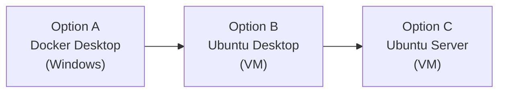
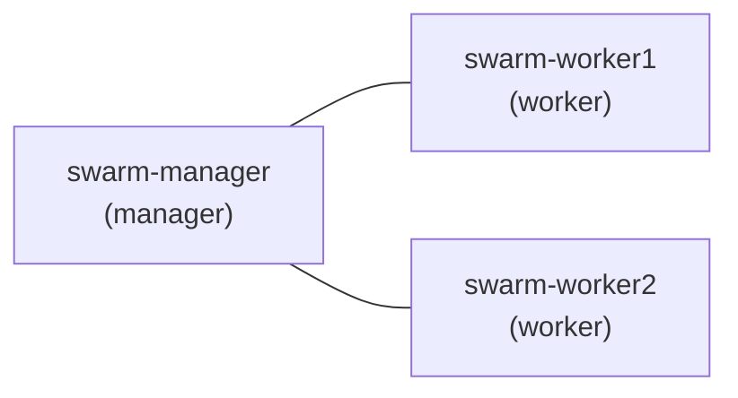

# Environnement de travail

Cette annexe décrit les machines, les logiciels, les comptes et les tests de validation dont vous avez besoin pour réaliser les travaux pratiques. **Lisez-la avant la première séance** et validez votre installation avec la liste de la section 6.

## 1. Principe : trois options au choix

Les labs sont rédigés pour **Docker Engine sous Linux**, qui sert de référence. Vous choisissez l'environnement dans lequel vous travaillez parmi trois options, classées de la plus simple à installer à la plus proche d'un serveur de production.

!!! info "Vous pouvez changer d'option en cours de cours"
    Les commandes Docker sont identiques dans les trois options. Les différences sont signalées dans les labs concernés. Une seule contrainte : le cluster Swarm (chapitres 11, 12 et 14) exige des machines virtuelles Linux (section 4).

## 2. Choisir son option

| | **A. Docker Desktop** | **B. Ubuntu Desktop (VM)** | **C. Ubuntu Server (VM)** |
|---|---|---|---|
| Difficulté d'installation | Faible | Moyenne | Plus élevée |
| Interface | Graphique, sous Windows | Graphique, sous Linux | Ligne de commande uniquement |
| Moteur Docker | Dans une machine virtuelle gérée par Docker Desktop | Directement sur la VM | Directement sur la VM |
| Ressources conseillées | Celles de votre poste | 2 vCPU, 4 Go de RAM, 25 Go de disque | 2 vCPU, 2 Go de RAM, 20 Go de disque |
| Proximité avec la production | Faible | Moyenne | Forte |
| Cluster Swarm | Non (voir section 4) | Oui, avec 3 VM | Oui, avec 3 VM |
| Recommandé pour | Chapitres 1 à 5 et 7 à 9 si vous débutez | Tous les labs, si vous êtes peu à l'aise en ligne de commande pure | Tous les labs, dont le réseau et le cluster |

**Pour vous aider à choisir :**

- Vous découvrez Linux et les conteneurs : commencez par l'option A ou B.
- Vous êtes à l'aise avec Linux en ligne de commande : choisissez l'option C, qui est aussi la plus utile pour votre futur métier.
- Quelle que soit l'option, prévoyez une VM Linux pour les chapitres 6 (réseau) et 10 (sécurité) : Docker s'y comporte comme sur un serveur réel.

## 3. Détail des trois options

### Option A : Docker Desktop

| Rubrique | Description |
|---|---|
| Système hôte | Windows, avec WSL 2 (ou Hyper-V selon l'édition de Windows) |
| Installation | Application officielle Docker Desktop |
| Terminal | PowerShell ou le terminal de votre distribution WSL |
| Points forts | Installation rapide, pas de machine Linux à administrer |

!!! warning "Points d'attention"
    - Le moteur Docker s'exécute dans une machine virtuelle interne : les adresses IP des conteneurs ne sont pas joignables directement depuis Windows, et le mode réseau `host` ne se comporte pas comme sur Linux (chapitre 6).
    - Docker Desktop et VMware Workstation doivent cohabiter sur le même poste : testez les deux avant la première séance (section 6).
    - Les conditions de licence de Docker Desktop dépendent de l'usage : vérifiez celles qui sont en vigueur pour votre situation.
    - Sous PowerShell, utilisez `curl.exe` et non l'alias `curl`.

### Option B : Ubuntu Desktop dans une VM

| Rubrique | Description |
|---|---|
| Hyperviseur | VMware Workstation |
| Système invité | Ubuntu Desktop LTS |
| Ressources | 2 vCPU, 4 Go de RAM, 25 Go de disque |
| Réseau | Une carte réseau avec accès Internet |
| Installation de Docker | [Lab 1.1 : Installer Docker](../partie-1-fondations/ch01-introduction-aux-conteneurs/lab-1-1-installer-docker.md) |

L'interface graphique vous permet d'ouvrir un navigateur dans la VM pour tester vos applications web, ce qui simplifie les premiers labs.

### Option C : Ubuntu Server dans une VM

| Rubrique | Description |
|---|---|
| Hyperviseur | VMware Workstation |
| Système invité | Ubuntu Server LTS |
| Ressources | 2 vCPU, 2 Go de RAM, 20 Go de disque |
| Réseau | Une carte réseau avec accès Internet |
| Accès | Console de la VM, ou SSH depuis votre poste |
| Installation de Docker | [Lab 1.1 : Installer Docker](../partie-1-fondations/ch01-introduction-aux-conteneurs/lab-1-1-installer-docker.md) |

Cette configuration est identique à celle des machines du cours Kubernetes : vous pourrez réutiliser vos VM d'un cours à l'autre.

!!! tip "Snapshot"
    Pour les options B et C, faites un **snapshot** de la VM dans VMware Workstation une fois Docker installé et validé, puis avant chaque séance. Vous pourrez ainsi revenir à un état propre en cas d'erreur.

## 4. Environnement du cluster Swarm

Les chapitres 11, 12 et 14 utilisent un cluster Docker Swarm de **trois nœuds**. Un vrai cluster exige trois machines distinctes : l'option A ne suffit donc pas pour ces chapitres.

| Rubrique | Description |
|---|---|
| Machines | 3 VM Ubuntu (Server ou Desktop), nommées `swarm-manager`, `swarm-worker1` et `swarm-worker2` |
| Ressources par VM | 2 vCPU, 2 Go de RAM, 20 Go de disque |
| Réseau | Les trois VM sont sur le même réseau virtuel, se joignent entre elles et accèdent à Internet |
| Nom d'hôte | Unique pour chaque VM |
| Docker | Installé et validé sur chacune des trois VM |

Les nœuds d'un cluster Swarm communiquent entre eux sur les ports suivants, qui doivent être ouverts entre les VM (ou le pare-feu désactivé pour le TP) :

| Port | Protocole | Usage |
|---|---|---|
| 2377 | TCP | Gestion du cluster (communication avec le manager) |
| 7946 | TCP et UDP | Communication entre les nœuds |
| 4789 | UDP | Trafic du réseau des services entre les nœuds |

!!! note "Ressources de votre poste"
    Trois VM de 2 Go consomment 6 Go de RAM. Si votre poste est limité, travaillez en binôme et répartissez les VM entre vos deux machines : elles doivent seulement se joindre sur le réseau.

## 5. Comptes et accès à prévoir

| Compte ou accès | Nécessaire à partir de | Usage |
|---|---|---|
| Accès Internet depuis l'environnement de TP | Chapitre 1 | Télécharger les images depuis Docker Hub et les paquets |
| Compte Docker Hub | Chapitre 4 | Publier vos images |
| Compte GitHub | Chapitre 13 | Héberger votre code et exécuter les pipelines GitHub Actions |

Créez ces comptes **avant** la séance concernée. Ne partagez jamais vos mots de passe ni vos jetons d'accès, et ne les enregistrez pas dans vos fichiers de code.

## 6. Tests de validation avant la séance

Réalisez ces vérifications dans votre environnement. Si l'une échoue, consultez le tableau de dépannage ou prévenez l'enseignant **avant** la séance.

!!! success "Liste de validation (chapitres 1 à 10)"
    - [ ] L'environnement a accès à Internet
    - [ ] `docker version` affiche à la fois le client et le serveur
    - [ ] `docker run hello-world` se termine par un message de bienvenue
    - [ ] `docker compose version` affiche une version
    - [ ] Vous disposez d'au moins 10 Go d'espace disque libre
    - [ ] (Options B et C) Un snapshot de la VM existe

!!! success "Liste de validation supplémentaire (chapitres 11, 12 et 14)"
    - [ ] Les trois VM ont des noms d'hôte différents
    - [ ] Chaque VM joint les deux autres avec `ping`
    - [ ] Docker est validé sur chacune des trois VM
    - [ ] Les ports 2377/tcp, 7946 (tcp et udp) et 4789/udp ne sont pas bloqués entre les VM

## 7. Dépannage

| Symptôme | Pistes |
|---|---|
| `permission denied` en lançant `docker` sous Linux | Utilisez `sudo`, ou ajoutez votre utilisateur au groupe `docker` comme indiqué au [Lab 1.1](../partie-1-fondations/ch01-introduction-aux-conteneurs/lab-1-1-installer-docker.md), puis rouvrez votre session |
| `docker version` n'affiche pas la partie serveur | Le service Docker n'est pas démarré : vérifiez-le avec `systemctl status docker` (Linux) ou lancez Docker Desktop et attendez qu'il soit prêt |
| Impossible de télécharger une image | Vérifiez l'accès Internet de l'environnement et la résolution de noms (`ping docker.com`) |
| Docker Desktop ne démarre pas à côté de VMware Workstation | Vérifiez que la virtualisation est activée dans le BIOS et que WSL 2 est installé ; à défaut, passez à l'option B ou C |
| Les VM du cluster ne se joignent pas | Vérifiez qu'elles sont sur le même réseau virtuel, notez leurs adresses IP, testez avec `ping` |
| Un nœud ne rejoint pas le cluster Swarm | Vérifiez les ports de la section 4, l'adresse du manager et l'unicité des noms d'hôte |
| Plus d'espace disque | Supprimez les VM ou snapshots inutiles ; un disque de 20 Go est un minimum pour les chapitres de la partie 3 |