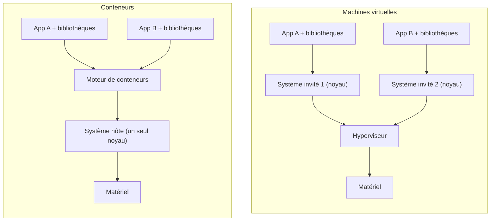
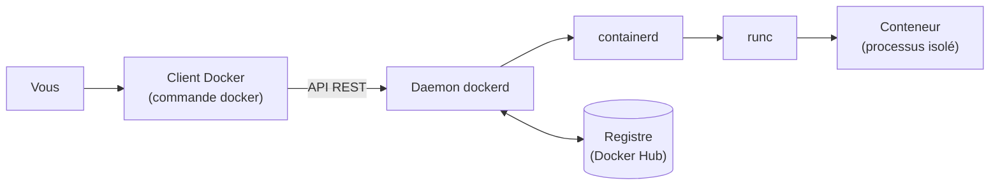

# Chapitre 1 : Introduction aux conteneurs

!!! abstract "Objectifs du chapitre"
    - Expliquer le problème que résolvent les conteneurs
    - Comparer un conteneur et une machine virtuelle
    - Décrire les mécanismes du noyau Linux qui isolent et limitent un conteneur (namespaces et cgroups)
    - Décrire l'architecture de Docker : client, daemon, containerd, runc
    - Situer les normes OCI et choisir votre environnement de TP
    - Acquis d'apprentissage visé : **AA1**

## 1. Pourquoi les conteneurs ?

Une application dépend de son environnement : version du langage, bibliothèques, fichiers de configuration, système. Quand l'un de ces éléments diffère entre le poste du développeur, la machine de test et le serveur de production, l'application se comporte autrement. C'est le célèbre « ça marche chez moi ».

Un **conteneur** résout ce problème en regroupant l'application et tout ce dont elle a besoin pour s'exécuter dans un ensemble **isolé** et **portable**. Le même ensemble s'exécute de la même façon sur le poste d'un étudiant, sur un serveur ou dans le cloud.

| Besoin | Apport des conteneurs |
|---|---|
| Reproduire un environnement | L'application et ses dépendances sont décrites une fois et réutilisées partout |
| Démarrer vite | Un conteneur démarre en général en quelques secondes ou moins |
| Occuper peu de ressources | Les conteneurs partagent le noyau de la machine hôte |
| Isoler les applications | Chaque conteneur a sa propre vue des processus, du réseau et des fichiers |

## 2. Conteneur et machine virtuelle

Une **machine virtuelle** (VM) simule une machine complète : un hyperviseur lui fournit du matériel virtuel et elle embarque son propre système d'exploitation, noyau compris. Un **conteneur** n'embarque pas de noyau : il s'exécute comme un processus de la machine hôte, **sur le noyau de l'hôte**, mais isolé des autres.

| Critère | Machine virtuelle | Conteneur |
|---|---|---|
| Noyau | Un noyau par VM | Le noyau de l'hôte, partagé |
| Taille | En général de l'ordre du gigaoctet | En général de l'ordre de la dizaine à la centaine de mégaoctets |
| Démarrage | Quelques dizaines de secondes à quelques minutes | Quelques secondes ou moins |
| Isolation | Forte (noyau séparé) | Plus légère (noyau partagé) |
| Usage typique | Faire tourner un système complet | Faire tourner une application et ses dépendances |

!!! note "Conteneurs et machines virtuelles se complètent"
    Dans ce cours, vous exécuterez des conteneurs **dans** des machines virtuelles. Les deux technologies ne s'opposent pas : on les combine très souvent.

!!! warning "Un conteneur Linux a besoin d'un noyau Linux"
    Un conteneur Linux partage le noyau Linux de son hôte. Sous Windows, Docker Desktop exécute donc le moteur dans une machine virtuelle Linux interne. C'est l'une des différences entre les options de TP décrites dans l'[annexe Environnement](../../annexes/environnement.md).

## 3. Ce qui isole un conteneur : namespaces et cgroups

Un conteneur n'est pas un objet magique : c'est un processus ordinaire auquel le noyau Linux applique deux mécanismes.

### 3.1 Les namespaces : isoler ce que le processus voit

Un **namespace** (espace de noms) donne à un processus sa propre vue d'une ressource du système. Docker en utilise plusieurs pour chaque conteneur :

| Namespace | Ce qui est isolé | Effet dans le conteneur |
|---|---|---|
| **PID** | Les identifiants de processus | Le conteneur ne voit que ses propres processus ; son premier processus a le numéro 1 |
| **NET** | La pile réseau | Le conteneur a ses propres interfaces, adresse IP et table de routage |
| **MNT** | Les points de montage | Le conteneur a son propre système de fichiers |
| **UTS** | Le nom d'hôte | Le conteneur a son propre nom de machine |
| **IPC** | La communication entre processus | Les échanges mémoire entre processus sont propres au conteneur |
| **USER** | Les identifiants d'utilisateurs | Un utilisateur du conteneur peut correspondre à un autre utilisateur de l'hôte |

### 3.2 Les cgroups : limiter ce que le processus consomme

Les **cgroups** (control groups) permettent de **mesurer et de limiter** les ressources utilisées par un groupe de processus : processeur, mémoire, entrées-sorties disque, nombre de processus. Sans limite, un conteneur peut consommer toutes les ressources de l'hôte.

| Mécanisme | Question à laquelle il répond | Exemple |
|---|---|---|
| Namespaces | « Que peut **voir** ce processus ? » | Il ne voit pas les processus des autres conteneurs |
| Cgroups | « Combien peut **consommer** ce processus ? » | Il ne peut pas utiliser plus de 512 Mo de mémoire |

!!! tip "Idée à retenir"
    Un conteneur = un **processus** + des **namespaces** (isolation) + des **cgroups** (limites) + un **système de fichiers** propre. Il n'y a ni machine ni noyau supplémentaire.

## 4. L'architecture de Docker

**Docker** est la plateforme qui rend ces mécanismes simples à utiliser. Elle repose sur une architecture client-serveur.

| Composant | Rôle |
|---|---|
| **Client Docker** (`docker`) | La commande que vous tapez. Il envoie vos demandes au daemon et affiche les résultats. |
| **Daemon** (`dockerd`) | Le service qui reçoit les demandes du client et gère images, conteneurs, réseaux et volumes. |
| **containerd** | Le gestionnaire de bas niveau : il gère le cycle de vie des conteneurs et le stockage des images pour le daemon. |
| **runc** | L'outil qui crée réellement le conteneur en demandant au noyau les namespaces et les cgroups. |
| **Registre** | Un service qui stocke et distribue des images. **Docker Hub** est le registre public par défaut. |

Le client et le daemon peuvent se trouver sur la même machine (cas de vos TP) ou sur des machines différentes : ils communiquent par une API.

### Les trois objets à connaître

Trois mots reviendront tout au long du cours :

| Objet | Définition | Analogie |
|---|---|---|
| **Image** | Modèle en lecture seule qui contient l'application et ses dépendances | La recette |
| **Conteneur** | Instance en cours d'exécution (ou arrêtée) d'une image | Le plat préparé |
| **Registre** | Service qui stocke et partage les images | Le livre de recettes partagé |

Plusieurs conteneurs peuvent être créés à partir de la même image. La construction des images est étudiée au chapitre 3 et leur distribution au chapitre 4.

## 5. Les normes OCI

Pour éviter qu'un fournisseur ne soit propriétaire du format des conteneurs, l'industrie a créé l'**Open Container Initiative** (OCI). Elle publie trois spécifications :

| Spécification | Ce qu'elle définit |
|---|---|
| **Image** | Le format d'une image de conteneur |
| **Runtime** | La manière d'exécuter un conteneur à partir d'une image |
| **Distribution** | La manière de publier et de télécharger des images depuis un registre |

Grâce à ces normes, une image construite avec Docker peut être exécutée par d'autres outils compatibles OCI. `runc` est l'implémentation de référence de la spécification runtime.

## 6. Votre environnement de TP

Vous choisissez parmi trois options : **Docker Desktop**, **Ubuntu Desktop** ou **Ubuntu Server** dans une machine virtuelle. Elles sont comparées dans l'[annexe Environnement](../../annexes/environnement.md), qui précise aussi les ressources nécessaires et les tests de validation. Vous installez et validez Docker au [Lab 1.1](lab-1-1-installer-docker.md).

!!! tip "À retenir"
    - Un conteneur est un **processus isolé** qui partage le **noyau** de l'hôte ; il est plus léger et plus rapide à démarrer qu'une machine virtuelle.
    - Les **namespaces** isolent ce que le processus voit ; les **cgroups** limitent ce qu'il consomme.
    - Docker repose sur un **client** (`docker`) qui parle à un **daemon** (`dockerd`), lequel s'appuie sur **containerd** et **runc**.
    - Une **image** est un modèle ; un **conteneur** en est une instance ; un **registre** stocke les images.
    - Les normes **OCI** rendent images et conteneurs portables d'un outil à l'autre.

## Pour vérifier votre compréhension

??? question "Pourquoi un conteneur démarre-t-il beaucoup plus vite qu'une machine virtuelle ?"
    Il n'embarque pas de système d'exploitation ni de noyau : c'est un simple processus de la machine hôte, isolé par le noyau. Il n'y a donc pas de système à démarrer.

??? question "Quelle est la différence entre un namespace et un cgroup ?"
    Un namespace limite ce que le processus **voit** (processus, réseau, fichiers, nom d'hôte). Un cgroup limite ce qu'il **consomme** (processeur, mémoire, entrées-sorties).

??? question "Vous tapez une commande `docker` : quel composant la reçoit, et quel composant crée finalement le conteneur ?"
    Le **daemon** `dockerd` reçoit la demande envoyée par le client. Il s'appuie sur **containerd**, puis **runc** crée le conteneur en s'adressant au noyau.

## Ressources du chapitre

- [Lab 1.1 : Installer Docker](lab-1-1-installer-docker.md)
- [Lab 1.2 : Premiers conteneurs](lab-1-2-premiers-conteneurs.md)
- [Quiz du chapitre](quiz.md)