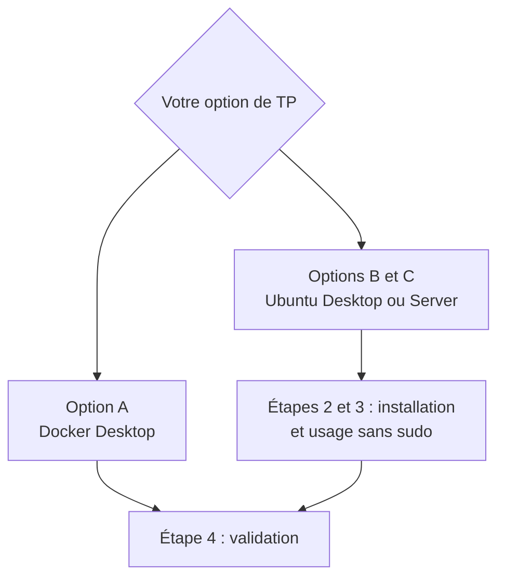

# Lab 1.1 : Installer Docker

| | |
|---|---|
| **Durée** | 60 min |
| **Niveau** | Guidé |
| **Prérequis** | Environnement choisi (voir [Environnement de travail](../../annexes/environnement.md)), accès Internet, droits d'administrateur (`sudo` sous Linux) |
| **Acquis visés** | AA1 |

!!! abstract "Objectifs"
    - Choisir votre environnement de TP et le préparer
    - Installer Docker (Docker Engine sous Ubuntu, ou Docker Desktop sous Windows)
    - Valider l'installation avec `docker version`, `docker run hello-world` et `docker compose version`
    - Utiliser Docker sans `sudo` sous Linux

## Contexte et schéma

Vous installez le moteur Docker dans l'environnement que vous avez choisi. Le client `docker` que vous tapez en ligne de commande dialogue avec le daemon, comme décrit dans le [chapitre 1](cours.md).



## Étapes

### Étape 1 : Préparer l'environnement

Selon votre option, suivez les consignes de l'[annexe Environnement](../../annexes/environnement.md) :

- **Options B et C** : créez la VM Ubuntu avec les ressources indiquées, démarrez-la et ouvrez un terminal.
- **Option A** : vérifiez que votre poste Windows répond aux prérequis de Docker Desktop (WSL 2 ou Hyper-V).

Sous Ubuntu, vérifiez le système et l'accès à Internet :

```bash
cat /etc/os-release
ping -c 2 download.docker.com
df -h /
```

!!! success "Point de contrôle"
    - [ ] Le système est bien Ubuntu (ligne `NAME="Ubuntu"`)
    - [ ] Le `ping` reçoit des réponses
    - [ ] Il reste au moins 10 Go d'espace libre sur `/`

### Étape 2 : Installer Docker

=== "Options B et C : Ubuntu"

    Vous installez Docker Engine depuis le **dépôt officiel de Docker**. Procédure de référence : [docs.docker.com/engine/install/ubuntu](https://docs.docker.com/engine/install/ubuntu/).

    **2.1 Préparer le dépôt**

    ```bash
    sudo apt update
    sudo apt install -y ca-certificates curl
    sudo install -m 0755 -d /etc/apt/keyrings
    sudo curl -fsSL https://download.docker.com/linux/ubuntu/gpg -o /etc/apt/keyrings/docker.asc
    sudo chmod a+r /etc/apt/keyrings/docker.asc
    ```

    La clé `docker.asc` permet à `apt` de vérifier que les paquets proviennent bien de Docker.

    **2.2 Déclarer le dépôt**

    ```bash
    echo "deb [arch=$(dpkg --print-architecture) signed-by=/etc/apt/keyrings/docker.asc] https://download.docker.com/linux/ubuntu $(. /etc/os-release && echo "${UBUNTU_CODENAME:-$VERSION_CODENAME}") stable" | sudo tee /etc/apt/sources.list.d/docker.list > /dev/null
    sudo apt update
    ```

    **2.3 Installer les paquets**

    ```bash
    sudo apt install -y docker-ce docker-ce-cli containerd.io docker-buildx-plugin docker-compose-plugin
    ```

    | Paquet | Rôle |
    |---|---|
    | `docker-ce` | Le daemon `dockerd` |
    | `docker-ce-cli` | Le client `docker` |
    | `containerd.io` | Le gestionnaire de conteneurs de bas niveau |
    | `docker-buildx-plugin` | L'outil de construction d'images (utilisé au chapitre 3) |
    | `docker-compose-plugin` | La commande `docker compose` (utilisée au chapitre 7) |

    **2.4 Vérifier que le service tourne**

    ```bash
    sudo systemctl is-active docker
    sudo systemctl status docker --no-pager
    ```

    !!! success "Point de contrôle"
        - [ ] `is-active` affiche `active`
        - [ ] `status` indique `active (running)`

=== "Option A : Docker Desktop (Windows)"

    **2.1 Télécharger et installer**

    Téléchargez Docker Desktop depuis la documentation officielle ([docs.docker.com/desktop](https://docs.docker.com/desktop/)), lancez l'installateur et conservez l'option qui utilise **WSL 2** si elle vous est proposée. Redémarrez Windows si l'installateur le demande.

    **2.2 Démarrer Docker Desktop**

    Lancez l'application et attendez que son état indique que le moteur est prêt (« Engine running »).

    **2.3 Ouvrir un terminal**

    Ouvrez **PowerShell**. Les commandes `docker` des étapes suivantes s'y exécutent telles quelles.

    !!! success "Point de contrôle"
        - [ ] Docker Desktop est démarré et indique que le moteur est en cours d'exécution
        - [ ] PowerShell reconnaît la commande `docker`

### Étape 3 : Utiliser Docker sans `sudo` (options B et C)

Par défaut, seul l'administrateur peut parler au daemon. Ajoutez votre utilisateur au groupe `docker` :

```bash
sudo usermod -aG docker $USER
```

Fermez puis rouvrez votre session (ou redémarrez la VM) pour que le changement soit pris en compte, puis vérifiez :

```bash
groups
```

!!! warning "Un droit important"
    Appartenir au groupe `docker` donne un pouvoir équivalent à celui d'un administrateur sur la machine. Dans cette VM de TP, c'est acceptable ; sur un serveur partagé, il faut le réserver aux personnes de confiance. Le chapitre 10 revient sur la sécurité.

!!! success "Point de contrôle"
    - [ ] La liste affichée par `groups` contient `docker`

### Étape 4 : Valider l'installation

**4.1 Le client et le serveur**

```bash
docker version
```

La commande doit afficher **deux blocs** : `Client` et `Server`. Le bloc `Server` prouve que le client joint bien le daemon.

**4.2 Le premier conteneur**

```bash
docker run hello-world
```

Vous devez obtenir un message qui commence par `Hello from Docker!` et indique que l'installation fonctionne correctement. Docker télécharge l'image `hello-world` depuis Docker Hub, crée un conteneur, l'exécute, puis celui-ci s'arrête après avoir affiché son message.

**4.3 Docker Compose**

```bash
docker compose version
```

**4.4 Informations sur le moteur**

```bash
docker info
```

Repérez dans la sortie le nombre de conteneurs et d'images, ainsi que les lignes `Server Version`, `Storage Driver` et `Operating System`. Notez-les dans votre carnet de TP.

!!! success "Point de contrôle"
    - [ ] `docker version` affiche les blocs `Client` et `Server`
    - [ ] `docker run hello-world` affiche `Hello from Docker!`
    - [ ] `docker compose version` affiche une version
    - [ ] `docker info` s'exécute sans erreur

### Étape 5 : Sauvegarder un état propre (options B et C)

Dans VMware Workstation, faites un **snapshot** de la VM nommé `docker-installe`. Vous pourrez y revenir avant chaque séance ou après une erreur.

## Questions de réflexion

??? question "Que montre la présence du bloc `Server` dans la sortie de `docker version` ?"
    Que le client `docker` a pu joindre le **daemon** `dockerd`. Si seul le bloc `Client` apparaît, le daemon n'est pas démarré ou n'est pas accessible.

??? question "Que s'est-il passé, dans l'ordre, quand vous avez lancé `docker run hello-world` ?"
    Le client a envoyé la demande au daemon. L'image `hello-world` n'étant pas présente sur la machine, le daemon l'a téléchargée depuis le registre Docker Hub. Il a ensuite créé un conteneur à partir de cette image et l'a exécuté ; le conteneur a affiché son message puis s'est arrêté.

??? question "Pourquoi installe-t-on Docker depuis le dépôt officiel de Docker plutôt que depuis les dépôts par défaut d'Ubuntu ?"
    Pour obtenir les paquets maintenus par Docker, dans leur version courante et signés avec la clé officielle, que `apt` vérifie avant l'installation.

## Dépannage

| Symptôme | Pistes |
|---|---|
| `curl` ou `apt update` échoue | Vérifiez l'accès Internet de la VM (`ping download.docker.com`) et l'heure du système |
| `permission denied while trying to connect to the Docker daemon socket` | Vous n'avez pas encore rouvert votre session après l'étape 3 ; utilisez `sudo docker ...` en attendant |
| `docker version` n'affiche pas le bloc `Server` | Vérifiez le service avec `sudo systemctl status docker` (Linux) ou attendez la fin du démarrage de Docker Desktop |
| `docker run hello-world` ne télécharge pas l'image | Vérifiez l'accès à Internet ; consultez le message d'erreur complet |
| `docker` n'est pas reconnu sous PowerShell | Fermez et rouvrez PowerShell, puis relancez Docker Desktop |
| Docker Desktop refuse de démarrer | Vérifiez que la virtualisation est activée dans le BIOS et que WSL 2 est installé ; à défaut, passez à l'option B ou C |

## Nettoyage et reprise

Pour revenir à un état propre sans réinstaller : restaurez le snapshot de la VM (options B et C).

Pour désinstaller Docker sous Ubuntu et repartir de zéro :

```bash
sudo apt purge -y docker-ce docker-ce-cli containerd.io docker-buildx-plugin docker-compose-plugin
sudo rm -rf /var/lib/docker /var/lib/containerd
```

!!! warning "Attention"
    La seconde commande supprime **toutes** les images et tous les conteneurs de la machine. Ne l'utilisez que pour recommencer à zéro.

## Retour au chapitre

[Chapitre 1 : Introduction aux conteneurs](cours.md) · Lab suivant : [Lab 1.2 : Premiers conteneurs](lab-1-2-premiers-conteneurs.md)