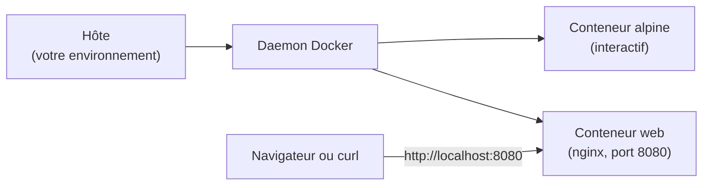

# Lab 1.2 : Premiers conteneurs

| | |
|---|---|
| **Durée** | 45 min |
| **Niveau** | Guidé |
| **Prérequis** | [Lab 1.1 : Installer Docker](lab-1-1-installer-docker.md) validé |
| **Acquis visés** | AA1 |

!!! abstract "Objectifs"
    - Lancer un conteneur interactif et explorer ce qu'il voit
    - Constater l'isolation des processus et du système de fichiers
    - Lancer un serveur web dans un conteneur et y accéder
    - Vérifier qu'un conteneur est un simple processus de la machine hôte

## Contexte et schéma

Vous lancez deux conteneurs à partir de deux images téléchargées depuis Docker Hub : une image minimale `alpine` pour explorer l'isolation, puis une image `nginx` qui fournit un serveur web.



!!! info "Commandes nouvelles"
    Ce lab utilise quelques commandes et options que vous étudierez en détail au chapitre 2. Elles sont expliquées au moment où elles apparaissent.

## Étapes

### Étape 1 : Un premier conteneur interactif

```bash
docker run -it --rm alpine:3.20 sh
```

| Élément | Signification |
|---|---|
| `docker run` | Crée un conteneur à partir d'une image et le démarre |
| `-it` | Mode interactif avec un terminal : vous dialoguez avec le conteneur |
| `--rm` | Supprime le conteneur dès qu'il s'arrête |
| `alpine:3.20` | L'image utilisée (nom `alpine`, version `3.20`), téléchargée si elle est absente |
| `sh` | Le programme lancé dans le conteneur : un interpréteur de commandes |

L'invite change : vous êtes **dans** le conteneur.

!!! success "Point de contrôle"
    - [ ] L'image `alpine:3.20` a été téléchargée
    - [ ] Vous voyez une invite de commande du conteneur (par exemple `/ #`)

### Étape 2 : Explorer le conteneur

Dans le conteneur, exécutez :

```bash
hostname
cat /etc/os-release
ps
ls /
uname -r
```

Notez vos observations :

- Le nom d'hôte est un identifiant hexadécimal propre au conteneur.
- Le système affiché est **Alpine Linux**, même si votre environnement est autre.
- `ps` ne montre que **deux ou trois processus** : `sh`, qui porte le numéro **1**, et la commande `ps` elle-même.
- `uname -r` affiche la version du **noyau**. Vous la comparerez à celle de l'hôte à l'étape 3.

!!! success "Point de contrôle"
    - [ ] Vous avez noté le nom d'hôte du conteneur, le système affiché et la version du noyau
    - [ ] Vous avez constaté que `ps` ne liste que les processus du conteneur

### Étape 3 : Comparer avec l'hôte

Restez dans le conteneur, ouvrez **un second terminal** sur votre environnement (la VM, ou PowerShell sous Docker Desktop) et exécutez :

```bash
hostname
uname -r
```

Comparez avec ce que vous avez noté à l'étape 2.

!!! note "Selon votre option"
    - **Options B et C** : le noyau affiché est **identique** dans l'hôte et dans le conteneur. Les conteneurs partagent le noyau de la machine (chapitre 1).
    - **Option A** : sous Windows, la commande `uname` n'existe pas. Le noyau du conteneur est celui de la machine virtuelle Linux interne de Docker Desktop.

!!! success "Point de contrôle"
    - [ ] Le nom d'hôte du conteneur est différent de celui de l'hôte
    - [ ] Vous savez expliquer pourquoi le noyau est le même (options B et C)

### Étape 4 : Constater que le conteneur est éphémère

Dans le conteneur, créez un fichier puis vérifiez sa présence :

```bash
touch /fichier-test
ls /fichier-test
exit
```

Le conteneur s'arrête et, grâce à `--rm`, il est supprimé. Lancez-en un **nouveau** :

```bash
docker run -it --rm alpine:3.20 sh
ls /fichier-test
exit
```

`ls` signale que le fichier n'existe pas : un nouveau conteneur repart de l'image, sans les modifications du précédent.

!!! success "Point de contrôle"
    - [ ] Le fichier existe dans le premier conteneur
    - [ ] Il est absent du second

!!! tip "À retenir pour la suite"
    Les données écrites dans un conteneur disparaissent avec lui. Le chapitre 5 présente les volumes, qui permettent de les conserver.

### Étape 5 : Lancer un serveur web

```bash
docker run -d -p 8080:80 --name web nginx:1.27-alpine
```

| Élément | Signification |
|---|---|
| `-d` | Mode détaché : le conteneur tourne en arrière-plan |
| `-p 8080:80` | Redirige le port **8080** de votre machine vers le port **80** du conteneur |
| `--name web` | Donne le nom `web` au conteneur |
| `nginx:1.27-alpine` | Image du serveur web nginx, version `1.27`, base `alpine` |

Vérifiez que le conteneur tourne :

```bash
docker ps
```

Accédez au serveur :

=== "Options B et C"

    ```bash
    curl http://localhost:8080
    ```

    Sous Ubuntu Desktop, vous pouvez aussi ouvrir `http://localhost:8080` dans le navigateur.

=== "Option A (PowerShell)"

    ```powershell
    curl.exe http://localhost:8080
    ```

    Vous pouvez aussi ouvrir `http://localhost:8080` dans votre navigateur.

La réponse contient la page d'accueil de nginx, avec le titre `Welcome to nginx!`.

!!! success "Point de contrôle"
    - [ ] `docker ps` montre le conteneur `web` à l'état `Up`
    - [ ] La page `Welcome to nginx!` s'affiche
    - [ ] Vous savez expliquer le rôle de `8080:80`

### Étape 6 : Observer les journaux et les processus

```bash
docker logs web
docker top web
```

`docker logs` affiche ce que le serveur a écrit, dont votre requête à l'étape 5. `docker top` liste les **processus du conteneur** tels que l'hôte les voit.

Sous Linux (options B et C), cherchez ce même processus directement dans l'hôte :

```bash
ps aux | grep nginx
```

!!! success "Point de contrôle"
    - [ ] `docker logs` montre votre requête
    - [ ] Vous avez retrouvé le processus nginx parmi les processus de l'hôte (options B et C)

### Étape 7 : Arrêter et supprimer le conteneur

```bash
docker stop web
docker ps
docker ps -a
docker rm web
docker ps -a
```

`docker ps -a` liste tous les conteneurs, y compris ceux qui sont arrêtés. Vous y retrouvez aussi celui du `hello-world` du lab précédent.

!!! success "Point de contrôle"
    - [ ] Après `docker stop`, `web` n'apparaît plus dans `docker ps` mais figure dans `docker ps -a`
    - [ ] Après `docker rm`, `web` a disparu de la liste

## Questions de réflexion

??? question "Pourquoi `ps` ne montre-t-il que deux ou trois processus dans le conteneur, alors que l'hôte en exécute des dizaines ?"
    Grâce au namespace **PID** : le conteneur a sa propre numérotation et ne voit que ses processus. Son premier processus (`sh`) porte le numéro 1.

??? question "Pourquoi le fichier créé à l'étape 4 a-t-il disparu ?"
    Chaque conteneur démarre à partir de l'image, qui n'est pas modifiée. Le fichier n'existait que dans le conteneur supprimé avec `--rm`. Pour conserver des données, il faut utiliser un volume (chapitre 5).

??? question "Que prouve le fait de retrouver le processus nginx dans la liste des processus de l'hôte ?"
    Qu'un conteneur n'est pas une machine virtuelle : c'est un **processus de l'hôte**, isolé par les namespaces et limité par les cgroups.

## Dépannage

| Symptôme | Pistes |
|---|---|
| `port is already allocated` ou `address already in use` | Le port 8080 est occupé : relancez avec un autre port, par exemple `-p 8081:80`, et adaptez l'adresse |
| `The container name "/web" is already in use` | Supprimez l'ancien conteneur avec `docker rm web`, ou arrêtez-le et supprimez-le s'il tourne encore (`docker stop web`) |
| `curl` ne répond pas | Vérifiez avec `docker ps` que `web` est `Up` ; consultez `docker logs web` |
| L'image ne se télécharge pas | Vérifiez l'accès à Internet et relisez le message d'erreur complet |
| `permission denied` | Rouvrez votre session après l'ajout au groupe `docker` (Lab 1.1) |
| Vous êtes bloqué dans le conteneur | Tapez `exit`, ou `Ctrl+D` |

## Nettoyage et reprise

```bash
docker ps -a
docker rm <ID_OU_NOM>
docker images
docker rmi alpine:3.20 nginx:1.27-alpine hello-world
```

Remplacez `<ID_OU_NOM>` par l'identifiant ou le nom de chaque conteneur restant (celui du `hello-world`, par exemple). La suppression des images est facultative : elle libère de l'espace disque.

## Retour au chapitre

[Chapitre 1 : Introduction aux conteneurs](cours.md) · Chapitre suivant : [Chapitre 2 : Cycle de vie des conteneurs](../ch02-cycle-de-vie-des-conteneurs/cours.md)