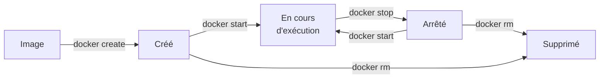

# Chapitre 2 : Cycle de vie des conteneurs

!!! abstract "Objectifs du chapitre"
    - Décrire les états d'un conteneur et les commandes qui les font évoluer
    - Expliquer le lien entre un conteneur et son processus principal
    - Publier un port et configurer un conteneur avec des variables d'environnement
    - Observer et diagnostiquer un conteneur : journaux, commande dans le conteneur, inspection
    - Limiter la mémoire et le processeur d'un conteneur
    - Acquis d'apprentissage visé : **AA2**

Vous avez déjà utilisé plusieurs de ces commandes au [Lab 1.2](../ch01-introduction-aux-conteneurs/lab-1-2-premiers-conteneurs.md). Ce chapitre les systématise et explique ce qui se passe derrière chacune.

## 1. Les états d'un conteneur

Un conteneur n'est pas simplement « lancé » ou « supprimé » : il passe par plusieurs états.



| Commande | Effet |
|---|---|
| `docker create` | Crée un conteneur à partir d'une image, sans le démarrer |
| `docker start` | Démarre un conteneur créé ou arrêté |
| `docker stop` | Arrête un conteneur en cours d'exécution |
| `docker restart` | Arrête puis redémarre un conteneur |
| `docker rm` | Supprime un conteneur arrêté |
| `docker run` | Enchaîne **création et démarrage** (et télécharge l'image si elle est absente) |

!!! note "Arrêter n'est pas supprimer"
    Un conteneur arrêté existe encore : il occupe de la place et garde son nom. Seul `docker rm` le supprime. `docker rm -f` force la suppression d'un conteneur encore en cours d'exécution.

## 2. Le processus principal

Un conteneur vit **aussi longtemps que son processus principal**, celui que l'image ou la commande `docker run` lance. Quand ce processus se termine, le conteneur s'arrête.

| Exemple | Processus principal | Durée de vie du conteneur |
|---|---|---|
| `docker run hello-world` | Un programme qui affiche un message | Quelques instants |
| `docker run -it alpine:3.20 sh` | Un interpréteur de commandes | Jusqu'à ce que vous tapiez `exit` |
| `docker run -d nginx:1.27-alpine` | Le serveur web nginx | Tant que le serveur tourne ou qu'on l'arrête |

Deux modes d'exécution :

| Mode | Option | Comportement |
|---|---|---|
| Premier plan | (par défaut) | Le terminal est relié au conteneur ; il est bloqué tant qu'il tourne |
| Arrière-plan (détaché) | `-d` | Le conteneur tourne en tâche de fond, le terminal reste libre |

Quand vous exécutez `docker stop`, Docker envoie au processus principal un signal lui demandant de s'arrêter proprement. Si le processus n'obéit pas dans un délai (10 secondes par défaut), Docker l'arrête de force.

## 3. Lister, nommer, supprimer

```bash
docker ps          # conteneurs en cours d'exécution
docker ps -a       # tous les conteneurs, y compris arrêtés
docker run -d --name web nginx:1.27-alpine
docker stop web
docker start web
docker rm -f web
```

Sans l'option `--name`, Docker attribue un nom aléatoire. Un nom doit être **unique** sur la machine : on ne peut pas créer deux conteneurs `web` en même temps. Les noms facilitent les commandes suivantes, car on peut les utiliser à la place de l'identifiant.

## 4. Publier un port

Un conteneur possède son propre réseau (namespace NET, chapitre 1) : ses ports ne sont pas joignables depuis l'extérieur par défaut. L'option `-p` **publie** un port du conteneur sur la machine hôte.

```bash
docker run -d --name web -p 8080:80 nginx:1.27-alpine
```

La forme générale est `-p <port hôte>:<port conteneur>`.

| Option | Signification |
|---|---|
| `-p 8080:80` | Le port 8080 de l'hôte est redirigé vers le port 80 du conteneur, sur toutes les interfaces de l'hôte |
| `-p 127.0.0.1:8080:80` | Idem, mais accessible **uniquement depuis l'hôte** lui-même |

Le port de l'hôte ne peut être utilisé que par un seul conteneur à la fois. Pour lancer deux serveurs web, publiez-les sur deux ports différents (8080 et 8081, par exemple). La commande `docker port <nom>` affiche les ports publiés d'un conteneur.

## 5. Configurer un conteneur par des variables d'environnement

Une même image peut se comporter différemment selon sa configuration. La méthode la plus courante est la **variable d'environnement**, définie au lancement avec `-e` :

```bash
docker run --rm -e NOM=Docker alpine:3.20 printenv NOM
```

Pour plusieurs variables, on peut les regrouper dans un fichier, un nom par ligne au format `NOM=valeur`, que l'on transmet avec `--env-file` :

```bash
docker run --rm --env-file mon-fichier.env alpine:3.20 printenv
```

!!! warning "Attention aux secrets"
    Une variable d'environnement n'est pas un coffre-fort : elle est visible avec `docker inspect`. N'y mettez pas de mots de passe réels dans vos projets partagés ou publiés. Le chapitre 10 présente de meilleures pratiques.

## 6. Observer et diagnostiquer

Trois commandes permettent de comprendre ce qui se passe dans un conteneur.

| Commande | Usage | Exemple |
|---|---|---|
| `docker logs` | Afficher ce que le processus principal écrit sur sa sortie | `docker logs --tail 20 web` ; `docker logs -f web` pour suivre en continu |
| `docker exec` | Exécuter une commande **dans un conteneur en cours d'exécution** | `docker exec -it web sh` ouvre un terminal dans `web` |
| `docker inspect` | Afficher la configuration et l'état détaillés, au format JSON | `docker inspect web` |

`docker inspect` produit beaucoup d'informations. L'option `--format` extrait une valeur précise :

```bash
docker inspect --format '{{.State.Status}}' web
```

| Situation | Premier réflexe |
|---|---|
| Le conteneur s'arrête tout de suite | `docker ps -a` pour voir son état, puis `docker logs` pour lire l'erreur |
| Le service ne répond pas | `docker ps` (le conteneur tourne-t-il ?), `docker logs`, vérification du port publié |
| Il faut vérifier un fichier ou une configuration | `docker exec -it <nom> sh` |

## 7. Limiter les ressources

Sans limite, un conteneur peut consommer toute la mémoire et tout le processeur de l'hôte. Docker s'appuie sur les **cgroups** (chapitre 1) pour les restreindre :

| Option | Effet | Exemple |
|---|---|---|
| `--memory` (ou `-m`) | Plafonne la mémoire utilisable | `--memory 256m` |
| `--cpus` | Plafonne le temps de processeur utilisable | `--cpus 0.5` (une demi-unité de processeur) |

```bash
docker run -d --name web --memory 256m --cpus 0.5 nginx:1.27-alpine
docker inspect --format '{{.HostConfig.Memory}}' web
```

La seconde commande affiche la limite mémoire en octets. Un conteneur qui dépasse sa limite de mémoire peut être arrêté par le noyau. Le suivi de la consommation en temps réel est présenté au chapitre 8.

!!! tip "À retenir"
    - Un conteneur passe par les états **créé**, **en cours d'exécution**, **arrêté** puis **supprimé** ; `docker run` enchaîne création et démarrage.
    - Un conteneur vit **tant que son processus principal tourne**.
    - `-d` lance en arrière-plan ; `--name` donne un nom unique ; `-p hôte:conteneur` publie un port.
    - `-e` et `--env-file` configurent un conteneur par des variables d'environnement, sans y placer de secrets.
    - `docker logs`, `docker exec` et `docker inspect` servent à observer et à diagnostiquer.
    - `--memory` et `--cpus` limitent les ressources grâce aux cgroups.

## Pour vérifier votre compréhension

??? question "Un conteneur lancé avec `docker run` s'arrête immédiatement. Quelle est la cause la plus probable et que faites-vous en premier ?"
    Son processus principal s'est terminé (fin normale ou erreur). On consulte `docker ps -a` pour voir l'état, puis `docker logs <nom>` pour lire le message de sortie.

??? question "Quelle est la différence entre `docker stop` et `docker rm` ?"
    `docker stop` arrête un conteneur en cours d'exécution, mais celui-ci existe toujours (état « arrêté ») et peut être redémarré. `docker rm` le supprime définitivement.

??? question "Pourquoi le deuxième conteneur échoue-t-il si vous lancez deux fois `docker run -d -p 8080:80 nginx:1.27-alpine` ?"
    Le port 8080 de l'hôte est déjà utilisé par le premier conteneur : un port de l'hôte ne peut être publié que pour un seul conteneur à la fois.

## Ressources du chapitre

- [Lab 2.1 : Gérer le cycle de vie](lab-2-1-gerer-le-cycle-de-vie.md)
- [Lab 2.2 : Publier et configurer un service](lab-2-2-publier-et-configurer-un-service.md)
- [Quiz du chapitre](quiz.md)