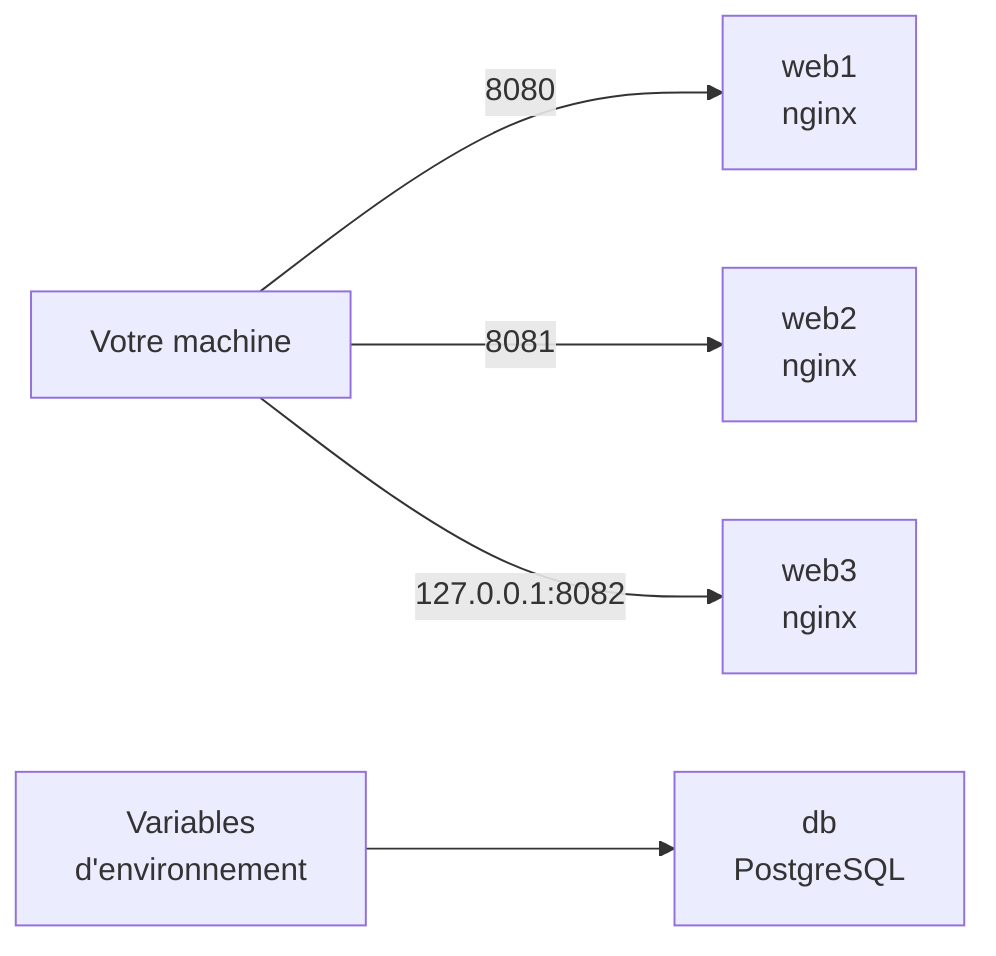

# Lab 2.2 : Publier et configurer un service

| | |
|---|---|
| **Durée** | 60 min |
| **Niveau** | Guidé |
| **Prérequis** | [Lab 2.1 : Gérer le cycle de vie](lab-2-1-gerer-le-cycle-de-vie.md), cours du [chapitre 2](cours.md) |
| **Acquis visés** | AA2 |

!!! abstract "Objectifs"
    - Publier plusieurs conteneurs sur des ports différents et diagnostiquer un conflit de port
    - Limiter l'accès à un port publié à la machine locale
    - Configurer un conteneur avec des variables d'environnement, directement ou avec un fichier
    - Démarrer une base de données configurée par variables d'environnement et diagnostiquer un échec de démarrage
    - Limiter la mémoire et le processeur d'un conteneur

## Contexte et schéma

Vous publiez des serveurs web, puis vous configurez une base de données PostgreSQL uniquement avec des variables d'environnement, sans modifier l'image.



!!! note "Sous PowerShell"
    Utilisez `curl.exe` à la place de `curl`.

## Étapes

### Étape 1 : Publier deux serveurs sur deux ports

```bash
docker run -d --name web1 -p 8080:80 nginx:1.27-alpine
docker run -d --name web2 -p 8081:80 nginx:1.27-alpine
docker ps
curl http://localhost:8080
curl http://localhost:8081
docker port web1
docker port web2
```

Les deux conteneurs utilisent le port 80 **à l'intérieur**, mais ils sont joignables sur deux ports différents de votre machine. `docker port` affiche la correspondance.

!!! success "Point de contrôle"
    - [ ] Les deux adresses renvoient la page `Welcome to nginx!`
    - [ ] `docker port web1` affiche `80/tcp -> 0.0.0.0:8080` (ou une forme équivalente)

### Étape 2 : Provoquer et lire un conflit de port

Essayez de lancer un troisième serveur sur un port déjà pris :

```bash
docker run -d --name web-conflit -p 8080:80 nginx:1.27-alpine
docker ps -a
```

Docker signale une erreur sur le port. Lisez le message complet, puis supprimez le conteneur créé :

```bash
docker rm web-conflit
```

!!! success "Point de contrôle"
    - [ ] Le message d'erreur indique que le port 8080 est déjà utilisé
    - [ ] Vous avez supprimé `web-conflit`

### Étape 3 : Limiter un port à la machine locale

```bash
docker run -d --name web3 -p 127.0.0.1:8082:80 nginx:1.27-alpine
docker port web3
curl http://localhost:8082
```

Avec `127.0.0.1` devant le port, le service n'est accessible que **depuis votre machine**, et non depuis les autres machines du réseau.

!!! success "Point de contrôle"
    - [ ] `docker port web3` affiche une adresse commençant par `127.0.0.1`
    - [ ] `curl` renvoie la page d'accueil

### Étape 4 : Configurer avec des variables d'environnement

Passez une variable directement :

```bash
docker run --rm -e NOM=Docker alpine:3.20 printenv NOM
```

Créez maintenant un fichier de variables, puis transmettez-le au conteneur.

=== "Options B et C"

    ```bash
    printf 'NOM=Docker\nNIVEAU=debutant\n' > app.env
    cat app.env
    ```

=== "Option A (PowerShell)"

    ```powershell
    "NOM=Docker","NIVEAU=debutant" | Set-Content app.env
    Get-Content app.env
    ```

```bash
docker run --rm --env-file app.env alpine:3.20 printenv NOM NIVEAU
```

!!! success "Point de contrôle"
    - [ ] La première commande affiche `Docker`
    - [ ] La seconde affiche `Docker` puis `debutant`

### Étape 5 : Configurer une base de données PostgreSQL

L'image `postgres` se configure par variables d'environnement : l'utilisateur, le mot de passe et la base à créer.

```bash
docker run -d --name db \
  -e POSTGRES_USER=etudiant \
  -e POSTGRES_PASSWORD=motdepasse-tp \
  -e POSTGRES_DB=cours \
  postgres:16-alpine
```

!!! note "Sous PowerShell"
    Écrivez la commande sur une seule ligne, sans les antislashs `\` de fin de ligne.

Attendez quelques secondes puis consultez les journaux :

```bash
docker logs --tail 5 db
```

Cherchez la ligne indiquant que la base est **prête à accepter des connexions**. Puis interrogez-la depuis l'intérieur du conteneur :

```bash
docker exec db psql -U etudiant -d cours -c "SELECT current_user, current_database();"
```

!!! warning "Mot de passe d'exemple"
    Ce mot de passe sert uniquement au TP. Dans vos projets réels, n'utilisez jamais un mot de passe de ce type.

Vérifiez enfin ce que `docker inspect` révèle de la configuration :

```bash
docker inspect --format '{{.Config.Env}}' db
```

!!! success "Point de contrôle"
    - [ ] Les journaux indiquent que la base est prête à accepter des connexions
    - [ ] La requête renvoie `etudiant` et `cours`
    - [ ] `docker inspect` affiche les variables, **mot de passe compris**

### Étape 6 : Diagnostiquer un échec de démarrage

Lancez la même image **sans** mot de passe :

```bash
docker run -d --name db-sans-mdp postgres:16-alpine
docker ps -a
docker logs db-sans-mdp
```

Suivez la démarche du chapitre 2 : l'état dans `docker ps -a`, puis le message dans `docker logs`.

!!! success "Point de contrôle"
    - [ ] `db-sans-mdp` est à l'état `Exited`
    - [ ] Les journaux expliquent qu'un mot de passe est nécessaire pour initialiser la base
    - [ ] Vous savez comment corriger : ajouter `-e POSTGRES_PASSWORD=...`

### Étape 7 : Limiter les ressources

```bash
docker run -d --name limite --memory 256m --cpus 0.5 nginx:1.27-alpine
docker inspect --format '{{.HostConfig.Memory}}' limite
docker inspect --format '{{.HostConfig.NanoCpus}}' limite
```

La première valeur est la limite de mémoire en octets, la seconde la limite de processeur exprimée en milliardièmes d'unité de processeur.

!!! success "Point de contrôle"
    - [ ] La limite mémoire vaut `268435456` (256 Mo)
    - [ ] La limite de processeur vaut `500000000` (0,5 unité)

## Questions de réflexion

??? question "Deux conteneurs nginx écoutent tous deux sur le port 80 : pourquoi n'y a-t-il pas de conflit ?"
    Chaque conteneur a son propre réseau (namespace NET) : le port 80 est celui de **son** réseau. Le conflit n'existe que pour le port **publié sur l'hôte**, qui ne peut être utilisé que par un seul conteneur.

??? question "Quel avantage présente `-p 127.0.0.1:8082:80` par rapport à `-p 8082:80` ?"
    Le service n'est joignable que depuis la machine locale, ce qui évite de l'exposer aux autres machines du réseau.

??? question "Pourquoi n'est-il pas recommandé de transmettre un mot de passe réel par `-e` ?"
    Les variables sont visibles avec `docker inspect` par quiconque a accès à Docker sur la machine, et elles restent dans l'historique des commandes. Le chapitre 10 présente de meilleures pratiques.

## Dépannage

| Symptôme | Pistes |
|---|---|
| `port is already allocated` ou `address already in use` | Un conteneur ou un programme utilise déjà ce port : `docker ps`, puis choisissez un autre port |
| `The container name "/web1" is already in use` | Supprimez l'ancien conteneur : `docker rm -f web1` |
| `psql` renvoie une erreur de connexion | La base démarre encore : attendez quelques secondes et relisez `docker logs db` |
| `printenv` n'affiche rien pour une variable | Vérifiez l'orthographe de la variable et le contenu de `app.env` (une ligne par variable, format `NOM=valeur`, sans espaces autour du signe `=`) |
| Les commandes multi-lignes échouent sous PowerShell | Écrivez-les sur une seule ligne, sans `\` |

## Nettoyage et reprise

```bash
docker rm -f web1 web2 web3 db db-sans-mdp limite
```

Les noms absents provoquent un message d'erreur sans gravité. Vous pouvez aussi supprimer le fichier `app.env`.

## Retour au chapitre

[Chapitre 2 : Cycle de vie des conteneurs](cours.md) · Quiz : [Quiz du chapitre 2](quiz.md)