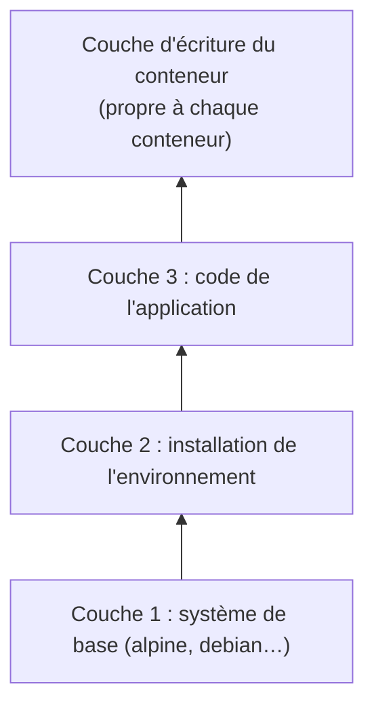

# Chapitre 3 : Images et Dockerfile

!!! abstract "Objectifs du chapitre"
    - Expliquer comment une image est composée de couches et ce que devient l'écriture dans un conteneur
    - Écrire un Dockerfile avec les instructions de base
    - Construire une image et l'identifier par un nom et un tag
    - Exploiter le cache de construction en ordonnant les instructions
    - Exclure des fichiers de la construction avec `.dockerignore`
    - Acquis d'apprentissage visé : **AA3**

Jusqu'ici, vous avez utilisé des images créées par d'autres (`alpine`, `nginx`, `postgres`). Ce chapitre vous apprend à construire les vôtres.

## 1. Qu'est-ce qu'une image ?

Une image est un modèle **en lecture seule**. Elle est formée d'un empilement de **couches** (layers) : chaque couche contient les fichiers ajoutés ou modifiés par rapport à la couche précédente.



Quand vous créez un conteneur, Docker ajoute au-dessus des couches de l'image une fine **couche d'écriture**. Le conteneur voit l'ensemble comme un seul système de fichiers, grâce à un système de fichiers **en union** (le pilote de stockage `overlay2` sur la plupart des installations, visible sous `Storage Driver` dans `docker info`).

| Élément | Caractéristique |
|---|---|
| Couches de l'image | En lecture seule, **partagées** entre toutes les images et tous les conteneurs qui les utilisent |
| Couche d'écriture | Propre à **un** conteneur ; supprimée avec lui |

Deux conséquences importantes :

- Ce que vous écrivez dans un conteneur n'est pas dans l'image : c'est pourquoi le fichier créé au [Lab 1.2](../ch01-introduction-aux-conteneurs/lab-1-2-premiers-conteneurs.md) avait disparu avec le conteneur.
- Dix conteneurs lancés depuis la même image ne dupliquent pas ses couches : ils les partagent et ne stockent chacun que leur propre couche d'écriture.

## 2. Le Dockerfile

Un **Dockerfile** est un fichier texte qui décrit, instruction par instruction, comment construire une image. Voici un exemple pour une petite application web écrite en Python :

```dockerfile
FROM python:3.12-slim
WORKDIR /app
COPY requirements.txt .
RUN pip install --no-cache-dir -r requirements.txt
COPY . .
EXPOSE 5000
CMD ["python", "app.py"]
```

### 2.1 Les instructions de base

| Instruction | Rôle | Dans l'exemple |
|---|---|---|
| `FROM` | Image de départ. Toute construction commence par `FROM` | `python:3.12-slim` |
| `WORKDIR` | Dossier de travail pour les instructions suivantes (créé s'il n'existe pas) | `/app` |
| `COPY` | Copie des fichiers de votre dossier vers l'image | `requirements.txt`, puis le reste du code |
| `RUN` | Exécute une commande **pendant la construction** | Installation des dépendances |
| `ENV` | Définit une variable d'environnement dans l'image | (non utilisée ici) |
| `EXPOSE` | Documente le port sur lequel l'application écoute ; ne publie rien | `5000` |
| `CMD` | Commande lancée **au démarrage du conteneur** | `python app.py` |

!!! warning "`EXPOSE` ne publie pas de port"
    `EXPOSE` est une indication pour les lecteurs de l'image. Pour joindre le service depuis l'hôte, il faut toujours publier le port avec `-p` au lancement (chapitre 2).

### 2.2 `RUN` et `CMD` : construction et exécution

Ne confondez pas les deux moments :

| | `RUN` | `CMD` |
|---|---|---|
| Quand ? | Pendant `docker build` | Au démarrage du conteneur |
| Résultat | Une nouvelle couche dans l'image | Une commande par défaut enregistrée dans l'image |
| Exemple | Installer des paquets | Lancer le serveur |

`CMD` peut être remplacée au lancement : tout ce qui est écrit après le nom de l'image dans `docker run` prend sa place. `ENTRYPOINT`, instruction voisine, fixe au contraire le programme principal de l'image ; les arguments de `docker run` s'y ajoutent au lieu de le remplacer. Dans ce cours, vous utiliserez surtout `CMD`.

On écrit de préférence `CMD` et `ENTRYPOINT` sous la **forme liste** (`["python", "app.py"]`) : le programme est alors lancé directement, comme processus principal du conteneur.

### 2.3 Choisir l'image de base

L'instruction `FROM` détermine le système de départ et la taille de l'image.

| Image de base | Particularité |
|---|---|
| `alpine` | Très légère ; utilise `apk` pour installer des paquets |
| `debian` ou `ubuntu` | Plus complètes et plus volumineuses ; utilisent `apt` |
| Variantes `-slim` | Versions allégées d'une distribution |
| Images de langage (`python`, `node`…) | Contiennent déjà l'environnement d'exécution |

Fixez toujours une **version précise** (`python:3.12-slim`) pour que la construction soit reproductible. Le chapitre 9 compare les images de base et leur taille.

## 3. Construire une image

La commande `docker build` lit le Dockerfile et produit l'image :

```bash
docker build -t monapp:1.0 .
```

| Élément | Signification |
|---|---|
| `-t monapp:1.0` | Nom (`monapp`) et tag (`1.0`) donnés à l'image |
| `.` | Le **contexte de construction** : le dossier dont les fichiers sont envoyés au daemon |

Le Dockerfile se trouve par défaut à la racine du contexte. Seuls les fichiers du contexte peuvent être copiés avec `COPY`.

Commandes utiles pour manipuler les images :

| Commande | Usage |
|---|---|
| `docker images` | Liste les images présentes sur la machine |
| `docker history monapp:1.0` | Affiche les couches de l'image et l'instruction qui a créé chacune |
| `docker run -p 5000:5000 monapp:1.0` | Lance un conteneur depuis l'image |
| `docker rmi monapp:1.0` | Supprime l'image |

## 4. Le cache de construction

Pendant la construction, Docker conserve le résultat de chaque instruction. Quand vous reconstruisez, il **réutilise** une couche si l'instruction et les fichiers qu'elle utilise n'ont pas changé. Pour `COPY`, Docker compare le contenu des fichiers.

!!! important "Règle du cache"
    Dès qu'une instruction est modifiée (ou que les fichiers qu'elle copie ont changé), **toutes les instructions suivantes sont réexécutées**.

Il faut donc placer les instructions **qui changent rarement en premier**, et celles qui changent souvent en dernier. Comparez deux manières d'écrire le même Dockerfile :

=== "Peu efficace"

    ```dockerfile
    FROM python:3.12-slim
    WORKDIR /app
    COPY . .
    RUN pip install --no-cache-dir -r requirements.txt
    CMD ["python", "app.py"]
    ```

    Une modification d'une seule ligne du code change le résultat de `COPY . .` : l'installation des dépendances est **refaite à chaque construction**.

=== "Efficace"

    ```dockerfile
    FROM python:3.12-slim
    WORKDIR /app
    COPY requirements.txt .
    RUN pip install --no-cache-dir -r requirements.txt
    COPY . .
    CMD ["python", "app.py"]
    ```

    La liste des dépendances est copiée seule : tant qu'elle ne change pas, l'installation est lue dans le cache. Seule la dernière copie est refaite lorsque vous modifiez le code.

Deux remarques :

- Le cache ne sait pas si un paquet a été mis à jour sur Internet. Pour forcer une reconstruction complète, ajoutez l'option `--no-cache` à `docker build`.
- Chaque instruction `RUN`, `COPY` ou `ADD` crée une couche. On regroupe souvent des commandes liées dans un seul `RUN` avec `&&`, pour obtenir moins de couches et un résultat plus propre.

## 5. Noms et tags

Une image est désignée par un **nom** et un **tag** : `nom:tag`.

| Exemple | Signification |
|---|---|
| `nginx:1.27-alpine` | Image `nginx`, tag `1.27-alpine` |
| `monapp:1.0` | Votre image, version 1.0 |
| `monapp` | Équivalent à `monapp:latest` |

!!! warning "`latest` n'est pas « la dernière version »"
    `latest` est simplement le tag utilisé **par défaut** quand aucun tag n'est précisé. Il peut désigner une version ancienne ou changer sans prévenir. Dans vos Dockerfiles et vos commandes, indiquez toujours une version explicite.

`docker tag` ajoute un second nom à une image existante, sans la copier :

```bash
docker tag monapp:1.0 monapp:stable
```

Chaque image possède aussi un **identifiant** unique, affiché par `docker images`. Le chapitre 4 explique comment nommer et versionner les images pour les publier dans un registre.

## 6. Le fichier `.dockerignore`

Le fichier `.dockerignore`, placé à la racine du contexte, liste les fichiers que Docker **n'envoie pas** au daemon lors de la construction. Il fonctionne comme un `.gitignore` :

```text
.git
__pycache__
*.log
.env
```

Il présente trois avantages :

| Avantage | Explication |
|---|---|
| Construction plus rapide | Moins de fichiers à envoyer |
| Image plus petite | Les fichiers inutiles ne sont pas copiés par `COPY . .` |
| Plus de sécurité | Les fichiers de secrets (`.env`, clés) ne se retrouvent pas par erreur dans l'image |

!!! tip "À retenir"
    - Une image est un empilement de **couches en lecture seule** ; chaque conteneur ajoute sa **couche d'écriture**, supprimée avec lui.
    - Un **Dockerfile** décrit la construction : `FROM`, `WORKDIR`, `COPY`, `RUN`, `EXPOSE`, `CMD`.
    - `RUN` agit à la **construction**, `CMD` au **démarrage** du conteneur.
    - `docker build -t nom:tag .` construit l'image ; `docker history` montre ses couches.
    - Le **cache** réutilise les couches inchangées : placez en premier ce qui change rarement.
    - Évitez `latest` : indiquez une version explicite.
    - `.dockerignore` exclut les fichiers inutiles ou sensibles du contexte de construction.

## Pour vérifier votre compréhension

??? question "Dans un Dockerfile, quelle est la différence entre `RUN` et `CMD` ?"
    `RUN` exécute une commande **pendant la construction** de l'image et en enregistre le résultat dans une couche. `CMD` définit la commande lancée **au démarrage** du conteneur.

??? question "Vous modifiez une ligne de votre code, et l'installation des dépendances est réexécutée à chaque construction. Comment l'éviter ?"
    Copier d'abord uniquement le fichier de dépendances (`COPY requirements.txt .`), exécuter l'installation (`RUN`), puis copier le reste du code (`COPY . .`). Tant que la liste des dépendances ne change pas, la couche d'installation est lue dans le cache.

??? question "Pourquoi faut-il éviter de s'appuyer sur le tag `latest` ?"
    Parce qu'il n'est que le tag par défaut : il peut pointer vers une version différente d'un jour à l'autre, ce qui rend les constructions et les déploiements non reproductibles. Une version explicite garantit la même image.

## Ressources du chapitre

- [Lab 3.1 : Écrire un premier Dockerfile](lab-3-1-ecrire-un-premier-dockerfile.md)
- [Lab 3.2 : Cache et couches](lab-3-2-cache-et-couches.md)
- [Quiz du chapitre](quiz.md)