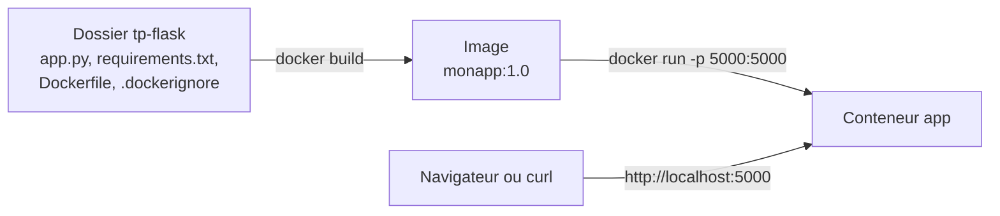

# Lab 3.1 : Écrire un premier Dockerfile

| | |
|---|---|
| **Durée** | 60 min |
| **Niveau** | Guidé |
| **Prérequis** | [Lab 2.2 : Publier et configurer un service](../ch02-cycle-de-vie-des-conteneurs/lab-2-2-publier-et-configurer-un-service.md), cours du [chapitre 3](cours.md) |
| **Acquis visés** | AA3 |

!!! abstract "Objectifs"
    - Écrire un Dockerfile pour une petite application web Python
    - Construire une image et lancer un conteneur à partir de cette image
    - Inspecter les couches d'une image avec `docker history`
    - Reconstruire une image après une modification du code et la versionner par un tag

## Contexte et schéma

Vous conteneurisez une application web minimale écrite avec **Flask**, une bibliothèque Python. Elle répond à une requête HTTP par un message. Vous n'avez pas besoin de connaître Python : le code vous est fourni.



!!! note "Sous PowerShell"
    Utilisez `curl.exe` à la place de `curl`. Quand vous créez les fichiers avec le Bloc-notes, vérifiez que `Dockerfile` et `.dockerignore` n'ont **pas** l'extension `.txt`.

## Étapes

### Étape 1 : Préparer le dossier du projet

Créez un dossier de travail et placez-vous dedans :

```bash
mkdir tp-flask
cd tp-flask
```

Avec votre éditeur de texte (`nano`, gedit, VS Code ou Bloc-notes), créez les deux fichiers suivants.

**`requirements.txt`** : la liste des bibliothèques nécessaires.

```text
flask==3.0.3
```

**`app.py`** : l'application.

```python
from flask import Flask

app = Flask(__name__)


@app.route("/")
def accueil():
    return "Bonjour depuis un conteneur Docker !\n"


if __name__ == "__main__":
    app.run(host="0.0.0.0", port=5000)
```

!!! info "Pourquoi `host=\"0.0.0.0\"` ?"
    Par défaut, Flask n'écoute que sur l'adresse locale (`127.0.0.1`) **du conteneur** : aucune requête venant de l'extérieur ne pourrait l'atteindre. `0.0.0.0` demande d'écouter sur toutes les interfaces du conteneur, ce qui permet à Docker de lui transmettre le port publié.

!!! success "Point de contrôle"
    - [ ] Le dossier `tp-flask` contient `app.py` et `requirements.txt`

### Étape 2 : Écrire le Dockerfile

Dans le même dossier, créez le fichier `Dockerfile` (sans extension) :

```dockerfile
FROM python:3.12-slim
WORKDIR /app
COPY . .
RUN pip install --no-cache-dir -r requirements.txt
EXPOSE 5000
CMD ["python", "app.py"]
```

| Ligne | Rôle |
|---|---|
| `FROM python:3.12-slim` | Part d'une image qui contient déjà Python 3.12 |
| `WORKDIR /app` | Se place dans le dossier `/app` de l'image |
| `COPY . .` | Copie tout le contenu du dossier du projet dans `/app` |
| `RUN pip install ...` | Installe Flask pendant la construction |
| `EXPOSE 5000` | Indique que l'application écoute sur le port 5000 |
| `CMD [...]` | Commande lancée au démarrage du conteneur |

!!! tip "Version volontairement simple"
    Cette première version est correcte, mais l'ordre de ses instructions n'est pas optimal pour le cache. Vous l'améliorerez au [Lab 3.2](lab-3-2-cache-et-couches.md).

### Étape 3 : Exclure des fichiers de la construction

Créez le fichier `.dockerignore`, toujours dans le même dossier :

```text
.git
__pycache__
*.pyc
.env
```

!!! success "Point de contrôle"
    - [ ] Le dossier contient `app.py`, `requirements.txt`, `Dockerfile` et `.dockerignore`
    - [ ] `ls -a` (ou `dir` sous PowerShell) affiche bien ces quatre fichiers, sans extension `.txt` supplémentaire

### Étape 4 : Construire l'image

```bash
docker build -t monapp:1.0 .
```

Observez la sortie : chaque instruction du Dockerfile correspond à une **étape numérotée**. Les images `python:3.12-slim` sont téléchargées lors de la première construction, ce qui peut prendre un moment.

Vérifiez que l'image existe :

```bash
docker images
```

!!! success "Point de contrôle"
    - [ ] La construction se termine sans erreur
    - [ ] `docker images` affiche `monapp` avec le tag `1.0`
    - [ ] Vous avez repéré la taille de l'image

### Étape 5 : Lancer et tester le conteneur

```bash
docker run -d --name app -p 5000:5000 monapp:1.0
docker ps
curl http://localhost:5000
docker logs app
```

La réponse doit être `Bonjour depuis un conteneur Docker !`. Les journaux indiquent que Flask écoute sur `0.0.0.0:5000` et affichent votre requête ; l'avertissement signalant un serveur de développement est normal dans ce TP.

!!! success "Point de contrôle"
    - [ ] `curl` affiche le message de l'application
    - [ ] `docker logs app` montre une ligne correspondant à votre requête

### Étape 6 : Inspecter l'image

```bash
docker history monapp:1.0
docker exec app ls /app
```

`docker history` liste les couches de l'image, de la plus récente à la plus ancienne. Repérez celles qui correspondent à vos instructions `COPY` et `RUN`, et comparez leurs tailles. Les couches de l'image `python:3.12-slim` apparaissent en dessous des vôtres.

`docker exec` montre les fichiers copiés dans `/app` : vous y trouvez `app.py` et `requirements.txt`, mais pas ceux exclus par `.dockerignore`.

!!! success "Point de contrôle"
    - [ ] Vous avez identifié la couche créée par `RUN pip install` et notez sa taille
    - [ ] `ls /app` affiche `app.py`, `requirements.txt` et `Dockerfile`

### Étape 7 : Modifier le code et reconstruire

Dans `app.py`, modifiez le message, par exemple :

```python
    return "Bonjour, version 1.1 !\n"
```

Reconstruisez l'image avec un **nouveau tag** et observez la sortie :

```bash
docker build -t monapp:1.1 .
```

Les étapes marquées `CACHED` sont reprises du cache. Notez quelles étapes sont exécutées de nouveau, en particulier l'installation de Flask.

Remplacez le conteneur par la nouvelle version :

```bash
docker rm -f app
docker run -d --name app -p 5000:5000 monapp:1.1
curl http://localhost:5000
docker images
```

!!! success "Point de contrôle"
    - [ ] `curl` affiche le nouveau message
    - [ ] `docker images` affiche `monapp:1.0` et `monapp:1.1`
    - [ ] Vous avez noté que l'installation de Flask a été refaite alors que `requirements.txt` n'a pas changé

## Questions de réflexion

??? question "Pourquoi l'application doit-elle écouter sur `0.0.0.0` et non sur `127.0.0.1` ?"
    `127.0.0.1` désigne le conteneur lui-même : seules des connexions venant de l'intérieur du conteneur pourraient l'atteindre. `0.0.0.0` permet d'accepter les connexions qui arrivent par le port publié.

??? question "`EXPOSE 5000` suffit-il à joindre l'application depuis votre machine ?"
    Non. `EXPOSE` documente seulement le port. Il faut publier le port avec `-p 5000:5000` au lancement du conteneur.

??? question "À l'étape 7, pourquoi l'installation de Flask a-t-elle été refaite alors que `requirements.txt` n'a pas changé ?"
    L'instruction `COPY . .` précède l'installation : en modifiant `app.py`, vous avez changé le résultat de cette copie, ce qui invalide le cache de toutes les instructions suivantes, dont `RUN pip install`. Le Lab 3.2 corrige cet ordre.

## Dépannage

| Symptôme | Pistes |
|---|---|
| `failed to read dockerfile` ou fichier introuvable | Le fichier doit s'appeler exactement `Dockerfile`, sans extension, et la commande doit être lancée dans le dossier qui le contient |
| `COPY failed` ou `file not found` | Vérifiez les noms des fichiers et que `docker build` est lancé avec le point `.` final |
| `ModuleNotFoundError: No module named 'flask'` dans les journaux | `requirements.txt` est vide ou mal nommé : vérifiez son contenu et reconstruisez |
| `curl` ne répond pas ou la connexion est refusée | Vérifiez `docker ps`, `docker logs app`, la publication du port (`-p 5000:5000`) et la présence de `host="0.0.0.0"` dans `app.py` |
| `port is already allocated` | Un autre conteneur utilise le port 5000 : `docker ps`, puis `docker rm -f` sur ce conteneur |
| `The container name "/app" is already in use` | `docker rm -f app` |

## Nettoyage et reprise

Supprimez le conteneur ; **conservez** le dossier `tp-flask` et les images, car le Lab 3.2 les réutilise :

```bash
docker rm -f app
```

Pour libérer de l'espace une fois le chapitre terminé :

```bash
docker rmi monapp:1.0 monapp:1.1
```

## Retour au chapitre

[Chapitre 3 : Images et Dockerfile](cours.md) · Lab suivant : [Lab 3.2 : Cache et couches](lab-3-2-cache-et-couches.md)