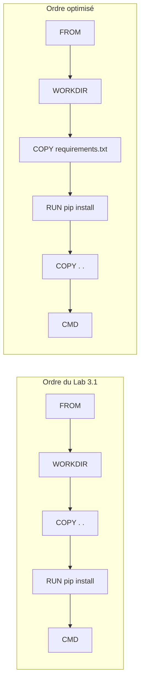

# Lab 3.2 : Cache et couches

| | |
|---|---|
| **Durée** | 45 min |
| **Niveau** | Guidé |
| **Prérequis** | [Lab 3.1 : Écrire un premier Dockerfile](lab-3-1-ecrire-un-premier-dockerfile.md) (dossier `tp-flask` et images `monapp:1.0` et `monapp:1.1`), section 4 du [cours](cours.md) |
| **Acquis visés** | AA3 |

!!! abstract "Objectifs"
    - Reconnaître dans la sortie de `docker build` les étapes lues dans le cache et celles qui sont réexécutées
    - Mesurer l'effet d'un mauvais ordre des instructions
    - Réécrire le Dockerfile pour exploiter le cache
    - Observer les couches d'une image avec `docker history`
    - Forcer une reconstruction complète avec `--no-cache`

## Contexte et schéma

Vous reprenez le projet du Lab 3.1 et vous comparez deux ordres d'instructions. Dans la version du Lab 3.1, la copie du code précède l'installation des dépendances : chaque modification du code relance l'installation.



!!! note "Selon votre option"
    Les commandes de mesure du temps diffèrent entre Linux (`time`) et PowerShell (`Measure-Command`). Dans les deux cas, vous pouvez vous contenter de comparer les durées affichées par Docker pour chaque étape.

## Étapes

### Étape 1 : Reprendre le projet

```bash
cd tp-flask
cat Dockerfile
docker images
```

Vérifiez que le Dockerfile est celui du Lab 3.1 (`COPY . .` avant `RUN pip install`). Si le dossier ou les images ont disparu, reprenez le Lab 3.1.

!!! success "Point de contrôle"
    - [ ] Le Dockerfile contient `COPY . .` **avant** `RUN pip install`
    - [ ] `docker images` affiche `monapp:1.1`

### Étape 2 : Reconstruire sans rien changer

=== "Options B et C"

    ```bash
    time docker build -t monapp:1.1 .
    ```

=== "Option A (PowerShell)"

    ```powershell
    Measure-Command { docker build -t monapp:1.1 . | Out-Default }
    ```

Comme rien n'a changé, Docker réutilise toutes les couches.

!!! success "Point de contrôle"
    - [ ] Toutes les étapes sont marquées `CACHED` (ou `Using cache` selon l'affichage)
    - [ ] La construction est quasi instantanée

### Étape 3 : Modifier le code avec l'ancien ordre

Dans `app.py`, changez le message, par exemple :

```python
    return "Version 1.2 : test du cache\n"
```

Reconstruisez et mesurez :

=== "Options B et C"

    ```bash
    time docker build -t monapp:1.2 .
    ```

=== "Option A (PowerShell)"

    ```powershell
    Measure-Command { docker build -t monapp:1.2 . | Out-Default }
    ```

Notez dans le tableau d'observation (ci-dessous) les étapes `CACHED` et celles qui sont exécutées de nouveau.

!!! success "Point de contrôle"
    - [ ] `FROM` et `WORKDIR` sont lues dans le cache
    - [ ] `COPY . .` et `RUN pip install` sont **réexécutées**
    - [ ] Vous avez noté la durée totale

### Étape 4 : Réécrire le Dockerfile avec le bon ordre

Remplacez le contenu du `Dockerfile` par :

```dockerfile
FROM python:3.12-slim
WORKDIR /app
COPY requirements.txt .
RUN pip install --no-cache-dir -r requirements.txt
COPY . .
EXPOSE 5000
CMD ["python", "app.py"]
```

La liste des dépendances est maintenant copiée **seule**, avant l'installation. Construisez la nouvelle version :

```bash
docker build -t monapp:2.0 .
```

Cette première construction avec le nouvel ordre réexécute l'installation, car le Dockerfile a changé.

!!! success "Point de contrôle"
    - [ ] La construction réussit
    - [ ] L'étape `RUN pip install` est exécutée (elle n'est pas dans le cache)

### Étape 5 : Modifier le code avec le nouvel ordre

Changez à nouveau le message dans `app.py` :

```python
    return "Version 2.1 : cache optimisé\n"
```

Reconstruisez et mesurez :

=== "Options B et C"

    ```bash
    time docker build -t monapp:2.1 .
    ```

=== "Option A (PowerShell)"

    ```powershell
    Measure-Command { docker build -t monapp:2.1 . | Out-Default }
    ```

!!! success "Point de contrôle"
    - [ ] `RUN pip install` est maintenant `CACHED`
    - [ ] Seule la dernière copie (`COPY . .`) est exécutée de nouveau
    - [ ] La construction est nettement plus rapide qu'à l'étape 3

### Étape 6 : Modifier la liste des dépendances

Ajoutez une ligne de commentaire à la fin de `requirements.txt` :

```text
flask==3.0.3
# TP cache
```

Reconstruisez :

```bash
docker build -t monapp:2.2 .
```

Même si le contenu utile n'a pas changé, le fichier n'est plus identique : Docker réinstalle donc les dépendances.

!!! success "Point de contrôle"
    - [ ] `COPY requirements.txt .` est exécutée de nouveau
    - [ ] `RUN pip install` est exécutée de nouveau

### Étape 7 : Observer les couches

```bash
docker history monapp:1.2
docker history monapp:2.1
docker images
```

Comparez les deux historiques : repérez la couche de l'installation de Flask et la couche de copie du code, leurs tailles et leur ordre.

!!! success "Point de contrôle"
    - [ ] Vous avez identifié l'ordre des couches `COPY` et `RUN` dans chacune des deux images
    - [ ] La couche de copie du code est bien plus petite que celle de l'installation des dépendances

### Étape 8 : Forcer une reconstruction complète

```bash
docker build --no-cache -t monapp:2.3 .
```

Cette fois, aucune étape n'est lue dans le cache. Vérifiez enfin que l'application fonctionne :

```bash
docker run -d --name app -p 5000:5000 monapp:2.3
curl http://localhost:5000
```

!!! success "Point de contrôle"
    - [ ] Aucune étape n'est marquée `CACHED`
    - [ ] `curl` affiche le message de l'application

## Tableau d'observation

Recopiez et complétez ce tableau dans votre carnet de TP.

| Étape | Modification | Étapes `CACHED` | Étapes exécutées | Durée |
|---|---|---|---|---|
| 2 | Aucune | | | |
| 3 | Code, ancien ordre | | | |
| 5 | Code, nouvel ordre | | | |
| 6 | `requirements.txt` | | | |
| 8 | `--no-cache` | | | |

## Questions de réflexion

??? question "Pourquoi l'étape 3 réexécute-t-elle l'installation des dépendances alors qu'elles n'ont pas changé ?"
    `COPY . .` précède `RUN pip install`. En modifiant `app.py`, le résultat de la copie change, ce qui invalide la couche de copie et toutes celles qui la suivent, dont l'installation.

??? question "Pourquoi l'étape 5 est-elle plus rapide ?"
    Avec le nouvel ordre, `RUN pip install` ne dépend que de `requirements.txt`, qui n'a pas changé. Docker la lit dans le cache ; seule la copie du code, qui est la dernière étape, est refaite.

??? question "Dans quelle situation faut-il utiliser `--no-cache` ?"
    Quand on veut une image reconstruite entièrement, par exemple pour récupérer des versions plus récentes de paquets installés pendant la construction, car le cache ne détecte pas qu'un paquet a été mis à jour sur Internet.

## Dépannage

| Symptôme | Pistes |
|---|---|
| Aucune étape n'est `CACHED` à l'étape 2 | Le cache a pu être supprimé, ou la construction précédente n'a pas eu lieu avec ce dossier : refaites une construction, puis une seconde |
| L'étape 5 réexécute l'installation | Vérifiez que `COPY requirements.txt .` et `RUN pip install` précèdent bien `COPY . .` dans le Dockerfile |
| `docker images` n'affiche pas `monapp:1.1` | Reprenez le Lab 3.1 ou reconstruisez avec `docker build -t monapp:1.1 .` |
| `The container name "/app" is already in use` | `docker rm -f app` |
| `port is already allocated` | Un autre conteneur utilise le port 5000 : `docker ps`, puis `docker rm -f` |

## Nettoyage et reprise

```bash
docker rm -f app
docker rmi monapp:1.0 monapp:1.1 monapp:1.2 monapp:2.0 monapp:2.1 monapp:2.2 monapp:2.3
```

Conservez le dossier `tp-flask` : le mini-projet 1 peut le réutiliser.

## Retour au chapitre

[Chapitre 3 : Images et Dockerfile](cours.md) · Quiz : [Quiz du chapitre 3](quiz.md)