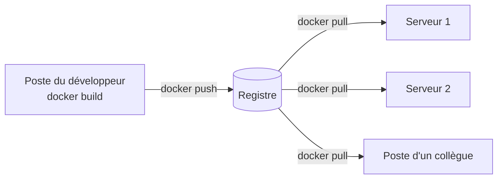

# Chapitre 4 : Registres et distribution

!!! abstract "Objectifs du chapitre" - Expliquer le rôle d'un registre dans le cycle de vie d'une image - Décomposer le nom complet d'une image : registre, espace de noms, dépôt, tag - Publier et récupérer une image sur Docker Hub - Versionner des images avec des tags cohérents - Décrire l'intérêt d'un registre privé et ses limites dans un contexte de TP - Acquis d'apprentissage visé : **AA3**

Au chapitre 3, vous avez construit une image sur votre machine. Pour qu'elle soit utilisée ailleurs (un collègue, un serveur, un cluster), il faut la **distribuer** : c'est le rôle des registres.

## 1. Le rôle d'un registre

Un **registre** est un service qui stocke des images et les distribue à ceux qui les demandent. Vous l'avez déjà utilisé sans le savoir : `docker run nginx:1.27-alpine` a téléchargé l'image depuis **Docker Hub**, le registre public par défaut.



| Commande        | Rôle                                     |
| --------------- | ---------------------------------------- |
| `docker push`   | Envoie une image locale vers un registre |
| `docker pull`   | Télécharge une image depuis un registre  |
| `docker login`  | S'authentifie auprès d'un registre       |
| `docker logout` | Termine la session avec un registre      |

`docker run` effectue automatiquement un `docker pull` quand l'image n'est pas présente sur la machine.

## 2. Anatomie du nom d'une image

Le nom complet d'une image comporte plusieurs parties :

```text
docker.io / monutilisateur / monapp : 1.0
    │             │            │       │
 registre   espace de noms   dépôt    tag
```

| Partie                 | Rôle                                     | Valeur par défaut                     |
| ---------------------- | ---------------------------------------- | ------------------------------------- |
| **Registre**           | L'adresse du service                     | `docker.io` (Docker Hub)              |
| **Espace de noms**     | Le propriétaire (compte ou organisation) | `library` pour les images officielles |
| **Dépôt** (repository) | L'ensemble des versions d'une même image |                                       |
| **Tag**                | Une version du dépôt                     | `latest`                              |

Ainsi `nginx:1.27-alpine` est une écriture abrégée de `docker.io/library/nginx:1.27-alpine`. Pour une image de votre compte, le nom abrégé est `monutilisateur/monapp:1.0`.

!!! note "Registre autre que Docker Hub"
Pour un autre registre, son adresse figure au début du nom : par exemple `localhost:5000/monapp:1.0` désigne un registre qui écoute sur le port 5000 de votre machine.

## 3. Docker Hub

**Docker Hub** est le registre public de Docker. Il propose :

| Élément                  | Description                                                                                                          |
| ------------------------ | -------------------------------------------------------------------------------------------------------------------- |
| Images officielles       | Maintenues avec des garanties de qualité (`nginx`, `python`, `postgres`, `alpine`…), dans l'espace de noms `library` |
| Images de la communauté  | Publiées par des utilisateurs et des organisations, sous leur espace de noms                                         |
| Dépôts publics et privés | Un dépôt public est lisible par tous ; un dépôt privé exige une authentification                                     |

Docker Hub applique des **limites de téléchargement**, notamment aux utilisateurs anonymes ou gratuits : consultez sa documentation pour les valeurs en vigueur.

### 3.1 S'authentifier

Pour publier une image, il faut un compte Docker Hub. On préfère un **jeton d'accès** (access token), créé dans les paramètres du compte, à son mot de passe :

```bash
docker login -u monutilisateur
```

Docker demande alors le mot de passe ou le jeton.

!!! warning "Secrets"
Ne placez jamais un mot de passe ou un jeton dans un Dockerfile, dans un fichier envoyé au dépôt Git ou dans un message. Un jeton peut être révoqué depuis le compte en cas de fuite.

### 3.2 Publier une image

Publier une image comporte deux étapes : lui donner un nom qui contient votre espace de noms, puis l'envoyer.

```bash
docker tag monapp:1.0 monutilisateur/monapp:1.0
docker push monutilisateur/monapp:1.0
```

Depuis n'importe quelle machine, il est alors possible de récupérer et d'exécuter l'image :

```bash
docker pull monutilisateur/monapp:1.0
docker run -d -p 5000:5000 monutilisateur/monapp:1.0
```

## 4. Versionner ses images

Une bonne stratégie de tags permet de savoir quelle version tourne où, et de revenir en arrière.

### 4.1 Le versionnage sémantique

Le schéma usuel est `MAJEUR.MINEUR.CORRECTIF` (par exemple `1.4.2`) :

| Partie        | Quand l'augmenter ?                                   |
| ------------- | ----------------------------------------------------- |
| **MAJEUR**    | Changement incompatible avec les versions précédentes |
| **MINEUR**    | Ajout de fonctionnalités compatibles                  |
| **CORRECTIF** | Correction d'anomalies sans nouvelle fonctionnalité   |

### 4.2 Plusieurs tags pour une même image

Une même image peut porter plusieurs tags. On publie souvent la version précise et des alias plus larges :

| Tag     | Désigne                                         |
| ------- | ----------------------------------------------- |
| `1.4.2` | Cette version exacte                            |
| `1.4`   | La dernière version correctif de la branche 1.4 |
| `1`     | La dernière version de la branche majeure 1     |

Les tags les plus larges **bougent** quand une nouvelle version est publiée, alors que le tag le plus précis doit rester fixe.

### 4.3 Tag et identifiant : ce qui est fixe et ce qui ne l'est pas

Un tag est un **nom modifiable** : le propriétaire d'un dépôt peut publier une autre image sous un tag existant. Pour désigner une image de façon **immuable**, on utilise son **digest**, une empreinte calculée à partir de son contenu :

```bash
docker images --digests
docker pull nginx@sha256:<digest>
```

!!! tip "Bonne pratique"
En production, on déploie une version précise (`1.4.2`) plutôt qu'un tag mobile comme `latest`, et on ne réécrit pas un tag déjà publié.

## 5. Le registre privé

### 5.1 Pourquoi un registre privé ?

| Besoin          | Apport                                                                |
| --------------- | --------------------------------------------------------------------- |
| Confidentialité | Les images propres à une entreprise ne sont pas exposées publiquement |
| Contrôle        | Vous décidez qui peut publier et télécharger                          |
| Performance     | Les images sont proches des serveurs qui les utilisent                |
| Indépendance    | Pas de limite de téléchargement imposée par un service externe        |

### 5.2 Lancer un registre avec Docker

Docker fournit une image de registre officielle, `registry`, qui permet de lancer son propre registre dans un conteneur :

```bash
docker run -d --name registre -p 5000:5000 registry:2
```

On y publie une image en lui donnant un nom qui commence par l'adresse du registre :

```bash
docker tag monapp:1.0 localhost:5000/monapp:1.0
docker push localhost:5000/monapp:1.0
docker pull localhost:5000/monapp:1.0
```

Le registre expose une API HTTP, par exemple pour lister son contenu :

```bash
curl http://localhost:5000/v2/_catalog
```

### 5.3 Limites de ce registre de TP

!!! warning "Un registre de TP n'est pas un registre de production" - **Pas de chiffrement ni d'authentification.** Docker accepte de communiquer sans chiffrement avec un registre situé sur `localhost`. Pour un registre accessible depuis **d'autres machines**, il faut normalement le protéger par TLS ; sinon, il faut déclarer explicitement son adresse comme registre « non sécurisé » dans la configuration du daemon, ce qui ne convient qu'à un TP. - **Pas de persistance.** Les images stockées dans le conteneur disparaissent avec lui : il faudrait lui associer un volume (chapitre 5).

## 6. Autres registres

Docker Hub n'est pas le seul registre. On en trouve notamment chez les plateformes de développement et les fournisseurs de cloud :

| Registre                              | Exemple d'usage                                                        |
| ------------------------------------- | ---------------------------------------------------------------------- |
| GitHub Container Registry (`ghcr.io`) | Images liées aux dépôts GitHub, publiées par un pipeline (chapitre 13) |
| Registres des fournisseurs cloud      | Azure Container Registry, Amazon ECR…                                  |
| Registres auto-hébergés               | Solutions installées sur votre propre infrastructure                   |

Les commandes `docker login`, `docker tag`, `docker push` et `docker pull` fonctionnent de la même façon avec tous ces registres, grâce à la norme OCI de distribution vue au [chapitre 1](../ch01-introduction-aux-conteneurs/cours.md).

!!! tip "À retenir" - Un **registre** stocke et distribue des images ; `docker push` envoie, `docker pull` télécharge. - Le nom complet d'une image est `registre/espace-de-noms/dépôt:tag` ; par défaut, le registre est Docker Hub et le tag est `latest`. - Pour publier sur Docker Hub : `docker login` (de préférence avec un **jeton**), `docker tag` pour ajouter votre espace de noms, puis `docker push`. - Un **tag** peut changer de cible ; le **digest** désigne une image de façon immuable. - On versionne avec `MAJEUR.MINEUR.CORRECTIF` et on déploie une version précise plutôt que `latest`. - Un **registre privé** (`registry:2`) est simple à lancer, mais celui du TP n'est ni chiffré ni persistant.

## Pour vérifier votre compréhension

??? question "Que désigne exactement `nginx:1.27-alpine` en écriture complète ?"
`docker.io/library/nginx:1.27-alpine` : l'image `nginx` de l'espace de noms officiel `library`, tag `1.27-alpine`, hébergée sur Docker Hub, le registre par défaut.

??? question "Pourquoi faut-il exécuter `docker tag` avant de publier sur Docker Hub une image construite localement sous le nom `monapp:1.0` ?"
Parce que Docker Hub range les images par espace de noms : le nom doit commencer par votre compte (`monutilisateur/monapp:1.0`). `docker tag` ajoute ce nouveau nom à l'image existante sans la copier.

??? question "Quelle est la différence entre un tag et un digest ?"
Un tag est un nom lisible qui peut être réaffecté à une autre image par le propriétaire du dépôt. Un digest est une empreinte du contenu de l'image : il désigne toujours la même image.

## Ressources du chapitre

- [Lab 4.1 : Publier sur Docker Hub](lab-4-1-publier-sur-docker-hub.md)
- [Lab 4.2 : Déployer un registre privé](lab-4-2-deployer-un-registre-prive.md)
- [Quiz du chapitre](quiz.md)
