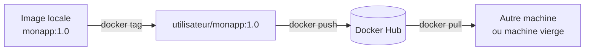

# Lab 4.1 : Publier sur Docker Hub

| | |
|---|---|
| **Durée** | 45 min |
| **Niveau** | Guidé |
| **Prérequis** | [Lab 3.2 : Cache et couches](../ch03-images-et-dockerfile/lab-3-2-cache-et-couches.md) (dossier `tp-flask`), un compte Docker Hub (voir [Environnement de travail](../../annexes/environnement.md)), cours du [chapitre 4](cours.md) |
| **Acquis visés** | AA3 |

!!! abstract "Objectifs"
    - Créer un jeton d'accès et s'authentifier sur Docker Hub
    - Nommer une image avec votre espace de noms et la publier
    - Publier une seconde version avec des tags cohérents
    - Récupérer et exécuter votre image depuis un état « machine vierge »
    - Comparer des tags et des digests

## Contexte et schéma

Vous publiez l'application Flask du chapitre 3 sur Docker Hub, puis vous la récupérez comme le ferait un autre utilisateur.



!!! note "Votre nom d'utilisateur"
    Dans les commandes, remplacez `<utilisateur>` par votre nom d'utilisateur Docker Hub, **en minuscules**. Les noms de dépôts Docker n'acceptent pas les majuscules.

## Étapes

### Étape 1 : Préparer le compte et le jeton d'accès

1. Si vous n'avez pas de compte, créez-en un sur le site de Docker Hub.
2. Dans les paramètres de sécurité de votre compte, créez un **jeton d'accès personnel** (access token) avec le droit de **lecture et écriture**. Donnez-lui un nom explicite, par exemple `tp-docker`.
3. Copiez le jeton et conservez-le dans un endroit sûr : il n'est affiché qu'**une seule fois**.

!!! warning "Jeton"
    Le jeton donne accès à votre compte. Ne l'écrivez pas dans un fichier du projet, ne le publiez pas, ne le partagez pas. Vous pourrez le révoquer à la fin du lab.

!!! success "Point de contrôle"
    - [ ] Vous avez un compte Docker Hub et noté votre nom d'utilisateur
    - [ ] Vous avez créé et copié un jeton d'accès

### Étape 2 : Construire l'image de départ

Placez-vous dans le dossier du chapitre 3 et construisez l'image avec le tag `1.0` :

```bash
cd tp-flask
docker build -t monapp:1.0 .
docker images monapp
```

!!! info "Si le dossier `tp-flask` a disparu"
    Reprenez le [Lab 3.1](../ch03-images-et-dockerfile/lab-3-1-ecrire-un-premier-dockerfile.md) pour recréer `app.py`, `requirements.txt`, le `Dockerfile` (avec l'ordre optimisé du Lab 3.2) et le `.dockerignore`.

!!! success "Point de contrôle"
    - [ ] `docker images monapp` affiche `monapp` avec le tag `1.0`

### Étape 3 : Se connecter à Docker Hub

```bash
docker login -u <utilisateur>
```

Collez le jeton quand Docker demande le mot de passe (rien ne s'affiche pendant la saisie). Un avertissement sur le stockage des identifiants peut apparaître : il est normal dans ce TP.

!!! success "Point de contrôle"
    - [ ] Le message `Login Succeeded` s'affiche

### Étape 4 : Nommer l'image avec votre espace de noms

```bash
docker tag monapp:1.0 <utilisateur>/monapp:1.0
docker images
```

`docker tag` n'a pas copié l'image : elle porte maintenant **deux noms**.

!!! success "Point de contrôle"
    - [ ] `docker images` affiche `monapp:1.0` et `<utilisateur>/monapp:1.0` avec le **même identifiant** d'image

### Étape 5 : Publier l'image

```bash
docker push <utilisateur>/monapp:1.0
```

Observez la sortie : Docker envoie les couches une à une. Celles qui existent déjà sur Docker Hub, comme celles de l'image de base Python, ne sont pas renvoyées.

Vérifiez ensuite dans votre navigateur, sur le site de Docker Hub : le dépôt `monapp` apparaît dans votre compte, avec le tag `1.0`. Relevez la **visibilité** du dépôt (public ou privé).

!!! success "Point de contrôle"
    - [ ] `docker push` se termine sans erreur
    - [ ] Le dépôt `<utilisateur>/monapp` et son tag `1.0` sont visibles sur Docker Hub

### Étape 6 : Publier une nouvelle version

Dans `app.py`, modifiez le message, par exemple :

```python
    return "Application publiée sur Docker Hub, version 1.1\n"
```

Construisez l'image, puis donnez-lui deux noms : la version précise et un alias plus large.

```bash
docker build -t monapp:1.1 .
docker tag monapp:1.1 <utilisateur>/monapp:1.1
docker tag monapp:1.1 <utilisateur>/monapp:1
docker push <utilisateur>/monapp:1.1
docker push <utilisateur>/monapp:1
```

Le second envoi est très rapide : l'image est déjà sur Docker Hub, seul un nouveau tag est créé.

!!! success "Point de contrôle"
    - [ ] Docker Hub affiche les tags `1.0`, `1.1` et `1`
    - [ ] Les tags `1.1` et `1` ont le même digest sur Docker Hub

### Étape 7 : Récupérer l'image depuis une machine « vierge »

Pour simuler une autre machine, supprimez les images locales, puis lancez l'image publiée :

```bash
docker rmi monapp:1.0 monapp:1.1 <utilisateur>/monapp:1.0 <utilisateur>/monapp:1.1 <utilisateur>/monapp:1
docker images
docker run -d --name app -p 5000:5000 <utilisateur>/monapp:1.1
curl http://localhost:5000
```

Docker constate que l'image est absente de la machine et la **télécharge** depuis Docker Hub avant de démarrer le conteneur.

Si votre dépôt est public, **en binôme**, demandez à votre voisin de lancer **votre** image depuis sa machine :

```bash
docker run -d -p 5000:5000 <utilisateur_du_voisin>/monapp:1.1
```

!!! success "Point de contrôle"
    - [ ] `docker images` est vide pour `monapp` avant le lancement
    - [ ] Le conteneur démarre après un téléchargement depuis Docker Hub
    - [ ] `curl` affiche le message de la version 1.1

### Étape 8 : Comparer les tags et les digests

```bash
docker images --digests <utilisateur>/monapp
```

Repérez la colonne `DIGEST`. Si vous avez téléchargé l'image avec le tag `1.1`, vous la voyez avec ce tag. Téléchargez aussi l'alias `1` et comparez :

```bash
docker pull <utilisateur>/monapp:1
docker images --digests <utilisateur>/monapp
```

!!! success "Point de contrôle"
    - [ ] Les tags `1.1` et `1` ont le **même digest**
    - [ ] Vous savez expliquer pourquoi le digest désigne une image de façon immuable

## Questions de réflexion

??? question "Pourquoi `docker push monapp:1.0` échouerait-il, alors que `docker push <utilisateur>/monapp:1.0` réussit ?"
    Sans espace de noms, Docker chercherait à publier dans `docker.io/library/monapp`, un espace réservé aux images officielles auquel vous n'avez pas accès. Le nom doit commencer par votre compte.

??? question "Quel intérêt y a-t-il à publier à la fois les tags `1.1` et `1` pour la même image ?"
    Le tag `1.1` désigne une version précise ; le tag `1` est un alias qui suivra les prochaines versions de la branche 1 (`1.2`, `1.3`…). Les utilisateurs choisissent entre la stabilité d'une version fixe et le suivi automatique des mises à jour compatibles.

??? question "Pourquoi un jeton d'accès vaut-il mieux que le mot de passe du compte pour `docker login` ?"
    Un jeton a des droits limités, il peut être créé pour un usage précis et révoqué à tout moment sans changer le mot de passe du compte.

## Dépannage

| Symptôme | Pistes |
|---|---|
| `denied: requested access to the resource is denied` | Vous n'êtes pas connecté (`docker login`), ou le nom ne commence pas par votre nom d'utilisateur |
| `unauthorized: incorrect username or password` | Vérifiez le nom d'utilisateur et le jeton ; créez un nouveau jeton si besoin |
| `invalid reference format` | Le nom contient une majuscule ou un caractère interdit : utilisez uniquement des minuscules |
| `An image does not exist locally with the tag` | Le tag source n'existe pas : vérifiez avec `docker images` |
| `toomanyrequests` | Limite de téléchargements de Docker Hub atteinte : connectez-vous avec `docker login` ou attendez |
| Le voisin ne peut pas télécharger votre image | Le dépôt est probablement privé : modifiez sa visibilité dans les paramètres du dépôt sur Docker Hub |
| `The container name "/app" is already in use` | `docker rm -f app` |

## Nettoyage et reprise

```bash
docker rm -f app
docker logout
```

Sur le site de Docker Hub, vous pouvez supprimer le dépôt `monapp` et **révoquer le jeton** `tp-docker` si vous ne l'utilisez plus. Conservez-le si vous poursuivez avec le [Lab 4.2](lab-4-2-deployer-un-registre-prive.md) ou le mini-projet 1.

## Retour au chapitre

[Chapitre 4 : Registres et distribution](cours.md) · Lab suivant : [Lab 4.2 : Déployer un registre privé](lab-4-2-deployer-un-registre-prive.md)