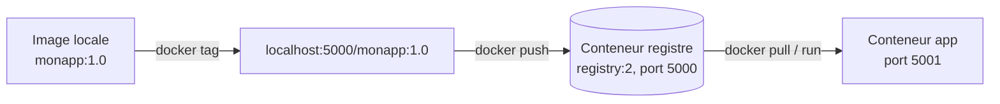

# Lab 4.2 : Déployer un registre privé

| | |
|---|---|
| **Durée** | 60 min |
| **Niveau** | Guidé |
| **Prérequis** | [Lab 4.1 : Publier sur Docker Hub](lab-4-1-publier-sur-docker-hub.md) (dossier `tp-flask`), cours du [chapitre 4](cours.md) |
| **Acquis visés** | AA3 |

!!! abstract "Objectifs"
    - Lancer un registre privé dans un conteneur
    - Publier et récupérer une image depuis ce registre
    - Interroger le contenu du registre par son API HTTP
    - Constater la limite de persistance d'un registre de TP
    - Comprendre pourquoi un registre accessible depuis d'autres machines demande une configuration particulière

## Contexte et schéma

Vous lancez votre propre registre sur votre machine, puis vous y publiez l'image du chapitre 3.



!!! warning "Attention aux ports"
    Le registre utilise le port **5000** de votre machine, le même que l'application des labs précédents. Dans ce lab, l'application sera publiée sur le port **5001**. Si un conteneur `app` du lab précédent tourne encore, supprimez-le avec `docker rm -f app`.

!!! note "Sous PowerShell"
    Utilisez `curl.exe` à la place de `curl`.

## Étapes

### Étape 1 : Lancer le registre

```bash
docker run -d --name registre -p 5000:5000 registry:2
docker ps
```

`registry` est l'image officielle d'un registre Docker ; le tag `2` correspond à la version 2 de ce registre.

Interrogez son API :

```bash
curl http://localhost:5000/v2/
curl http://localhost:5000/v2/_catalog
```

La première commande renvoie `{}`, ce qui prouve que le registre répond. La seconde liste les dépôts : la liste est vide.

!!! success "Point de contrôle"
    - [ ] `docker ps` affiche le conteneur `registre` à l'état `Up`
    - [ ] `/v2/_catalog` renvoie une liste de dépôts vide (`"repositories":[]`)

### Étape 2 : Préparer l'image

Dans le dossier `tp-flask`, construisez l'image si elle n'existe plus :

```bash
cd tp-flask
docker build -t monapp:1.0 .
docker images monapp
```

!!! success "Point de contrôle"
    - [ ] `monapp:1.0` est présente dans `docker images`

### Étape 3 : Nommer l'image pour le registre privé

Le nom d'une image destinée à un registre privé commence par **l'adresse du registre** :

```bash
docker tag monapp:1.0 localhost:5000/monapp:1.0
docker images
```

!!! success "Point de contrôle"
    - [ ] `localhost:5000/monapp:1.0` apparaît dans `docker images`, avec le même identifiant que `monapp:1.0`

### Étape 4 : Publier dans le registre privé

```bash
docker push localhost:5000/monapp:1.0
```

Aucun `docker login` n'est nécessaire : ce registre n'est pas protégé par un mot de passe.

!!! success "Point de contrôle"
    - [ ] `docker push` se termine sans erreur

### Étape 5 : Interroger le registre

```bash
curl http://localhost:5000/v2/_catalog
curl http://localhost:5000/v2/monapp/tags/list
```

!!! success "Point de contrôle"
    - [ ] Le catalogue contient `monapp`
    - [ ] La liste des tags de `monapp` contient `1.0`

### Étape 6 : Récupérer l'image depuis le registre privé

Supprimez les images locales pour forcer un téléchargement, puis lancez l'application depuis le registre :

```bash
docker rmi monapp:1.0 localhost:5000/monapp:1.0
docker run -d --name app -p 5001:5000 localhost:5000/monapp:1.0
curl http://localhost:5001
docker images
```

Docker ne trouve pas l'image localement : il la télécharge depuis `localhost:5000`, puis démarre le conteneur.

!!! success "Point de contrôle"
    - [ ] `curl` affiche le message de l'application
    - [ ] `docker images` affiche `localhost:5000/monapp:1.0`, téléchargée depuis votre registre

### Étape 7 : Constater la non-persistance

Supprimez le registre et recréez-le :

```bash
docker rm -f registre
docker run -d --name registre -p 5000:5000 registry:2
curl http://localhost:5000/v2/_catalog
```

!!! success "Point de contrôle"
    - [ ] Le catalogue est de nouveau **vide** : les images stockées dans le conteneur ont disparu avec lui

!!! info "Solution à venir"
    Pour conserver les images, il faut associer un **volume** au registre. Cette notion est présentée au [chapitre 5](../../partie-2-donnees-reseau-et-exploitation/ch05-volumes-et-persistance/cours.md).

### Étape 8 (facultative) : Accès depuis une autre machine

Cette étape demande une **seconde machine** (VM ou machine du binôme) sur le même réseau. Relevez l'adresse IP de votre machine (par exemple avec `ip -4 addr` sous Linux), republiez l'image dans le registre :

```bash
docker tag monapp:1.0 localhost:5000/monapp:1.0
docker push localhost:5000/monapp:1.0
```

(si `monapp:1.0` a été supprimée à l'étape 6, reconstruisez-la d'abord). Depuis la seconde machine :

```bash
docker pull <ADRESSE_IP>:5000/monapp:1.0
```

Docker refuse avec un message du type `http: server gave HTTP response to HTTPS client` : il exige le chiffrement (HTTPS) pour tout registre autre que `localhost`.

Pour ce TP seulement, vous pouvez déclarer le registre comme « non sécurisé » **sur la seconde machine** :

=== "Options B et C (Linux)"

    Éditez ou créez le fichier `/etc/docker/daemon.json` :

    ```json
    {
      "insecure-registries": ["<ADRESSE_IP>:5000"]
    }
    ```

    Puis redémarrez Docker et relancez le téléchargement :

    ```bash
    sudo systemctl restart docker
    docker pull <ADRESSE_IP>:5000/monapp:1.0
    ```

=== "Option A (Docker Desktop)"

    Dans les paramètres de Docker Desktop, ouvrez la section **Docker Engine** et ajoutez la clé `"insecure-registries": ["<ADRESSE_IP>:5000"]` à la configuration JSON, puis appliquez et redémarrez.

!!! warning "Réservé au TP"
    Déclarer un registre comme non sécurisé désactive la protection du chiffrement : n'utilisez jamais cette méthode en production. Un registre réel est protégé par TLS et par une authentification. Redémarrer Docker arrête les conteneurs en cours (sauf configuration particulière).

!!! success "Point de contrôle"
    - [ ] Vous avez obtenu l'erreur HTTP/HTTPS avant la configuration
    - [ ] Le téléchargement réussit après avoir déclaré le registre comme non sécurisé

## Questions de réflexion

??? question "Pourquoi `docker push localhost:5000/monapp:1.0` fonctionne-t-il sans HTTPS, alors que le même registre est refusé depuis une autre machine ?"
    Docker accepte de communiquer sans chiffrement avec un registre situé sur `localhost`, mais exige HTTPS pour tout autre registre, sauf déclaration explicite dans la configuration du daemon.

??? question "Pourquoi le nom de l'image doit-il commencer par `localhost:5000/` ?"
    Sans adresse de registre, Docker utilise Docker Hub par défaut. Le préfixe indique à Docker où envoyer ou chercher l'image.

??? question "Qu'est-ce qui manque à ce registre pour être utilisable en production ?"
    Le chiffrement (TLS), l'authentification des utilisateurs et la persistance des images, avec un volume ou un stockage dédié.

## Dépannage

| Symptôme | Pistes |
|---|---|
| `port is already allocated` au lancement du registre | Un conteneur utilise déjà le port 5000 (souvent `app` du lab précédent) : `docker ps`, puis `docker rm -f` |
| `connection refused` lors du `push` | Le conteneur `registre` n'est pas démarré : `docker ps -a`, puis `docker start registre` |
| `curl` ne renvoie rien ou une erreur | Vérifiez l'adresse (`http://`, pas `https://`) et le port 5000 |
| `http: server gave HTTP response to HTTPS client` | Normal pour une autre machine que `localhost` : voir l'étape 8 |
| Le catalogue est vide après le `push` | Vérifiez le nom utilisé dans `docker tag` : il doit commencer par `localhost:5000/` |
| `The container name "/registre" is already in use` | `docker rm -f registre` |

## Nettoyage et reprise

```bash
docker rm -f app registre
docker rmi localhost:5000/monapp:1.0
```

Si vous avez modifié `daemon.json` à l'étape 8, retirez l'entrée `insecure-registries`, puis redémarrez Docker.

## Retour au chapitre

[Chapitre 4 : Registres et distribution](cours.md) · Quiz : [Quiz du chapitre 4](quiz.md)