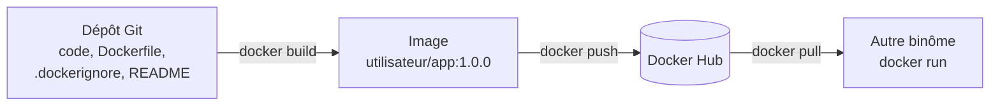

# Mini-projet 1 : Conteneuriser et publier une application web

## 1. Fiche du mini-projet

| Rubrique      | Description                                                                                                                     |
| ------------- | ------------------------------------------------------------------------------------------------------------------------------- |
| Cours         | Docker : conteneurisation, orchestration et industrialisation d'applications                                                    |
| Position      | Fin de la Partie 1 : Fondations (chapitres 1 à 4)                                                                               |
| Modalité      | En binôme, hors séance, avec une démonstration de 5 min en début de séance suivante                                             |
| Durée         | Environ 3 h de travail + compte rendu                                                                                           |
| Prérequis     | Labs 1.1 à 4.2 réalisés, compte Docker Hub avec un jeton d'accès (voir [Environnement de travail](../annexes/environnement.md)) |
| Environnement | Au choix : Docker Desktop, Ubuntu Desktop ou Ubuntu Server                                                                      |
| Acquis visés  | AA2 (créer, exécuter et gérer des conteneurs), AA3 (construire, versionner et distribuer des images)                            |

## 2. Contexte

Une petite équipe a développé une application web interne. Elle fonctionne sur le poste de son auteur, mais personne d'autre ne parvient à la lancer : versions différentes, dépendances manquantes, configuration inconnue. Vous êtes l'équipe DevOps. Votre mission : **conteneuriser** cette application, la rendre **configurable**, la **versionner** et la **publier** pour que n'importe quel collègue puisse la lancer avec une seule commande.

!!! info "Ce qui est évalué"
Vous pouvez écrire votre propre application ou réutiliser celle du chapitre 3. **L'évaluation porte sur la conteneurisation et l'exploitation de l'application, et non sur la qualité de son code.** Une application très simple suffit.

## 3. Objectifs pédagogiques

À l'issue du mini-projet, vous serez capables de :

1. écrire un Dockerfile reproductible, avec un ordre d'instructions qui exploite le cache ;
2. exclure les fichiers inutiles ou sensibles de l'image ;
3. configurer un conteneur par variables d'environnement et limiter ses ressources ;
4. diagnostiquer un conteneur qui ne démarre pas ;
5. versionner une image et la publier sur un registre ;
6. documenter un projet pour qu'une autre équipe puisse l'exécuter.

## 4. Architecture cible

## 5. Cahier des charges

| N°  | Exigence                                                                                                                                              |
| --- | ----------------------------------------------------------------------------------------------------------------------------------------------------- |
| E1  | Une application web répond à des requêtes HTTP (une page ou un message suffit). Son code est dans un dépôt Git.                                       |
| E2  | Le **Dockerfile** utilise une image de base à **version explicite** (pas de `latest`), un `WORKDIR`, et une commande de démarrage en **forme liste**. |
| E3  | L'ordre des instructions **exploite le cache** : les dépendances sont installées avant la copie du code.                                              |
| E4  | Un fichier **`.dockerignore`** exclut au minimum le dossier `.git`, les fichiers temporaires et les fichiers de secrets.                              |
| E5  | L'application écoute sur toutes les interfaces du conteneur et son port est indiqué dans le Dockerfile (`EXPOSE`).                                    |
| E6  | Au moins un paramètre (par exemple un message d'accueil) est configurable par **variable d'environnement**, avec une valeur par défaut.               |
| E7  | Le conteneur est lancé avec un **nom explicite**, un **port publié** et des **limites** de mémoire et de processeur.                                  |
| E8  | L'image est publiée sur **Docker Hub** avec deux versions successives (par exemple `1.0.0` puis `1.0.1`) et les tags `X.Y.Z` et `X.Y`.                |
| E9  | **Aucun secret** (jeton, mot de passe) ne figure dans l'image, dans le Dockerfile ou dans le dépôt Git.                                               |
| E10 | Un `README.md` permet à une équipe extérieure de lancer l'application **à partir de l'image publiée seulement**.                                      |

## 6. Application et images suggérées

- **Option simple :** reprenez l'application Flask du [Lab 3.1](ch03-images-et-dockerfile/lab-3-1-ecrire-un-premier-dockerfile.md), avec `python:3.12-slim`. Il vous reste à la rendre configurable (E6) : par exemple en lui faisant lire un message dans une variable d'environnement.
- **Option libre :** une autre application web simple (autre langage ou autre contenu), après accord de votre enseignant. Fixez alors la version de l'image de base.

Quel que soit votre choix, ne passez pas de temps à perfectionner le code : le temps est consacré à l'image et à son exploitation.

## 7. Démarche guidée en étapes

Chaque étape propose un but, des indices (pas la solution), un point de contrôle et une question à traiter dans votre compte rendu.

### Étape 0 : Préparer le projet (15 min)

- **But :** disposer d'un dossier de travail propre et versionné.
- **Indices :** créez un dossier pour le projet, initialisez un dépôt Git, choisissez votre application, répartissez les rôles dans le binôme.
- **Point de contrôle :** le dépôt existe et contient une première version de l'application ou de son squelette.
- **Question :** pourquoi versionne-t-on le Dockerfile avec le code de l'application ?

### Étape 1 : Écrire l'application configurable (25 min)

- **But :** une application web qui lit au moins une variable d'environnement et qui a une valeur par défaut.
- **Indices :** reprenez l'application du chapitre 3. L'application doit écouter sur `0.0.0.0` (voir le Lab 3.1). Prévoyez une valeur par défaut si la variable n'est pas définie.
- **Point de contrôle :** vous savez dire quelle variable configure quel comportement.
- **Question :** pourquoi configure-t-on une application par variable d'environnement plutôt qu'en modifiant l'image ?

### Étape 2 : Écrire le Dockerfile et le `.dockerignore` (30 min)

- **But :** décrire la construction de l'image (E2 à E5).
- **Indices :** inspirez-vous du Lab 3.2 pour l'ordre des instructions. Ajoutez `.git`, `__pycache__` et les fichiers de secrets au `.dockerignore`.
- **Point de contrôle :** relisez votre Dockerfile instruction par instruction, en indiquant à quelle exigence chacune répond.
- **Question :** quelle instruction du Dockerfile crée une couche, et lesquelles ne font qu'ajouter des informations à l'image ?

### Étape 3 : Construire, lancer et configurer (30 min)

- **But :** obtenir un conteneur fonctionnel et configuré (E6, E7).
- **Indices :** construisez l'image avec un tag de version, lancez le conteneur avec un nom, un port publié, les limites de ressources et la variable d'environnement. Vérifiez le résultat avec `curl`, `docker logs` et `docker inspect`.
- **Point de contrôle :** le message affiché change quand vous modifiez la variable, **sans reconstruire l'image**.
- **Question :** quelles limites avez-vous fixées et comment avez-vous vérifié qu'elles sont appliquées ?

### Étape 4 : Panne et diagnostic (15 min)

- **But :** appliquer la démarche de diagnostic du chapitre 2.
- **Scénario :** votre binôme voisin (ou votre enseignant) introduit une erreur dans votre Dockerfile ou votre commande de lancement, par exemple un nom de fichier faux dans `CMD` ou un port non publié. Vous la trouvez et la corrigez.
- **Indices :** `docker ps -a`, `docker logs`, `docker inspect`. Notez l'ordre de vos investigations.
- **Point de contrôle :** le conteneur fonctionne de nouveau.
- **Question :** quels symptômes vous ont mis sur la piste et quelle est la cause racine ?

### Étape 5 : Observer le cache (20 min)

- **But :** mesurer l'effet de l'ordre des instructions (E3).
- **Indices :** modifiez le code de l'application, reconstruisez l'image et relevez les étapes `CACHED` et celles qui sont exécutées de nouveau. Utilisez `docker history` pour observer les couches.
- **Point de contrôle :** l'installation des dépendances est lue dans le cache quand seul le code change.
- **Question :** que se passerait-il si vous copiiez tout le code avant d'installer les dépendances ?

### Étape 6 : Versionner et publier (25 min)

- **But :** publier deux versions de l'image sur Docker Hub (E8, E9).
- **Indices :** connectez-vous avec un **jeton d'accès**, publiez la version `1.0.0` avec son alias `1.0`, modifiez le code, puis publiez `1.0.1` en déplaçant l'alias `1.0`. Vérifiez sur le site de Docker Hub les tags et les digests.
- **Point de contrôle :** les tags `1.0.0`, `1.0.1` et `1.0` sont visibles, et `1.0` désigne la même image que `1.0.1`.
- **Question :** pourquoi ne faut-il pas réécrire un tag de version précise déjà publié ?

### Étape 7 : Documenter et valider avec un autre binôme (20 min)

- **But :** prouver que votre image est utilisable par d'autres (E10).
- **Indices :** rédigez le `README.md` (voir la section 8), puis demandez à un autre binôme de lancer votre image **en suivant uniquement votre README**.
- **Point de contrôle :** l'autre binôme obtient votre application sans vous poser de question.
- **Question :** quelles informations manquaient dans votre README lors du premier essai ?

## 8. Livrables

1. **Dépôt Git** contenant le code, le `Dockerfile`, le `.dockerignore` et un `README.md`. Le README indique : ce que fait l'application, comment la construire, comment la lancer (commande complète avec le port, les variables d'environnement et les limites), les variables disponibles avec leurs valeurs par défaut, le nom de l'image sur Docker Hub et ses versions.
2. **Image publiée** sur Docker Hub, dans un dépôt accessible à vos évaluateurs et à l'autre binôme.
3. **Compte rendu** (1 à 2 pages) comprenant :
   - les réponses aux questions de chaque étape ;
   - le tableau d'observation du cache (étapes `CACHED` et étapes exécutées) ;
   - des sorties de commandes ou captures prouvant les exigences E6, E7 et E8 ;
   - un court paragraphe « difficultés rencontrées et enseignements ».
4. **Démonstration orale** de 5 minutes au début de la séance suivante : téléchargement de l'image depuis Docker Hub, lancement configuré, consultation des journaux et des couches.

## 9. Grille d'évaluation (/20)

| Critère                                                   | Points | AA       |
| --------------------------------------------------------- | ------ | -------- |
| Dockerfile et `.dockerignore` corrects (E2, E4, E5, E9)   | 4      | AA3      |
| Ordre des instructions et exploitation du cache (E3)      | 3      | AA3      |
| Lancement, configuration et limites du conteneur (E6, E7) | 4      | AA2      |
| Versionnage et publication sur Docker Hub (E8)            | 4      | AA3      |
| Diagnostic de la panne (démarche et explication)          | 2      | AA2      |
| README, compte rendu et démonstration (E10)               | 3      | AA2, AA3 |

## 10. Pour aller plus loin (facultatif)

- Publier aussi l'image dans le **registre privé** local du Lab 4.2 et la récupérer depuis ce registre.
- Comparer deux images de base (par exemple `python:3.12-slim` et une variante `alpine`) et leur taille, puis expliquer votre choix.
- Ajouter un second paramètre configurable et le documenter dans le README.

## 11. Erreurs fréquentes et conseils de diagnostic

| Symptôme                                               | Pistes                                                                                                      |
| ------------------------------------------------------ | ----------------------------------------------------------------------------------------------------------- |
| Le conteneur s'arrête immédiatement                    | `docker ps -a` pour voir l'état et le code de sortie, puis `docker logs` pour lire l'erreur                 |
| L'application ne répond pas depuis l'hôte              | Port non publié avec `-p`, application qui n'écoute pas sur `0.0.0.0`, ou mauvais port dans la commande     |
| La variable d'environnement n'a aucun effet            | Nom différent dans le code et dans la commande, ou variable lue au mauvais endroit                          |
| `denied` ou `unauthorized` au `push`                   | Pas connecté, jeton incorrect, ou nom de l'image qui ne commence pas par votre compte                       |
| L'autre binôme ne peut pas télécharger l'image         | Dépôt privé, tag erroné ou faute dans le nom : comparez avec le README                                      |
| Une reconstruction réinstalle toujours les dépendances | Ordre des instructions : la copie du code précède l'installation                                            |
| Un secret apparaît dans l'image ou le dépôt            | Révoquez-le immédiatement (jeton), retirez-le du projet et ajoutez-le au `.dockerignore` et au `.gitignore` |

## 12. Aide-mémoire

| Besoin                          | Commande                                                                                           |
| ------------------------------- | -------------------------------------------------------------------------------------------------- |
| Construire une image            | `docker build -t nom:tag .`                                                                        |
| Lancer un conteneur configuré   | `docker run -d --name nom -p hôte:conteneur -e VARIABLE=valeur --memory 256m --cpus 0.5 image:tag` |
| Lire l'état et la configuration | `docker ps -a`, `docker logs`, `docker inspect`                                                    |
| Observer les couches            | `docker history image:tag`                                                                         |
| Nommer et publier               | `docker tag`, `docker login`, `docker push`                                                        |
| Récupérer une image             | `docker pull utilisateur/image:tag`                                                                |
