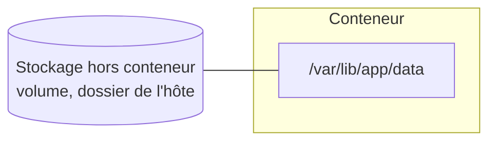
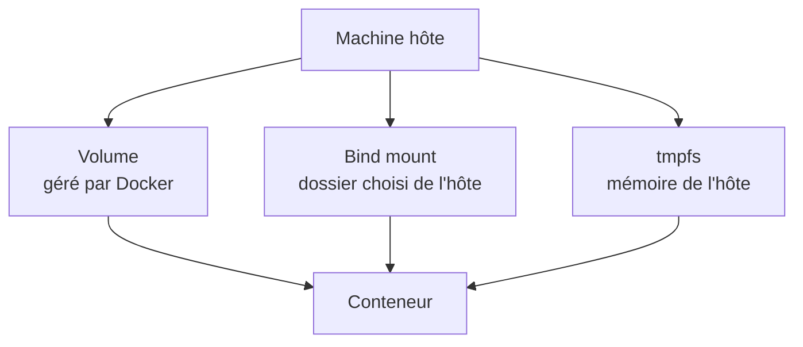
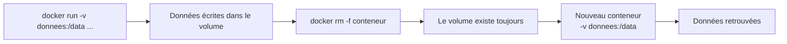
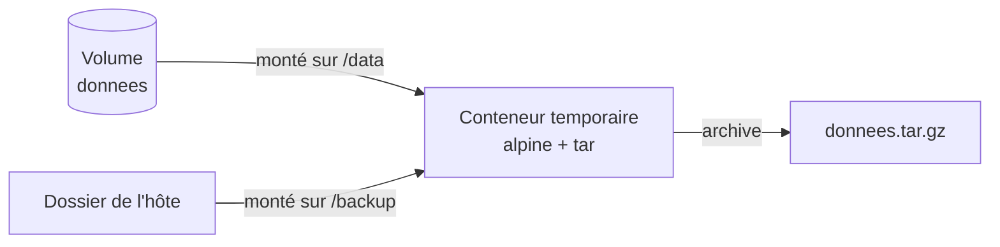

# Chapitre 5 : Volumes et persistance

!!! abstract "Objectifs du chapitre"
    - Expliquer pourquoi les données d'un conteneur sont éphémères
    - Distinguer les volumes nommés, les bind mounts et les montages tmpfs
    - Utiliser un volume pour conserver des données au-delà de la vie d'un conteneur
    - Utiliser un bind mount, en connaissant ses risques
    - Sauvegarder et restaurer le contenu d'un volume
    - Acquis d'apprentissage visé : **AA4**

## 1. Pourquoi persister des données ?

Vous l'avez constaté dès le [Lab 1.2](../../partie-1-fondations/ch01-introduction-aux-conteneurs/lab-1-2-premiers-conteneurs.md) : un fichier écrit dans un conteneur disparaît avec lui. Ce que vous écrivez va dans la **couche d'écriture** du conteneur (chapitre 3), qui est supprimée quand le conteneur l'est. C'est voulu : un conteneur doit pouvoir être détruit et recréé à volonté.

Mais certaines applications ont des données à conserver : la base de données PostgreSQL du [Lab 2.2](../../partie-1-fondations/ch02-cycle-de-vie-des-conteneurs/lab-2-2-publier-et-configurer-un-service.md), les images du registre du [Lab 4.2](../../partie-1-fondations/ch04-registres-et-distribution/lab-4-2-deployer-un-registre-prive.md), des fichiers téléversés par des utilisateurs.

La solution consiste à **stocker les données en dehors du conteneur**, puis à les « brancher » dans son système de fichiers : c'est le principe des **montages**.



Ainsi, vous pouvez supprimer et recréer le conteneur, ou le remplacer par une nouvelle version de l'image : les données restent.

## 2. Les trois types de montages

Docker propose trois manières de brancher du stockage dans un conteneur.



| Type | Où sont les données ? | Qui le gère ? | Usage typique |
|---|---|---|---|
| **Volume nommé** | Dans une zone gérée par Docker | Docker | Données d'une application : bases de données, fichiers persistants |
| **Bind mount** | Dans un dossier de l'hôte que **vous** choisissez | Vous | Partager du code ou une configuration entre l'hôte et le conteneur |
| **tmpfs** | En mémoire vive de l'hôte | Docker | Données temporaires ou sensibles qui ne doivent pas être écrites sur disque |

## 3. Les volumes nommés

Un **volume** est un espace de stockage créé et géré par Docker, indépendant de tout conteneur. Sous Linux, il est stocké dans un dossier du système de fichiers de l'hôte réservé à Docker, que l'on n'a pas besoin de connaître pour l'utiliser.

### 3.1 Commandes de gestion

| Commande | Rôle |
|---|---|
| `docker volume create donnees` | Crée un volume nommé |
| `docker volume ls` | Liste les volumes |
| `docker volume inspect donnees` | Affiche les détails (dont l'emplacement sur l'hôte) |
| `docker volume rm donnees` | Supprime un volume qui n'est utilisé par aucun conteneur |

### 3.2 Utiliser un volume

On monte un volume avec l'option `-v` : `-v nom-du-volume:/chemin/dans/le/conteneur`.

```bash
docker run -d --name base -v donnees:/var/lib/postgresql/data \
  -e POSTGRES_PASSWORD=motdepasse-tp postgres:16-alpine
```

Si le volume n'existe pas, Docker le crée automatiquement. Les données écrites dans `/var/lib/postgresql/data` sont alors stockées dans le volume `donnees`.

### 3.3 Cycle de vie

Un volume a sa **propre vie**, indépendante de celle des conteneurs :



- Supprimer un conteneur **ne supprime pas** ses volumes nommés.
- Un volume peut être monté dans **plusieurs conteneurs** à la fois.
- Seule la commande `docker volume rm` (ou un nettoyage explicite) supprime un volume.

### 3.4 Les volumes anonymes

Certaines images déclarent un emplacement de données dans leur Dockerfile (instruction `VOLUME`). C'est le cas de l'image `postgres`. Si vous lancez le conteneur **sans** `-v`, Docker crée un **volume anonyme** : il porte un nom aléatoire et il est facile à oublier.

!!! warning "Volumes orphelins"
    Les volumes anonymes restent après la suppression du conteneur et occupent de l'espace disque. `docker volume ls` permet de les repérer. Préférez toujours des **volumes nommés**, faciles à identifier et à réutiliser.

## 4. Les bind mounts

Un **bind mount** relie un dossier précis de l'hôte à un dossier du conteneur : `-v /chemin/hôte:/chemin/conteneur`. Le chemin de l'hôte doit être **absolu**.

```bash
docker run -d --name web -p 8080:80 -v /home/etudiant/site:/usr/share/nginx/html nginx:1.27-alpine
```

Les fichiers de `/home/etudiant/site` apparaissent dans le conteneur, et toute modification faite sur l'hôte est visible immédiatement : c'est très pratique pour développer.

| Avantages | Limites |
|---|---|
| Modification des fichiers depuis l'hôte, sans reconstruire l'image | Dépend de la structure de dossiers de l'hôte : peu portable |
| Partage simple d'une configuration | Le contenu du dossier **masque** ce que l'image contenait à cet emplacement |
| | Problèmes possibles de droits sur les fichiers (identifiants d'utilisateurs différents) |
| | Le conteneur peut modifier ou supprimer des fichiers de l'hôte |

!!! tip "Lecture seule"
    Pour qu'un conteneur ne puisse pas modifier les fichiers de l'hôte, ajoutez `:ro` : `-v /home/etudiant/site:/usr/share/nginx/html:ro`. Cette option fonctionne aussi pour un volume.

## 5. Les montages tmpfs

Un montage **tmpfs** stocke les données **en mémoire vive** de l'hôte, jamais sur disque. Elles disparaissent à l'arrêt du conteneur. Cette option, disponible sous Linux, convient aux données temporaires ou sensibles (cache, fichiers de session).

```bash
docker run -d --name temp --tmpfs /cache alpine:3.20 sleep 3600
```

## 6. Deux syntaxes : `-v` et `--mount`

L'option `--mount` décrit explicitement le montage. Elle est plus longue, mais plus lisible :

| Type | Avec `-v` ou `--tmpfs` | Avec `--mount` |
|---|---|---|
| Volume | `-v donnees:/data` | `--mount type=volume,source=donnees,target=/data` |
| Bind mount | `-v /home/etudiant/site:/site` | `--mount type=bind,source=/home/etudiant/site,target=/site` |
| tmpfs | `--tmpfs /cache` | `--mount type=tmpfs,target=/cache` |
| Lecture seule | `-v donnees:/data:ro` | `--mount type=volume,source=donnees,target=/data,readonly` |

Avec `-v`, un dossier de l'hôte inexistant est **créé silencieusement** (avec les droits de l'administrateur), ce qui masque souvent une faute de frappe. Avec `--mount type=bind`, Docker **signale une erreur** si le dossier n'existe pas.

## 7. Sauvegarder et restaurer un volume

Un volume n'est pas une sauvegarde : il persiste, mais il peut être supprimé ou corrompu. Pour le sauvegarder sans connaître son emplacement sur l'hôte, on utilise un **conteneur temporaire** qui monte à la fois le volume et un dossier de l'hôte :



Le principe, en deux temps :

| Opération | Idée |
|---|---|
| Sauvegarde | Le conteneur temporaire lit `/data` (le volume) et écrit une archive dans `/backup` (le dossier de l'hôte) |
| Restauration | Le conteneur temporaire lit l'archive dans `/backup` et la décompresse dans `/data`, monté sur un volume neuf ou vidé |

Le conteneur est lancé avec `--rm` : il disparaît dès que l'archive est écrite. Vous réaliserez ces opérations au [Lab 5.2](lab-5-2-sauvegarder-et-restaurer-un-volume.md).

!!! note "Cas des bases de données"
    Archiver les fichiers d'une base de données pendant qu'elle écrit peut produire une sauvegarde incohérente. Pour une base en production, on préfère l'outil de sauvegarde de la base elle-même, ou l'on arrête le conteneur avant d'archiver.

## 8. Choisir le bon type de montage

| Besoin | Choix |
|---|---|
| Conserver les données d'une application (base de données, fichiers) | **Volume nommé** |
| Partager du code ou une configuration entre l'hôte et un conteneur, en développement | **Bind mount**, de préférence en lecture seule |
| Garder des données temporaires hors du disque | **tmpfs** |
| Sauvegarder ou migrer des données | Volume + conteneur temporaire, ou bind mount vers un dossier de sauvegarde |

!!! tip "À retenir"
    - Les données écrites dans un conteneur disparaissent avec lui : pour les conserver, on les **monte** depuis l'extérieur.
    - Un **volume nommé** est géré par Docker et survit à la suppression du conteneur ; c'est le choix par défaut pour les données applicatives.
    - Un **bind mount** relie un dossier de l'hôte ; pratique en développement, mais moins portable et plus risqué.
    - Un montage **tmpfs** stocke en mémoire, jamais sur disque.
    - `-v nom:/chemin` monte un volume, `-v /chemin/hôte:/chemin` un bind mount ; `:ro` met en lecture seule.
    - Évitez les **volumes anonymes** : nommez vos volumes.
    - On sauvegarde un volume avec un **conteneur temporaire** qui monte le volume et un dossier de l'hôte.

## Pour vérifier votre compréhension

??? question "Vous supprimez un conteneur de base de données lancé avec `-v donnees:/var/lib/postgresql/data`. Que deviennent les données ?"
    Elles sont conservées : le volume nommé `donnees` existe toujours. En lançant un nouveau conteneur avec le même `-v`, vous retrouvez les données.

??? question "Quelle est la différence entre un volume nommé et un bind mount ?"
    Un volume est créé et géré par Docker, dans une zone dont vous n'avez pas à connaître l'emplacement. Un bind mount relie un dossier précis de l'hôte que vous choisissez et gérez vous-même.

??? question "Pourquoi les volumes anonymes posent-ils problème ?"
    Ils portent un nom aléatoire, restent après la suppression du conteneur et occupent de l'espace sans que l'on sache à quoi ils servent. Un volume nommé est facile à identifier, à réutiliser et à supprimer.

## Ressources du chapitre

- [Lab 5.1 : Persister des données](lab-5-1-persister-des-donnees.md)
- [Lab 5.2 : Sauvegarder et restaurer un volume](lab-5-2-sauvegarder-et-restaurer-un-volume.md)
- [Quiz du chapitre](quiz.md)