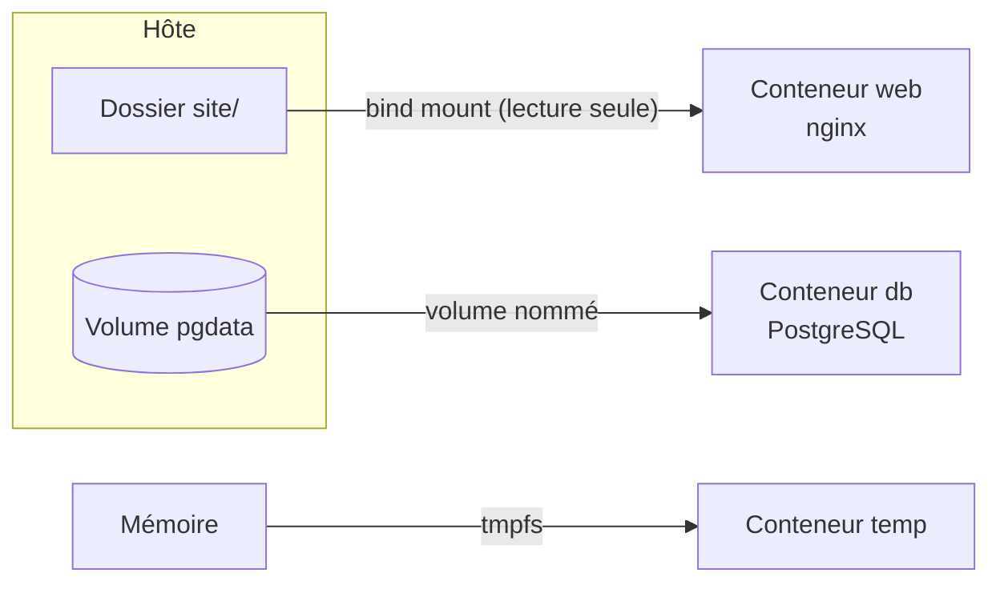

# Lab 5.1 : Persister des données

| | |
|---|---|
| **Durée** | 60 min |
| **Niveau** | Semi-guidé |
| **Prérequis** | [Lab 2.2 : Publier et configurer un service](../../partie-1-fondations/ch02-cycle-de-vie-des-conteneurs/lab-2-2-publier-et-configurer-un-service.md), cours du [chapitre 5](cours.md) |
| **Acquis visés** | AA4 |

!!! abstract "Objectifs"
    - Constater la perte des données d'un conteneur sans montage adapté
    - Conserver les données d'une base PostgreSQL avec un volume nommé
    - Partager un dossier de l'hôte avec un conteneur grâce à un bind mount, en lecture seule
    - Utiliser un montage tmpfs et constater que son contenu est temporaire

## Contexte et schéma

Vous testez les trois types de montages avec deux services : une base de données PostgreSQL (volume) et un serveur web nginx (bind mount). Dans ce lab, seules les **commandes clés** vous sont données : à vous de les adapter et de déduire le reste à l'aide du [cours](cours.md).



!!! note "Selon votre option"
    - Sous PowerShell, utilisez `curl.exe`, écrivez les commandes sur une seule ligne et remplacez `$(pwd)` par `${PWD}`.
    - Avec Docker Desktop, le dossier interne des volumes n'est pas directement accessible depuis Windows.

## Étapes

### Étape 1 : Constater la perte de données

- **Objectif :** montrer qu'une base lancée **sans volume nommé** perd ses données quand on la recrée.
- **Indices :**
    - Lancez un conteneur `db` à partir de `postgres:16-alpine` avec les variables `POSTGRES_USER=etudiant`, `POSTGRES_PASSWORD=motdepasse-tp` et `POSTGRES_DB=cours` (voir le [Lab 2.2](../../partie-1-fondations/ch02-cycle-de-vie-des-conteneurs/lab-2-2-publier-et-configurer-un-service.md)), sans option `-v`.
    - Attendez que les journaux indiquent que la base est prête, puis créez une table et une ligne :

```bash
docker exec db psql -U etudiant -d cours -c "CREATE TABLE notes (id serial PRIMARY KEY, texte text);"
docker exec db psql -U etudiant -d cours -c "INSERT INTO notes (texte) VALUES ('premiere note');"
docker exec db psql -U etudiant -d cours -c "SELECT * FROM notes;"
```

- Supprimez le conteneur avec `docker rm -f db`, relancez-le avec la **même commande**, puis interrogez de nouveau la table `notes`.
- Observez la liste des volumes : `docker volume ls`.

!!! success "Point de contrôle"
    - [ ] Après recréation, la table `notes` n'existe plus
    - [ ] `docker volume ls` montre des volumes **anonymes** (noms hexadécimaux longs), un par conteneur créé

### Étape 2 : Conserver les données avec un volume nommé

- **Objectif :** retrouver les données après suppression du conteneur.
- **Indices :**
    - Supprimez le conteneur `db`, puis créez un volume nommé `pgdata` : `docker volume create pgdata`.
    - Relancez `db` avec la même configuration, en montant `pgdata` sur `/var/lib/postgresql/data` (option `-v pgdata:/var/lib/postgresql/data`).
    - Recréez la table et la ligne de l'étape 1.
    - Supprimez le conteneur `db` (`docker rm -f db`), puis **relancez-en un nouveau** avec la même commande et le même volume.
    - Interrogez la table `notes`.

!!! success "Point de contrôle"
    - [ ] Après recréation du conteneur, la ligne `premiere note` est retrouvée
    - [ ] `docker volume ls` affiche le volume `pgdata`

!!! info "Variables ignorées au second démarrage"
    Les variables `POSTGRES_USER`, `POSTGRES_PASSWORD` et `POSTGRES_DB` ne servent qu'à l'**initialisation** d'une base vide. Quand le volume contient déjà une base, elles sont ignorées. Essayez de relancer le conteneur avec un autre mot de passe : la base utilise toujours l'ancien.

### Étape 3 : Localiser les données du volume

- **Objectif :** savoir où Docker stocke un volume.
- **Indices :**
    - `docker volume inspect pgdata` : repérez le champ `Mountpoint`.
    - Sous Linux (options B et C), listez le contenu du dossier avec `sudo ls <Mountpoint>`.
    - Sous Docker Desktop, ce dossier se trouve dans la machine virtuelle interne : vous ne pouvez pas l'ouvrir directement.

!!! success "Point de contrôle"
    - [ ] Vous avez relevé le `Mountpoint` du volume `pgdata`
    - [ ] (Options B et C) Vous avez vu les fichiers de la base dans ce dossier

### Étape 4 : Partager un dossier avec un bind mount

- **Objectif :** servir un site statique depuis un dossier de l'hôte et le modifier sans redémarrer le conteneur.
- **Indices :**
    - Créez un dossier `site` contenant un fichier `index.html` avec un message de votre choix.
    - Lancez un conteneur `web` (`nginx:1.27-alpine`, port `8080:80`) en montant votre dossier sur `/usr/share/nginx/html`, **en lecture seule** :

=== "Options B et C"

    ```bash
    docker run -d --name web -p 8080:80 -v "$(pwd)/site:/usr/share/nginx/html:ro" nginx:1.27-alpine
    ```

=== "Option A (PowerShell)"

    ```powershell
    docker run -d --name web -p 8080:80 -v "${PWD}/site:/usr/share/nginx/html:ro" nginx:1.27-alpine
    ```

- Testez avec `curl http://localhost:8080`.
- **Sans toucher au conteneur**, modifiez `index.html` sur l'hôte et testez de nouveau.
- Essayez d'écrire un fichier depuis le conteneur dans ce dossier, par exemple :

```bash
docker exec web sh -c "echo test > /usr/share/nginx/html/test.txt"
```

!!! success "Point de contrôle"
    - [ ] `curl` affiche le contenu de votre `index.html`
    - [ ] Après modification sur l'hôte, `curl` affiche le nouveau contenu **sans redémarrage**
    - [ ] L'écriture depuis le conteneur est refusée (système de fichiers en lecture seule)

### Étape 5 (facultative, options B et C) : Comparer `-v` et `--mount`

- **Objectif :** voir la différence de comportement pour un dossier d'hôte inexistant.
- **Indices :**
    - Montez avec `-v` un dossier qui n'existe pas, par exemple `/tmp/dossier-v`, dans un conteneur `alpine:3.20` qui exécute `ls /data`, puis vérifiez sur l'hôte avec `ls -ld /tmp/dossier-v`.
    - Faites la même chose avec `--mount type=bind,source=/tmp/dossier-mount,target=/data`.

!!! success "Point de contrôle"
    - [ ] Avec `-v`, le dossier a été créé silencieusement sur l'hôte (propriétaire : `root`)
    - [ ] Avec `--mount`, Docker a signalé une erreur car le dossier n'existe pas

### Étape 6 : Utiliser un montage tmpfs

- **Objectif :** constater que le contenu d'un tmpfs ne survit pas à l'arrêt du conteneur.
- **Indices :**
    - Lancez un conteneur `temp` (`alpine:3.20`) qui exécute `sleep 3600`, avec l'option `--tmpfs /cache`.
    - Vérifiez avec `docker exec temp df /cache` : le système de fichiers est de type `tmpfs`.
    - Écrivez un fichier dans `/cache` (`docker exec temp sh -c "echo donnees > /cache/f.txt"`), lisez-le, puis redémarrez le conteneur avec `docker restart temp` et regardez de nouveau le contenu de `/cache`.

!!! success "Point de contrôle"
    - [ ] `df` indique `tmpfs` pour `/cache`
    - [ ] Le fichier a disparu après le redémarrage

## Questions de réflexion

??? question "À l'étape 1, pourquoi `docker volume ls` montre-t-il un volume anonyme par conteneur créé ?"
    L'image `postgres` déclare un emplacement de données (`VOLUME`). Sans `-v`, Docker crée un volume anonyme pour chaque conteneur ; un nouveau conteneur reçoit un **nouveau** volume vide, et les données de l'ancien restent dans un volume orphelin.

??? question "Pourquoi les variables d'environnement `POSTGRES_*` sont-elles ignorées au second démarrage ?"
    Parce que l'image n'initialise la base que si le dossier de données est vide. Le volume contient déjà une base : le conteneur la réutilise telle quelle.

??? question "Dans quel cas utiliseriez-vous un bind mount plutôt qu'un volume nommé ?"
    Pour partager du code ou une configuration que vous éditez sur l'hôte et que le conteneur doit voir immédiatement (développement). Pour les données d'une application, un volume nommé est plus portable et géré par Docker.

## Dépannage

| Symptôme | Pistes |
|---|---|
| `psql` renvoie une erreur de connexion | La base démarre encore : attendez quelques secondes et relisez `docker logs db` |
| `password authentication failed` à l'étape 2 | Le volume contient déjà une base initialisée avec un autre mot de passe : utilisez celui d'origine, ou supprimez le volume pour repartir de zéro |
| `curl` affiche la page nginx par défaut ou une erreur 403 | Le dossier monté est vide, ou le chemin est faux : vérifiez le chemin absolu et la présence de `index.html` |
| `invalid mount config` ou chemin refusé | Le chemin de l'hôte doit être **absolu** ; sous PowerShell, utilisez `${PWD}` |
| `volume is in use` en supprimant un volume | Un conteneur l'utilise encore : `docker rm -f` du conteneur, puis `docker volume rm` |
| Sous Docker Desktop, `Mountpoint` introuvable | Le volume est dans la machine virtuelle interne : c'est normal |

## Nettoyage et reprise

```bash
docker rm -f db web temp
docker volume ls
docker volume rm pgdata
```

Les volumes anonymes créés à l'étape 1 apparaissent dans `docker volume ls` avec un nom hexadécimal : supprimez-les avec `docker volume rm <nom>`. Conservez `pgdata` si vous poursuivez avec le [Lab 5.2](lab-5-2-sauvegarder-et-restaurer-un-volume.md), qui l'utilise.

!!! warning "Ne supprimez pas tout à l'aveugle"
    `docker volume prune` supprime tous les volumes inutilisés, y compris ceux dont vous pourriez avoir besoin. Le nettoyage de la machine est étudié au chapitre 8.

## Retour au chapitre

[Chapitre 5 : Volumes et persistance](cours.md) · Lab suivant : [Lab 5.2 : Sauvegarder et restaurer un volume](lab-5-2-sauvegarder-et-restaurer-un-volume.md)