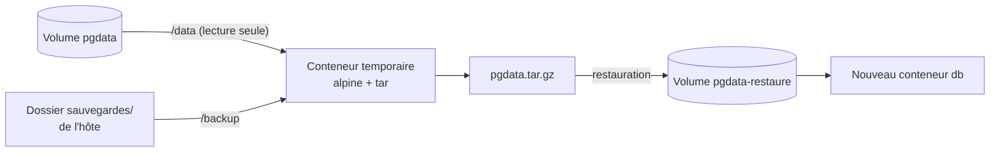

# Lab 5.2 : Sauvegarder et restaurer un volume

| | |
|---|---|
| **Durée** | 45 min |
| **Niveau** | Semi-guidé |
| **Prérequis** | [Lab 5.1 : Persister des données](lab-5-1-persister-des-donnees.md) (volume `pgdata`), section 7 du [cours](cours.md) |
| **Acquis visés** | AA4 |

!!! abstract "Objectifs"
    - Sauvegarder le contenu d'un volume dans une archive stockée sur l'hôte
    - Simuler la perte d'un volume
    - Restaurer l'archive dans un nouveau volume et vérifier l'intégrité des données
    - Comparer avec une sauvegarde propre à la base de données

## Contexte et schéma

Vous sauvegardez les données de la base PostgreSQL du Lab 5.1 sans connaître l'emplacement du volume sur l'hôte : un **conteneur temporaire** monte le volume d'un côté et un dossier de l'hôte de l'autre.



!!! note "Selon votre option"
    Sous PowerShell, écrivez les commandes sur une seule ligne, remplacez `$(pwd)` par `${PWD}` et utilisez `curl.exe` si besoin.

## Étapes

### Étape 1 : Préparer des données à sauvegarder

- **Objectif :** disposer d'une base avec quelques lignes, stockée dans le volume `pgdata`.
- **Indices :**
    - Si le conteneur `db` et le volume `pgdata` du Lab 5.1 n'existent plus, recréez-les : volume `pgdata` monté sur `/var/lib/postgresql/data`, mêmes variables `POSTGRES_*` que précédemment.
    - Créez la table `notes` si elle n'existe pas, puis insérez **au moins trois lignes**.
    - Notez le nombre de lignes avec :

```bash
docker exec db psql -U etudiant -d cours -c "SELECT count(*) FROM notes;"
```

!!! success "Point de contrôle"
    - [ ] `docker volume ls` affiche `pgdata`
    - [ ] La table `notes` contient au moins trois lignes, dont vous avez noté le nombre

### Étape 2 : Arrêter la base avant la sauvegarde

- **Objectif :** obtenir une sauvegarde cohérente.
- **Indices :** archiver les fichiers d'une base pendant qu'elle écrit peut donner une copie incohérente (voir le [cours](cours.md), section 7). Arrêtez le conteneur `db` avec `docker stop db` : le volume, lui, est conservé.

!!! success "Point de contrôle"
    - [ ] `docker ps -a` affiche `db` à l'état `Exited`

### Étape 3 : Sauvegarder le volume dans une archive

- **Objectif :** produire un fichier `pgdata.tar.gz` dans un dossier `sauvegardes` de votre machine.
- **Indices :** créez d'abord le dossier sur l'hôte (`mkdir sauvegardes`), puis lancez un conteneur temporaire (`--rm`) qui monte le volume sur `/data` **en lecture seule** et le dossier sur `/backup` :

=== "Options B et C"

    ```bash
    mkdir sauvegardes
    docker run --rm -v pgdata:/data:ro -v "$(pwd)/sauvegardes:/backup" alpine:3.20 tar czf /backup/pgdata.tar.gz -C /data .
    ```

=== "Option A (PowerShell)"

    ```powershell
    mkdir sauvegardes
    docker run --rm -v pgdata:/data:ro -v "${PWD}/sauvegardes:/backup" alpine:3.20 tar czf /backup/pgdata.tar.gz -C /data .
    ```

| Élément | Rôle |
|---|---|
| `-v pgdata:/data:ro` | Monte le volume à sauvegarder, en lecture seule |
| `-v ".../sauvegardes:/backup"` | Monte le dossier de l'hôte qui recevra l'archive |
| `tar czf /backup/pgdata.tar.gz` | Crée (`c`) une archive compressée (`z`) dans le fichier (`f`) indiqué |
| `-C /data .` | Se place dans `/data` et archive tout son contenu |

Vérifiez l'archive : sa présence sur l'hôte, puis son contenu.

```bash
docker run --rm -v "$(pwd)/sauvegardes:/backup" alpine:3.20 tar tzf /backup/pgdata.tar.gz
```

(`t` liste le contenu d'une archive.)

!!! success "Point de contrôle"
    - [ ] Le fichier `pgdata.tar.gz` existe dans `sauvegardes` et n'est pas vide
    - [ ] La liste du contenu montre les fichiers de la base (dossiers `base`, `global`…)
    - [ ] Le conteneur temporaire a disparu (`docker ps -a`)

### Étape 4 : Simuler la perte du volume

- **Objectif :** détruire les données d'origine pour prouver que la sauvegarde suffit.
- **Indices :**
    - Supprimez le conteneur `db`, puis le volume `pgdata`.
    - Vérifiez avec `docker volume ls` qu'il a disparu.

!!! warning "Avant de continuer"
    Vérifiez que `pgdata.tar.gz` existe et n'est pas vide. Après cette étape, l'archive est la **seule** copie de vos données.

!!! success "Point de contrôle"
    - [ ] Le volume `pgdata` n'existe plus
    - [ ] L'archive est toujours dans `sauvegardes`

### Étape 5 : Restaurer dans un nouveau volume

- **Objectif :** recréer les données dans un volume neuf `pgdata-restaure`.
- **Indices :** créez le volume, puis lancez un conteneur temporaire qui le monte sur `/data` (en écriture) et monte `sauvegardes` sur `/backup`. La commande de décompression est `tar xzf` (`x` : extraire) avec l'option `-C /data` :

=== "Options B et C"

    ```bash
    docker volume create pgdata-restaure
    docker run --rm -v pgdata-restaure:/data -v "$(pwd)/sauvegardes:/backup" alpine:3.20 tar xzf /backup/pgdata.tar.gz -C /data
    ```

=== "Option A (PowerShell)"

    ```powershell
    docker volume create pgdata-restaure
    docker run --rm -v pgdata-restaure:/data -v "${PWD}/sauvegardes:/backup" alpine:3.20 tar xzf /backup/pgdata.tar.gz -C /data
    ```

Lancez ensuite un **nouveau** conteneur `db` à partir de `postgres:16-alpine`, avec les mêmes variables `POSTGRES_*` et le volume `pgdata-restaure` monté sur `/var/lib/postgresql/data`.

!!! success "Point de contrôle"
    - [ ] Les journaux de `db` indiquent que la base est prête à accepter des connexions
    - [ ] Les journaux ne montrent **pas** d'initialisation d'une base neuve (la base existante est reprise)

### Étape 6 : Vérifier l'intégrité des données

- **Objectif :** prouver que les données restaurées sont identiques aux données d'origine.
- **Indices :** interrogez la table `notes` et comparez avec le nombre de lignes noté à l'étape 1 :

```bash
docker exec db psql -U etudiant -d cours -c "SELECT count(*) FROM notes;"
docker exec db psql -U etudiant -d cours -c "SELECT * FROM notes;"
```

!!! success "Point de contrôle"
    - [ ] Le nombre de lignes est identique à celui de l'étape 1
    - [ ] Le contenu des lignes est celui que vous aviez inséré

### Étape 7 (facultative, options B et C) : Sauvegarde propre à la base

- **Objectif :** comparer avec l'outil de sauvegarde de PostgreSQL, qui ne nécessite pas d'arrêter la base.
- **Indices :** `pg_dump` produit un fichier de commandes SQL. Redirigez sa sortie vers un fichier de l'hôte, puis observez les premières lignes :

```bash
docker exec db pg_dump -U etudiant cours > sauvegardes/cours.sql
head -n 20 sauvegardes/cours.sql
```

!!! success "Point de contrôle"
    - [ ] `cours.sql` contient des instructions SQL, dont la création de la table `notes`
    - [ ] Vous savez expliquer l'avantage de cette méthode sur l'archive du volume

## Questions de réflexion

??? question "Pourquoi le volume est-il monté en lecture seule (`:ro`) lors de la sauvegarde ?"
    Pour que le conteneur temporaire ne puisse pas modifier les données qu'il archive : une erreur de commande ne peut pas altérer le volume d'origine.

??? question "Pourquoi arrête-t-on la base avant d'archiver son volume ?"
    Une base écrit en permanence dans ses fichiers. Archiver pendant une écriture peut produire une copie incohérente, inutilisable à la restauration. Arrêtée, la base laisse des fichiers cohérents.

??? question "Quel est l'avantage de `pg_dump` sur l'archive du volume ?"
    `pg_dump` passe par la base elle-même : la sauvegarde est cohérente sans arrêter le service, et indépendante de la version et de l'organisation interne des fichiers.

## Dépannage

| Symptôme | Pistes |
|---|---|
| `tar: can't open ... Permission denied` | Vérifiez les chemins `/data` et `/backup` et que le dossier `sauvegardes` existe sur l'hôte |
| L'archive est vide ou très petite | Le volume est vide ou mal nommé : vérifiez avec `docker volume ls` et l'étape 1 |
| Docker signale un chemin invalide | Le chemin de l'hôte doit être absolu ; sous PowerShell, utilisez `${PWD}` |
| `database files are incompatible` ou la base ne démarre pas | Version de l'image différente de celle d'origine, ou archive faite pendant que la base tournait : refaites la sauvegarde base arrêtée, avec la même image |
| `password authentication failed` | La restauration conserve le mot de passe d'origine : utilisez-le (les variables `POSTGRES_*` sont ignorées si la base existe déjà) |
| `volume is in use` en le supprimant | Un conteneur l'utilise encore : `docker rm -f` du conteneur, puis `docker volume rm` |
| `cours.sql` est vide ou corrompu sous PowerShell | La redirection `>` de PowerShell modifie l'encodage : faites cette étape sous Linux |

## Nettoyage et reprise

```bash
docker rm -f db
docker volume rm pgdata-restaure
```

Supprimez le volume `pgdata` s'il existe encore, et le dossier `sauvegardes` si vous n'en avez plus besoin.

## Retour au chapitre

[Chapitre 5 : Volumes et persistance](cours.md) · Quiz : [Quiz du chapitre 5](quiz.md)