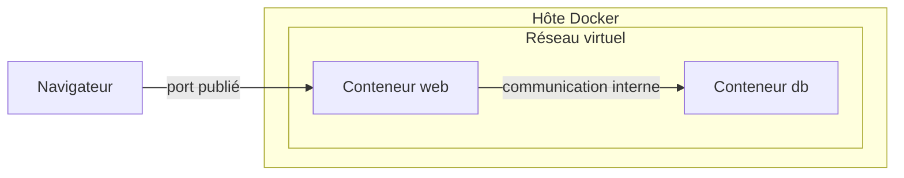
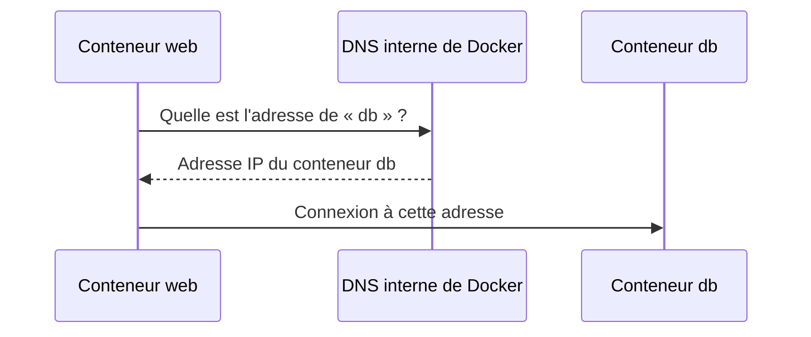
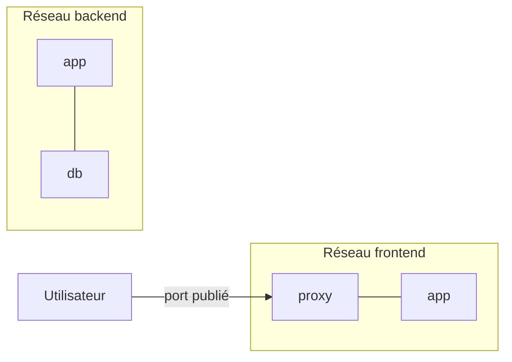

# Chapitre 6 : Réseau Docker

!!! abstract "Objectifs du chapitre"
    - Expliquer comment un conteneur est relié au réseau de l'hôte et aux autres conteneurs
    - Distinguer le réseau bridge par défaut, les réseaux définis par l'utilisateur et les modes `host` et `none`
    - Faire communiquer des conteneurs par leur **nom** grâce au DNS interne de Docker
    - Publier un port, en maîtrisant l'interface d'écoute
    - Cloisonner une application en plusieurs réseaux
    - Acquis d'apprentissage visé : **AA4**

## 1. Pourquoi un réseau pour les conteneurs ?

Jusqu'ici, vous avez joint vos conteneurs depuis l'hôte grâce à l'option `-p` (chapitre 2). Mais une application réelle comporte plusieurs conteneurs qui doivent se parler : une application web et sa base de données, par exemple. Deux questions se posent :

- Comment un conteneur **trouve-t-il** un autre conteneur ?
- Qui a le droit de **joindre** quoi ?

Docker répond par des **réseaux virtuels** : chaque conteneur est branché sur un ou plusieurs réseaux, et ne communique directement qu'avec les conteneurs du même réseau.



## 2. Les pilotes réseau

Un réseau Docker est créé avec un **pilote** (driver) qui détermine son fonctionnement. La commande `docker network ls` liste les réseaux de votre machine.

| Pilote | Principe | Usage |
|---|---|---|
| `bridge` | Réseau privé à l'intérieur de l'hôte, avec sa propre plage d'adresses | Cas général sur une seule machine |
| `host` | Le conteneur partage directement le réseau de l'hôte, sans isolation réseau | Cas particuliers (performances, ports nombreux) |
| `none` | Aucune interface réseau (hormis l'interface locale du conteneur) | Conteneur totalement isolé |

!!! note "Autres pilotes"
    Le pilote `overlay`, qui relie des conteneurs répartis sur plusieurs machines, est étudié avec Swarm au chapitre 11.

Sur une installation neuve, `docker network ls` affiche trois réseaux : `bridge`, `host` et `none`. Le premier est le **réseau bridge par défaut** : tout conteneur lancé sans option `--network` y est branché.

## 3. Le réseau bridge par défaut

Les conteneurs du réseau bridge par défaut reçoivent une adresse IP privée et peuvent se joindre **par adresse IP**. Mais ils ne peuvent **pas** se joindre par leur nom : ce réseau n'offre pas de résolution de noms entre conteneurs.

Or les adresses IP sont attribuées par Docker et changent quand un conteneur est recréé : on ne peut pas s'y fier dans une application. C'est pourquoi on utilise, dans la pratique, des réseaux **définis par l'utilisateur**.

## 4. Les réseaux bridge définis par l'utilisateur

Vous créez un réseau avec `docker network create`, puis vous y branchez vos conteneurs avec l'option `--network`.

### 4.1 Commandes de gestion

| Commande | Rôle |
|---|---|
| `docker network create reseau-app` | Crée un réseau bridge nommé `reseau-app` |
| `docker network ls` | Liste les réseaux |
| `docker network inspect reseau-app` | Affiche les détails : plage d'adresses, conteneurs connectés |
| `docker run --network reseau-app ...` | Lance un conteneur directement sur ce réseau |
| `docker network connect reseau-app conteneur` | Branche un conteneur existant sur le réseau |
| `docker network disconnect reseau-app conteneur` | Le débranche |
| `docker network rm reseau-app` | Supprime un réseau (aucun conteneur ne doit y être connecté) |

### 4.2 Le DNS interne

Sur un réseau défini par l'utilisateur, Docker fournit un **serveur DNS intégré** : chaque conteneur peut joindre les autres **par leur nom**. Le nom d'un conteneur est celui donné par `--name`.

```bash
docker network create reseau-app
docker run -d --name db --network reseau-app -e POSTGRES_PASSWORD=motdepasse-tp postgres:16-alpine
docker run -d --name web --network reseau-app nginx:1.27-alpine
```

Depuis `web`, le nom `db` est résolu vers l'adresse IP actuelle du conteneur `db`, même si cette adresse change plus tard.



Pour donner un **nom supplémentaire** à un conteneur, utilisez l'option `--network-alias` au lancement : le conteneur répond alors aussi à ce nom sur ce réseau.

### 4.3 Comparaison avec le réseau par défaut

| | Bridge par défaut | Bridge défini par l'utilisateur |
|---|---|---|
| Résolution des noms entre conteneurs | Non | **Oui** |
| Branchement ou débranchement à chaud d'un conteneur | Non | **Oui** (`connect`, `disconnect`) |
| Isolation entre applications | Tous les conteneurs mélangés | **Un réseau par application** possible |

!!! tip "Règle pratique"
    Pour toute application de plus d'un conteneur, créez un réseau dédié. N'utilisez pas le réseau bridge par défaut.

## 5. Publier des ports

Les conteneurs d'un réseau bridge ne sont pas joignables depuis l'extérieur de l'hôte. Pour exposer un service, on **publie** un port avec `-p`. Vous l'avez déjà fait ; voici le détail des formes possibles.

| Forme | Effet |
|---|---|
| `-p 8080:80` | Le port 8080 de l'hôte, sur **toutes** ses interfaces, est relié au port 80 du conteneur |
| `-p 127.0.0.1:8080:80` | Idem, mais accessible **uniquement depuis l'hôte lui-même** |
| `-p 80` | Docker choisit un port libre de l'hôte pour le port 80 du conteneur |
| `-P` | Publie sur des ports choisis par Docker les ports déclarés par l'image (instruction `EXPOSE`) |

La commande `docker port conteneur` affiche les correspondances d'un conteneur.


!!! warning "Publier, c'est exposer"
    Avec `-p 8080:80`, le service est accessible depuis **n'importe quelle machine** qui atteint votre hôte. Pour un service destiné seulement à l'hôte (une base de données consultée en local, un outil d'administration), écrivez `-p 127.0.0.1:...`. Pour un service qui n'a besoin d'être joint que par d'autres conteneurs, **ne publiez rien**.

### 5.1 Publier ou non : le cas de la base de données

Un conteneur qui répond à d'autres conteneurs du **même réseau** n'a pas besoin de port publié : ces conteneurs le joignent directement sur son port interne. Dans l'exemple de la section 4.2, `web` peut joindre `db` sur le port 5432 sans que `db` publie quoi que ce soit.

| Communication | Port publié nécessaire ? | Port à utiliser |
|---|---|---|
| Hôte ou machine extérieure vers un conteneur | **Oui** | Le port **de l'hôte** |
| Conteneur vers conteneur, sur le même réseau | **Non** | Le port **du conteneur** |

## 6. Les modes `host` et `none`

### 6.1 Mode `host`

Avec `--network host`, le conteneur n'a plus son propre réseau : il utilise directement les interfaces et les ports de l'hôte. Il n'y a plus de traduction de ports, et l'option `-p` n'a pas de sens.

```bash
docker run -d --name web-host --network host nginx:1.27-alpine
```

Le serveur est alors joignable sur le port 80 de l'hôte, sans publication.

| Avantage | Limite |
|---|---|
| Pas de traduction de ports | **Aucune isolation réseau** : le conteneur voit le réseau de l'hôte |
| | Conflit de ports possible avec l'hôte ou avec d'autres conteneurs |

!!! warning "Selon votre option"
    Le mode `host` est conçu pour Linux (options B et C). Avec Docker Desktop (option A), le comportement diffère car Docker s'exécute dans une machine virtuelle : la fonction est soumise à des conditions et peut ne pas se comporter comme sous Linux. Réalisez les manipulations sur ce mode sous Linux.

### 6.2 Mode `none`

Avec `--network none`, le conteneur n'a **aucun accès réseau** : ni Internet, ni autre conteneur. Il convient aux traitements qui n'ont pas besoin du réseau (calcul sur des fichiers montés, par exemple) et qui doivent en être coupés pour des raisons de sécurité.

```bash
docker run --rm --network none alpine:3.20 ip addr
```

Seule l'interface locale (`lo`) apparaît.

## 7. Cloisonner une application avec plusieurs réseaux

Un conteneur peut être branché sur **plusieurs réseaux**. On s'en sert pour appliquer le principe du moindre accès : chaque conteneur ne voit que ce dont il a besoin.

Exemple d'une application en trois niveaux :



- `proxy` est sur le réseau `frontend` uniquement : il joint `app`, mais **ne peut pas** joindre `db`.
- `app` est sur les **deux** réseaux : elle sert de passerelle.
- `db` est sur le réseau `backend` uniquement : seule `app` peut la joindre, et rien n'est publié.

Pour brancher un conteneur sur un second réseau, on lance le conteneur avec un premier `--network`, puis on ajoute l'autre avec `docker network connect`.

### 7.1 Réseau interne

L'option `--internal` à la création d'un réseau (`docker network create --internal backend`) coupe ce réseau du monde extérieur : les conteneurs qui y sont branchés communiquent entre eux, mais **n'ont pas d'accès à Internet** et leurs ports ne peuvent pas être publiés vers l'extérieur. C'est un bon choix pour un réseau qui ne porte que des bases de données.

## 8. Diagnostiquer un problème réseau

Quand deux conteneurs ne se joignent pas, procédez dans l'ordre :

| Vérification | Commande |
|---|---|
| Les deux conteneurs sont-ils sur le **même réseau** ? | `docker network inspect reseau-app` |
| Le nom est-il résolu ? | Depuis un conteneur du réseau : `ping nom` ou `nslookup nom` (selon les outils de l'image) |
| Le service écoute-t-il sur le bon port ? | `docker logs conteneur` |
| Le bon **port** est-il utilisé (port du conteneur entre conteneurs, port de l'hôte depuis l'extérieur) ? | `docker port conteneur` |
| Le service écoute-t-il sur toutes les interfaces du conteneur, et non sur `127.0.0.1` seulement ? | Documentation de l'application |

!!! note "Outils absents des images minimales"
    Beaucoup d'images n'incluent pas `ping` ni `curl`. Pour tester, lancez un conteneur de diagnostic sur le même réseau, par exemple à partir de `alpine:3.20`, plutôt que d'installer des outils dans le conteneur de l'application. Vous le ferez au [Lab 6.1](lab-6-1-reseaux-et-resolution-dns.md).

!!! warning "Application qui n'écoute que sur `127.0.0.1`"
    Une application qui n'écoute que sur l'adresse locale `127.0.0.1` n'est joignable que depuis **son propre conteneur** : le port publié ne fonctionne pas. Elle doit écouter sur `0.0.0.0`. Vous avez rencontré ce cas avec Flask au chapitre 3.

## 9. Choisir le bon réseau

| Besoin | Choix |
|---|---|
| Faire communiquer plusieurs conteneurs d'une application | **Réseau bridge défini par l'utilisateur**, un par application |
| Exposer un service à l'extérieur | Port publié avec `-p`, sur la bonne interface |
| Service interne (base de données) | Aucun port publié, réseau dédié ou `--internal` |
| Séparer des niveaux (web, application, données) | **Plusieurs réseaux**, passerelle par le conteneur intermédiaire |
| Conteneur qui ne doit rien joindre | `--network none` |
| Cas particulier de performance, sous Linux | `--network host` (en connaissant ses limites) |

!!! tip "À retenir"
    - Un réseau bridge **défini par l'utilisateur** offre la résolution des noms ; le réseau par défaut ne l'offre pas.
    - Entre conteneurs d'un même réseau, on utilise le **nom** et le **port du conteneur** ; aucun port n'a besoin d'être publié.
    - `-p hôte:conteneur` expose sur toutes les interfaces ; `-p 127.0.0.1:...` limite à l'hôte.
    - `--network host` supprime l'isolation réseau ; `--network none` supprime tout accès réseau.
    - On cloisonne une application avec **plusieurs réseaux** ; un réseau `--internal` n'a pas d'accès extérieur.
    - Pour diagnostiquer : même réseau ? nom résolu ? bon port ? service à l'écoute sur `0.0.0.0` ?

## Pour vérifier votre compréhension

??? question "Pourquoi le conteneur `web` ne parvient-il pas à joindre `db` par son nom sur le réseau bridge par défaut ?"
    Le réseau bridge par défaut n'offre pas de résolution de noms entre conteneurs. Il faut créer un réseau défini par l'utilisateur, y brancher les deux conteneurs, et utiliser le nom du conteneur.

??? question "Une application web doit joindre sa base de données sur le même réseau. Faut-il publier le port de la base ?"
    Non. Entre conteneurs d'un même réseau, la base est jointe directement sur son port interne (par exemple 5432). Publier le port ne servirait qu'à l'exposer inutilement à l'hôte et à l'extérieur.

??? question "Quelle est la différence entre `-p 8080:80` et `-p 127.0.0.1:8080:80` ?"
    Avec la première forme, le port est accessible depuis toute machine qui atteint l'hôte. Avec la seconde, il n'est accessible que depuis l'hôte lui-même.

??? question "Dans l'architecture en trois niveaux de la section 7, pourquoi le proxy ne peut-il pas joindre la base de données ?"
    Ils ne partagent aucun réseau : le proxy est sur `frontend`, la base sur `backend`. Seule l'application, branchée sur les deux, peut communiquer avec les deux.

## Ressources du chapitre

- [Lab 6.1 : Réseaux et résolution DNS](lab-6-1-reseaux-et-resolution-dns.md)
- [Lab 6.2 : Isoler une application par réseaux](lab-6-2-isoler-une-application-par-reseaux.md)
- [Quiz du chapitre](quiz.md)