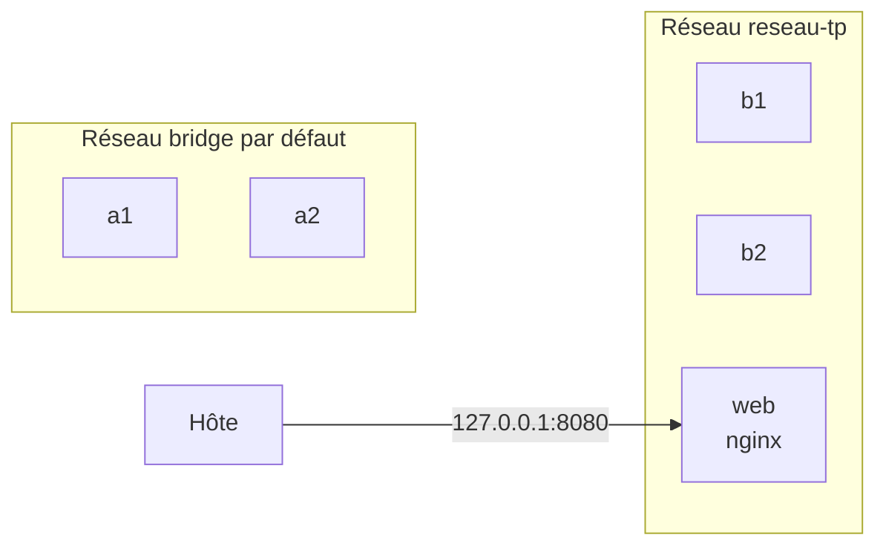

# Lab 6.1 : Réseaux et résolution DNS

| | |
|---|---|
| **Durée** | 60 min |
| **Niveau** | Semi-guidé |
| **Prérequis** | [Lab 5.2 : Sauvegarder et restaurer un volume](../ch05-volumes-et-persistance/lab-5-2-sauvegarder-et-restaurer-un-volume.md), cours du [chapitre 6](cours.md) |
| **Acquis visés** | AA4 |

!!! abstract "Objectifs"
    - Constater que le réseau bridge par défaut ne résout pas les noms
    - Créer un réseau défini par l'utilisateur et joindre un conteneur par son nom
    - Distinguer le port d'un conteneur et le port publié sur l'hôte
    - Brancher et débrancher un conteneur à chaud, et lui donner un alias
    - Observer le mode `none` (et le mode `host` sous Linux)

## Contexte et schéma

Vous lancez de petits conteneurs `alpine` pour tester la communication, puis un serveur `nginx`. Dans ce lab, seules les **commandes clés** vous sont données : à vous de les adapter et de déduire le reste à l'aide du [cours](cours.md).



!!! note "Selon votre option"
    - Sous PowerShell, utilisez `curl.exe` et écrivez les commandes sur une seule ligne.
    - Le mode `host` (étape 7) se manipule sous Linux (options B et C) uniquement.

## Étapes

### Étape 1 : Observer les réseaux existants

- **Objectif :** connaître les réseaux présents sur votre machine.
- **Indices :**
    - `docker network ls` : repérez les trois réseaux créés par Docker et leur pilote.
    - `docker network inspect bridge` : repérez la plage d'adresses (champ `Subnet`) et la liste des conteneurs connectés (vide, si vous n'avez aucun conteneur en cours).

!!! success "Point de contrôle"
    - [ ] Vous avez relevé les réseaux `bridge`, `host` et `none` et leur pilote
    - [ ] Vous avez relevé le `Subnet` du réseau `bridge`

### Étape 2 : Tester le réseau bridge par défaut

- **Objectif :** montrer que, sur le réseau par défaut, on joint un conteneur par son adresse IP mais pas par son nom.
- **Indices :**
    - Lancez deux conteneurs `a1` et `a2` (`alpine:3.20`, commande `sleep 3600`), **sans** option `--network`.
    - Relevez l'adresse IP de `a2` :

```bash
docker inspect -f '{{range .NetworkSettings.Networks}}{{.IPAddress}}{{end}}' a2
```

- Depuis `a1`, testez la communication avec `docker exec a1 ping -c 2 <adresse-de-a2>`, puis avec `docker exec a1 ping -c 2 a2`.

!!! success "Point de contrôle"
    - [ ] Le `ping` par adresse IP réussit
    - [ ] Le `ping` par nom échoue (nom non résolu)

### Étape 3 : Créer un réseau défini par l'utilisateur

- **Objectif :** obtenir la résolution des noms.
- **Indices :**
    - Créez le réseau `reseau-tp` avec `docker network create`.
    - Lancez deux conteneurs `b1` et `b2` (`alpine:3.20`, `sleep 3600`) **sur ce réseau** avec l'option `--network`.
    - Depuis `b1`, testez `ping -c 2 b2` puis `nslookup b2`.
    - Comparez l'adresse obtenue avec celle affichée par `docker network inspect reseau-tp`.

!!! success "Point de contrôle"
    - [ ] `ping b2` depuis `b1` réussit par nom
    - [ ] L'adresse résolue correspond à celle de `b2` dans `docker network inspect`
    - [ ] Depuis `a1` (réseau par défaut), le nom `b2` n'est toujours pas résolu : les deux réseaux sont **séparés**

!!! info "Le serveur DNS"
    Dans un conteneur d'un réseau défini par l'utilisateur, `docker exec b1 cat /etc/resolv.conf` montre l'adresse du serveur DNS intégré de Docker (une adresse locale du conteneur). C'est lui qui répond aux demandes de noms.

### Étape 4 : Distinguer port du conteneur et port publié

- **Objectif :** comprendre quel port utiliser selon d'où l'on s'adresse au service.
- **Indices :**
    - Lancez un conteneur `web` (`nginx:1.27-alpine`) sur `reseau-tp`, avec le port 8080 de l'hôte relié au port 80 du conteneur, **accessible uniquement depuis l'hôte** (voir la section 5 du [cours](cours.md)).
    - Depuis l'hôte : `curl http://localhost:8080`.
    - Depuis `b1`, testez les deux adresses ci-dessous. L'image `alpine` fournit `wget` :

```bash
docker exec b1 wget -qO- http://web
docker exec b1 wget -qO- -T 3 http://web:8080
```

- Affichez les ports publiés avec `docker port web`.

!!! success "Point de contrôle"
    - [ ] `curl http://localhost:8080` affiche la page d'accueil de nginx
    - [ ] Depuis `b1`, `http://web` (port du conteneur, sans publication) fonctionne
    - [ ] Depuis `b1`, `http://web:8080` échoue : le port 8080 n'existe que sur l'hôte
    - [ ] Vous savez expliquer pourquoi, dans les deux cas, l'un des ports est « le bon »

### Étape 5 : Brancher, débrancher et donner un alias

- **Objectif :** modifier les réseaux d'un conteneur sans le recréer.
- **Indices :**
    - Branchez `a1` (réseau par défaut) sur `reseau-tp` avec `docker network connect`.
    - Depuis `a1`, joignez maintenant `b2` et `web` par leur nom.
    - Vérifiez avec `docker inspect` que `a1` est sur **deux** réseaux.
    - Débranchez `a1` de `reseau-tp` avec `docker network disconnect` et refaites le test.
    - Lancez un conteneur `b3` sur `reseau-tp` avec en plus l'option `--network-alias serveur`, puis joignez `b3` depuis `b1` en utilisant le nom `serveur`.

!!! success "Point de contrôle"
    - [ ] Après `connect`, `a1` joint `b2` et `web` par leur nom
    - [ ] Après `disconnect`, `a1` ne les joint plus
    - [ ] `b1` joint `b3` par le nom `b3` **et** par l'alias `serveur`

### Étape 6 : Observer le mode `none`

- **Objectif :** constater l'absence totale de réseau.
- **Indices :**
    - Lancez un conteneur temporaire (`--rm`, `alpine:3.20`) avec `--network none` qui exécute `ip addr`, puis un autre qui exécute `ping -c 2 8.8.8.8`.

!!! success "Point de contrôle"
    - [ ] Seule l'interface `lo` apparaît
    - [ ] Le `ping` échoue (aucun accès réseau)

### Étape 7 (facultative, options B et C) : Observer le mode `host`

- **Objectif :** voir un conteneur partager le réseau de l'hôte.
- **Indices :**
    - Lancez un conteneur `web-host` (`nginx:1.27-alpine`) avec `--network host`, **sans** option `-p`.
    - Depuis l'hôte : `curl http://localhost:80` (si le port 80 est déjà utilisé sur votre machine, observez l'erreur dans `docker logs web-host`).
    - Comparez `docker exec web-host ip addr` avec l'affichage de `ip addr` sur l'hôte.

!!! success "Point de contrôle"
    - [ ] Le serveur répond sur le port 80 de l'hôte sans publication
    - [ ] Les interfaces vues dans le conteneur sont celles de l'hôte

## Questions de réflexion

??? question "Pourquoi `a1` ne parvient-il pas à joindre `a2` par son nom, alors que `b1` joint `b2` ?"
    `a1` et `a2` sont sur le réseau bridge par défaut, qui n'offre pas de résolution de noms. `b1` et `b2` sont sur un réseau défini par l'utilisateur, qui fournit un DNS intégré.

??? question "À l'étape 4, pourquoi `http://web:8080` échoue-t-il depuis `b1` ?"
    Entre conteneurs d'un même réseau, on utilise le port **du conteneur** (80). Le port 8080 est un port de l'**hôte** : il n'existe pas sur l'adresse du conteneur `web`.

??? question "Pourquoi publier avec `127.0.0.1:8080:80` plutôt que `8080:80` ?"
    Pour que le service ne soit accessible que depuis l'hôte, et non depuis les autres machines du réseau. Moins un service est exposé, mieux c'est.

??? question "Quel intérêt présente le mode `none` ?"
    Il coupe totalement le conteneur du réseau, ce qui convient aux traitements qui n'en ont pas besoin et qui ne doivent pas pouvoir communiquer.

## Dépannage

| Symptôme | Pistes |
|---|---|
| `ping: bad address 'b2'` sur `reseau-tp` | Les deux conteneurs sont-ils bien sur `reseau-tp` ? Vérifiez avec `docker network inspect reseau-tp` |
| `port is already allocated` | Le port 8080 est déjà utilisé : choisissez un autre port de l'hôte, ou arrêtez le conteneur qui l'utilise |
| `curl` ne répond pas sur `localhost:8080` | Vérifiez `docker ps` et `docker port web` ; le conteneur `web` est-il bien lancé ? |
| `network ... has active endpoints` en supprimant un réseau | Des conteneurs y sont encore connectés : supprimez-les ou débranchez-les d'abord |
| `network with name reseau-tp already exists` | Le réseau existe déjà : réutilisez-le, ou supprimez-le avec `docker network rm` |
| `wget: bad address` ou `wget: download timed out` | Voulu à l'étape 4 pour `web:8080` ; sinon, vérifiez le réseau et le nom du conteneur |
| Sous PowerShell, l'option `-f` de `docker inspect` est refusée | Écrivez la commande sur une seule ligne, avec le modèle entre apostrophes |

## Nettoyage et reprise

```bash
docker rm -f a1 a2 b1 b2 b3 web web-host
docker network rm reseau-tp
```

(Si `web-host` n'a pas été créé, Docker le signale : sans conséquence.) Les réseaux `bridge`, `host` et `none` sont créés par Docker et ne se suppriment pas. Le [Lab 6.2](lab-6-2-isoler-une-application-par-reseaux.md) repart de zéro.

## Retour au chapitre

[Chapitre 6 : Réseau Docker](cours.md) · Lab suivant : [Lab 6.2 : Isoler une application par réseaux](lab-6-2-isoler-une-application-par-reseaux.md)