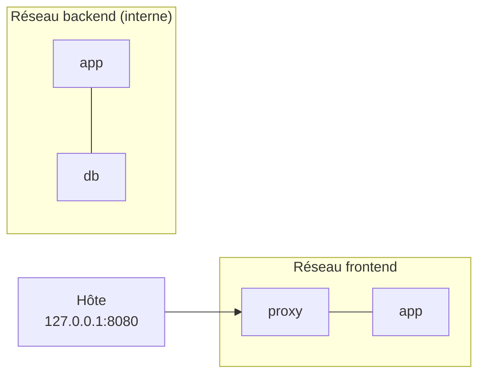

# Lab 6.2 : Isoler une application par réseaux

| | |
|---|---|
| **Durée** | 60 min |
| **Niveau** | Semi-guidé |
| **Prérequis** | [Lab 6.1 : Réseaux et résolution DNS](lab-6-1-reseaux-et-resolution-dns.md), sections 5 à 7 du [cours](cours.md) |
| **Acquis visés** | AA4 |

!!! abstract "Objectifs"
    - Construire une architecture en trois niveaux cloisonnée par deux réseaux
    - Vérifier qu'un niveau ne peut pas joindre un autre niveau non adjacent
    - Ne publier que le point d'entrée de l'application
    - Couper le réseau des données du monde extérieur avec `--internal`

## Contexte et schéma

Vous mettez en place le cloisonnement décrit à la section 7 du cours. Trois conteneurs jouent les trois rôles :

| Conteneur | Rôle | Image | Réseaux visés |
|---|---|---|---|
| `proxy` | Point d'entrée | `nginx:1.27-alpine` | `frontend` |
| `app` | Passerelle entre les niveaux | `postgres:16-alpine`, lancée avec `sleep 3600` | `frontend` et `backend` |
| `db` | Base de données | `postgres:16-alpine` | `backend` |

!!! note "Pourquoi `app` utilise-t-elle l'image PostgreSQL ?"
    Ce lab porte sur le réseau, pas sur le code. L'image `postgres` fournit l'outil client `pg_isready`, qui permet à `app` de vérifier qu'elle joint bien la base. Le conteneur `app` ne sert donc à rien d'autre qu'à tester la communication.



!!! note "Selon votre option"
    Sous PowerShell, utilisez `curl.exe` et écrivez les commandes sur une seule ligne.

## Étapes

### Étape 1 : Créer les deux réseaux

- **Objectif :** disposer d'un réseau pour chaque niveau.
- **Indices :**
    - Créez le réseau `frontend` (réseau bridge ordinaire).
    - Créez le réseau `backend` avec l'option qui le rend **interne** (section 7.1 du [cours](cours.md)).
    - Relevez avec `docker network inspect backend` le champ `Internal`.

!!! success "Point de contrôle"
    - [ ] `docker network ls` affiche `frontend` et `backend`
    - [ ] `docker network inspect backend` indique `"Internal": true`

### Étape 2 : Lancer la base de données

- **Objectif :** placer `db` sur le réseau `backend` uniquement, sans publier de port.
- **Indices :**
    - Image `postgres:16-alpine`, variables `POSTGRES_USER=etudiant`, `POSTGRES_PASSWORD=motdepasse-tp` et `POSTGRES_DB=cours` (comme au [Lab 5.1](../ch05-volumes-et-persistance/lab-5-1-persister-des-donnees.md)).
    - Utilisez un volume nommé `pgdata-reseau` pour les données, afin de ne pas créer de volume anonyme.
    - Aucune option `-p`.

!!! success "Point de contrôle"
    - [ ] Les journaux de `db` indiquent que la base est prête
    - [ ] La colonne `PORTS` de `docker ps` n'affiche aucune publication pour `db` (seulement `5432/tcp`, port déclaré par l'image)

### Étape 3 : Lancer `app` sur les deux réseaux

- **Objectif :** faire d'`app` la passerelle entre `frontend` et `backend`.
- **Indices :**
    - Lancez `app` (`postgres:16-alpine`, commande `sleep 3600`) avec un premier `--network backend`.
    - Ajoutez ensuite le réseau `frontend` avec `docker network connect`.
    - Contrôlez avec `docker inspect app` qu'elle figure sur les deux réseaux.
    - Testez la base depuis `app` :

```bash
docker exec app pg_isready -h db -U etudiant
```

!!! success "Point de contrôle"
    - [ ] `app` est branchée sur `backend` et sur `frontend`
    - [ ] `pg_isready` répond que `db` accepte les connexions (le nom `db` est résolu)

### Étape 4 : Lancer le proxy

- **Objectif :** exposer uniquement le point d'entrée, et seulement à l'hôte.
- **Indices :**
    - Lancez `proxy` (`nginx:1.27-alpine`) sur `frontend`, avec le port 8080 de l'hôte relié au port 80 du conteneur, accessible **uniquement depuis l'hôte**.
    - Testez avec `curl http://localhost:8080`.

!!! success "Point de contrôle"
    - [ ] `curl` affiche la page d'accueil de nginx
    - [ ] `docker ps` montre une publication de port pour `proxy` et aucune pour `app` ni pour `db`

### Étape 5 : Vérifier le cloisonnement

- **Objectif :** prouver, par des tests, qui peut joindre qui.
- **Indices :** complétez le tableau suivant en testant chaque communication. Pour la résolution des noms, utilisez `ping -c 2 <nom>` depuis le conteneur source (`docker exec`) ; pour la base, `pg_isready`.

| Source | Cible | Résultat attendu | Résultat observé |
|---|---|---|---|
| `proxy` | `app` | À déterminer | |
| `proxy` | `db` | À déterminer | |
| `app` | `proxy` | À déterminer | |
| `app` | `db` | À déterminer | |
| `db` | `proxy` | À déterminer | |

Écrivez d'abord le résultat **attendu** d'après les réseaux de chaque conteneur, puis testez.

!!! success "Point de contrôle"
    - [ ] Chaque ligne du tableau est complétée, avec le résultat attendu **avant** le test
    - [ ] `proxy` joint `app` mais ne résout pas le nom `db`
    - [ ] `app` joint à la fois `proxy` et `db`
    - [ ] `db` ne résout pas le nom `proxy`

### Étape 6 : Vérifier l'isolement du réseau interne

- **Objectif :** constater que `db` n'a aucun accès extérieur.
- **Indices :**
    - Depuis `db`, essayez de joindre une adresse extérieure : `docker exec db ping -c 2 -W 3 8.8.8.8`.
    - Faites le même test depuis `proxy` (branché sur `frontend`, qui n'est pas interne).
    - Si votre environnement n'a pas d'accès Internet, comparez plutôt les messages d'erreur ou utilisez `docker network inspect` pour justifier la différence.

!!! success "Point de contrôle"
    - [ ] Depuis `db`, la machine extérieure n'est pas joignable
    - [ ] Depuis `proxy`, elle l'est (si votre environnement a un accès Internet)

### Étape 7 : Documenter l'architecture

- **Objectif :** produire le schéma de ce que vous avez construit.
- **Indices :** dessinez (à la main ou avec l'outil de votre choix) un schéma qui montre les trois conteneurs, les deux réseaux, le port publié et le caractère interne de `backend`. Ce schéma servira de modèle pour le [Mini-projet 2](../mini-projet-2.md).

!!! success "Point de contrôle"
    - [ ] Le schéma indique, pour chaque conteneur, ses réseaux
    - [ ] Il distingue clairement ce qui est exposé de ce qui ne l'est pas

## Questions de réflexion

??? question "Pourquoi `app` est-elle branchée sur les deux réseaux ?"
    Parce qu'elle doit communiquer avec les deux niveaux voisins : le proxy (réseau `frontend`) et la base (réseau `backend`). Elle sert de passerelle contrôlée entre eux.

??? question "Quel avantage de sécurité y a-t-il à ce que le proxy ne puisse pas joindre la base ?"
    Si le proxy, qui est le conteneur exposé, est compromis, l'attaquant ne peut pas atteindre la base de données directement : il doit d'abord compromettre `app`. On réduit la surface d'attaque.

??? question "Pourquoi n'a-t-on publié aucun port pour `db` et `app` ?"
    Aucune machine extérieure n'a besoin de les joindre : seuls des conteneurs du même réseau les utilisent, sur leurs ports internes. Chaque port publié est une exposition supplémentaire.

??? question "Que change l'option `--internal` pour `db` ?"
    Les conteneurs du réseau `backend` communiquent entre eux, mais n'ont aucun accès à l'extérieur : une base compromise ne peut pas, par exemple, envoyer des données vers Internet.

## Dépannage

| Symptôme | Pistes |
|---|---|
| `pg_isready` répond `no response` | La base démarre encore : attendez quelques secondes et relisez `docker logs db` |
| `could not translate host name "db"` ou nom non résolu depuis `app` | `app` n'est pas sur `backend` : vérifiez avec `docker inspect app` |
| `curl` ne répond pas sur `localhost:8080` | Vérifiez `docker ps`, `docker port proxy`, et que le port 8080 n'est pas déjà utilisé |
| `network ... has active endpoints` en supprimant un réseau | Supprimez d'abord les conteneurs connectés |
| `app` quitte immédiatement | La commande `sleep 3600` est-elle bien placée après le nom de l'image ? |
| Le `ping` vers l'extérieur échoue aussi depuis `proxy` | Votre environnement n'a peut-être pas d'accès Internet : voir l'étape 6 |

## Nettoyage et reprise

```bash
docker rm -f proxy app db
docker network rm frontend backend
docker volume rm pgdata-reseau
```

## Retour au chapitre

[Chapitre 6 : Réseau Docker](cours.md) · Quiz : [Quiz du chapitre 6](quiz.md)