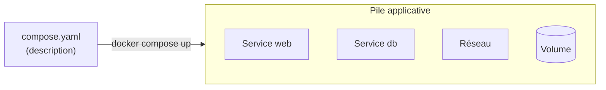
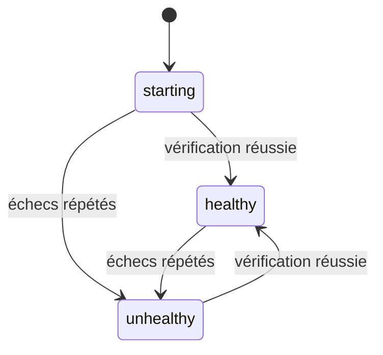
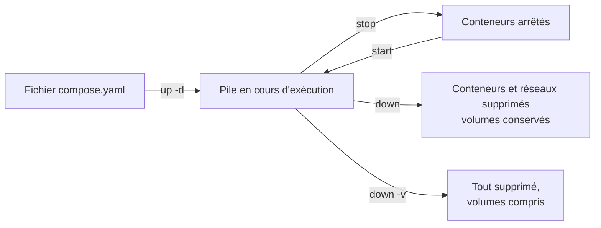

# Chapitre 7 : Docker Compose

!!! abstract "Objectifs du chapitre"
    - Expliquer ce qu'apporte Docker Compose par rapport aux commandes `docker run`
    - Décrire une application multi-conteneurs dans un fichier `compose.yaml`
    - Déclarer services, réseaux et volumes, et paramétrer l'application avec des variables et un fichier `.env`
    - Définir un healthcheck et ordonner le démarrage des services
    - Piloter le cycle de vie d'une pile avec `docker compose`
    - Acquis d'apprentissage visé : **AA5**

## 1. Pourquoi Docker Compose ?

Au chapitre 6, vous avez monté une application en trois niveaux avec une dizaine de commandes : deux réseaux, un volume, trois conteneurs, chacun avec ses options. Cette méthode pose trois problèmes :

- les commandes sont **longues** et faciles à mal recopier ;
- elles ne sont **documentées** nulle part : l'architecture n'existe que dans votre historique ;
- il faut les rejouer dans le bon ordre, et les défaire une à une.

**Docker Compose** résout ces problèmes : on décrit l'application complète dans **un fichier texte**, et une seule commande la crée, la démarre ou la supprime.



Le fichier se versionne avec le code : il devient la **documentation exécutable** de l'application.

!!! note "Commande `docker compose`"
    Compose est fourni sous forme de module de Docker : la commande s'écrit `docker compose` (avec un espace). Vous l'avez vérifiée dans l'[annexe environnement](../../annexes/environnement.md).

## 2. Structure d'un fichier Compose

Le fichier s'appelle `compose.yaml` et est écrit en **YAML**. Il comporte trois sections principales :

| Section | Contenu |
|---|---|
| `services` | Les conteneurs de l'application |
| `networks` | Les réseaux |
| `volumes` | Les volumes nommés |

!!! warning "Règles du YAML"
    - L'**indentation** exprime la structure : utilisez des **espaces** (jamais de tabulations), deux par niveau.
    - Une liste s'écrit avec un tiret par élément : `- élément`.
    - Un texte contenant le caractère `:` ou commençant par un caractère spécial s'écrit entre guillemets.

Voici un fichier minimal qui lance un serveur nginx :

```yaml
services:
  web:
    image: nginx:1.27-alpine
    ports:
      - "8080:80"
```

Il équivaut à `docker run -d --name ... -p 8080:80 nginx:1.27-alpine`. Le fichier n'a pas besoin d'une ligne `version` : elle n'est plus nécessaire.

## 3. Les services

Chaque entrée sous `services` décrit un conteneur (ou plusieurs répliques de celui-ci). Le nom de l'entrée est le **nom du service**.

| Clé | Rôle | Équivalent en ligne de commande |
|---|---|---|
| `image` | Image à utiliser | Argument `image` de `docker run` |
| `build` | Dossier contenant un Dockerfile à construire | `docker build` |
| `ports` | Ports publiés | `-p` |
| `environment` | Variables d'environnement | `-e` |
| `volumes` | Montages | `-v` |
| `networks` | Réseaux auxquels le service est branché | `--network` |
| `restart` | Politique de redémarrage | `--restart` |
| `command` | Commande remplaçant celle de l'image | Fin de la commande `docker run` |

### 3.1 Image ou construction

Un service utilise soit une image existante (`image`), soit une image **construite** à partir de votre Dockerfile (`build`) :

```yaml
services:
  app:
    build: ./app
    image: mon-app:1.0
```

Ici, Compose construit l'image à partir du dossier `./app` (chapitre 3) et la nomme `mon-app:1.0`. Les commandes `docker compose build` et `docker compose up --build` reconstruisent l'image.

### 3.2 Politique de redémarrage

| Valeur de `restart` | Effet |
|---|---|
| `no` | Pas de redémarrage automatique (valeur par défaut) |
| `on-failure` | Redémarre si le conteneur s'arrête avec une erreur |
| `always` | Redémarre toujours, y compris au redémarrage de Docker |
| `unless-stopped` | Comme `always`, sauf si le conteneur a été arrêté manuellement |

## 4. Réseaux et noms de services

Par défaut, Compose crée **un réseau** pour la pile et y branche tous les services. Ce réseau est de type bridge défini par l'utilisateur (chapitre 6) : les services se joignent donc **par leur nom de service**, sur le port du conteneur.

```yaml
services:
  web:
    image: nginx:1.27-alpine
  db:
    image: postgres:16-alpine
```

Depuis `web`, la base est joignable à l'adresse `db:5432`, sans port publié. Les noms du réseau et des volumes sont préfixés par le **nom du projet**, qui est par défaut le nom du dossier contenant `compose.yaml` (par exemple `tp-compose_default`).

Pour cloisonner, on déclare ses propres réseaux et on précise, pour chaque service, ceux auxquels il est branché. C'est le même principe qu'à la section 7 du [chapitre 6](../ch06-reseau-docker/cours.md) :

```yaml
services:
  proxy:
    image: nginx:1.27-alpine
    ports:
      - "127.0.0.1:8080:80"
    networks:
      - frontend
  app:
    image: mon-app:1.0
    networks:
      - frontend
      - backend
  db:
    image: postgres:16-alpine
    networks:
      - backend

networks:
  frontend:
  backend:
    internal: true
```

La clé `internal: true` correspond à l'option `--internal` du chapitre 6.

## 5. Volumes

Les volumes nommés se déclarent dans la section `volumes`, puis se montent dans les services :

```yaml
services:
  db:
    image: postgres:16-alpine
    volumes:
      - pgdata:/var/lib/postgresql/data

volumes:
  pgdata:
```

Le montage s'écrit comme avec `-v`. Un bind mount s'écrit avec un chemin : `- ./site:/usr/share/nginx/html:ro`. Un chemin relatif est interprété par rapport au dossier du fichier Compose.

## 6. Variables et fichier `.env`

Écrire les mots de passe en dur dans le fichier Compose est une mauvaise pratique : le fichier est versionné et partagé. Compose propose deux mécanismes.

### 6.1 Variables d'un service

La clé `environment` fixe les variables du conteneur :

```yaml
environment:
  POSTGRES_USER: etudiant
  POSTGRES_DB: cours
```

### 6.2 Substitution depuis un fichier `.env`

Compose lit automatiquement un fichier nommé `.env`, placé à côté de `compose.yaml`, et remplace les expressions `${NOM}` du fichier Compose par les valeurs qu'il contient.

Fichier `.env` :

```text
DB_PASSWORD=motdepasse-tp
WEB_PORT=8080
```

Fichier `compose.yaml` :

```yaml
services:
  db:
    image: postgres:16-alpine
    environment:
      POSTGRES_PASSWORD: ${DB_PASSWORD}
  web:
    image: nginx:1.27-alpine
    ports:
      - "${WEB_PORT}:80"
```

| Expression | Effet |
|---|---|
| `${VAR}` | Valeur de `VAR` (vide si elle n'est pas définie) |
| `${VAR:-défaut}` | Valeur de `VAR`, ou `défaut` si elle est absente ou vide |
| `${VAR:?message}` | Arrête avec le message d'erreur si `VAR` est absente ou vide |

!!! warning "Le fichier `.env` ne doit pas être versionné"
    Il contient des valeurs propres à une machine ou des secrets. Ajoutez `.env` au fichier `.gitignore`, et fournissez à la place un fichier d'exemple (`.env.example`) avec des valeurs fictives. Le mot de passe de ce cours est réservé aux TP. Le traitement des secrets est étudié au chapitre 10.

Pour vérifier le résultat des substitutions, la commande `docker compose config` affiche le fichier Compose **après** interprétation, et signale les erreurs de syntaxe.

## 7. Healthchecks et dépendances

### 7.1 Le problème

Démarrer un conteneur n'est pas la même chose qu'avoir un service **prêt**. Une base de données met quelques secondes à accepter des connexions après le démarrage de son conteneur. Une application qui s'y connecte trop tôt échoue.

### 7.2 Le healthcheck

Un **healthcheck** est une commande que Docker exécute régulièrement dans le conteneur pour savoir si le service fonctionne. Elle réussit (code de sortie 0) ou échoue.

```yaml
db:
  image: postgres:16-alpine
  healthcheck:
    test: ["CMD-SHELL", "pg_isready -U etudiant -d cours"]
    interval: 5s
    timeout: 3s
    retries: 5
    start_period: 10s
```

| Clé | Rôle |
|---|---|
| `test` | Commande de vérification |
| `interval` | Délai entre deux vérifications |
| `timeout` | Durée maximale d'une vérification |
| `retries` | Nombre d'échecs consécutifs avant de déclarer le conteneur **unhealthy** |
| `start_period` | Délai de grâce au démarrage, pendant lequel les échecs ne comptent pas |

Un conteneur avec healthcheck passe par trois états, visibles dans `docker compose ps` : `starting`, `healthy`, puis éventuellement `unhealthy`.



### 7.3 `depends_on`

La clé `depends_on` exprime qu'un service dépend d'un autre :

```yaml
app:
  image: mon-app:1.0
  depends_on:
    db:
      condition: service_healthy
```

| Condition | Le service dépendant démarre... |
|---|---|
| `service_started` (par défaut) | ... dès que l'autre conteneur a **démarré** |
| `service_healthy` | ... quand l'autre service est **healthy** |

!!! warning "`depends_on` seul ne garantit pas que le service est prêt"
    Sans condition, `depends_on` ne contrôle que l'**ordre de démarrage** des conteneurs. Pour attendre qu'une base accepte réellement des connexions, il faut un healthcheck **et** la condition `service_healthy`.

## 8. Cycle de vie avec `docker compose`

Les commandes s'exécutent dans le dossier du fichier `compose.yaml`.

| Commande | Rôle |
|---|---|
| `docker compose up -d` | Crée (si besoin) et démarre la pile en arrière-plan |
| `docker compose ps` | Liste les services de la pile et leur état |
| `docker compose logs -f` | Affiche les journaux de tous les services, en continu (`Ctrl+C` pour quitter) |
| `docker compose logs -f db` | Journaux d'un seul service |
| `docker compose exec db psql -U etudiant -d cours` | Exécute une commande dans un service |
| `docker compose stop` / `start` | Arrête / redémarre les conteneurs, sans les supprimer |
| `docker compose down` | Supprime les conteneurs et les réseaux de la pile |
| `docker compose down -v` | Idem, **et supprime les volumes** déclarés dans le fichier |
| `docker compose config` | Affiche le fichier Compose interprété |



Si vous modifiez le fichier et relancez `docker compose up -d`, Compose ne recrée que les services dont la configuration a changé.

!!! warning "`down -v` supprime les données"
    Comme au chapitre 5, un volume contient vos données. `docker compose down` les conserve ; `docker compose down -v` les détruit.

## 9. Compose en résumé : de `docker run` au fichier

| Avec `docker run` | Avec Compose |
|---|---|
| Une commande par conteneur, par réseau, par volume | Un fichier décrit tout |
| Ordre de création à respecter à la main | `docker compose up -d` gère l'ordre, avec `depends_on` |
| Suppression élément par élément | `docker compose down` |
| Architecture connue seulement de vous | Fichier versionné avec le code |

!!! note "Et après ?"
    Compose pilote une seule machine. Pour répartir une application sur plusieurs machines, on utilise un orchestrateur : Docker Swarm, étudié aux chapitres 11 et 12. Le format de fichier que vous venez d'apprendre y sera réutilisé.

!!! tip "À retenir"
    - Un fichier `compose.yaml` décrit services, réseaux et volumes ; `docker compose up -d` crée et lance toute la pile.
    - Les services se joignent par leur **nom de service**, sur le port du conteneur ; Compose crée un réseau par défaut pour la pile.
    - Les volumes se déclarent à la racine du fichier, puis se montent dans les services.
    - Les valeurs sensibles ou propres à une machine vont dans un fichier `.env` **non versionné**, lu automatiquement et utilisé avec `${VARIABLE}`.
    - Un **healthcheck** vérifie qu'un service est prêt ; `depends_on` avec `condition: service_healthy` attend cet état.
    - `docker compose down` conserve les volumes, `down -v` les supprime.

## Pour vérifier votre compréhension

??? question "Quel est l'avantage principal d'un fichier Compose sur une série de commandes `docker run` ?"
    L'application est décrite dans un fichier unique, versionnable et rejouable : une commande la crée, une autre la supprime. L'architecture est documentée par le fichier lui-même.

??? question "Dans une pile Compose, comment le service `app` joint-il le service `db` ?"
    Par le nom du service (`db`) et le port du conteneur (par exemple 5432), grâce au réseau que Compose crée et à son DNS interne. Aucun port n'a besoin d'être publié.

??? question "Pourquoi `depends_on` sans condition ne suffit-il pas pour une application qui se connecte à une base ?"
    Il garantit seulement que le conteneur de la base est démarré avant celui de l'application, pas que la base accepte déjà des connexions. Il faut un healthcheck sur la base et `condition: service_healthy`.

??? question "Quelle est la différence entre `docker compose down` et `docker compose down -v` ?"
    `down` supprime les conteneurs et les réseaux mais conserve les volumes ; `down -v` supprime aussi les volumes déclarés, donc les données.

## Ressources du chapitre

- [Lab 7.1 : Première pile Compose](lab-7-1-premiere-pile-compose.md)
- [Lab 7.2 : Application trois niveaux avec Compose](lab-7-2-application-trois-niveaux-avec-compose.md)
- [Quiz du chapitre](quiz.md)