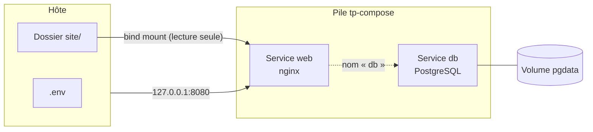

# Lab 7.1 : Première pile Compose

| | |
|---|---|
| **Durée** | 60 min |
| **Niveau** | Semi-guidé |
| **Prérequis** | [Lab 6.2 : Isoler une application par réseaux](../ch06-reseau-docker/lab-6-2-isoler-une-application-par-reseaux.md), cours du [chapitre 7](cours.md) |
| **Acquis visés** | AA5 |

!!! abstract "Objectifs"
    - Convertir des commandes `docker run` en un fichier `compose.yaml`
    - Démarrer, observer et supprimer une pile avec `docker compose`
    - Vérifier la résolution des noms de services et la persistance d'un volume
    - Sortir un mot de passe du fichier Compose grâce à un fichier `.env`

## Contexte et schéma

Vous décrivez dans un fichier Compose une pile de deux services que vous savez déjà lancer à la main : un serveur web nginx (bind mount, chapitre 5) et une base PostgreSQL (volume nommé). Dans ce lab, seules les **commandes clés** vous sont données : à vous de les adapter et de déduire le reste à l'aide du [cours](cours.md).



!!! note "Selon votre option"
    Sous PowerShell, utilisez `curl.exe` et écrivez les commandes sur une seule ligne. Dans les fichiers YAML, n'utilisez que des **espaces** pour l'indentation.

## Étapes

### Étape 1 : Préparer le dossier du projet

- **Objectif :** disposer d'un dossier de travail et du contenu à servir.
- **Indices :**
    - Vérifiez que les conteneurs et réseaux des labs précédents sont supprimés (`docker ps -a`), en particulier ceux qui utilisent le port 8080.
    - Créez un dossier `tp-compose`, placez-vous dedans, puis créez un sous-dossier `site` contenant un `index.html` avec un message de votre choix.
    - Le nom du dossier devient le **nom du projet** Compose.

!!! success "Point de contrôle"
    - [ ] `tp-compose/site/index.html` existe
    - [ ] Aucun conteneur n'occupe le port 8080

### Étape 2 : Traduire les commandes en fichier Compose

- **Objectif :** écrire `compose.yaml` à partir des deux commandes ci-dessous, qui sont celles que vous utiliseriez sans Compose.

```bash
docker run -d --name web -p 127.0.0.1:8080:80 -v "$(pwd)/site:/usr/share/nginx/html:ro" nginx:1.27-alpine
docker run -d --name db -v pgdata:/var/lib/postgresql/data -e POSTGRES_USER=etudiant -e POSTGRES_PASSWORD=motdepasse-tp -e POSTGRES_DB=cours postgres:16-alpine
```

- **Indices :**
    - Deux services : `web` et `db`.
    - Chaque option de la ligne de commande a une clé équivalente : consultez le tableau de la section 3 du [cours](cours.md).
    - Le volume `pgdata` se déclare dans la section `volumes` du fichier.
    - Pour le bind mount, utilisez un chemin **relatif** (`./site`).
    - Pour l'instant, écrivez le mot de passe en clair (vous le corrigerez à l'étape 5).
    - Squelette à compléter :

```yaml
services:
  web:
    # image, ports, volumes
  db:
    # image, environment, volumes

volumes:
  # volume pgdata
```

Validez ensuite le fichier avec `docker compose config` : il affiche le fichier interprété, ou signale une erreur de syntaxe.

!!! success "Point de contrôle"
    - [ ] `docker compose config` s'exécute sans erreur
    - [ ] La sortie montre les deux services, le volume et un réseau créé automatiquement

### Étape 3 : Démarrer et observer la pile

- **Objectif :** lancer toute la pile avec une seule commande.
- **Indices :**
    - `docker compose up -d`, puis `docker compose ps`.
    - Consultez les journaux d'un service, puis de tous : `docker compose logs db`, `docker compose logs -f` (`Ctrl+C` pour quitter).
    - Testez le site : `curl http://localhost:8080`.
    - Modifiez `site/index.html` sur l'hôte et testez de nouveau.

!!! success "Point de contrôle"
    - [ ] `docker compose ps` affiche `web` et `db` à l'état `running`
    - [ ] `curl` affiche votre page
    - [ ] Les journaux de `db` indiquent que la base est prête
    - [ ] Le contenu modifié est servi sans redémarrage

### Étape 4 : Observer ce que Compose a créé

- **Objectif :** identifier les ressources créées automatiquement et leurs noms.
- **Indices :**
    - `docker ps` : relevez le nom des conteneurs (il contient le nom du projet).
    - `docker network ls` et `docker volume ls` : repérez le réseau et le volume créés, et leur préfixe.
    - Vérifiez que `web` joint `db` par son nom de service :

```bash
docker compose exec web ping -c 2 db
```

!!! success "Point de contrôle"
    - [ ] Vous avez relevé le nom du réseau (`tp-compose_default`) et du volume (`tp-compose_pgdata`)
    - [ ] Le `ping` vers `db` réussit : le nom de service est résolu

### Étape 5 : Sortir le mot de passe du fichier Compose

- **Objectif :** ne plus écrire de valeur sensible dans `compose.yaml`.
- **Indices :**
    - Créez à côté de `compose.yaml` un fichier `.env` définissant `DB_PASSWORD` et `WEB_PORT` (voir la section 6.2 du [cours](cours.md)).
    - Dans `compose.yaml`, remplacez le mot de passe et le port publié par des expressions `${...}`.
    - Créez un fichier `.gitignore` contenant `.env`, et un fichier `.env.example` avec des valeurs fictives.
    - Vérifiez avec `docker compose config` que les valeurs sont bien substituées.
    - Relancez avec `docker compose up -d`, **après** avoir changé `WEB_PORT` dans `.env` (par exemple `8081`) : observez quels services sont recréés.

!!! success "Point de contrôle"
    - [ ] `compose.yaml` ne contient plus de mot de passe en clair
    - [ ] `docker compose config` affiche la valeur issue de `.env`
    - [ ] Après changement de `WEB_PORT`, seul le service `web` est recréé, et le site répond sur le nouveau port

!!! info "Mot de passe et base existante"
    Comme au [Lab 5.1](../ch05-volumes-et-persistance/lab-5-1-persister-des-donnees.md), un changement de `POSTGRES_PASSWORD` est **ignoré** quand le volume contient déjà une base. Gardez donc la même valeur dans `.env` pour cette étape.

### Étape 6 : Vérifier la persistance et le cycle de vie

- **Objectif :** comprendre la différence entre `down` et `down -v`.
- **Indices :**
    - Dans `db`, créez une table et une ligne : `docker compose exec db psql -U etudiant -d cours -c "CREATE TABLE notes (id serial PRIMARY KEY, texte text);"` puis un `INSERT` de votre choix.
    - Exécutez `docker compose down`, puis `docker compose ps -a` et `docker volume ls`.
    - Relancez avec `docker compose up -d` et interrogez la table.
    - Exécutez ensuite `docker compose down -v`, relancez la pile et interrogez de nouveau.
    - Testez aussi `docker compose stop` puis `docker compose start`.

!!! success "Point de contrôle"
    - [ ] Après `down` puis `up`, la ligne est retrouvée
    - [ ] Après `down -v` puis `up`, la table n'existe plus
    - [ ] `stop` puis `start` conservent les conteneurs et leurs données

### Étape 7 (facultative) : Redémarrage automatique

- **Objectif :** observer l'effet d'une politique de redémarrage.
- **Indices :**
    - Ajoutez `restart: unless-stopped` au service `web` (section 3.2 du [cours](cours.md)), puis relancez la pile.
    - Arrêtez le processus principal du conteneur en vous aidant de `docker kill` (en vérifiant son nom avec `docker ps`), puis observez avec `docker compose ps`.

!!! success "Point de contrôle"
    - [ ] Le conteneur `web` est redémarré automatiquement après le `docker kill`

## Questions de réflexion

??? question "Pourquoi le service `web` joint-il `db` par son nom alors que vous n'avez créé aucun réseau ?"
    Compose crée automatiquement un réseau pour la pile, de type bridge défini par l'utilisateur, avec DNS intégré (chapitre 6). Tous les services y sont branchés et se joignent par leur nom de service.

??? question "Pourquoi un fichier `.env` doit-il être exclu du dépôt Git ?"
    Il contient des valeurs sensibles ou propres à la machine. Le fichier Compose, lui, peut être partagé : il ne contient que des références `${VARIABLE}`. Le fichier `.env.example` documente les variables attendues.

??? question "À l'étape 5, pourquoi seul `web` est-il recréé ?"
    Compose compare la configuration de chaque service avec celle des conteneurs existants et ne recrée que ceux dont la configuration a changé. Seul le port publié de `web` a changé.

??? question "Quelle commande faut-il éviter si vous voulez conserver les données de la base ?"
    `docker compose down -v`, qui supprime aussi les volumes déclarés.

## Dépannage

| Symptôme | Pistes |
|---|---|
| `yaml: line N: found character that cannot start any token` ou erreur d'indentation | Une tabulation ou un décalage : indentez avec des espaces, deux par niveau |
| `no configuration file provided: not found` | Vous n'êtes pas dans le dossier de `compose.yaml` |
| `port is already allocated` | Le port est déjà utilisé : arrêtez le conteneur concerné ou changez `WEB_PORT` |
| `variable is not set. Defaulting to a blank string` | Une variable de `compose.yaml` n'est pas définie dans `.env` |
| `curl` affiche la page par défaut de nginx | Le montage du dossier `site` est incorrect : vérifiez le chemin et la présence de `index.html` |
| `password authentication failed` | Le volume contient déjà une base créée avec un autre mot de passe : utilisez-le, ou `docker compose down -v` |
| Sous PowerShell, `curl` ne se comporte pas comme attendu | Utilisez `curl.exe` |

## Nettoyage et reprise

```bash
docker compose down -v
```

Supprimez le dossier `tp-compose` si vous n'en avez plus besoin. Le [Lab 7.2](lab-7-2-application-trois-niveaux-avec-compose.md) repart d'un nouveau dossier.

## Retour au chapitre

[Chapitre 7 : Docker Compose](cours.md) · Lab suivant : [Lab 7.2 : Application trois niveaux avec Compose](lab-7-2-application-trois-niveaux-avec-compose.md)