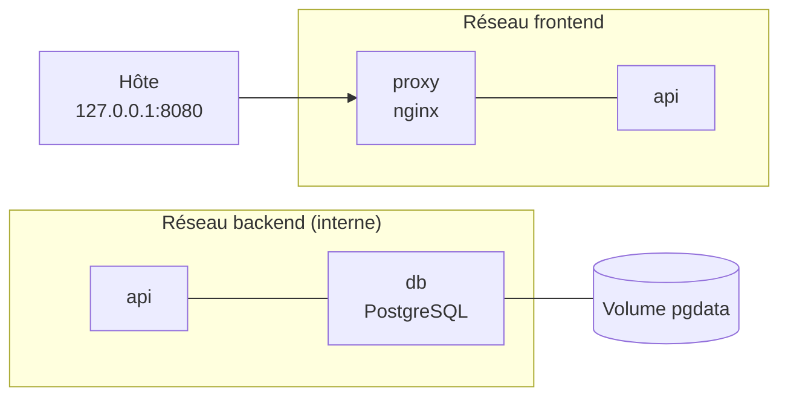

# Lab 7.2 : Application trois niveaux avec Compose

| | |
|---|---|
| **Durée** | 75 min |
| **Niveau** | Semi-guidé |
| **Prérequis** | [Lab 7.1 : Première pile Compose](lab-7-1-premiere-pile-compose.md), [Lab 6.2 : Isoler une application par réseaux](../ch06-reseau-docker/lab-6-2-isoler-une-application-par-reseaux.md), cours du [chapitre 7](cours.md) |
| **Acquis visés** | AA5 |

!!! abstract "Objectifs"
    - Décrire dans un seul fichier Compose une application en trois niveaux (proxy, API, base de données)
    - Cloisonner l'application avec deux réseaux et ne publier que le point d'entrée
    - Définir des healthchecks et ordonner le démarrage avec `depends_on`
    - Observer le comportement de la pile lorsque la base s'arrête
    - Vérifier la persistance des données après `down` et `up`

## Contexte et schéma

Vous reprenez l'architecture du [Lab 6.2](../ch06-reseau-docker/lab-6-2-isoler-une-application-par-reseaux.md), cette fois avec une **vraie API** et un fichier Compose. L'API est une petite application Flask qui compte les visites dans une base PostgreSQL. Son code vous est fourni : vous n'avez pas besoin de connaître Python.



| Service | Rôle | Image | Réseaux |
|---|---|---|---|
| `proxy` | Point d'entrée, transmet les requêtes à l'API | `nginx:1.27-alpine` | `frontend` |
| `api` | Application Flask, construite par vous | construite depuis `./api` | `frontend` et `backend` |
| `db` | Base de données | `postgres:16-alpine` | `backend` |

!!! note "Selon votre option"
    Sous PowerShell, utilisez `curl.exe` et écrivez les commandes sur une seule ligne. Dans les fichiers YAML, n'utilisez que des **espaces** pour l'indentation.

## Étapes

### Étape 1 : Préparer les fichiers fournis

- **Objectif :** disposer du code de l'API et de la configuration du proxy.
- **Indices :** créez le dossier `tp-trois-niveaux` et placez-vous dedans, puis créez l'arborescence suivante :

```text
tp-trois-niveaux/
├── api/
│   ├── app.py
│   ├── requirements.txt
│   └── Dockerfile
├── nginx/
│   └── default.conf
└── .env
```

**`api/requirements.txt`**

```text
flask==3.0.3
psycopg2-binary==2.9.9
```

**`api/app.py`**

```python
import os

import psycopg2
from flask import Flask

app = Flask(__name__)


def connexion():
    return psycopg2.connect(
        host=os.environ["DB_HOST"],
        dbname=os.environ["DB_NAME"],
        user=os.environ["DB_USER"],
        password=os.environ["DB_PASSWORD"],
    )


@app.route("/")
def visites():
    conn = connexion()
    with conn:
        with conn.cursor() as cur:
            cur.execute(
                "CREATE TABLE IF NOT EXISTS visites "
                "(id serial PRIMARY KEY, date timestamp DEFAULT now())"
            )
            cur.execute("INSERT INTO visites DEFAULT VALUES")
            cur.execute("SELECT count(*) FROM visites")
            total = cur.fetchone()[0]
    conn.close()
    return f"Nombre de visites : {total}\n"


@app.route("/sante")
def sante():
    return "ok\n"


if __name__ == "__main__":
    app.run(host="0.0.0.0", port=5000)
```

!!! info "Deux routes"
    `/` enregistre une visite dans la base et renvoie le total. `/sante` répond `ok` **sans** toucher à la base : elle servira au healthcheck de l'API.

**`api/Dockerfile`** (l'ordre des instructions est celui que vous avez optimisé au [Lab 3.2](../../partie-1-fondations/ch03-images-et-dockerfile/lab-3-2-cache-et-couches.md))

```dockerfile
FROM python:3.12-slim
WORKDIR /app
COPY requirements.txt .
RUN pip install --no-cache-dir -r requirements.txt
COPY app.py .
EXPOSE 5000
CMD ["python", "app.py"]
```

**`nginx/default.conf`** : le proxy transmet toutes les requêtes au service `api`, désigné par son nom.

```text
server {
    listen 80;
    location / {
        proxy_pass http://api:5000;
    }
}
```

**`.env`**

```text
DB_NAME=cours
DB_USER=etudiant
DB_PASSWORD=motdepasse-tp
WEB_PORT=8080
```

Créez aussi un `.gitignore` contenant `.env`, et un `.env.example` avec des valeurs fictives (voir le [Lab 7.1](lab-7-1-premiere-pile-compose.md)).

!!! success "Point de contrôle"
    - [ ] L'arborescence est conforme et les fichiers ne portent pas d'extension `.txt` supplémentaire
    - [ ] Le port 8080 n'est utilisé par aucun conteneur (`docker ps`)

### Étape 2 : Écrire le fichier `compose.yaml`

- **Objectif :** décrire les trois services, les deux réseaux, le volume, les healthchecks et les dépendances.
- **Indices :**
    - **Réseaux** : `frontend` ordinaire, `backend` interne (section 4 du [cours](cours.md)).
    - **`db`** : image `postgres:16-alpine`, réseau `backend` seulement, volume nommé `pgdata`, aucune publication de port. Ses variables `POSTGRES_USER`, `POSTGRES_PASSWORD` et `POSTGRES_DB` proviennent du fichier `.env`. Healthcheck avec `pg_isready` (section 7.2).
    - **`api`** : image construite depuis le dossier `./api` (clé `build`), réseaux `frontend` et `backend`, aucun port publié. Variables `DB_HOST` (le **nom du service** de la base), `DB_NAME`, `DB_USER`, `DB_PASSWORD`. Elle ne doit démarrer que lorsque `db` est **healthy**. Pour son healthcheck, l'image ne contient pas `curl` : utilisez Python.

```yaml
healthcheck:
  test: ["CMD", "python", "-c", "import urllib.request; urllib.request.urlopen('http://localhost:5000/sante')"]
  interval: 5s
  timeout: 3s
  retries: 5
  start_period: 5s
```

    - **`proxy`** : image `nginx:1.27-alpine`, réseau `frontend`, port publié **uniquement sur l'hôte** (`127.0.0.1`) avec `${WEB_PORT}` comme port de l'hôte, fichier `./nginx/default.conf` monté en lecture seule sur `/etc/nginx/conf.d/default.conf`. Il ne doit démarrer que lorsque `api` est **healthy**.

Validez avec `docker compose config`.

!!! success "Point de contrôle"
    - [ ] `docker compose config` s'exécute sans erreur et les valeurs de `.env` sont substituées
    - [ ] Seul `proxy` possède une section `ports`
    - [ ] `backend` est déclaré `internal: true`
    - [ ] `api` et `proxy` ont une condition `service_healthy` sur le service dont ils dépendent

### Étape 3 : Démarrer et tester la pile

- **Objectif :** démarrer l'application et observer l'enchaînement des démarrages.
- **Indices :**
    - Lancez `docker compose up -d --build`, puis surveillez l'état avec `docker compose ps` pendant quelques secondes : `db`, puis `api`, puis `proxy`.
    - Testez trois fois de suite : `curl http://localhost:8080`.
    - Consultez les journaux : `docker compose logs api`.

!!! success "Point de contrôle"
    - [ ] Les trois services sont `running`, `db` et `api` sont `healthy`
    - [ ] Les trois requêtes renvoient `Nombre de visites : 1`, puis `2`, puis `3`
    - [ ] Les journaux de `api` montrent les requêtes reçues du proxy

### Étape 4 : Vérifier le cloisonnement

- **Objectif :** confirmer que l'architecture respecte le plan.
- **Indices :** complétez le tableau en prédisant d'abord le résultat, puis en testant avec `docker compose exec <service> ping -c 2 <cible>`.

| Source | Cible | Résultat attendu | Résultat observé |
|---|---|---|---|
| `proxy` | `api` | À déterminer | |
| `proxy` | `db` | À déterminer | |
| `api` | `db` | À déterminer | |

Vérifiez aussi qu'aucun port n'est exposé en dehors de celui du proxy : `docker compose ps` et `docker ps`.

!!! success "Point de contrôle"
    - [ ] `proxy` joint `api` mais pas `db`
    - [ ] `api` joint `db`
    - [ ] Une seule publication de port apparaît, celle de `proxy`, limitée à `127.0.0.1`

### Étape 5 : Observer une panne de la base

- **Objectif :** constater l'effet d'un service arrêté, puis le retour à la normale.
- **Indices :**
    - Arrêtez uniquement la base : `docker compose stop db`.
    - Testez `curl http://localhost:8080`, puis consultez `docker compose logs api` et `docker compose ps`.
    - Redémarrez la base : `docker compose start db`, attendez qu'elle soit `healthy`, puis testez de nouveau.

!!! success "Point de contrôle"
    - [ ] Pendant la panne, `curl` renvoie une erreur (les journaux de `api` montrent l'échec de connexion) alors que `api` reste `running`
    - [ ] Après le redémarrage de `db`, le service reprend et le compteur **continue** de la valeur précédente
    - [ ] Vous savez expliquer pourquoi l'API reste `healthy` pendant la panne (voir les questions de réflexion)

### Étape 6 : Vérifier la persistance

- **Objectif :** s'assurer que les données survivent à la suppression de la pile.
- **Indices :**
    - Notez le compteur, puis exécutez `docker compose down`, puis `docker compose up -d`.
    - Testez : le compteur doit continuer.
    - Exécutez `docker compose down -v`, relancez, testez : le compteur repart de 1.

!!! success "Point de contrôle"
    - [ ] Après `down` puis `up`, le compteur continue
    - [ ] Après `down -v` puis `up`, le compteur repart de 1

### Étape 7 (facultative) : Modifier l'API

- **Objectif :** reconstruire un seul service.
- **Indices :**
    - Modifiez le message renvoyé par `app.py`, puis lancez `docker compose up -d --build`.
    - Observez quels services sont recréés.
    - Si le proxy ne répond plus après la recréation de `api`, redémarrez-le avec `docker compose restart proxy`.

!!! success "Point de contrôle"
    - [ ] Le nouveau message est servi
    - [ ] Vous avez identifié les services recréés

## Questions de réflexion

??? question "Pourquoi `proxy` ne peut-il pas joindre `db` ?"
    Il est branché sur `frontend` seulement, alors que `db` est sur `backend` seulement : ils ne partagent aucun réseau. Seule `api` est branchée sur les deux.

??? question "Pourquoi la base n'a-t-elle aucun port publié alors que l'API s'y connecte ?"
    L'API et la base sont sur le même réseau : elles communiquent par le nom de service et le port du conteneur (5432). Publier le port ne servirait qu'à exposer la base à l'hôte.

??? question "À quoi sert `condition: service_healthy` pour l'API ?"
    L'API ne démarre que lorsque la base accepte des connexions. Sans cette condition, `depends_on` ne garantit que l'ordre de démarrage des conteneurs, et l'API pourrait démarrer avant que la base soit prête.

??? question "Pourquoi l'API reste-t-elle `healthy` pendant la panne de la base ?"
    Son healthcheck interroge la route `/sante`, qui ne touche pas à la base. Il vérifie que le processus de l'API répond, pas que toutes ses dépendances fonctionnent. Choisir ce que mesure un healthcheck est un choix de conception.

??? question "Pourquoi les identifiants sont-ils dans `.env` et non dans `compose.yaml` ?"
    Le fichier Compose peut être versionné et partagé, alors que `.env` reste propre à la machine et exclu du dépôt.

## Dépannage

| Symptôme | Pistes |
|---|---|
| `api` reste `unhealthy` | Consultez `docker compose logs api` : erreur de syntaxe Python, ou dépendance manquante |
| `could not translate host name "db"` dans les journaux de `api` | `api` n'est pas sur le réseau `backend`, ou `DB_HOST` n'est pas le nom du service |
| `password authentication failed` | Le volume contient déjà une base créée avec un autre mot de passe : utilisez-le, ou `docker compose down -v` |
| `host not found in upstream "api"` dans les journaux de `proxy` | Le proxy a démarré sans pouvoir résoudre `api` : vérifiez qu'il est sur `frontend` et qu'il dépend de `api` |
| `502 Bad Gateway` | `api` ne répond pas : consultez ses journaux et son état |
| `port is already allocated` | Le port est déjà utilisé : changez `WEB_PORT` dans `.env` |
| Erreur à l'installation de `psycopg2-binary` pendant `--build` | Notez le message exact et signalez-le à l'enseignant : la version épinglée est à valider |
| Sous PowerShell, `curl` ne se comporte pas comme attendu | Utilisez `curl.exe` |

## Nettoyage et reprise

```bash
docker compose down -v
docker image rm tp-trois-niveaux-api
```

(Le nom de l'image construite est celui du projet suivi du nom du service ; vérifiez-le avec `docker images`.) Conservez le dossier `tp-trois-niveaux` : il sert de point de départ au [Mini-projet 2](../mini-projet-2.md).

## Retour au chapitre

[Chapitre 7 : Docker Compose](cours.md) · Quiz : [Quiz du chapitre 7](quiz.md)