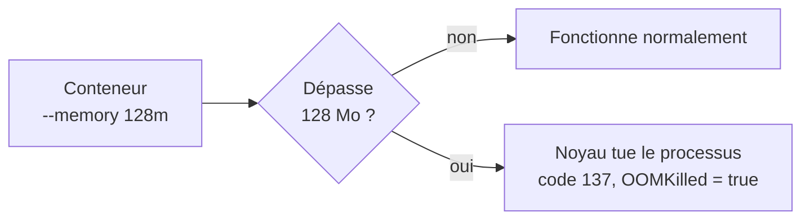
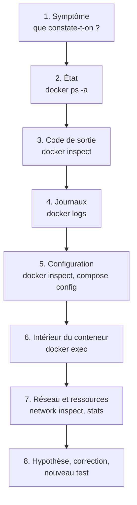

# Chapitre 8 : Observabilité et dépannage

!!! abstract "Objectifs du chapitre"
    - Consulter et filtrer les journaux d'un conteneur
    - Mesurer la consommation de ressources avec `docker stats` et suivre l'activité du moteur avec `docker events`
    - Limiter la mémoire et le processeur d'un conteneur, et reconnaître un arrêt par manque de mémoire
    - Lire l'état d'un conteneur (code de sortie, état de santé) avec `docker inspect`
    - Appliquer une démarche méthodique pour diagnostiquer une panne
    - Entretenir le moteur : mesurer l'espace disque et nettoyer sans détruire de données utiles
    - Acquis d'apprentissage visé : **AA6**

## 1. Pourquoi observer et diagnostiquer ?

Une application conteneurisée tourne sans que vous la regardiez. Quand elle se comporte mal, vous n'avez pas d'écran devant vous : il faut interroger Docker pour savoir **ce qui s'est passé**. Vous avez déjà utilisé `docker logs`, `docker ps` et `docker inspect` ; ce chapitre les organise en une démarche et ajoute les outils de mesure et de nettoyage.

Trois questions guident l'exploitation d'une pile :

| Question | Outils |
|---|---|
| Que **dit** l'application ? | Journaux (`docker logs`) |
| Quelle est son **état** et que **consomme**-t-elle ? | `docker ps`, `docker inspect`, `docker stats`, healthchecks |
| Que **fait** le moteur ? | `docker events` |

## 2. Les journaux

Docker capture ce que le processus principal du conteneur écrit sur sa **sortie standard** et sa **sortie d'erreur**. C'est pourquoi une application conteneurisée doit écrire ses messages sur ces sorties plutôt que dans des fichiers.

### 2.1 Options utiles de `docker logs`

| Commande | Effet |
|---|---|
| `docker logs conteneur` | Affiche tous les journaux |
| `docker logs -f conteneur` | Suit les journaux en continu (`Ctrl+C` pour quitter) |
| `docker logs --tail 20 conteneur` | Affiche les 20 dernières lignes |
| `docker logs --since 10m conteneur` | Affiche les journaux des 10 dernières minutes |
| `docker logs -t conteneur` | Ajoute l'horodatage à chaque ligne |

Avec Compose, `docker compose logs` regroupe les journaux de tous les services de la pile ; on peut le limiter à un service avec `docker compose logs -f db`.

!!! tip "Les journaux d'un conteneur arrêté restent consultables"
    Tant que le conteneur n'est pas supprimé, `docker logs` fonctionne même s'il s'est arrêté : c'est souvent là que se trouve la cause de la panne.

### 2.2 Où sont stockés les journaux, et leur taille

Par défaut, le pilote de journalisation `json-file` écrit les journaux dans un fichier sur l'hôte, **sans limite de taille**. Sur un conteneur qui écrit beaucoup, ce fichier peut remplir le disque. On limite la taille et le nombre de fichiers avec des options de journalisation :

```bash
docker run -d --name bavard --log-opt max-size=10m --log-opt max-file=3 alpine:3.20 sh -c "while true; do echo message; sleep 1; done"
```

Ici, chaque fichier est limité à 10 Mo et Docker n'en conserve que trois (rotation).

## 3. Les statistiques de consommation

`docker stats` affiche, en continu, la consommation des conteneurs en cours d'exécution.

| Colonne | Signification |
|---|---|
| `CPU %` | Part de processeur utilisée |
| `MEM USAGE / LIMIT` | Mémoire utilisée / limite autorisée au conteneur |
| `MEM %` | Mémoire utilisée par rapport à la limite |
| `NET I/O` | Données reçues / émises sur le réseau |
| `BLOCK I/O` | Données lues / écrites sur le disque |
| `PIDS` | Nombre de processus dans le conteneur |

Quelques variantes :

| Commande | Effet |
|---|---|
| `docker stats` | Affichage en continu pour tous les conteneurs en cours d'exécution |
| `docker stats --no-stream` | Une seule mesure, puis retour à l'invite |
| `docker stats db web` | Limité aux conteneurs indiqués |
| `docker top conteneur` | Liste les processus du conteneur |

Rappelez-vous le chapitre 1 : ces mesures proviennent des **cgroups**, le mécanisme du noyau qui comptabilise et limite les ressources d'un groupe de processus.

## 4. Les événements du moteur

`docker events` affiche, en temps réel, ce que le moteur fait : création, démarrage, arrêt, mort d'un conteneur, changement d'état de santé, etc.

| Commande | Effet |
|---|---|
| `docker events` | Affiche les événements au fur et à mesure (`Ctrl+C` pour quitter) |
| `docker events --since 30m` | Affiche aussi ceux des 30 dernières minutes |
| `docker events --filter type=container` | Limite aux événements de conteneurs |
| `docker events --filter event=die` | Limite à un type d'événement, ici la mort d'un conteneur |

Les événements `die` (arrêt du processus principal) et `oom` (arrêt par manque de mémoire, voir la section 6) sont les plus utiles pour comprendre une panne **après coup**.

## 5. Lire l'état d'un conteneur

### 5.1 États et codes de sortie

`docker ps -a` liste tous les conteneurs, y compris arrêtés, avec leur état (`Up`, `Exited (code)`…). Le **code de sortie** indique pourquoi un conteneur s'est arrêté :

| Code | Signification courante |
|---|---|
| `0` | Fin normale |
| `1` | Erreur de l'application |
| `125` | Docker n'a pas pu lancer le conteneur (option invalide, par exemple) |
| `126` | Commande trouvée mais non exécutable |
| `127` | Commande introuvable dans le conteneur |
| `137` | Processus tué (signal 9) : arrêt forcé ou **manque de mémoire** |
| `143` | Arrêt demandé proprement (signal 15) |

### 5.2 `docker inspect` : extraire une information précise

`docker inspect` renvoie une grande structure. L'option `-f` (format) en extrait un champ :

```bash
docker inspect -f '{{.State.Status}}' db
docker inspect -f '{{.State.ExitCode}}' db
docker inspect -f '{{.State.OOMKilled}}' db
docker inspect -f '{{json .State.Health}}' db
```

| Champ | Contenu |
|---|---|
| `.State.Status` | État : `running`, `exited`… |
| `.State.ExitCode` | Code de sortie |
| `.State.OOMKilled` | `true` si le conteneur a été tué faute de mémoire |
| `.State.Health` | État de santé et résultats des dernières vérifications (si un healthcheck existe) |

## 6. Limiter les ressources

Sans limite, un conteneur peut consommer toute la mémoire et tout le processeur de l'hôte, au détriment des autres conteneurs. On fixe des limites au lancement :

| Option | Effet |
|---|---|
| `--memory 256m` (ou `-m`) | Limite la mémoire du conteneur à 256 Mo |
| `--cpus 0.5` | Limite le conteneur à la moitié d'un cœur de processeur |

```bash
docker run -d --name limite --memory 128m --cpus 0.5 nginx:1.27-alpine
docker stats --no-stream limite
```

La colonne `MEM USAGE / LIMIT` affiche alors 128 Mo comme limite.

### 6.1 Que se passe-t-il quand la limite est dépassée ?

| Ressource | Comportement |
|---|---|
| Processeur | Le conteneur est **ralenti** : il ne reçoit pas plus que sa part |
| Mémoire | Si le conteneur dépasse sa limite, le noyau **tue** son processus : on parle de **OOM kill** (Out Of Memory). Le code de sortie est `137` et `OOMKilled` vaut `true` |



Dans un fichier Compose, ces limites s'écrivent avec les clés `mem_limit` et `cpus` du service.

!!! warning "Une limite trop basse provoque des pannes"
    Fixez la limite d'après la consommation mesurée avec `docker stats`, avec une marge. Un conteneur qui redémarre en boucle avec le code 137 est le signe d'une limite de mémoire trop basse (ou d'une fuite mémoire).

## 7. Healthchecks : observer la santé d'un service

Vous avez défini des healthchecks dans Compose au [chapitre 7](../ch07-docker-compose/cours.md). On les observe ainsi :

| Où | Information |
|---|---|
| `docker ps` ou `docker compose ps` | État affiché entre parenthèses : `starting`, `healthy`, `unhealthy` |
| `docker inspect -f '{{json .State.Health}}' conteneur` | Détail des dernières vérifications, avec leur sortie |
| `docker events --filter event=health_status` | Changements d'état de santé |

Un healthcheck peut aussi se définir sans Compose, au lancement : `docker run --health-cmd "..." --health-interval 5s ...`.

!!! note "Santé et redémarrage"
    Un conteneur `unhealthy` n'est pas redémarré par Docker : l'état informe, il ne répare pas. C'est un orchestrateur, comme Swarm (chapitres 11 et 12), qui peut remplacer un service défaillant.

## 8. Une démarche de diagnostic

Face à une panne, ne devinez pas : procédez dans l'ordre, du plus simple au plus fin.



| Étape | Questions | Commandes |
|---|---|---|
| État | Le conteneur tourne-t-il ? S'est-il arrêté ? Redémarre-t-il en boucle ? | `docker ps -a` |
| Code de sortie | Fin normale, erreur, arrêt forcé, OOM ? | `docker inspect -f '{{.State.ExitCode}}' c` |
| Journaux | Quel message d'erreur l'application a-t-elle écrit ? | `docker logs --tail 50 c` |
| Configuration | Variables, ports, montages, réseaux conformes à ce qui était prévu ? | `docker inspect c`, `docker compose config` |
| Intérieur | Les fichiers, les variables et les processus sont-ils ceux attendus ? | `docker exec -it c sh`, `docker top c` |
| Réseau | Les conteneurs sont-ils sur le même réseau ? Le nom est-il résolu ? | `docker network inspect`, `ping` depuis un conteneur |
| Ressources | Mémoire, processeur, disque sont-ils saturés ? | `docker stats`, `docker system df` |

### 8.1 Pannes fréquentes et indices

| Symptôme | Cause fréquente | Où le voir |
|---|---|---|
| Le conteneur s'arrête aussitôt (`Exited (1)`) | Erreur dans l'application ou variable manquante | Journaux |
| `Exited (127)` | Commande introuvable dans l'image | Journaux, commande du Dockerfile |
| `Exited (137)` et `OOMKilled: true` | Limite de mémoire trop basse | `docker inspect`, `docker events` |
| Le conteneur redémarre en boucle | Application en erreur avec `restart: always` | `docker ps` (colonne état), journaux |
| Le service ne répond pas sur le port publié | Application qui écoute sur `127.0.0.1`, mauvais port, port non publié | Journaux, `docker port` |
| Un conteneur ne résout pas le nom d'un autre | Réseaux différents | `docker network inspect` |
| `unhealthy` | Le service est lancé mais ne répond pas | `docker inspect` (détail de `Health`) |
| `no space left on device` | Disque saturé (images, volumes, journaux) | `docker system df` |

!!! tip "Changez une seule chose à la fois"
    Après chaque correction, retestez. Si vous modifiez plusieurs choses en même temps, vous ne saurez pas laquelle a résolu le problème, ni laquelle en a créé un autre.

## 9. Entretenir le moteur

Images, conteneurs arrêtés, volumes, réseaux et cache de construction **s'accumulent** sur la machine. Il faut les mesurer, puis les nettoyer avec discernement.

### 9.1 Mesurer

`docker system df` affiche l'espace occupé par type de ressource, et la part récupérable (colonne `RECLAIMABLE`) :

| Ligne | Contenu |
|---|---|
| Images | Images téléchargées ou construites |
| Containers | Conteneurs (en cours ou arrêtés) |
| Local Volumes | Volumes |
| Build Cache | Cache de construction |

`docker system df -v` détaille chaque élément.

### 9.2 Nettoyer

| Commande | Supprime |
|---|---|
| `docker container prune` | Tous les conteneurs arrêtés |
| `docker image prune` | Les images **sans nom ni tag** (appelées *dangling*) |
| `docker image prune -a` | Toutes les images qu'aucun conteneur n'utilise |
| `docker network prune` | Les réseaux inutilisés |
| `docker volume prune` | Les volumes inutilisés (**données perdues**) |
| `docker builder prune` | Le cache de construction |
| `docker system prune` | Conteneurs arrêtés, réseaux inutilisés, images sans nom, cache de construction |

Chaque commande demande une confirmation et indique l'espace récupéré.

!!! warning "Avant de nettoyer"
    - Lisez ce que la commande va supprimer avant de confirmer.
    - Les **volumes** contiennent vos données : n'utilisez `docker volume prune` (ou l'option `--volumes` de `docker system prune`) que si vous êtes sûr qu'aucun volume inutilisé ne vous est nécessaire. Un volume « inutilisé » est simplement un volume qu'aucun conteneur **existant** ne monte, pas un volume sans valeur.
    - Sur une machine partagée ou un serveur, ne lancez jamais un nettoyage global sans en connaître les conséquences.

!!! note "Selon la version de Docker"
    Le comportement de `docker volume prune` (volumes anonymes seulement, ou tous les volumes inutilisés) dépend de la version de Docker. Lisez toujours le message de confirmation.

## 10. Observer et dépanner en résumé

!!! tip "À retenir"
    - Les journaux sont la sortie standard et la sortie d'erreur du processus principal ; `docker logs` fonctionne aussi pour un conteneur arrêté.
    - Limitez la taille des journaux (`max-size`, `max-file`) pour ne pas saturer le disque.
    - `docker stats` mesure la consommation ; `docker events` retrace l'activité du moteur.
    - Le **code de sortie** et le champ `OOMKilled` expliquent l'arrêt d'un conteneur ; `137` signale souvent un manque de mémoire.
    - `--memory` et `--cpus` limitent les ressources ; dépasser la mémoire provoque un arrêt, dépasser le processeur provoque un ralentissement.
    - Un conteneur `unhealthy` n'est pas redémarré automatiquement : l'état informe, il ne répare pas.
    - Diagnostiquez dans l'ordre : état, code de sortie, journaux, configuration, intérieur, réseau, ressources. Changez une chose à la fois.
    - `docker system df` mesure, les commandes `prune` nettoient ; attention aux volumes.

## Pour vérifier votre compréhension

??? question "Un conteneur s'est arrêté il y a une heure. Comment retrouver le message d'erreur de l'application ?"
    Avec `docker logs` sur ce conteneur : tant qu'il n'est pas supprimé, ses journaux restent consultables. `docker inspect -f '{{.State.ExitCode}}'` donne en plus son code de sortie.

??? question "Un conteneur affiche `Exited (137)` et `OOMKilled: true`. Que s'est-il passé et que faire ?"
    Le conteneur a dépassé sa limite de mémoire et le noyau a tué son processus. Il faut mesurer sa consommation réelle avec `docker stats`, puis relever la limite (avec une marge), ou chercher une fuite mémoire dans l'application.

??? question "Pourquoi un conteneur `unhealthy` n'est-il pas redémarré automatiquement ?"
    L'état de santé est une information : Docker le signale mais ne réagit pas seul. Seul un orchestrateur, ou une politique de redémarrage liée à l'arrêt du processus, agit sur l'état du conteneur.

??? question "Quelle précaution faut-il prendre avant `docker volume prune` ?"
    Vérifier que les volumes inutilisés ne contiennent aucune donnée dont on a besoin : ils sont supprimés avec leurs données, de façon irréversible.

## Ressources du chapitre

- [Lab 8.1 : Superviser une pile applicative](lab-8-1-superviser-une-pile-applicative.md)
- [Lab 8.2 : Dépanner des pannes imposées](lab-8-2-depanner-des-pannes-imposees.md)
- [Quiz du chapitre](quiz.md)