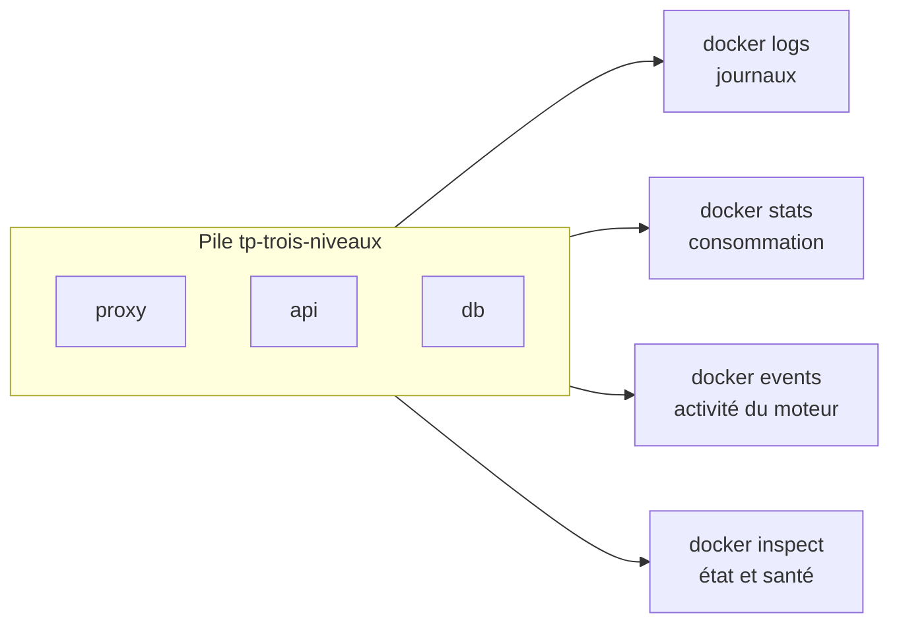

# Lab 8.1 : Superviser une pile applicative

| | |
|---|---|
| **Durée** | 75 min |
| **Niveau** | Semi-guidé |
| **Prérequis** | [Lab 7.2 : Application trois niveaux avec Compose](../ch07-docker-compose/lab-7-2-application-trois-niveaux-avec-compose.md) (dossier `tp-trois-niveaux`), cours du [chapitre 8](cours.md) |
| **Acquis visés** | AA6 |

!!! abstract "Objectifs"
    - Consulter et filtrer les journaux d'une pile
    - Mesurer la consommation de ressources et fixer des limites
    - Suivre l'activité du moteur avec `docker events`
    - Lire l'état de santé des services
    - Provoquer et reconnaître un arrêt par manque de mémoire
    - Mesurer l'espace occupé par Docker et nettoyer prudemment

## Contexte et schéma

Vous supervisez la pile du [Lab 7.2](../ch07-docker-compose/lab-7-2-application-trois-niveaux-avec-compose.md) (proxy, API, base de données). Chaque étape utilise un outil d'observation différent ; vous terminez par une fiche qui associe chaque question d'exploitation à la bonne commande. Dans ce lab, seules les **commandes clés** vous sont données : à vous de les adapter et de déduire le reste à l'aide du [cours](cours.md).



!!! note "Selon votre option"
    - Sous PowerShell, utilisez `curl.exe` et écrivez les commandes sur une seule ligne. Pour générer du trafic, utilisez `1..30 | ForEach-Object { curl.exe -s http://localhost:8080 | Out-Null }`.
    - Avec Docker Desktop, les mesures de `docker stats` portent sur la machine virtuelle interne ; les valeurs diffèrent de celles d'une machine Linux.
    - Ouvrez **deux terminaux** pour l'étape 5.

## Étapes

### Étape 1 : Démarrer la pile et relever un état de référence

- **Objectif :** partir d'une pile saine, dont vous connaissez l'état normal.
- **Indices :**
    - Placez-vous dans `tp-trois-niveaux` (recréez le dossier à partir du Lab 7.2 si besoin), puis `docker compose up -d --build`.
    - Attendez que `db` et `api` soient `healthy` (`docker compose ps`), puis testez `curl http://localhost:8080`.

!!! success "Point de contrôle"
    - [ ] Les trois services sont `running`, `db` et `api` sont `healthy`
    - [ ] `curl` renvoie `Nombre de visites : ...`

### Étape 2 : Interroger les journaux

- **Objectif :** retrouver une information précise dans les journaux.
- **Indices :**
    - Générez du trafic : une trentaine de requêtes `curl` vers `http://localhost:8080`.
    - Affichez les 10 dernières lignes des journaux du `proxy`, puis de l'`api`, avec horodatage (`--tail`, `-t`).
    - Affichez uniquement les journaux de la dernière minute (`--since 1m`).
    - Suivez en continu les journaux de **toute la pile** (`docker compose logs -f`), envoyez une requête `curl` depuis un autre terminal, et repérez la ligne correspondante dans chaque service.

!!! success "Point de contrôle"
    - [ ] Vous avez repéré, dans les journaux du `proxy`, la ligne correspondant à votre dernière requête
    - [ ] Vous avez repéré la même requête dans les journaux de l'`api`
    - [ ] Vous savez expliquer pourquoi les journaux de `db` ne contiennent pas de ligne par requête HTTP

### Étape 3 : Mesurer la consommation

- **Objectif :** connaître la consommation normale de chaque service.
- **Indices :**
    - `docker stats --no-stream` : relevez, pour chaque conteneur, `CPU %`, `MEM USAGE / LIMIT` et `PIDS`.
    - Lancez `docker stats` en continu dans un terminal pendant que vous générez du trafic dans un autre : quelle colonne varie ?
    - `docker compose top` (ou `docker top <conteneur>`) liste les processus.

!!! success "Point de contrôle"
    - [ ] Vous avez relevé la mémoire utilisée par `proxy`, `api` et `db`
    - [ ] Pour chaque conteneur, la limite affichée correspond à la mémoire totale de la machine (aucune limite fixée)
    - [ ] Vous avez identifié le service qui consomme le plus de mémoire

### Étape 4 : Fixer des limites de ressources

- **Objectif :** limiter les services d'après les mesures de l'étape 3.
- **Indices :**
    - Dans `compose.yaml`, ajoutez au service `api` les clés `mem_limit` (par exemple `128m`) et `cpus` (par exemple `0.5`), puis `mem_limit` (par exemple `256m`) au service `db` (section 6 du [cours](cours.md)).
    - Vérifiez avec `docker compose config`, puis appliquez avec `docker compose up -d`.
    - Si le proxy ne répond plus après la recréation de `api`, redémarrez-le (`docker compose restart proxy`).
    - Contrôlez avec `docker stats --no-stream` et refaites quelques requêtes.

!!! success "Point de contrôle"
    - [ ] La colonne `MEM USAGE / LIMIT` affiche 128 Mo pour `api` et 256 Mo pour `db`
    - [ ] L'application répond toujours normalement
    - [ ] Vous pouvez justifier le choix des limites par vos mesures de l'étape 3

### Étape 5 : Suivre les événements du moteur

- **Objectif :** voir ce que fait Docker quand un service s'arrête et redémarre.
- **Indices :**
    - **Terminal 1** : `docker events --filter type=container`.
    - **Terminal 2** : `docker compose restart api`, puis `docker compose stop db` et `docker compose start db`.
    - Relevez les événements `die`, `stop`, `start` et `health_status`.
    - Avec un seul terminal, lancez d'abord les actions, puis consultez `docker events --since 5m --until 0s --filter type=container` (à la place du suivi en continu).

!!! success "Point de contrôle"
    - [ ] Vous avez observé l'enchaînement d'événements d'un redémarrage (`kill`/`die`/`stop`, puis `start`)
    - [ ] Vous avez observé au moins un événement `health_status`
    - [ ] Vous savez dire quel service a été touché par chaque événement (attribut `name`)

### Étape 6 : Lire l'état de santé

- **Objectif :** exploiter le healthcheck pour connaître l'état réel des services.
- **Indices :**
    - `docker compose ps` : relevez l'état de santé affiché.
    - Affichez le détail des vérifications de l'`api` :

```bash
docker inspect -f '{{json .State.Health}}' tp-trois-niveaux-api-1
```

    - Vérifiez le nom exact du conteneur avec `docker ps` ; il dépend du nom du projet.
    - Arrêtez `db` (`docker compose stop db`), attendez une vingtaine de secondes, puis relevez de nouveau l'état de `api` et celui du site (`curl`). Redémarrez `db`.

!!! success "Point de contrôle"
    - [ ] Vous avez lu le champ `Status` et le journal des dernières vérifications (`Log`) de l'`api`
    - [ ] Pendant l'arrêt de `db`, l'`api` reste `healthy` alors que le site renvoie une erreur
    - [ ] Vous pouvez expliquer cet écart (voir les questions de réflexion)

### Étape 7 : Provoquer et reconnaître un arrêt par manque de mémoire

- **Objectif :** voir un OOM kill et savoir l'identifier a posteriori.
- **Indices :**
    - Lancez un conteneur `gourmand` (`alpine:3.20`) limité à 32 Mo, sans mémoire d'échange supplémentaire (`--memory 32m --memory-swap 32m`), qui exécute la commande `tail /dev/zero` (elle lit un flux sans fin sans saut de ligne et remplit la mémoire).
    - Une fois le conteneur arrêté, relevez : `docker ps -a`, le code de sortie, et l'indicateur `OOMKilled` (section 5.2 du [cours](cours.md)).
    - Retrouvez l'événement `oom` avec `docker events --since 5m --until 0s --filter event=oom`.

!!! success "Point de contrôle"
    - [ ] Le conteneur est à l'état `Exited (137)`
    - [ ] `OOMKilled` vaut `true`
    - [ ] L'événement `oom` apparaît dans la liste des événements

### Étape 8 : Mesurer et nettoyer

- **Objectif :** récupérer de l'espace sans supprimer de données utiles.
- **Indices :**
    - `docker system df` : notez l'espace occupé et l'espace récupérable pour chaque type de ressource.
    - Listez ce qui serait supprimé : `docker ps -a` (conteneurs arrêtés), `docker images`, `docker volume ls`.
    - Supprimez les conteneurs arrêtés avec `docker container prune`. **Lisez** le message de confirmation avant de valider.
    - Supprimez les images sans nom avec `docker image prune`.
    - **N'exécutez pas** `docker volume prune` ni `docker system prune --volumes` : vos volumes contiennent des données.
    - Relancez `docker system df` et comparez.

!!! success "Point de contrôle"
    - [ ] Le conteneur `gourmand` a disparu, la pile est intacte
    - [ ] Vous avez comparé l'espace avant et après nettoyage
    - [ ] Vous savez expliquer pourquoi vous n'avez pas nettoyé les volumes

### Étape 9 (facultative) : Limiter la taille des journaux

- **Objectif :** éviter qu'un conteneur très bavard sature le disque.
- **Indices :**
    - Lancez un conteneur `bavard` (`alpine:3.20`) qui écrit une ligne par seconde, avec `--log-opt max-size=10m --log-opt max-file=3` (section 2.2 du [cours](cours.md)).
    - Vérifiez la configuration avec `docker inspect -f '{{.HostConfig.LogConfig}}' bavard`.

!!! success "Point de contrôle"
    - [ ] `docker inspect` affiche les options `max-size` et `max-file`

### Étape 10 : Dresser votre fiche d'exploitation

- **Objectif :** associer chaque question d'exploitation à la bonne commande.
- **Indices :** complétez le tableau avec la commande exacte que vous utiliseriez, en vous appuyant sur ce que vous venez de faire.

| Question | Commande |
|---|---|
| Que dit l'application depuis 10 minutes ? | |
| Combien de mémoire consomme chaque service maintenant ? | |
| Pourquoi ce conteneur s'est-il arrêté ? (deux commandes) | |
| Quels événements sont survenus dans les 30 dernières minutes ? | |
| Le service est-il en bonne santé ? | |
| Combien d'espace Docker occupe-t-il sur le disque ? | |

!!! success "Point de contrôle"
    - [ ] Chaque ligne contient une commande que vous avez effectivement exécutée pendant ce lab

## Questions de réflexion

??? question "Pourquoi la limite de mémoire d'un conteneur sans option `--memory` correspond-elle à la mémoire de la machine ?"
    Sans limite, le conteneur peut utiliser toute la mémoire disponible sur l'hôte (ou dans la machine virtuelle de Docker Desktop). La colonne `LIMIT` affiche donc la mémoire totale.

??? question "Pourquoi l'API reste-t-elle `healthy` quand la base est arrêtée, alors que le site renvoie une erreur ?"
    Son healthcheck interroge la route `/sante`, qui ne touche pas à la base : il vérifie que le processus de l'API répond, pas que ses dépendances fonctionnent. L'état de santé mesure ce que le healthcheck teste, rien de plus.

??? question "Quelle information le code de sortie `137` seul ne donne-t-il pas, et comment l'obtenir ?"
    Il indique un processus tué par le signal 9, sans dire pourquoi : arrêt forcé ou manque de mémoire. L'indicateur `OOMKilled` de `docker inspect`, ou l'événement `oom`, confirme la cause.

??? question "Pourquoi `docker volume prune` est-il plus risqué que `docker container prune` ?"
    Un conteneur arrêté se recrée à partir de l'image. Un volume contient des données qui n'existent nulle part ailleurs : leur suppression est irréversible.

## Dépannage

| Symptôme | Pistes |
|---|---|
| `Error: No such container` avec `docker inspect` | Le nom du conteneur dépend du nom du projet : vérifiez-le avec `docker ps` |
| `docker events` n'affiche rien | Lancez-le **avant** les actions, ou utilisez `--since` et `--until 0s` pour relire les événements passés |
| `docker stats` n'affiche rien pour un conteneur | Seuls les conteneurs en cours d'exécution sont mesurés |
| `curl` ne répond plus après le changement des limites | `api` a été recréée : redémarrez le proxy (`docker compose restart proxy`) |
| `gourmand` ne s'arrête pas | La limite est peut-être mal appliquée : vérifiez `--memory` et `--memory-swap`, et utilisez une limite plus basse (16 Mo) |
| `OOMKilled` reste à `false` avec un code `137` | L'arrêt vient d'un autre signal : consultez les événements et relancez avec une limite plus basse |
| `mem_limit` ou `cpus` refusés par `docker compose config` | Vérifiez l'indentation : ces clés sont au niveau du service |
| Sous PowerShell, les accolades de `-f` sont mal interprétées | Écrivez la commande sur une seule ligne, avec le modèle entre apostrophes |

## Nettoyage et reprise

```bash
docker compose down -v
docker rm -f bavard gourmand
```

Les conteneurs `gourmand` et `bavard` n'existent peut-être plus : Docker le signale sans conséquence. Conservez le dossier `tp-trois-niveaux`. Le [Lab 8.2](lab-8-2-depanner-des-pannes-imposees.md) fournit sa propre pile à dépanner.

## Retour au chapitre

[Chapitre 8 : Observabilité et dépannage](cours.md) · Lab suivant : [Lab 8.2 : Dépanner des pannes imposées](lab-8-2-depanner-des-pannes-imposees.md)