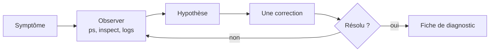

# Lab 8.2 : Dépanner des pannes imposées

| | |
|---|---|
| **Durée** | 90 min |
| **Niveau** | Semi-guidé |
| **Prérequis** | [Lab 8.1 : Superviser une pile applicative](lab-8-1-superviser-une-pile-applicative.md), sections 5 à 8 du [cours](cours.md) |
| **Acquis visés** | AA6 |

!!! abstract "Objectifs"
    - Appliquer la démarche de diagnostic du cours à des pannes que vous n'avez pas provoquées
    - Identifier la cause d'une panne à partir de l'état, du code de sortie, des journaux et de la configuration
    - Corriger **une seule chose à la fois** et vérifier la correction
    - Rédiger une fiche de diagnostic pour chaque panne

## Contexte et schéma

On vous fournit quatre petites piles Compose qui **ne fonctionnent pas** (et une cinquième, facultative). Pour chacune, vous constatez un symptôme, vous cherchez la cause avec les outils du chapitre, vous corrigez, puis vous prouvez que la panne est résolue.



!!! warning "Règle du jeu"
    Pour chaque panne, **observez d'abord** (état, code de sortie, journaux, configuration réelle) avant de relire le fichier Compose à la recherche de la faute. Notez les commandes que vous utilisez : elles figureront dans votre fiche. Les corrigés ne sont pas publiés ; faites valider votre fiche par votre enseignant.

!!! note "Selon votre option"
    Sous PowerShell, utilisez `curl.exe` et écrivez les commandes sur une seule ligne.

## Étapes

### Étape 0 : Préparer les dossiers

- **Objectif :** disposer d'un dossier par panne.
- **Indices :** créez un dossier `tp-pannes` contenant quatre sous-dossiers `panne1`, `panne2`, `panne3` et `panne4`. Dans chacun, le fichier fourni ci-dessous s'enregistre sous le nom `compose.yaml`. Travaillez toujours **dans le dossier de la panne** (`docker compose` y lit le fichier).
- Avant de commencer, supprimez les conteneurs des labs précédents qui pourraient occuper des ports (`docker ps -a`).

!!! success "Point de contrôle"
    - [ ] Les quatre dossiers existent et la commande `docker compose config` s'exécute sans erreur dans chacun une fois le fichier copié

### Étape 1 : Panne 1, le service qui ne reste pas démarré

- **Symptôme :** après `docker compose up -d`, la commande ne signale aucune erreur, mais le service n'apparaît pas comme `running`.

??? note "Fichier `panne1/compose.yaml` (à copier)"
    ```yaml
    services:
      db:
        image: postgres:16-alpine
        environment:
          POSTGRES_USER: etudiant
          POSTGRES_DB: cours
        volumes:
          - pgdata:/var/lib/postgresql/data

    volumes:
      pgdata:
    ```

- **Démarche :** état de la pile, code de sortie du conteneur, journaux. Proposez une correction, appliquez-la (`docker compose up -d`) et vérifiez que la base accepte des connexions (`docker compose exec db pg_isready -U etudiant`).
- **Indice de méthode :** `docker compose ps -a` montre aussi les conteneurs arrêtés.

!!! success "Point de contrôle"
    - [ ] Vous avez relevé l'état et le code de sortie du conteneur
    - [ ] Vous avez retrouvé dans les journaux le message qui explique l'arrêt
    - [ ] Après correction, `pg_isready` répond que la base accepte les connexions
    - [ ] Votre fiche de la panne 1 est complétée (étape 6)

### Étape 2 : Panne 2, le port publié qui ne répond pas

- **Symptôme :** le conteneur est `running` et son port est publié, mais `curl http://localhost:8000` ne renvoie pas de page (réponse vide ou connexion coupée).

??? note "Fichier `panne2/compose.yaml` (à copier)"
    ```yaml
    services:
      web:
        image: python:3.12-slim
        command: ["python", "-m", "http.server", "8000", "--bind", "127.0.0.1"]
        ports:
          - "8000:8000"
    ```

- **Démarche :** vérifiez que le port est bien publié (`docker port`), lisez les journaux, puis testez le service **depuis l'intérieur** du conteneur. L'image ne contient pas `curl` : utilisez Python, par exemple `docker compose exec web python -c "import urllib.request; print(urllib.request.urlopen('http://127.0.0.1:8000').status)"`. Comparez avec un test depuis l'hôte, puis relisez la section 8.1 du [cours](cours.md).
- Proposez une correction et vérifiez avec `curl`.

!!! success "Point de contrôle"
    - [ ] Vous avez montré que le service répond **dans** le conteneur mais pas depuis l'hôte
    - [ ] Vous avez identifié l'adresse sur laquelle le serveur écoute, dans les journaux
    - [ ] Après correction, `curl http://localhost:8000` renvoie une page
    - [ ] Votre fiche de la panne 2 est complétée

### Étape 3 : Panne 3, le nom qui ne se résout pas

- **Symptôme :** les deux services sont `running`, mais le service `app` n'atteint jamais la base : ses journaux répètent le même message.

??? note "Fichier `panne3/compose.yaml` (à copier)"
    ```yaml
    services:
      db:
        image: postgres:16-alpine
        environment:
          POSTGRES_USER: etudiant
          POSTGRES_PASSWORD: motdepasse-tp
          POSTGRES_DB: cours
        networks:
          - backend

      app:
        image: postgres:16-alpine
        command: ["sh", "-c", "until pg_isready -h db -U etudiant; do echo attente de db; sleep 2; done; echo connecte; sleep 3600"]
        networks:
          - frontend

    networks:
      frontend:
      backend:
    ```

- **Démarche :** vérifiez d'abord que la base fonctionne (`docker compose exec db pg_isready -U etudiant`), puis examinez les journaux de `app`, puis les réseaux de chaque conteneur (`docker inspect`, `docker network inspect`). Testez la résolution du nom depuis `app`.
- Proposez une correction qui **ne supprime pas** le cloisonnement voulu entre les réseaux (la base doit rester sur `backend`).

!!! success "Point de contrôle"
    - [ ] Vous avez montré que la base est saine
    - [ ] Vous avez identifié, avec une commande, les réseaux de `app` et de `db`
    - [ ] Après correction, les journaux de `app` affichent `connecte`
    - [ ] Votre fiche de la panne 3 est complétée

### Étape 4 : Panne 4, le conteneur qui redémarre en boucle

- **Symptôme :** le service est sans cesse redémarré ; son message de réussite n'apparaît jamais dans les journaux.

??? note "Fichier `panne4/compose.yaml` (à copier)"
    ```yaml
    services:
      traitement:
        image: python:3.12-slim
        command: ["python", "-c", "x = b'a' * (100 * 1024 * 1024); print('memoire allouee', flush=True); import time; time.sleep(3600)"]
        mem_limit: 64m
        restart: on-failure
    ```

- **Démarche :** état, code de sortie, indicateur `OOMKilled`, événements. Estimez la mémoire dont le programme a besoin, **sans deviner** : corrigez la limite et mesurez la consommation réelle avec `docker stats --no-stream`.
- Vérifiez que le message `memoire allouee` apparaît dans les journaux et que le conteneur reste en fonctionnement.

!!! success "Point de contrôle"
    - [ ] Vous avez relevé le code de sortie et `OOMKilled`
    - [ ] Vous avez justifié la nouvelle limite par une mesure
    - [ ] Après correction, le conteneur reste `running` et le message apparaît
    - [ ] Votre fiche de la panne 4 est complétée

### Étape 5 (facultative) : Panne 5, le service « unhealthy »

- **Symptôme :** le site répond à `curl`, mais Docker déclare le service `unhealthy` au bout de quelques secondes.
- Créez un dossier `panne5` avec le fichier suivant.

??? note "Fichier `panne5/compose.yaml` (à copier)"
    ```yaml
    services:
      web:
        image: nginx:1.27-alpine
        ports:
          - "8080:80"
        healthcheck:
          test: ["CMD", "wget", "-q", "-O", "/dev/null", "http://localhost:8080"]
          interval: 5s
          timeout: 3s
          retries: 3
    ```

- **Démarche :** lisez le détail des vérifications (`.State.Health`), testez la commande du healthcheck à la main dans le conteneur (`docker compose exec web ...`), proposez une correction.

!!! success "Point de contrôle"
    - [ ] Vous avez trouvé le message d'erreur du healthcheck
    - [ ] Après correction, le service passe `healthy`
    - [ ] Vous savez dire pourquoi le site fonctionnait alors que l'état était `unhealthy`

### Étape 6 : Rédiger vos fiches de diagnostic

- **Objectif :** garder une trace réutilisable de chaque diagnostic.
- **Indices :** pour chaque panne, remplissez un tableau comme celui-ci :

| Rubrique | Contenu |
|---|---|
| Panne | Numéro et symptôme observé |
| Commandes utilisées | Dans l'ordre, avec le résultat clé de chacune |
| Cause | Une phrase |
| Correction | Ce que vous avez changé, et dans quel fichier |
| Vérification | La commande qui prouve que c'est résolu |
| Prévention | Comment éviter cette panne (une phrase) |

!!! success "Point de contrôle"
    - [ ] Vous avez une fiche pour chaque panne traitée
    - [ ] Chaque fiche cite des commandes que vous avez réellement exécutées

## Questions de réflexion

??? question "Pourquoi relire le fichier Compose en dernier plutôt qu'en premier ?"
    Un fichier lu sans symptôme précis amène à deviner. Les observations (état, code de sortie, journaux) désignent la cause et orientent la lecture de la configuration vers le bon endroit ; la méthode vaut aussi quand le fichier est long ou écrit par quelqu'un d'autre.

??? question "Pourquoi tester un service depuis l'intérieur du conteneur avant de tester depuis l'hôte ?"
    Cela sépare deux questions : « le service fonctionne-t-il ? » et « est-il joignable de l'extérieur ? ». Si le service répond à l'intérieur mais pas depuis l'hôte, le problème vient du réseau, de l'adresse d'écoute ou de la publication du port.

??? question "Pourquoi corriger une seule chose à la fois ?"
    On sait ainsi quelle modification a résolu (ou aggravé) le problème. Plusieurs changements simultanés masquent la cause réelle et peuvent introduire de nouvelles pannes.

## Dépannage

| Symptôme | Pistes |
|---|---|
| `docker compose` ne trouve pas de fichier | Vous n'êtes pas dans le dossier de la panne, ou le fichier ne s'appelle pas `compose.yaml` |
| `port is already allocated` | Un conteneur d'un lab précédent utilise le port : supprimez-le |
| Erreur de syntaxe YAML à la copie | Indentation altérée par la copie : n'utilisez que des espaces |
| La panne 4 ne se reproduit pas | La machine dispose peut-être d'un comportement de mémoire différent (Docker Desktop) : essayez `mem_limit: 32m` |
| La panne 2 : `curl` renvoie malgré tout une page | Le serveur écoute peut-être aussi sur une autre adresse : relisez les journaux |
| Après une correction, l'ancien comportement persiste | La pile n'a pas été recréée : relancez `docker compose up -d` après modification du fichier |

## Nettoyage et reprise

Dans chaque dossier de panne :

```bash
docker compose down -v
```

Les corrections que vous avez apportées aux fichiers peuvent être conservées dans un dossier `tp-pannes-corriges`, avec vos fiches de diagnostic, pour la préparation du [Mini-projet 2](../mini-projet-2.md).

## Retour au chapitre

[Chapitre 8 : Observabilité et dépannage](cours.md) · Quiz : [Quiz du chapitre 8](quiz.md)