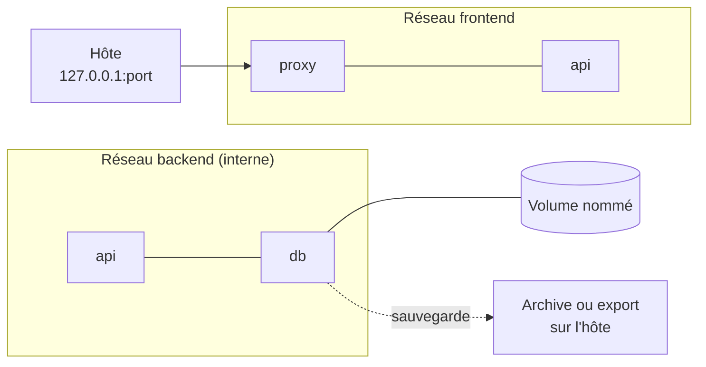

# Mini-projet 2 : Pile applicative persistante, cloisonnée et supervisée

## 1. Fiche du mini-projet

| Rubrique | Description |
|---|---|
| Cours | Docker : conteneurisation, orchestration et industrialisation d'applications |
| Position | Fin de la Partie 2 : Données, réseau et exploitation (chapitres 5 à 8) |
| Modalité | En binôme, hors séance, avec une démonstration de 5 min en début de séance suivante |
| Durée | Environ 3 h de travail + compte rendu |
| Prérequis | Labs 5.1 à 8.2 réalisés, en particulier le [Lab 7.2](ch07-docker-compose/lab-7-2-application-trois-niveaux-avec-compose.md) (dossier `tp-trois-niveaux`) |
| Environnement | Au choix : Docker Desktop, Ubuntu Desktop ou Ubuntu Server (voir [Environnement de travail](../annexes/environnement.md)) |
| Acquis visés | AA4 (gérer données et réseau), AA5 (orchestrer avec Docker Compose), AA6 (superviser et dépanner) |

## 2. Contexte

Votre équipe doit mettre en exploitation une application web qui enregistre des données dans une base PostgreSQL. L'application est prête, mais son exploitation ne l'est pas : personne n'a décrit comment la démarrer d'un coup, comment protéger la base, comment savoir si elle va bien, ni comment récupérer les données après un incident. Vous êtes l'équipe d'exploitation. Votre mission : livrer une **pile Compose** qui démarre avec une seule commande, dont les données sont **persistantes** et **sauvegardables**, dont les composants sont **cloisonnés**, et que n'importe quel collègue peut **superviser et dépanner** grâce à un dossier d'exploitation.

!!! info "Ce qui est évalué"
    Vous pouvez reprendre l'application du Lab 7.2 ou une autre application web utilisant une base PostgreSQL. **L'évaluation porte sur la conception et l'exploitation de la pile, et non sur la qualité du code de l'application.**

## 3. Objectifs pédagogiques

À l'issue du mini-projet, vous serez capables de :

1. décrire une application multi-services dans un fichier Compose reproductible ;
2. cloisonner les niveaux d'une application avec des réseaux et n'exposer que son point d'entrée ;
3. conserver, sauvegarder et restaurer les données d'une base ;
4. paramétrer la pile sans y écrire de secret ;
5. mesurer la consommation, fixer des limites justifiées et définir des healthchecks ;
6. diagnostiquer une panne avec méthode et documenter l'exploitation de la pile.

## 4. Architecture cible

## 5. Cahier des charges

| N° | Exigence |
|---|---|
| E1 | La pile comporte **trois services** : un point d'entrée (`proxy`), une application (`api`, construite depuis un Dockerfile du dépôt) et une base PostgreSQL (`db`). Toutes les images externes ont une **version explicite**. |
| E2 | Un **seul fichier `compose.yaml`** décrit la pile : après `git clone` et création du fichier `.env`, la commande `docker compose up -d --build` démarre tout. |
| E3 | Deux réseaux : `frontend` et `backend` (**interne**). Le proxy ne peut **pas** joindre la base. **Seul le proxy** publie un port, limité à l'interface locale de l'hôte. |
| E4 | Les données de la base sont dans un **volume nommé** : elles survivent à `docker compose down` puis `up`. |
| E5 | Les identifiants et le port publié viennent d'un fichier **`.env` non versionné** ; un fichier **`.env.example`** (valeurs fictives) et un `.gitignore` sont fournis. Aucun secret n'est présent dans le dépôt. |
| E6 | `db` et `api` ont un **healthcheck** ; l'`api` ne démarre que si `db` est `healthy` et le proxy que si l'`api` est `healthy`. |
| E7 | Chaque service a des **limites de mémoire** (et de processeur pour l'`api`), **justifiées par des mesures** de `docker stats` présentées dans un tableau. |
| E8 | Une **procédure de sauvegarde et de restauration** de la base est décrite et **prouvée** : vous détruisez les données puis les retrouvez à l'identique. |
| E9 | Un fichier **`SUPERVISION.md`** (dossier d'exploitation) décrit comment superviser la pile et comment la dépanner, et contient la **fiche de diagnostic** d'une panne imposée (étape 5). |
| E10 | Un **`README.md`** permet à une équipe extérieure de démarrer, utiliser et arrêter la pile **sans vous poser de question**. |

## 6. Application et images suggérées

- **Option simple :** reprenez l'API Flask, le Dockerfile et la configuration nginx du [Lab 7.2](ch07-docker-compose/lab-7-2-application-trois-niveaux-avec-compose.md), avec `nginx:1.27-alpine` et `postgres:16-alpine`.
- **Option libre :** une autre application web simple utilisant PostgreSQL, après accord de votre enseignant. Fixez la version de chaque image.

Ne passez pas de temps à perfectionner le code de l'application : le temps est consacré à la pile et à son exploitation.

## 7. Démarche guidée en étapes

Chaque étape propose un but, des indices (pas la solution), un point de contrôle et une question à traiter dans votre compte rendu.

### Étape 0 : Préparer le projet (15 min)

- **But :** disposer d'un dossier de travail propre et versionné.
- **Indices :** créez un dossier de projet (ou reprenez `tp-trois-niveaux`), initialisez un dépôt Git, répartissez les rôles dans le binôme (par exemple : l'un écrit la pile, l'autre prépare la procédure de sauvegarde et le dossier de supervision, puis vous échangez).
- **Point de contrôle :** le dépôt existe et contient l'application et ses fichiers de configuration.
- **Question :** pourquoi versionne-t-on le fichier Compose avec le code de l'application ?

### Étape 1 : Concevoir l'architecture (20 min)

- **But :** décider, avant d'écrire, qui est branché sur quoi (E1, E3).
- **Indices :** complétez le tableau service, image, réseaux, port publié, volume. Repartez du schéma du [Lab 6.2](ch06-reseau-docker/lab-6-2-isoler-une-application-par-reseaux.md).
- **Point de contrôle :** un schéma et un tableau décrivent les trois services, les deux réseaux, le volume et l'unique port publié.
- **Question :** pourquoi la base ne publie-t-elle aucun port ?

### Étape 2 : Écrire le fichier Compose et le démarrer (35 min)

- **But :** obtenir une pile qui démarre d'un coup (E1, E2, E3, E5).
- **Indices :** [Lab 7.2](ch07-docker-compose/lab-7-2-application-trois-niveaux-avec-compose.md). Sortez les identifiants et le port du fichier Compose (`.env`, `.env.example`, `.gitignore`). Contrôlez avec `docker compose config`.
- **Point de contrôle :** après suppression de la pile, `docker compose up -d --build` la recrée, et `curl` sur le port publié renvoie une réponse. Vous prouvez le cloisonnement avec un test de résolution de nom depuis le proxy vers la base.
- **Question :** quel changement du fichier Compose faudrait-il pour que le proxy puisse joindre la base, et pourquoi ne faut-il pas le faire ?

### Étape 3 : Rendre les données persistantes et sauvegardables (30 min)

- **But :** protéger les données (E4, E8).
- **Indices :** volume nommé pour la base ([Lab 5.1](ch05-volumes-et-persistance/lab-5-1-persister-des-donnees.md)). Choisissez une méthode de sauvegarde : archive du volume avec un conteneur temporaire ou export avec l'outil de la base ([Lab 5.2](ch05-volumes-et-persistance/lab-5-2-sauvegarder-et-restaurer-un-volume.md)). Décrivez la méthode **et sa restauration** dans le README.
- **Point de contrôle :** vous insérez des données, sauvegardez, supprimez le volume (`down -v`), restaurez, et retrouvez les mêmes données.
- **Question :** quelle différence de garanties entre l'archive du volume et l'export par l'outil de la base ?

### Étape 4 : Healthchecks et limites de ressources (30 min)

- **But :** rendre la pile surveillable et maîtrisée (E6, E7).
- **Indices :** [chapitre 7](ch07-docker-compose/cours.md), section 7, pour les healthchecks et `depends_on`. [Lab 8.1](ch08-observabilite-et-depannage/lab-8-1-superviser-une-pile-applicative.md) pour la mesure avec `docker stats` : relevez la consommation **sous charge** (générez des requêtes), puis fixez les limites avec une marge.
- **Point de contrôle :** `docker compose ps` affiche `healthy` pour `db` et `api` ; `docker stats` affiche vos limites ; le tableau de mesures est rempli.
- **Question :** comment avez-vous choisi chaque limite, et que se passerait-il si la limite de mémoire de la base était trop basse ?

### Étape 5 : Panne et diagnostic (20 min)

- **But :** appliquer la démarche du [chapitre 8](ch08-observabilite-et-depannage/cours.md) à une panne que vous n'avez pas provoquée (E9).
- **Scénario :** votre binôme voisin (ou votre enseignant) introduit **une** erreur dans votre pile, par exemple dans la configuration d'un service, un réseau, une variable ou une limite. Vous la trouvez et la corrigez, comme au [Lab 8.2](ch08-observabilite-et-depannage/lab-8-2-depanner-des-pannes-imposees.md), sans relire d'abord le fichier.
- **Indices :** état, code de sortie, journaux, configuration, réseau, ressources. Notez l'ordre de vos investigations.
- **Point de contrôle :** la pile fonctionne de nouveau et vous avez rempli une fiche de diagnostic (symptôme, commandes, cause, correction, vérification, prévention).
- **Question :** quels symptômes vous ont mis sur la piste et quelle est la cause racine ?

### Étape 6 : Rédiger le dossier de supervision (15 min)

- **But :** transmettre l'exploitation de la pile (E9).
- **Indices :** `SUPERVISION.md` contient au minimum : comment consulter les journaux de chaque service, comment lire l'état de santé, comment mesurer la consommation, comment mesurer l'espace disque (`docker system df`), la démarche de diagnostic en quelques lignes, et la fiche de la panne de l'étape 5.
- **Point de contrôle :** un collègue peut, avec ce seul fichier, savoir où regarder en cas de problème.
- **Question :** quelle information manquerait à un collègue qui devrait dépanner la pile un week-end ?

### Étape 7 : Documenter et valider avec un autre binôme (15 min)

- **But :** prouver que votre pile est utilisable par d'autres (E10).
- **Indices :** rédigez le `README.md` (voir la section 8), puis demandez à un autre binôme de démarrer votre pile **en suivant uniquement votre README**.
- **Point de contrôle :** l'autre binôme obtient une pile fonctionnelle sans vous poser de question.
- **Question :** quelles informations manquaient dans votre README lors du premier essai ?

## 8. Livrables

1. **Dépôt Git** contenant le code, le `Dockerfile` de l'API, la configuration du proxy, le fichier `compose.yaml`, `.env.example`, `.gitignore`, le `README.md` et `SUPERVISION.md`. Le README indique : ce que fait l'application, le schéma de l'architecture, comment démarrer et arrêter la pile (commandes complètes), les variables de `.env` avec leur rôle, comment sauvegarder et restaurer la base, et les adresses utiles.
2. **Compte rendu** (2 à 3 pages) comprenant :
   - les réponses aux questions de chaque étape ;
   - le tableau d'architecture de l'étape 1 ;
   - le tableau des mesures de consommation et des limites choisies ;
   - des sorties de commandes ou captures prouvant les exigences E3, E4, E6 et E8 ;
   - un court paragraphe « difficultés rencontrées et enseignements ».
3. **Démonstration orale** de 5 minutes au début de la séance suivante : démarrage de la pile, test du site, preuve du cloisonnement, état de santé, simulation d'une sauvegarde et d'une restauration (ou montage de la preuve préparée).

## 9. Grille d'évaluation (/20)

| Critère | Points | AA |
|---|---|---|
| Pile Compose reproductible et cloisonnée : services, réseaux, ports (E1, E2, E3) | 5 | AA4, AA5 |
| Persistance, sauvegarde et restauration prouvées (E4, E8) | 4 | AA4 |
| Configuration et gestion des secrets (E5) | 2 | AA5 |
| Healthchecks, dépendances et limites justifiées (E6, E7) | 3 | AA5, AA6 |
| Diagnostic de la panne et dossier de supervision (E9) | 3 | AA6 |
| README, compte rendu et démonstration (E10) | 3 | AA5, AA6 |

## 10. Pour aller plus loin (facultatif)

- Automatiser la sauvegarde avec un script daté (nom de l'archive contenant la date) et décrire une politique de conservation.
- Ajouter un second service d'administration de la base, joignable uniquement depuis l'hôte.
- Comparer la consommation de la pile au repos et sous charge, et expliquer l'écart dans votre dossier de supervision.

## 11. Erreurs fréquentes et conseils de diagnostic

| Symptôme | Pistes |
|---|---|
| `password authentication failed` après un changement de `.env` | Le volume contient déjà une base initialisée avec l'ancien mot de passe : utilisez l'ancien, ou supprimez le volume pour repartir de zéro |
| L'API démarre avant que la base soit prête | Healthcheck absent ou `depends_on` sans `condition: service_healthy` |
| Le proxy renvoie une erreur 502 après une recréation de l'API | Le proxy garde l'ancienne adresse de l'API : redémarrez-le, et vérifiez l'ordre de démarrage |
| Le proxy joint la base | Les deux services partagent un réseau : relisez la section `networks` de chacun |
| La base est joignable depuis l'extérieur | Un port est publié pour `db` : retirez la clé `ports` |
| Les données disparaissent à chaque redémarrage | Volume absent, volume anonyme, ou `down -v` exécuté |
| Le conteneur redémarre en boucle avec le code 137 | Limite de mémoire trop basse : mesurez, puis relevez la limite |
| La restauration échoue | Version de l'image différente de celle d'origine, ou sauvegarde faite base en fonctionnement (archive du volume) |
| Le fichier `.env` apparaît dans `git status` | Il manque dans `.gitignore` : ajoutez-le, et révoquez les secrets déjà publiés |

## 12. Aide-mémoire

| Besoin | Commande |
|---|---|
| Valider le fichier Compose | `docker compose config` |
| Démarrer / arrêter la pile | `docker compose up -d --build`, `docker compose down` |
| État et santé | `docker compose ps`, `docker inspect -f '{{json .State.Health}}' conteneur` |
| Journaux | `docker compose logs -f service` |
| Consommation et événements | `docker stats --no-stream`, `docker events --since 10m` |
| Tester la résolution de noms | `docker compose exec service ping -c 2 autre-service` |
| Réseaux et volumes | `docker network inspect`, `docker volume ls` |
| Espace disque | `docker system df` |