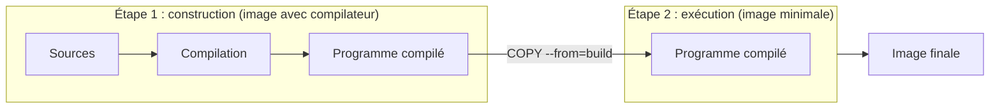

# Chapitre 9 : Optimisation des images

!!! abstract "Objectifs du chapitre"
    - Expliquer pourquoi une image légère est préférable et ce qui détermine sa taille
    - Comparer les images de base (complète, `slim`, `alpine`, `scratch`) et leurs contraintes
    - Écrire un Dockerfile **multi-stage** qui sépare la construction de l'exécution
    - Décrire ce qu'apporte BuildKit
    - Mesurer la taille d'une image et la durée de sa construction
    - Acquis d'apprentissage visés : **AA7** (réduire la surface d'attaque) et **AA3** (construire des images)

## 1. Pourquoi optimiser une image ?

Une image fonctionnelle n'est pas forcément une bonne image. Une image inutilement grosse coûte à chaque étape de sa vie :

| Conséquence | Explication |
|---|---|
| **Téléchargement lent** | Chaque machine qui lance l'image la télécharge : plus elle est grosse, plus le déploiement est long |
| **Stockage** | Un registre et chaque hôte conservent toutes les images : l'espace disque s'accumule (chapitre 8) |
| **Surface d'attaque** | Chaque paquet présent dans l'image peut contenir une faille. Un compilateur, un gestionnaire de paquets ou un shell absents ne peuvent pas être exploités |
| **Reconstruction lente** | Plus de couches et de contenu à produire, à envoyer et à stocker |

!!! note "Légère ne veut pas dire meilleure à tout prix"
    On optimise pour un besoin précis : un déploiement rapide, une surface d'attaque réduite. Une image minimale plus difficile à déboguer ou incompatible avec votre application n'est pas un progrès. Ce chapitre vous apprend à **mesurer** avant de décider.

## 2. D'où vient la taille d'une image ?

Vous savez qu'une image est une pile de **couches** (chapitre 3). Sa taille est la somme des couches. La commande `docker history` détaille chacune, et `docker images` donne le total :

```bash
docker images monapp
docker history monapp:1.0
```

Trois sources de poids sont fréquentes :

1. **L'image de base** : souvent la plus grosse part.
2. **Les outils de construction** (compilateurs, en-têtes de bibliothèques, gestionnaire de paquets) qui ne servent plus à l'exécution.
3. **Les fichiers temporaires** (caches de téléchargement, listes de paquets, sources).

### 2.1 Supprimer dans une autre couche ne réduit rien

Les couches sont **immuables** : un fichier ajouté par une couche reste dans l'image, même si une instruction ultérieure le supprime. La suppression le masque seulement.

=== "Inefficace : la taille ne diminue pas"

    ```dockerfile
    RUN apt-get update && apt-get install -y curl
    RUN rm -rf /var/lib/apt/lists/*
    ```

    Les listes de paquets sont conservées dans la première couche ; la seconde ne fait que les cacher.

=== "Efficace : nettoyer dans la **même** instruction"

    ```dockerfile
    RUN apt-get update \
        && apt-get install -y --no-install-recommends curl \
        && rm -rf /var/lib/apt/lists/*
    ```

    Rien d'inutile n'est enregistré dans la couche.

La construction **multi-stage** (section 4) va plus loin : elle écarte en une fois tous les outils de construction.

## 3. Choisir l'image de base

Au chapitre 3, vous avez vu les familles d'images de base. Voici ce qu'il faut savoir pour choisir.

| Famille | Principe | Intérêt | Contraintes |
|---|---|---|---|
| Image complète (`python:3.12`) | Distribution complète et outils | Pratique, tout est présent | La plus volumineuse |
| `-slim` (`python:3.12-slim`) | Distribution Debian allégée | Bon compromis | Moins d'outils : certains paquets sont à installer |
| `alpine` (`python:3.12-alpine`) | Distribution Alpine, très légère | Très petite | Bibliothèque C différente (**musl**) : certains programmes ou bibliothèques précompilées ne fonctionnent pas ou sont à recompiler |
| `scratch` | Image **vide**, sans aucun fichier | La plus petite possible | Seulement pour des programmes **autonomes** (binaire statique) : ni shell, ni certificats, ni utilisateur |
| Images « distroless » | Contiennent l'application et son environnement d'exécution, sans shell ni gestionnaire de paquets | Surface d'attaque réduite | Débogage plus difficile, choix plus restreint |

!!! warning "Alpine : tester avant de s'engager"
    Alpine donne souvent les plus petites images, mais sa bibliothèque C diffère de celle de Debian. Une application qui fonctionne sur `-slim` peut échouer ou devenir lente sur Alpine. Mesurez et **testez** l'application dans l'image choisie.

!!! tip "Une version précise, toujours"
    Quelle que soit la famille, fixez la version (`python:3.12-slim`, `alpine:3.20`) : la construction reste reproductible. Vous comparerez ces images au [Lab 9.2](lab-9-2-reduire-et-comparer-des-images.md).

## 4. La construction multi-stage

### 4.1 Le principe

Beaucoup d'applications ont besoin d'outils pour être **construites** (compilateur, gestionnaire de dépendances) qui sont inutiles pour être **exécutées**. Avec un Dockerfile classique, ces outils restent dans l'image finale.

Un Dockerfile **multi-stage** contient plusieurs instructions `FROM`. Chacune démarre une **étape** (stage) indépendante. Une étape peut copier des fichiers produits par une étape précédente ; **seule la dernière étape** devient l'image finale.



### 4.2 Syntaxe

| Élément | Rôle |
|---|---|
| `FROM image AS nom` | Démarre une étape et lui donne un nom |
| `COPY --from=nom /chemin /destination` | Copie des fichiers depuis l'étape `nom` |
| Dernière instruction `FROM` | Définit l'image finale ; les étapes précédentes n'y apparaissent pas |

### 4.3 Exemple : un programme compilé

Prenons un petit serveur web écrit en **Go**, un langage compilé. Pour le compiler, il faut l'image `golang`, qui contient le compilateur et pèse plusieurs centaines de Mo. Le résultat est un **unique fichier exécutable**. Vous n'avez pas besoin de connaître Go : le code vous sera fourni au [Lab 9.1](lab-9-1-construire-avec-multi-stage.md).

=== "Sans multi-stage"

    ```dockerfile
    FROM golang:1.22-alpine
    WORKDIR /src
    COPY . .
    RUN go build -o /serveur .
    CMD ["/serveur"]
    ```

    L'image finale contient le compilateur et les sources, alors que seul le programme compilé est utile à l'exécution.

=== "Avec multi-stage"

    ```dockerfile
    FROM golang:1.22-alpine AS build
    WORKDIR /src
    COPY go.mod .
    COPY main.go .
    RUN CGO_ENABLED=0 go build -o /serveur .

    FROM alpine:3.20
    COPY --from=build /serveur /serveur
    EXPOSE 8080
    CMD ["/serveur"]
    ```

    L'étape `build` compile ; l'étape finale ne contient qu'Alpine et le programme. Le compilateur n'est **pas** dans l'image livrée.

!!! note "`CGO_ENABLED=0`"
    Cette variable demande à Go de produire un programme **statique**, sans dépendance à la bibliothèque C du système. C'est ce qui permet de l'exécuter sur une image très différente de celle qui l'a compilé, et même sur `scratch`.

### 4.4 Aller plus loin avec `scratch`

Un programme statique peut s'exécuter dans une image **vide** :

```dockerfile
FROM scratch
COPY --from=build /serveur /serveur
CMD ["/serveur"]
```

L'image finale ne contient que le programme : la taille est minimale et la surface d'attaque aussi. En contrepartie :

- pas de **shell** : `docker exec -it conteneur sh` échoue ;
- pas de **certificats** racine : le programme ne peut pas valider une connexion sécurisée vers l'extérieur sans qu'on les copie ;
- pas d'outils de diagnostic.

### 4.5 Le cas de Python

Python n'est pas compilé : l'étape finale a toujours besoin de l'interpréteur. Le multi-stage sert à écarter les **outils de construction des dépendances** (compilateurs, en-têtes) lorsqu'une dépendance doit être compilée à l'installation :

```dockerfile
FROM python:3.12-slim AS builder
WORKDIR /app
COPY requirements.txt .
RUN pip install --no-cache-dir --prefix=/install -r requirements.txt

FROM python:3.12-slim
WORKDIR /app
COPY --from=builder /install /usr/local
COPY app.py .
CMD ["python", "app.py"]
```

L'étape `builder` installe les dépendances dans un dossier séparé (`/install`) ; l'image finale n'en reprend que le résultat.

!!! note "Un gain variable selon le langage"
    Avec une application Flask dont les dépendances sont fournies précompilées, le gain d'un multi-stage Python est **modeste** : il est surtout décisif pour les langages compilés, ou quand des paquets exigent un compilateur. Mesurez avant de conclure.

### 4.6 Construire une étape précise

L'option `--target` arrête la construction à l'étape indiquée. C'est utile pour déboguer l'étape de construction ou comparer ses résultats :

```bash
docker build --target build -t monapp:build .
docker build -t monapp:1.0 .
```

## 5. BuildKit

**BuildKit** est le moteur de construction de Docker. Dans les versions récentes, il est utilisé par défaut par `docker build`. Sa sortie est plus lisible (étapes numérotées, durée de chacune, mention `CACHED`), et il apporte des améliorations de fond :

| Apport | Effet |
|---|---|
| **Étapes en parallèle** | Les étapes indépendantes d'un Dockerfile multi-stage sont construites simultanément |
| **Étapes inutiles ignorées** | Seules les étapes nécessaires à la cible sont construites |
| **Cache plus efficace** | Meilleure réutilisation des couches, y compris entre constructions |
| **Montages de cache** | `RUN --mount=type=cache,target=...` conserve un dossier de cache (par exemple celui de `pip`) d'une construction à l'autre sans l'inclure dans l'image |
| **Secrets de construction** | `RUN --mount=type=secret,...` met un secret à disposition d'une instruction **sans** l'enregistrer dans l'image (étudié au chapitre 10) |

!!! note "Selon la version de Docker"
    Si votre installation est ancienne, BuildKit peut ne pas être actif par défaut. La sortie de `docker build` vous l'indique : une sortie avec des étapes numérotées `[1/5]` et des durées est celle de BuildKit.

## 6. Mesurer pour décider

On ne décide pas d'une optimisation à l'intuition. Pour chaque variante d'image, mesurez :

| Mesure | Comment |
|---|---|
| Taille de l'image | `docker images` (colonne `SIZE`) |
| Taille par couche | `docker history image:tag` |
| Durée d'une construction **à froid** | `time docker build --no-cache -t ... .` (sous PowerShell : `Measure-Command { docker build --no-cache -t ... . }`) |
| Durée d'une **reconstruction** après modification du code | Même mesure, sans `--no-cache`, après avoir modifié un fichier source |
| Fonctionnement | L'application répond-elle correctement dans cette image ? |

!!! warning "Comparer ce qui est comparable"
    La première construction inclut le téléchargement des images de base : elle dépend de votre connexion. Pour comparer deux variantes, répétez la mesure et notez les conditions. Une image plus petite qui échoue au démarrage n'est pas une réussite.

### 6.1 Tableau de décision

| Votre priorité | Orientation |
|---|---|
| Programme compilé, surface d'attaque minimale | Multi-stage, final `alpine` ou `scratch` |
| Application Python simple, compatibilité maximale | `-slim`, éventuellement multi-stage |
| Image la plus petite, compatibilité vérifiée | `alpine`, après test |
| Débogage fréquent dans le conteneur | Une image avec shell (`-slim` ou `alpine`) plutôt que `scratch` |

## 7. Bonnes pratiques d'optimisation

!!! tip "À retenir"
    - Une image plus petite se télécharge plus vite, occupe moins d'espace et expose moins de composants à d'éventuelles failles.
    - Les couches sont immuables : nettoyer dans une couche **ultérieure** ne réduit pas la taille ; nettoyez dans la même instruction `RUN`.
    - Le **multi-stage** sépare construction et exécution : seule la dernière étape forme l'image finale.
    - `scratch` convient aux programmes statiques, mais n'offre ni shell, ni certificats, ni outils de diagnostic.
    - Alpine est petite mais utilise une autre bibliothèque C : **testez** l'application.
    - **BuildKit** construit les étapes indépendantes en parallèle et ignore celles dont la cible n'a pas besoin.
    - **Mesurez** taille, durée de construction et fonctionnement avant de choisir.
    - Gardez le `.dockerignore` et l'ordre des instructions du chapitre 3 : ils restent la base d'un bon cache.

## Pour vérifier votre compréhension

??? question "Pourquoi `RUN rm -rf /var/lib/apt/lists/*` placé dans une instruction séparée ne réduit-il pas la taille de l'image ?"
    Parce que la couche qui a créé ces fichiers les contient toujours : une couche est immuable. La suppression dans une couche ultérieure ne fait que les masquer. Il faut nettoyer dans la **même** instruction `RUN`.

??? question "Que contient l'image finale d'un Dockerfile multi-stage ?"
    Uniquement ce que contient la **dernière** étape, y compris les fichiers qu'elle a copiés depuis les étapes précédentes avec `COPY --from`. Les outils des étapes précédentes n'y figurent pas.

??? question "Pourquoi une image `scratch` est-elle difficile à déboguer ?"
    Elle ne contient aucun fichier autre que votre programme : pas de shell, donc pas de `docker exec ... sh`, et pas d'outils de diagnostic. On s'appuie sur les journaux et sur une image de débogage séparée.

??? question "Pourquoi un programme Go doit-il être compilé avec `CGO_ENABLED=0` pour tourner sur `scratch` ?"
    Sans cette option, le programme peut dépendre de la bibliothèque C du système de construction, absente de `scratch`. Avec `CGO_ENABLED=0`, le programme est statique et se suffit à lui-même.

??? question "Quelles mesures effectueriez-vous pour choisir entre `python:3.12-slim` et une variante Alpine ?"
    La taille de l'image (`docker images`), la durée de construction à froid et en reconstruction, et surtout le **bon fonctionnement** de l'application dans chaque image. Une différence de taille ne justifie pas une image qui échoue ou qui ralentit l'application.

## Ressources du chapitre

- [Lab 9.1 : Construire avec multi-stage](lab-9-1-construire-avec-multi-stage.md)
- [Lab 9.2 : Réduire et comparer des images](lab-9-2-reduire-et-comparer-des-images.md)
- [Quiz du chapitre](quiz.md)