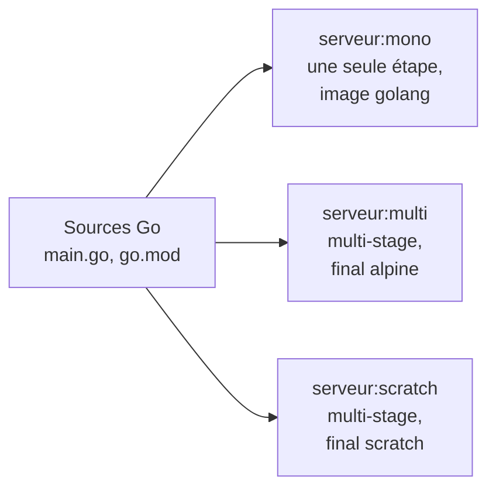

# Lab 9.1 : Construire avec multi-stage

| | |
|---|---|
| **Durée** | 60 min |
| **Niveau** | Semi-guidé |
| **Prérequis** | [Lab 8.2 : Dépanner des pannes imposées](../../partie-2-donnees-reseau-et-exploitation/ch08-observabilite-et-depannage/lab-8-2-depanner-des-pannes-imposees.md), cours du [chapitre 9](cours.md) |
| **Acquis visés** | AA7, AA3 |

!!! abstract "Objectifs"
    - Construire la même application avec et sans multi-stage, et mesurer l'écart de taille
    - Écrire un Dockerfile multi-stage dont l'image finale ne contient que le programme
    - Construire une image sur `scratch` et en mesurer les limites
    - Construire une étape précise avec `--target`
    - Observer l'effet du cache et de BuildKit lors d'une reconstruction

## Contexte et schéma

Vous conteneurisez un petit serveur web écrit en **Go**, un langage compilé. Vous n'avez pas besoin de connaître Go : le code vous est fourni. Vous produisez trois images du même programme, puis vous les comparez.



!!! note "Selon votre option"
    - Sous PowerShell, utilisez `curl.exe`. Pour mesurer une durée, remplacez `time commande` par `Measure-Command { commande }`.
    - Les premières constructions téléchargent l'image `golang:1.22-alpine` : prévoyez un délai selon votre connexion.

## Étapes

### Étape 1 : Préparer le projet

- **Objectif :** disposer du code de l'application.
- **Indices :** créez un dossier `tp-go` et placez-vous dedans, puis créez les trois fichiers suivants.

**`main.go`**

```go
package main

import (
	"fmt"
	"log"
	"net/http"
	"os"
)

func main() {
	message := os.Getenv("MESSAGE")
	if message == "" {
		message = "Bonjour depuis un serveur Go dans un conteneur !"
	}
	http.HandleFunc("/", func(w http.ResponseWriter, r *http.Request) {
		fmt.Fprintln(w, message)
	})
	log.Println("Serveur en écoute sur le port 8080")
	log.Fatal(http.ListenAndServe(":8080", nil))
}
```

**`go.mod`**

```text
module serveur

go 1.22
```

**`.dockerignore`**

```text
.git
*.md
```

!!! info "Ce que fait le programme"
    Il écoute sur le port 8080 (sur toutes les interfaces du conteneur) et renvoie un message. Si la variable d'environnement `MESSAGE` est définie, il renvoie sa valeur.

!!! success "Point de contrôle"
    - [ ] Le dossier contient `main.go`, `go.mod` et `.dockerignore`

### Étape 2 : Construire sans multi-stage

- **Objectif :** obtenir l'image de référence, avec le compilateur dedans.
- **Indices :**
    - Écrivez un `Dockerfile` qui part de `golang:1.22-alpine`, copie le projet, compile avec `go build -o /serveur .` et démarre `/serveur` (onglet « Sans multi-stage » de la section 4.3 du [cours](cours.md)).
    - Construisez l'image `serveur:mono` en mesurant la durée (`time docker build -t serveur:mono .`).
    - Lancez-la sur le port 8081 de l'hôte et testez avec `curl`.
    - Relevez sa taille avec `docker images serveur`.

!!! success "Point de contrôle"
    - [ ] `curl http://localhost:8081` affiche le message
    - [ ] Vous avez noté la taille de `serveur:mono` et la durée de construction

### Étape 3 : Construire en multi-stage avec une image finale `alpine`

- **Objectif :** séparer construction et exécution.
- **Indices :**
    - Dans le **même** dossier, créez un second fichier `Dockerfile.multi` : une première étape nommée `build` (`golang:1.22-alpine`) qui compile avec `CGO_ENABLED=0 go build -o /serveur .`, puis une étape finale à partir de `alpine:3.20` qui récupère `/serveur` avec `COPY --from=build` et le démarre (section 4.3 du [cours](cours.md)).
    - Copiez d'abord `go.mod`, puis `main.go` (ordre favorable au cache).
    - Construisez avec l'option `-f Dockerfile.multi` : `docker build -f Dockerfile.multi -t serveur:multi .`
    - Lancez sur le port 8082, testez, et comparez les tailles.
    - Observez les couches de l'image : `docker history serveur:multi`.

!!! success "Point de contrôle"
    - [ ] `curl http://localhost:8082` affiche le message
    - [ ] `serveur:multi` est nettement plus petite que `serveur:mono`
    - [ ] `docker history serveur:multi` ne montre aucune couche liée au compilateur Go

### Étape 4 : Construire sur `scratch`

- **Objectif :** produire l'image la plus petite possible.
- **Indices :**
    - Créez `Dockerfile.scratch`, identique à `Dockerfile.multi` mais avec une étape finale `FROM scratch` (section 4.4 du [cours](cours.md)). Ce Dockerfile n'a pas besoin de `EXPOSE`.
    - Construisez `serveur:scratch`, lancez-la sur le port 8083 et testez.
    - Essayez d'ouvrir un shell dans chaque conteneur : `docker exec -it <conteneur> sh`. Comparez les résultats pour les conteneurs `alpine` et `scratch`.

!!! success "Point de contrôle"
    - [ ] `curl http://localhost:8083` affiche le message
    - [ ] `serveur:scratch` est plus petite que `serveur:multi`
    - [ ] Le shell s'ouvre dans l'image `alpine` et pas dans l'image `scratch`
    - [ ] Vous pouvez expliquer pourquoi le programme fonctionne sur `scratch` grâce à `CGO_ENABLED=0`

### Étape 5 : Construire une étape précise avec `--target`

- **Objectif :** comparer l'étape de construction à l'image finale.
- **Indices :**
    - Construisez uniquement la première étape de `Dockerfile.multi` sous le nom `serveur:build` (option `--target build`, section 4.6 du [cours](cours.md)).
    - Comparez sa taille à celle de `serveur:multi`.
    - Vérifiez que le compilateur est présent dans `serveur:build` et absent de `serveur:multi` : `docker run --rm serveur:build go version`, puis la même commande avec `serveur:multi`.

!!! success "Point de contrôle"
    - [ ] `go version` s'affiche dans `serveur:build`
    - [ ] La commande échoue dans `serveur:multi`
    - [ ] Vous avez noté la taille de l'étape de construction

### Étape 6 : Observer le cache et BuildKit

- **Objectif :** voir ce qui est reconstruit quand le code change.
- **Indices :**
    - Reconstruisez `serveur:multi` **sans rien modifier** : relevez les étapes marquées `CACHED`.
    - Modifiez le message par défaut dans `main.go`, puis reconstruisez en mesurant la durée.
    - Relevez les étapes réexécutées. Repérez dans la sortie de BuildKit les étapes numérotées de chaque stage (par exemple `[build 4/4]`, `[stage-1 2/2]`).
    - Relancez le conteneur (supprimez l'ancien, créez-en un nouveau avec la nouvelle image) et vérifiez le nouveau message.

!!! success "Point de contrôle"
    - [ ] Sans modification, toutes les étapes sont `CACHED`
    - [ ] Après modification de `main.go`, la compilation est refaite, mais l'image de base n'est pas retéléchargée
    - [ ] Le nouveau message est servi

### Étape 7 : Dresser le tableau comparatif

- **Objectif :** décider avec des mesures.
- **Indices :** complétez le tableau avec **vos** mesures. Pour la durée à froid, ajoutez `--no-cache` à la construction ; pour la reconstruction, mesurez après une modification de `main.go`.

| Image | Taille | Durée de construction à froid | Durée de reconstruction | Shell disponible ? |
|---|---|---|---|---|
| `serveur:mono` | | | | |
| `serveur:multi` | | | | |
| `serveur:scratch` | | | | |

Concluez en une phrase : quelle image livreriez-vous en production pour ce programme, et pourquoi ?

!!! success "Point de contrôle"
    - [ ] Le tableau est complété avec des valeurs mesurées
    - [ ] Votre conclusion s'appuie sur ces mesures

### Étape 8 (facultative) : Multi-stage pour l'application Flask

- **Objectif :** mesurer le gain sur une application Python.
- **Indices :**
    - Reprenez le dossier `tp-flask` du [Lab 3.2](../../partie-1-fondations/ch03-images-et-dockerfile/lab-3-2-cache-et-couches.md).
    - Écrivez un Dockerfile multi-stage sur le modèle de la section 4.5 du [cours](cours.md) et comparez sa taille à celle de l'image obtenue sans multi-stage.

!!! success "Point de contrôle"
    - [ ] L'application répond dans les deux versions
    - [ ] Vous pouvez expliquer pourquoi le gain est plus faible qu'avec Go

## Questions de réflexion

??? question "Pourquoi l'image `serveur:mono` est-elle beaucoup plus grosse que `serveur:multi` pour le même programme ?"
    Parce qu'elle contient l'image `golang` complète : compilateur, outils et sources. Seul le fichier exécutable est utile à l'exécution, et c'est lui seul que l'image multi-stage conserve.

??? question "Pourquoi le programme fonctionne-t-il sur `alpine` et sur `scratch` alors qu'il a été compilé dans l'image `golang` ?"
    Il est compilé avec `CGO_ENABLED=0` : c'est un programme statique, sans dépendance à des bibliothèques du système. Il s'exécute donc sur n'importe quelle image, même vide.

??? question "Quel avantage de sécurité présente l'image `scratch` ? Quel inconvénient pour l'exploitation ?"
    Elle ne contient que le programme : pas de shell ni d'outils qu'un attaquant pourrait utiliser, et très peu de composants à maintenir. En contrepartie, on ne peut pas ouvrir de shell pour diagnostiquer, ni valider de certificats sans les ajouter.

??? question "Pourquoi la modification de `main.go` n'entraîne-t-elle pas un nouveau téléchargement de `golang:1.22-alpine` ?"
    Les images de base sont déjà présentes sur la machine, et les couches qui précèdent la copie de `main.go` restent dans le cache. Seules les instructions situées à partir de cette copie sont réexécutées.

## Dépannage

| Symptôme | Pistes |
|---|---|
| `pull access denied` ou image `golang:1.22-alpine` introuvable | Nom ou version incorrects : relisez le nom de l'image, vérifiez votre connexion |
| `go: cannot find main module` | Le fichier `go.mod` est absent ou n'a pas été copié dans l'image avant la compilation |
| `COPY failed: file not found` | Le fichier n'existe pas dans le dossier de construction, ou il est exclu par `.dockerignore` |
| `exec /serveur: no such file or directory` (image `alpine` ou `scratch`) | Le programme n'est pas statique : vérifiez `CGO_ENABLED=0` dans la commande de compilation |
| `curl` ne répond pas | Port publié incorrect, conteneur arrêté (`docker ps -a`, `docker logs`), ou port de l'hôte déjà utilisé |
| `docker exec ... sh` échoue sur `scratch` | Comportement attendu : l'image ne contient pas de shell |
| Sous PowerShell, `time` n'est pas reconnu | Utilisez `Measure-Command { docker build ... }` |
| La construction ne semble pas utiliser le Dockerfile voulu | Précisez-le avec l'option `-f` (`Dockerfile.multi`, `Dockerfile.scratch`) |

## Nettoyage et reprise

```bash
docker rm -f go-mono go-multi go-scratch
docker rmi serveur:mono serveur:multi serveur:scratch serveur:build
```

(Adaptez les noms de conteneurs à ceux que vous avez choisis.) Conservez le dossier `tp-go` : le [Lab 9.2](lab-9-2-reduire-et-comparer-des-images.md) le réutilise.

## Retour au chapitre

[Chapitre 9 : Optimisation des images](cours.md) · Lab suivant : [Lab 9.2 : Réduire et comparer des images](lab-9-2-reduire-et-comparer-des-images.md)