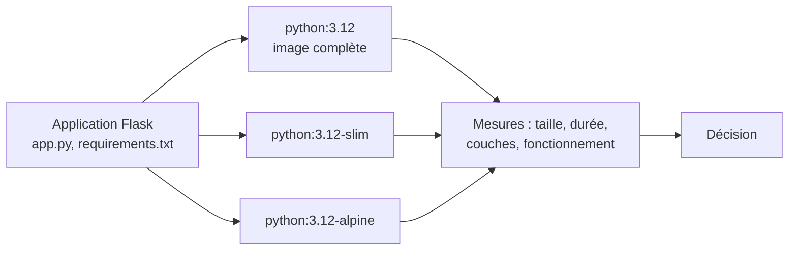

# Lab 9.2 : Réduire et comparer des images

| | |
|---|---|
| **Durée** | 60 min |
| **Niveau** | Semi-guidé |
| **Prérequis** | [Lab 9.1 : Construire avec multi-stage](lab-9-1-construire-avec-multi-stage.md), sections 2, 3 et 6 du [cours](cours.md) |
| **Acquis visés** | AA7, AA3 |

!!! abstract "Objectifs"
    - Comparer la taille, la durée de construction et le fonctionnement d'une même application sur trois images de base
    - Repérer, avec `docker history`, ce qui pèse dans une image
    - Mesurer l'effet d'un nettoyage fait dans la même instruction ou dans une instruction séparée
    - Constater qu'une image plus légère n'est pas toujours compatible avec les dépendances de l'application
    - Choisir une image en s'appuyant sur des mesures

## Contexte et schéma

Vous prenez la petite application Flask du chapitre 3 et vous la construisez sur trois images de base. Vous mesurez, vous testez, puis vous décidez. Dans ce lab, seules les **commandes clés** vous sont données : à vous de les adapter et de déduire le reste à l'aide du [cours](cours.md).



!!! note "Selon votre option"
    Sous PowerShell, utilisez `curl.exe` et `Measure-Command { ... }` à la place de `time`. Les téléchargements des trois images de base peuvent être longs : lancez-les dès l'étape 2.

## Étapes

### Étape 1 : Préparer le projet

- **Objectif :** disposer de l'application et de trois Dockerfile qui ne diffèrent que par l'image de base.
- **Indices :** créez un dossier `tp-compare` et placez-vous dedans, puis créez les fichiers suivants.

**`requirements.txt`**

```text
flask==3.0.3
```

**`app.py`**

```python
from flask import Flask

app = Flask(__name__)


@app.route("/")
def accueil():
    return "Bonjour depuis un conteneur Docker !\n"


if __name__ == "__main__":
    app.run(host="0.0.0.0", port=5000)
```

**`Dockerfile.slim`**

```dockerfile
FROM python:3.12-slim
WORKDIR /app
COPY requirements.txt .
RUN pip install --no-cache-dir -r requirements.txt
COPY app.py .
EXPOSE 5000
CMD ["python", "app.py"]
```

Créez `Dockerfile.full` et `Dockerfile.alpine` en changeant **uniquement** la première ligne (`python:3.12` et `python:3.12-alpine`). Ajoutez un `.dockerignore` contenant `.git` et `*.md`.

!!! success "Point de contrôle"
    - [ ] Le dossier contient `app.py`, `requirements.txt`, `.dockerignore` et les trois Dockerfile
    - [ ] Les trois Dockerfile ne diffèrent que par la ligne `FROM`

### Étape 2 : Construire et mesurer

- **Objectif :** obtenir trois images et relever leurs tailles et durées de construction.
- **Indices :**
    - Construisez `flask:full`, `flask:slim` et `flask:alpine` avec l'option `-f` pour choisir le Dockerfile, en mesurant la durée de chaque construction.
    - Les images de base sont téléchargées pendant la première construction : notez que la durée dépend de votre connexion.
    - Relevez les tailles avec `docker images flask`.
    - Pour une comparaison équitable de la construction, refaites la mesure avec `--no-cache` quand toutes les images de base sont présentes.

!!! success "Point de contrôle"
    - [ ] Les trois images apparaissent dans `docker images flask`
    - [ ] Vous avez noté, pour chacune, la taille et la durée de construction
    - [ ] Vous avez classé les trois images par taille

### Étape 3 : Vérifier le fonctionnement

- **Objectif :** vérifier que la plus petite image fonctionne aussi bien que les autres.
- **Indices :** lancez un conteneur par image, sur les ports 5001, 5002 et 5003 de l'hôte (port 5000 dans le conteneur), puis testez chaque port avec `curl`.

!!! success "Point de contrôle"
    - [ ] Les trois conteneurs répondent par le même message
    - [ ] `docker ps` montre les trois conteneurs en fonctionnement

### Étape 4 : Analyser les couches

- **Objectif :** repérer ce qui pèse.
- **Indices :**
    - `docker history flask:full`, `docker history flask:slim` et `docker history flask:alpine`.
    - Pour chaque image, relevez la couche la plus volumineuse et celle qui correspond à l'installation de Flask.

!!! success "Point de contrôle"
    - [ ] Pour chaque image, vous avez identifié la couche la plus volumineuse (l'image de base)
    - [ ] Vous avez comparé la taille de la couche d'installation de Flask d'une image à l'autre

### Étape 5 : Réduire en nettoyant dans la bonne instruction

- **Objectif :** mesurer l'effet d'un nettoyage mal placé et bien placé (section 2.1 du [cours](cours.md)).
- **Indices :**
    - Écrivez trois Dockerfile qui partent de `python:3.12-slim` et installent seulement `curl` :
        1. **`Dockerfile.apt1`** : installation et suppression dans deux `RUN` séparés.

```dockerfile
FROM python:3.12-slim
RUN apt-get update && apt-get install -y curl
RUN rm -rf /var/lib/apt/lists/*
```

        2. **`Dockerfile.apt2`** : installation et suppression dans un **seul** `RUN`.
        3. **`Dockerfile.apt3`** : comme `apt2`, avec en plus l'option `--no-install-recommends` d'`apt-get install`.
    - Construisez `outils:apt1`, `outils:apt2` et `outils:apt3`, puis comparez les tailles avec `docker images outils` et les couches avec `docker history`.

!!! success "Point de contrôle"
    - [ ] `outils:apt2` est plus petite que `outils:apt1`
    - [ ] `outils:apt3` est la plus petite des trois
    - [ ] Vous pouvez expliquer, avec `docker history`, pourquoi `apt1` garde le poids des listes de paquets

### Étape 6 : Tester une dépendance native sur Alpine

- **Objectif :** vérifier qu'une image plus légère accepte les dépendances de votre application.
- **Indices :**
    - Créez un dossier `tp-native` avec un fichier `requirements.txt` contenant `psycopg2-binary==2.9.9` (la bibliothèque de connexion à PostgreSQL utilisée au [Lab 7.2](../../partie-2-donnees-reseau-et-exploitation/ch07-docker-compose/lab-7-2-application-trois-niveaux-avec-compose.md)).
    - Écrivez un Dockerfile `Dockerfile.slim` à partir de `python:3.12-slim` et un `Dockerfile.alpine` à partir de `python:3.12-alpine` : copie de `requirements.txt`, installation avec `pip install --no-cache-dir -r requirements.txt`, puis la commande :

```dockerfile
CMD ["python", "-c", "import psycopg2; print(psycopg2.__version__)"]
```

    - Construisez les deux images, lancez chaque conteneur et notez le résultat **tel que vous l'observez** : réussite ou échec de la construction, durée, message d'erreur éventuel.

!!! success "Point de contrôle"
    - [ ] Vous avez le résultat de la construction et de l'exécution pour `slim` et pour `alpine`
    - [ ] En cas d'échec, vous avez relevé la ligne du message d'erreur qui indique la cause
    - [ ] Vous savez dire si cette dépendance est compatible avec l'image Alpine, d'après **votre** observation

### Étape 7 (facultative) : Mesurer l'effet du `.dockerignore`

- **Objectif :** voir qu'un fichier inutile peut entrer dans l'image.
- **Indices :**
    - Dans `tp-compare`, créez un fichier volumineux de 50 Mo (sous Linux : `head -c 50M /dev/zero > gros.bin` ; sous PowerShell : `fsutil file createnew gros.bin 52428800`).
    - Écrivez un Dockerfile `Dockerfile.copie` qui part de `python:3.12-slim` et copie **tout** le dossier avec `COPY . .` ; construisez `copie:1` et relevez la taille.
    - Ajoutez `gros.bin` au `.dockerignore`, reconstruisez `copie:2` et comparez.

!!! success "Point de contrôle"
    - [ ] `copie:1` est plus grosse que `copie:2` d'environ 50 Mo
    - [ ] Vous pouvez expliquer le rôle du `.dockerignore` dans la taille de l'image

### Étape 8 : Choisir et justifier

- **Objectif :** décider avec des mesures.
- **Indices :** complétez le tableau avec **vos** mesures (reprenez, si vous l'avez, le résultat du serveur Go du [Lab 9.1](lab-9-1-construire-avec-multi-stage.md)).

| Image | Taille | Durée de construction | Fonctionne ? | Dépendance native (étape 6) | Shell disponible ? |
|---|---|---|---|---|---|
| `python:3.12` | | | | non testé | |
| `python:3.12-slim` | | | | | |
| `python:3.12-alpine` | | | | | |

Concluez en quelques lignes : quelle image choisissez-vous pour l'application du Lab 7.2 (Flask et `psycopg2-binary`), et pourquoi ? Que feriez-vous différemment pour une application sans dépendance native ?

!!! success "Point de contrôle"
    - [ ] Le tableau est complété avec des valeurs mesurées
    - [ ] Votre choix tient compte de la taille, du fonctionnement et de la compatibilité des dépendances

## Questions de réflexion

??? question "Pourquoi l'image complète est-elle bien plus grosse que `slim` pour exactement la même application ?"
    L'image complète contient une distribution avec de nombreux outils (compilateurs, en-têtes de bibliothèques, utilitaires) qui sont inutiles à l'exécution de l'application. L'image `slim` ne conserve que le nécessaire.

??? question "Pourquoi `outils:apt1` n'est-elle pas plus légère malgré la suppression des listes de paquets ?"
    Les listes sont créées par la couche de l'installation et y restent : la suppression dans une couche ultérieure ne fait que les masquer. Seul un nettoyage dans la **même** instruction empêche de les enregistrer.

??? question "Qu'apprend-on de l'étape 6 sur le choix d'une image de base ?"
    Qu'une image plus légère n'est pas toujours compatible : une dépendance précompilée pour un système peut ne pas exister pour un autre, et il faut alors la compiler (ce qui exige des outils et alourdit l'image) ou changer d'image. D'où la règle : tester l'application, pas seulement mesurer la taille.

??? question "Quand préférez-vous `slim` à `alpine` ?"
    Quand l'application a des dépendances natives ou que la compatibilité prime sur quelques dizaines de Mo : `slim` est plus compatible. On choisit `alpine` quand la taille minimale est une priorité et que l'application a été **testée** dessus.

## Dépannage

| Symptôme | Pistes |
|---|---|
| `error: command 'gcc' failed` ou `Failed building wheel` à l'étape 6 | Résultat à noter : la dépendance doit être compilée et l'image ne contient pas les outils nécessaires |
| `E: Unable to locate package curl` | `apt-get update` est manquant ou exécuté dans une instruction séparée de l'installation |
| `could not resolve host` pendant `apt-get` ou `pip` | Problème réseau du conteneur de construction : vérifiez votre connexion et la configuration de Docker |
| Les tailles de `slim` et `full` sont presque identiques | Vous avez construit deux fois la même image : vérifiez la ligne `FROM` de chaque Dockerfile |
| `port is already allocated` | Un conteneur d'une étape précédente occupe le port : supprimez-le |
| La construction est très lente | Premier téléchargement des images de base : relancez après coup pour une mesure comparable |
| `fsutil` demande des droits d'administrateur | Ouvrez PowerShell en administrateur, ou créez le fichier avec `[IO.File]::WriteAllBytes("gros.bin", (New-Object byte[] 52428800))` |

## Nettoyage et reprise

```bash
docker rm -f <les trois conteneurs de l'étape 3>
docker rmi flask:full flask:slim flask:alpine outils:apt1 outils:apt2 outils:apt3
```

Remplacez la partie entre chevrons par les noms que vous avez choisis (`docker ps -a`), puis supprimez aussi les images des étapes 6 et 7. Mesurez ensuite l'espace récupéré avec `docker system df`.

## Retour au chapitre

[Chapitre 9 : Optimisation des images](cours.md) · Quiz : [Quiz du chapitre 9](quiz.md)