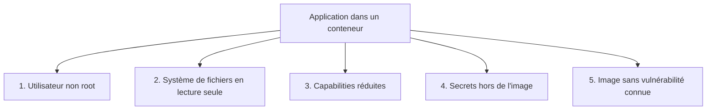
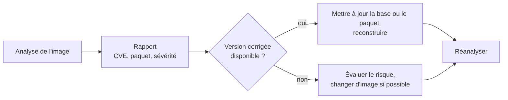

# Chapitre 10 : Sécurité des conteneurs

!!! abstract "Objectifs du chapitre"
    - Expliquer ce que l'isolation d'un conteneur garantit, et ce qu'elle ne garantit pas
    - Exécuter un conteneur avec un utilisateur non privilégié
    - Utiliser un système de fichiers en lecture seule et réduire les capabilities d'un conteneur
    - Fournir un secret à une application sans l'inscrire dans l'image ni dans une variable d'environnement
    - Lire un rapport d'analyse de vulnérabilités et décider d'une correction
    - Acquis d'apprentissage visé : **AA7**

## 1. Ce que l'isolation garantit, et ce qu'elle ne garantit pas

Au [chapitre 1](../../partie-1-fondations/ch01-introduction-aux-conteneurs/cours.md), vous avez vu qu'un conteneur est un processus isolé par les **namespaces** et limité par les **cgroups**, mais qui partage le **noyau** de l'hôte. Cette isolation est réelle, mais elle est plus légère que celle d'une machine virtuelle : une faille du noyau, ou une mauvaise configuration du conteneur, peut permettre à un attaquant de dépasser les limites du conteneur.

La sécurité des conteneurs repose donc sur deux idées :

- **réduire la surface d'attaque** : moins de composants, moins de services exposés (chapitres 6 et 9) ;
- **appliquer le principe du moindre privilège** : un conteneur ne reçoit que les droits dont il a besoin, rien de plus.

Ce chapitre présente cinq leviers concrets.



!!! warning "Rappel : l'accès à Docker est un accès administrateur"
    Quiconque peut lancer des conteneurs sur une machine (membre du groupe `docker`) peut, avec un bind mount, lire ou modifier n'importe quel fichier de l'hôte. L'accès au moteur Docker équivaut à un accès administrateur à la machine.

## 2. Utilisateur non root

### 2.1 Le problème

Par défaut, le processus d'un conteneur s'exécute en tant que **root** (identifiant 0). Vous pouvez le vérifier :

```bash
docker run --rm alpine:3.20 id
```

Pour le noyau, cet utilisateur 0 est, par défaut, le même que l'utilisateur 0 de l'hôte : seules les limites du conteneur (namespaces, capabilities) l'en séparent. Si l'application est compromise, ou si le conteneur est mal configuré (volume sensible monté, droits supplémentaires), l'attaquant dispose de droits maximaux.

### 2.2 Exécuter avec un utilisateur ordinaire

On crée un utilisateur dans l'image, puis on l'active avec l'instruction `USER`. Les commandes suivantes, y compris `CMD`, s'exécutent avec cet utilisateur.

=== "Image Debian ou `-slim`"

    ```dockerfile
    FROM python:3.12-slim
    RUN useradd --system --no-create-home --uid 10001 appuser
    WORKDIR /app
    COPY requirements.txt .
    RUN pip install --no-cache-dir -r requirements.txt
    COPY --chown=appuser:appuser app.py .
    USER appuser
    EXPOSE 5000
    CMD ["python", "app.py"]
    ```

=== "Image Alpine"

    ```dockerfile
    FROM python:3.12-alpine
    RUN adduser -D -u 10001 appuser
    WORKDIR /app
    COPY requirements.txt .
    RUN pip install --no-cache-dir -r requirements.txt
    COPY --chown=appuser:appuser app.py .
    USER appuser
    EXPOSE 5000
    CMD ["python", "app.py"]
    ```

| Élément | Rôle |
|---|---|
| `useradd` ou `adduser` | Crée l'utilisateur sans mot de passe ; sur Debian, `--system` marque un compte de service |
| `--uid 10001` | Fixe un identifiant numérique explicite, utile pour les droits sur des volumes |
| `COPY --chown=...` | Donne la propriété des fichiers copiés à l'utilisateur |
| `USER appuser` | Les instructions et le conteneur s'exécutent désormais avec cet utilisateur |

Placez `USER` **après** les instructions qui exigent des droits d'administrateur (installation de paquets, par exemple).

On peut aussi imposer l'utilisateur au lancement, sans modifier l'image :

```bash
docker run --rm --user 10001:10001 alpine:3.20 id
```

Vérifiez avec `docker exec conteneur id` ou `docker exec conteneur whoami`.

!!! note "Conséquences pratiques"
    - Un utilisateur ordinaire ne peut pas écrire partout : un dossier de données monté doit lui appartenir ou être accessible en écriture.
    - Privilégiez les ports supérieurs à 1024 (par exemple 8080) dans le conteneur.
    - Certaines images officielles (nginx, par exemple) démarrent en administrateur pour des raisons de fonctionnement : consultez leur documentation avant de leur imposer `--user`.

## 3. Système de fichiers en lecture seule

Si le système de fichiers du conteneur est **en lecture seule**, un attaquant qui prend le contrôle de l'application ne peut ni modifier ses programmes, ni y déposer des fichiers. L'option est `--read-only` :

```bash
docker run -d --name web --read-only nginx:1.27-alpine
```

Une application a presque toujours besoin d'écrire quelque part (fichiers temporaires, journaux, cache). On autorise l'écriture **uniquement** aux endroits nécessaires, avec les montages du [chapitre 5](../../partie-2-donnees-reseau-et-exploitation/ch05-volumes-et-persistance/cours.md) :

| Besoin | Solution |
|---|---|
| Fichiers temporaires | `--tmpfs /tmp` (en mémoire) |
| Données à conserver | Volume nommé monté à l'endroit voulu |

```bash
docker run -d --name web --read-only --tmpfs /tmp --tmpfs /var/cache/nginx --tmpfs /var/run nginx:1.27-alpine
```

Quand une application échoue avec le message `Read-only file system`, ses journaux indiquent le chemin où elle essaie d'écrire : c'est l'endroit à monter en écriture. Dans un fichier Compose, les clés correspondantes sont `read_only: true` et `tmpfs:`.

## 4. Les capabilities

### 4.1 Principe

Sous Linux, les privilèges de l'administrateur sont découpés en **capabilities** : chacune autorise une action précise (se lier à un port inférieur à 1024, changer le propriétaire d'un fichier, utiliser des sockets réseau bruts…). Docker lance les conteneurs avec un **sous-ensemble réduit** de ces capabilities, mais ce sous-ensemble reste souvent plus large que nécessaire.

| Capability | Autorise |
|---|---|
| `NET_BIND_SERVICE` | Écouter sur un port inférieur à 1024 |
| `CHOWN` | Changer le propriétaire de fichiers |
| `SETUID`, `SETGID` | Changer d'identité d'utilisateur ou de groupe |
| `NET_RAW` | Utiliser des sockets réseau bruts (`ping`, par exemple) |
| `SYS_ADMIN` | Un grand nombre d'opérations d'administration : très dangereuse |

### 4.2 Retirer tout, puis ajouter le nécessaire

La méthode du moindre privilège : retirer **toutes** les capabilities, puis ajouter seulement celles dont l'application a réellement besoin.

```bash
docker run -d --name web --cap-drop ALL --cap-add NET_BIND_SERVICE nginx:1.27-alpine
```

Si l'application ne démarre plus, ses journaux indiquent l'opération refusée : on ajoute alors la capability correspondante, **une à la fois**. Dans un fichier Compose : `cap_drop: [ALL]` et `cap_add: [...]`.

Pour consulter la configuration d'un conteneur :

```bash
docker inspect -f '{{.HostConfig.CapDrop}} {{.HostConfig.CapAdd}}' web
```

### 4.3 Deux options à connaître

| Option | Effet |
|---|---|
| `--security-opt no-new-privileges` | Empêche un processus du conteneur d'obtenir de nouveaux privilèges (par exemple via un programme à bit setuid) |
| `--privileged` | Donne **toutes** les capabilities et l'accès aux périphériques de l'hôte : l'isolation est quasiment supprimée |

!!! danger "N'utilisez jamais `--privileged` par commodité"
    Un conteneur `--privileged` peut quasiment tout faire sur l'hôte. Comme l'accès au socket du moteur (`/var/run/docker.sock`) monté dans un conteneur, c'est un accès administrateur à la machine. Si une documentation vous le suggère, cherchez d'abord la capability précise qui est nécessaire.

## 5. Gérer les secrets

Un **secret** est une donnée sensible : mot de passe, jeton, clé privée. Vous avez déjà vu que les placer dans une variable d'environnement n'est pas satisfaisant.

### 5.1 Où ne pas mettre un secret

| Emplacement | Pourquoi c'est dangereux |
|---|---|
| Dans le code ou dans un fichier copié dans l'image (`COPY .env`) | Il fait partie de l'image et de ses couches : quiconque obtient l'image l'obtient |
| Instruction `ENV` ou `ARG` du Dockerfile | Visible avec `docker history` et `docker inspect` |
| Variable d'environnement au lancement (`-e MOT_DE_PASSE=...`) | Visible avec `docker inspect`, dans l'historique des commandes, et souvent dans les journaux d'erreur |
| Dépôt Git | Il y reste, même après suppression (chapitre 7 : `.env` non versionné) |

!!! warning "Un secret publié est un secret perdu"
    Si un secret a été publié par erreur (image, dépôt Git), il faut le **révoquer et le remplacer**, pas seulement le supprimer de l'endroit où il apparaît.

### 5.2 Fournir un secret sous forme de fichier

La bonne pratique : le secret est un **fichier**, monté dans le conteneur en lecture seule, que l'application lit. Beaucoup d'images officielles le permettent, avec des variables qui se terminent par `_FILE` : par exemple, l'image `postgres` lit le mot de passe dans le fichier indiqué par `POSTGRES_PASSWORD_FILE`.

```bash
docker run -d --name db \
  -v "$(pwd)/db_password.txt:/run/secrets/db_password:ro" \
  -e POSTGRES_PASSWORD_FILE=/run/secrets/db_password \
  postgres:16-alpine
```

La variable d'environnement ne contient alors que le **chemin** du fichier, pas le secret.

### 5.3 Les secrets de Compose

Compose propose une section `secrets` qui monte un fichier dans `/run/secrets/<nom>` :

```yaml
services:
  db:
    image: postgres:16-alpine
    environment:
      POSTGRES_PASSWORD_FILE: /run/secrets/db_password
    secrets:
      - db_password

secrets:
  db_password:
    file: ./db_password.txt
```

Le fichier `db_password.txt` est exclu du dépôt Git (`.gitignore`), comme le fichier `.env`. Au chapitre 12, vous retrouverez le même principe avec les **secrets de Swarm**, stockés chiffrés dans le cluster.

### 5.4 Secrets de construction

Quand une instruction du Dockerfile a besoin d'un secret **pendant la construction** (télécharger un paquet depuis un dépôt privé, par exemple), BuildKit (chapitre 9) fournit un secret **temporaire** qui n'est pas enregistré dans l'image :

```dockerfile
RUN --mount=type=secret,id=jeton cat /run/secrets/jeton > /dev/null
```

```bash
docker build --secret id=jeton,src=jeton.txt -t monapp:1.0 .
```

Le secret n'est disponible que pendant cette instruction. Contrairement à un `ARG`, il n'apparaît pas dans `docker history`.

!!! note "Les limites"
    Un secret monté en fichier reste lisible par l'administrateur de la machine et par le processus de l'application. Il faut aussi prévoir sa **rotation** (le renouveler régulièrement). Un gestionnaire de secrets dédié dépasse le cadre de ce cours.

## 6. Analyser les vulnérabilités d'une image

### 6.1 Principe

Une image contient des paquets (système, bibliothèques). Des failles de sécurité y sont découvertes en continu : elles sont répertoriées sous un identifiant **CVE** (par exemple `CVE-2024-12345`) avec une **sévérité**. Un **scanner de vulnérabilités** compare les paquets de l'image à une base de failles connues et produit un rapport.

| Information du rapport | Signification |
|---|---|
| Identifiant CVE | Référence publique de la faille |
| Paquet concerné | Le composant vulnérable (nom, version installée) |
| Sévérité | `CRITICAL`, `HIGH`, `MEDIUM`, `LOW` |
| Version corrigée (*fixed version*) | La version qui corrige la faille, si elle existe |

Plusieurs outils existent (Trivy, Docker Scout, Grype…). Vous utiliserez **Trivy** au [Lab 10.2](lab-10-2-analyser-et-corriger-une-image.md), exécuté lui-même dans un conteneur.

### 6.2 Interpréter et corriger



Les actions de correction les plus efficaces sont celles que vous connaissez déjà :

| Action | Effet |
|---|---|
| Passer à une version plus récente de l'image de base | Reprend les correctifs de la distribution |
| Choisir une image plus petite (`slim`, `alpine`, multi-stage, `scratch`) | Moins de paquets, donc moins de failles possibles (chapitre 9) |
| Reconstruire régulièrement | Récupère les mises à jour de l'image de base |
| Retirer les outils inutiles de l'image finale | Supprime les composants qui portent des failles |

!!! warning "Lire un rapport avec discernement"
    - Un rapport sans faille ne prouve pas que l'image est sûre : il ne couvre que les failles **connues**.
    - Une faille n'est pas toujours exploitable dans votre contexte ; mais ne l'écartez que si vous savez pourquoi.
    - Certaines failles n'ont pas encore de correctif : on note le risque et on le réévalue.
    - Priorisez : sévérité `CRITICAL` et `HIGH` avec correctif disponible d'abord.

Au [chapitre 13](../../partie-4-industrialisation/ch13-integration-continue/cours.md), l'analyse sera intégrée à la chaîne de livraison.

## 7. Un conteneur durci : récapitulatif

| Par défaut | Durci |
|---|---|
| Exécution en root | `USER` dans l'image ou `--user` |
| Système de fichiers modifiable | `--read-only` + `--tmpfs` ou volumes aux endroits nécessaires |
| Capabilities par défaut | `--cap-drop ALL` puis `--cap-add` du strict nécessaire |
| Élévation de privilèges possible | `--security-opt no-new-privileges` |
| Secret en variable d'environnement | Secret en fichier (`/run/secrets/...`) |
| Image non analysée | Analyse de vulnérabilités avant publication |
| Ports et réseaux ouverts | Réseaux cloisonnés, un seul point d'entrée (chapitre 6) |
| Ressources illimitées | `--memory`, `--cpus` (chapitre 8) |

Exemple de commande qui combine plusieurs de ces leviers :

```bash
docker run -d --name web \
  --user 10001:10001 \
  --read-only --tmpfs /tmp \
  --cap-drop ALL \
  --security-opt no-new-privileges \
  --memory 128m --cpus 0.5 \
  monapp:1.0
```

!!! tip "À retenir"
    - Un conteneur partage le noyau de l'hôte : son isolation est moins forte que celle d'une machine virtuelle.
    - Appliquez le **moindre privilège** : utilisateur ordinaire (`USER`), système de fichiers en lecture seule, capabilities réduites, `no-new-privileges`.
    - `--privileged` et le montage du socket Docker donnent un accès administrateur à l'hôte.
    - Un secret ne va ni dans l'image, ni dans un `ENV` ou `ARG`, ni dans Git ; on le fournit **en fichier** monté en lecture seule.
    - Un scanner compare les paquets d'une image aux failles connues ; on corrige en mettant à jour, en réduisant l'image et en reconstruisant, puis on **réanalyse**.
    - Un rapport vide ne prouve pas l'absence de failles.

## Pour vérifier votre compréhension

??? question "Pourquoi est-il préférable de ne pas exécuter une application en root dans un conteneur ?"
    Parce qu'un conteneur partage le noyau de l'hôte : si l'application est compromise ou le conteneur mal configuré, un processus root dispose de droits maximaux pour dépasser les limites du conteneur. Un utilisateur ordinaire limite les dégâts.

??? question "Une application échoue avec `Read-only file system` après l'ajout de `--read-only`. Que faites-vous ?"
    On lit le chemin indiqué dans les journaux et on autorise l'écriture uniquement à cet endroit, par exemple avec `--tmpfs` pour des fichiers temporaires ou un volume pour des données. On ne retire pas `--read-only`.

??? question "Pourquoi `--cap-drop ALL` suivi de `--cap-add` vaut-il mieux que laisser les capabilities par défaut ?"
    Parce que l'on part de zéro et que l'on n'ajoute que les privilèges dont l'application a prouvé avoir besoin : tout le reste est interdit, ce qui réduit ce qu'un attaquant peut faire.

??? question "Pourquoi un mot de passe passé avec `ENV` dans le Dockerfile reste-t-il dangereux même si on le supprime ensuite ?"
    Il est enregistré dans les couches de l'image et dans ses métadonnées, visibles avec `docker history` et `docker inspect`. Une suppression ultérieure ne l'enlève pas des couches existantes. Un secret exposé doit être révoqué.

??? question "Votre rapport d'analyse n'affiche plus de faille critique. Pouvez-vous conclure que l'image est sûre ?"
    Non. Le rapport ne couvre que les failles **connues** de la base utilisée au moment de l'analyse. Il faut réanalyser régulièrement et conserver les autres protections (moindre privilège, réseau cloisonné, mises à jour).

## Ressources du chapitre

- [Lab 10.1 : Durcir un conteneur](lab-10-1-durcir-un-conteneur.md)
- [Lab 10.2 : Analyser et corriger une image](lab-10-2-analyser-et-corriger-une-image.md)
- [Quiz du chapitre](quiz.md)