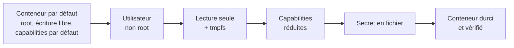

# Lab 10.1 : Durcir un conteneur

| | |
|---|---|
| **Durée** | 75 min |
| **Niveau** | Semi-guidé |
| **Prérequis** | [Lab 9.2 : Réduire et comparer des images](../ch09-optimisation-des-images/lab-9-2-reduire-et-comparer-des-images.md) (application Flask du dossier `tp-compare`), cours du [chapitre 10](cours.md) |
| **Acquis visés** | AA7 |

!!! abstract "Objectifs"
    - Constater les droits d'un conteneur lancé « par défaut »
    - Exécuter une application avec un utilisateur non privilégié
    - Utiliser un système de fichiers en lecture seule et ajouter les montages en écriture strictement nécessaires
    - Retirer les capabilities d'un conteneur et ne rajouter que celles qui sont indispensables
    - Fournir un mot de passe sous forme de fichier plutôt que de variable d'environnement
    - Vérifier le durcissement avec des commandes de contrôle

## Contexte et schéma

Vous partez d'un conteneur qui fonctionne mais qui a tous les droits par défaut, puis vous le durcissez levier par levier, en testant l'effet de chacun. Dans ce lab, seules les **commandes clés** vous sont données : à vous de les adapter et de déduire le reste à l'aide du [cours](cours.md).



!!! note "Selon votre option"
    - Sous PowerShell, utilisez `curl.exe`, écrivez les commandes sur une seule ligne et remplacez `$(pwd)` par `${PWD}`.
    - Les commandes de contrôle (`docker exec`, `docker inspect`) fonctionnent de la même manière avec les trois options.

## Étapes

### Étape 1 : Préparer l'application et constater la situation initiale

- **Objectif :** disposer d'une image « de départ » et mesurer ses droits.
- **Indices :**
    - Créez un dossier `tp-secure` et copiez-y `app.py` et `requirements.txt` du Lab 9.2.
    - Écrivez un `Dockerfile` (à partir de `python:3.12-slim`, ordre optimisé du chapitre 3, port 5000) et construisez l'image `secure:1.0`.
    - Lancez un conteneur `app` sur le port 5000 de l'hôte, sans aucune option de sécurité, puis testez avec `curl`.
    - Relevez l'identité du processus et la possibilité d'écrire dans l'image :

```bash
docker exec app id
docker exec app sh -c "echo test > /app/fichier.txt && echo ecriture-possible"
```

!!! success "Point de contrôle"
    - [ ] `id` indique l'utilisateur `root` (uid 0)
    - [ ] L'écriture dans `/app` réussit
    - [ ] Vous avez compris que ce conteneur dispose de tous les droits par défaut

### Étape 2 : Exécuter avec un utilisateur non privilégié

- **Objectif :** l'application ne s'exécute plus en root.
- **Indices :**
    - Écrivez `Dockerfile.user` en créant un utilisateur `appuser` d'identifiant 10001 et en l'activant avec `USER`, après l'installation des dépendances (section 2.2 du [cours](cours.md), onglet Debian). Les fichiers de l'application doivent appartenir à cet utilisateur (`--chown`).
    - Construisez `secure:2.0` avec `-f Dockerfile.user`, lancez-la (en supprimant d'abord l'ancien conteneur) et testez.
    - Refaites les deux commandes de l'étape 1.
    - Testez aussi l'imposition de l'utilisateur **au lancement** sur l'image d'origine : `docker run --rm --user 10001:10001 secure:1.0 id`.

!!! success "Point de contrôle"
    - [ ] `curl` affiche le message de l'application
    - [ ] `id` indique l'uid 10001
    - [ ] L'écriture dans `/app` est refusée (`Permission denied`)

### Étape 3 : Système de fichiers en lecture seule

- **Objectif :** interdire toute écriture dans le conteneur, sauf aux endroits nécessaires.
- **Indices :**
    - Relancez `secure:2.0` avec l'option `--read-only`, puis testez avec `curl`.
    - Essayez d'écrire dans `/tmp` : `docker exec app sh -c "echo test > /tmp/f.txt"`. Ajoutez `--tmpfs /tmp` et recommencez.
    - Appliquez ensuite `--read-only` à un serveur qui a **besoin** d'écrire : lancez `nginx:1.27-alpine` avec `--read-only` (conteneur `web`, port 8080) et lisez ses journaux. Ajoutez au fur et à mesure les montages `--tmpfs` qui correspondent aux chemins signalés, jusqu'à ce que le serveur démarre (section 3 du [cours](cours.md)).

!!! success "Point de contrôle"
    - [ ] L'application Flask répond avec `--read-only` ; l'écriture dans `/tmp` n'est possible qu'avec `--tmpfs /tmp`
    - [ ] Vous avez relevé dans les journaux de nginx les chemins signalés en lecture seule
    - [ ] nginx fonctionne avec `--read-only` et la **liste minimale** de `--tmpfs` que vous avez déterminée
    - [ ] `curl http://localhost:8080` affiche la page de nginx

### Étape 4 : Réduire les capabilities

- **Objectif :** voir l'effet des capabilities, puis ne garder que le nécessaire.
- **Indices :**
    - Comparez les capabilities effectives d'un conteneur par défaut et d'un conteneur sans capabilities :

```bash
docker run --rm alpine:3.20 grep CapEff /proc/self/status
docker run --rm --cap-drop ALL alpine:3.20 grep CapEff /proc/self/status
```

    - Testez une action qui exige la capability `CHOWN` (changer le propriétaire d'un fichier), avec et sans `--cap-drop ALL`, puis avec `--cap-drop ALL --cap-add CHOWN` :

```bash
docker run --rm alpine:3.20 sh -c "touch /f && chown 1234 /f && echo chown-ok"
```

    - Lancez maintenant nginx (avec ses `--tmpfs` et `--read-only` de l'étape 3) avec `--cap-drop ALL` : lisez les journaux, puis ajoutez **une capability à la fois** (`--cap-add`) jusqu'à ce que le serveur démarre. Notez la liste minimale.

!!! success "Point de contrôle"
    - [ ] `CapEff` est non nul par défaut et nul avec `--cap-drop ALL`
    - [ ] `chown` échoue sans la capability et réussit avec `--cap-add CHOWN`
    - [ ] Vous avez déterminé la liste minimale de capabilities de nginx, avec les messages qui vous y ont conduit
    - [ ] `docker inspect -f '{{.HostConfig.CapDrop}} {{.HostConfig.CapAdd}}' web` affiche votre configuration

### Étape 5 : Assembler un conteneur durci

- **Objectif :** combiner les leviers pour l'application Flask.
- **Indices :** lancez `secure:2.0` (conteneur `app-durci`, port 5001 de l'hôte) avec : l'utilisateur non privilégié, le système de fichiers en lecture seule avec `/tmp` en `tmpfs`, `--cap-drop ALL`, `--security-opt no-new-privileges`, et des limites de mémoire et de processeur de votre choix (chapitre 8). Testez avec `curl`, puis vérifiez la configuration :

```bash
docker inspect -f '{{.HostConfig.ReadonlyRootfs}} {{.HostConfig.CapDrop}} {{.HostConfig.SecurityOpt}} {{.Config.User}}' app-durci
```

!!! success "Point de contrôle"
    - [ ] L'application répond sur le port 5001
    - [ ] `docker inspect` indique `true`, `[ALL]`, `[no-new-privileges]` (ou équivalent) et l'utilisateur configuré
    - [ ] Le conteneur ne peut ni écrire dans `/app`, ni obtenir de privilèges

### Étape 6 : Fournir un mot de passe sous forme de fichier

- **Objectif :** ne plus passer le mot de passe dans une variable d'environnement.
- **Indices :**
    - **Mauvaise méthode** : lancez un conteneur `db-env` (`postgres:16-alpine`, `--rm`) avec `-e POSTGRES_PASSWORD=motdepasse-tp`, puis affichez ses variables avec `docker inspect -f '{{.Config.Env}}' db-env`.
    - **Bonne méthode** : créez un fichier `db_password.txt` contenant `motdepasse-tp` (sans saut de ligne superflu). Sous PowerShell, utilisez `Set-Content -NoNewline -Encoding ascii db_password.txt "motdepasse-tp"`. Lancez un conteneur `db-file` (`postgres:16-alpine`, `--rm`) qui monte ce fichier en **lecture seule** sur `/run/secrets/db_password` et utilise `POSTGRES_PASSWORD_FILE` (section 5.2 du [cours](cours.md)).
    - Vérifiez avec `docker inspect` que le mot de passe n'apparaît plus, et que la base démarre (`docker logs db-file`, `docker exec db-file pg_isready`).
    - Ajoutez `db_password.txt` à un fichier `.gitignore`.

!!! success "Point de contrôle"
    - [ ] Avec `-e`, le mot de passe apparaît en clair dans `docker inspect`
    - [ ] Avec le fichier, `docker inspect` n'affiche que le **chemin** du fichier
    - [ ] La base démarre avec le mot de passe lu dans le fichier
    - [ ] `db_password.txt` est dans `.gitignore`

### Étape 7 (facultative) : Durcir un service Compose

- **Objectif :** exprimer le durcissement dans un fichier Compose.
- **Indices :** créez un fichier `compose.yaml` pour l'application Flask avec les clés `read_only`, `tmpfs`, `cap_drop`, `security_opt`, `mem_limit` et `cpus`, puis une section `secrets` pour le mot de passe de la base (sections 3 à 5 du [cours](cours.md)). Vérifiez avec `docker compose config`, puis avec `docker inspect`.

!!! success "Point de contrôle"
    - [ ] La pile démarre avec le durcissement exprimé dans le fichier
    - [ ] `docker inspect` confirme chaque option

### Étape 8 : Dresser la fiche de contrôle

- **Objectif :** savoir prouver chaque protection.
- **Indices :** complétez le tableau avec la commande que vous avez réellement utilisée pour vérifier chaque point sur `app-durci` ou sur `db-file`.

| Protection | Commande de vérification | Résultat attendu |
|---|---|---|
| Utilisateur non root | | |
| Système de fichiers en lecture seule | | |
| Capabilities retirées | | |
| Pas d'élévation de privilèges | | |
| Secret absent des variables d'environnement | | |

!!! success "Point de contrôle"
    - [ ] Chaque ligne contient une commande que vous avez exécutée pendant ce lab

## Questions de réflexion

??? question "Pourquoi l'écriture dans `/app` est-elle refusée après l'étape 2 alors que l'application fonctionne ?"
    Le conteneur s'exécute avec l'utilisateur 10001, qui n'est pas propriétaire de `/app` et n'a pas le droit d'y créer de fichier. L'application n'a besoin que de lire son code, pas d'y écrire.

??? question "Pourquoi retire-t-on toutes les capabilities puis ajoute-t-on celles qui sont nécessaires, plutôt que de retirer les capabilities dangereuses une par une ?"
    Une liste d'exclusion est incomplète par construction : on risque d'oublier une capability dangereuse. Une liste d'autorisation part de zéro et ne contient que ce qui a été justifié.

??? question "Pourquoi un secret passé par `-e` est-il visible dans `docker inspect` mais pas un secret monté en fichier ?"
    Les variables d'environnement font partie de la configuration du conteneur, que `docker inspect` affiche. Avec un fichier, la configuration ne contient que le chemin ; le contenu reste dans le fichier monté.

??? question "Un conteneur durci est-il pour autant invulnérable ?"
    Non. Le durcissement réduit ce qu'un attaquant peut faire s'il compromet l'application, mais il ne corrige pas ses failles. Il se complète par l'analyse des vulnérabilités des images (Lab 10.2), les mises à jour et un réseau cloisonné.

## Dépannage

| Symptôme | Pistes |
|---|---|
| `Permission denied` au démarrage de l'application après `USER` | Les fichiers de l'application n'appartiennent pas à l'utilisateur : `COPY --chown`, ou droits sur un dossier monté |
| `Read-only file system` dans les journaux | Chemin à ouvrir en écriture : ajoutez un `--tmpfs` (temporaire) ou un volume (données) à cet endroit |
| nginx s'arrête avec `--cap-drop ALL` | Messages `Operation not permitted` : repérez l'opération et ajoutez la capability correspondante, une à la fois |
| `docker: invalid reference format` ou option ignorée | Les options doivent précéder le nom de l'image dans `docker run` |
| `useradd: command not found` ou `adduser` introuvable | La commande dépend de l'image de base : `useradd` sur Debian et `-slim`, `adduser` sur Alpine |
| `password authentication failed` ou la base ne démarre pas avec `POSTGRES_PASSWORD_FILE` | Chemin du fichier monté ou nom de variable incorrect, ou fichier vide ; vérifiez `docker logs db-file` |
| Le fichier du mot de passe contient des caractères parasites (PowerShell) | Utilisez `Set-Content -NoNewline -Encoding ascii` et non la redirection `>` |
| `port is already allocated` | Un conteneur d'une étape précédente occupe le port : supprimez-le |

## Nettoyage et reprise

```bash
docker rm -f app app-durci web db-env db-file
docker rmi secure:1.0 secure:2.0
```

Certains conteneurs n'existent peut-être plus (`--rm`) : Docker le signale sans conséquence. Supprimez le fichier `db_password.txt` si vous n'en avez plus besoin. Le [Lab 10.2](lab-10-2-analyser-et-corriger-une-image.md) réutilise l'application de ce lab.

## Retour au chapitre

[Chapitre 10 : Sécurité des conteneurs](cours.md) · Lab suivant : [Lab 10.2 : Analyser et corriger une image](lab-10-2-analyser-et-corriger-une-image.md)