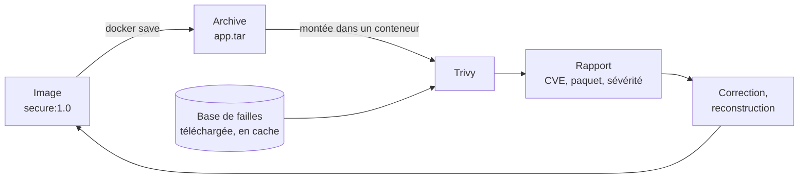

# Lab 10.2 : Analyser et corriger une image

| | |
|---|---|
| **Durée** | 75 min |
| **Niveau** | Semi-guidé |
| **Prérequis** | [Lab 10.1 : Durcir un conteneur](lab-10-1-durcir-un-conteneur.md) (image `secure:1.0` et dossier `tp-secure`), [Lab 9.2 : Réduire et comparer des images](../ch09-optimisation-des-images/lab-9-2-reduire-et-comparer-des-images.md), section 6 du [cours](cours.md) |
| **Acquis visés** | AA7 |

!!! abstract "Objectifs"
    - Analyser les vulnérabilités d'une image avec un scanner exécuté dans un conteneur
    - Lire un rapport : CVE, paquet, version installée, version corrigée, sévérité
    - Comparer la situation de plusieurs images de base
    - Corriger une image, reconstruire et réanalyser pour mesurer le résultat
    - Définir un critère d'acceptation qui renvoie un code de sortie exploitable par un automate

## Contexte et schéma

Vous analysez l'image de votre application avec **Trivy**, un scanner de vulnérabilités. Trivy est lui-même fourni sous forme d'image Docker : vous n'installez rien sur votre machine. Pour ne pas lui donner accès au moteur Docker, vous exportez d'abord l'image dans une **archive** que Trivy analyse. Dans ce lab, seules les **commandes clés** vous sont données : à vous de les adapter et de déduire le reste à l'aide du [cours](cours.md).



!!! note "Selon votre option"
    - Sous PowerShell, utilisez `${PWD}` à la place de `$(pwd)`, écrivez les commandes sur une seule ligne, et lisez le code de sortie avec `$LASTEXITCODE` au lieu de `$?`.
    - Le premier lancement télécharge la base de failles : il exige un accès à Internet et prend un moment.

## Étapes

### Étape 1 : Choisir et vérifier la version de Trivy

- **Objectif :** utiliser une version précise du scanner, comme pour toute image (chapitre 3).
- **Indices :**
    - Consultez la page de l'image `aquasec/trivy` sur Docker Hub, choisissez un **tag de version précis** (pas `latest`) et notez-le : vous l'utiliserez dans toutes les commandes du lab, écrit ci-dessous `<version>`.
    - Téléchargez l'image et affichez sa version : `docker run --rm aquasec/trivy:<version> --version`.
    - Créez un volume nommé `trivy-cache` (chapitre 5) pour conserver la base de failles d'un lancement à l'autre.

!!! success "Point de contrôle"
    - [ ] `--version` affiche la version choisie
    - [ ] `docker volume ls` affiche `trivy-cache`

### Étape 2 : Analyser l'image de l'application

- **Objectif :** obtenir un premier rapport.
- **Indices :**
    - Exportez l'image du Lab 10.1 : `docker save -o app.tar secure:1.0`.
    - Lancez Trivy dans un conteneur éphémère (`--rm`) qui monte le dossier courant sur `/work` et le volume `trivy-cache` sur `/root/.cache/`, avec la commande `image --input /work/app.tar` :

```bash
docker run --rm -v "$(pwd):/work" -v trivy-cache:/root/.cache/ aquasec/trivy:<version> image --input /work/app.tar
```

    - Lisez le résumé : nombre de failles par sévérité, et distinction entre les paquets du **système** et ceux de **Python** (les dépendances installées par `pip`).

!!! success "Point de contrôle"
    - [ ] Le rapport s'affiche (la base a été téléchargée au premier lancement)
    - [ ] Vous avez relevé le nombre de failles par sévérité (`CRITICAL`, `HIGH`, `MEDIUM`, `LOW`)
    - [ ] Vous avez distingué ce qui vient du système et ce qui vient des dépendances Python

### Étape 3 : Lire un rapport et filtrer

- **Objectif :** se concentrer sur ce qui est important et réparable.
- **Indices :**
    - Relancez l'analyse avec l'option `--severity HIGH,CRITICAL` : combien de failles restent ?
    - Ajoutez l'option `--ignore-unfixed` : combien de failles restent maintenant, et pourquoi le nombre diminue-t-il ?
    - Choisissez **une** faille de sévérité `HIGH` ou `CRITICAL` et relevez : l'identifiant CVE, le paquet concerné, la version installée et la **version corrigée** (si elle existe).

!!! success "Point de contrôle"
    - [ ] Vous avez trois chiffres : toutes failles, `HIGH` et `CRITICAL`, puis avec `--ignore-unfixed`
    - [ ] Vous avez décrit une faille précise : CVE, paquet, version installée, version corrigée
    - [ ] Vous savez expliquer l'effet de `--ignore-unfixed`

### Étape 4 : Comparer des images de base

- **Objectif :** relier le choix de l'image de base au nombre de failles (chapitre 9).
- **Indices :**
    - Téléchargez `python:3.12`, `python:3.12-slim` et `python:3.12-alpine` (`docker pull`), exportez chacune avec `docker save` dans un fichier distinct, puis analysez chaque archive avec les mêmes options (`--severity HIGH,CRITICAL`).
    - Remplissez le tableau avec vos mesures :

| Image de base | Nombre de failles `HIGH` + `CRITICAL` | Dont avec correctif disponible | Taille de l'image |
|---|---|---|---|
| `python:3.12` | | | |
| `python:3.12-slim` | | | |
| `python:3.12-alpine` | | | |

!!! success "Point de contrôle"
    - [ ] Le tableau est complété avec **vos** mesures
    - [ ] Vous avez comparé le nombre de failles et la taille des trois images
    - [ ] Vous pouvez formuler une conclusion, à partir de vos résultats uniquement, sur le lien entre taille et failles

### Étape 5 : Corriger, reconstruire et réanalyser

- **Objectif :** réduire les failles corrigeables de l'image de l'application.
- **Indices :**
    - Reconstruisez l'image en récupérant les dernières mises à jour de l'image de base : `docker build --pull --no-cache -t secure:1.1 .` (dans `tp-secure`, avec le Dockerfile du Lab 10.1).
    - Si le rapport de l'étape 2 signalait une faille dans une **dépendance Python** (par exemple Flask) avec une version corrigée, modifiez `requirements.txt` pour utiliser la version corrigée indiquée par le rapport, puis reconstruisez. Ne choisissez **pas** une version au hasard : prenez celle du rapport.
    - Si votre image de départ repose sur une image complète, changez-la pour une variante allégée (chapitre 9), puis reconstruisez.
    - Exportez la nouvelle image, analysez-la avec les mêmes options qu'à l'étape 3, puis comparez avant et après.
    - **Vérifiez que l'application fonctionne toujours** avec la nouvelle image (`curl`).

!!! success "Point de contrôle"
    - [ ] Vous avez noté, pour chaque modification, ce que vous avez changé et pourquoi
    - [ ] Le nombre de failles `HIGH` et `CRITICAL` corrigeables a diminué (ou vous expliquez pourquoi il n'a pas diminué)
    - [ ] L'application répond toujours avec `secure:1.1`

### Étape 6 : Définir un critère d'acceptation

- **Objectif :** obtenir un résultat exploitable par un automate : le code de sortie.
- **Indices :**
    - Ajoutez à la commande d'analyse les options `--severity CRITICAL --ignore-unfixed --exit-code 1`, puis relevez le code de sortie (`echo $?`, ou `$LASTEXITCODE` sous PowerShell) pour `secure:1.0` et pour `secure:1.1`.
    - Rédigez en une phrase la règle que vous appliqueriez avant de publier une image (par exemple : quelle sévérité bloque la publication ?).

!!! success "Point de contrôle"
    - [ ] Vous avez relevé le code de sortie pour chaque image
    - [ ] Vous savez expliquer comment un pipeline utiliserait ce code (voir le [chapitre 13](../../partie-4-industrialisation/ch13-integration-continue/cours.md))
    - [ ] Votre règle de publication est écrite

### Étape 7 (facultative) : Auditer les images de la pile

- **Objectif :** analyser les images officielles utilisées depuis le début du cours.
- **Indices :** analysez `nginx:1.27-alpine` et `postgres:16-alpine` avec les mêmes options, comparez leurs résultats à ceux de votre image et décidez, pour chacune, d'une action (mettre à jour, surveiller, accepter) avec une justification.

!!! success "Point de contrôle"
    - [ ] Les deux images sont analysées
    - [ ] Chacune a une décision justifiée

### Étape 8 : Rédiger la fiche d'analyse

- **Objectif :** garder une trace des décisions.
- **Indices :** pour trois failles de votre rapport (au moins une avec correctif et une sans), remplissez :

| CVE | Paquet et version | Sévérité | Correctif ? | Décision (corriger, surveiller, accepter) | Justification |
|---|---|---|---|---|---|
| | | | | | |

!!! success "Point de contrôle"
    - [ ] Trois lignes sont complétées, avec une justification pour chaque décision

## Questions de réflexion

??? question "Pourquoi exporte-t-on l'image avec `docker save` plutôt que de donner à Trivy l'accès au moteur Docker ?"
    Donner l'accès au socket du moteur revient à donner un accès administrateur à la machine (chapitre 10, section 1). L'archive suffit à l'analyse et limite les droits du conteneur du scanner.

??? question "Pourquoi le nombre de failles diminue-t-il avec `--ignore-unfixed` ?"
    Cette option masque les failles pour lesquelles aucune version corrigée n'existe. Elles ne sont pas résolues : on ne peut simplement rien y faire pour l'instant, et on les surveille. Le chiffre restant correspond à ce que l'on peut corriger.

??? question "Pourquoi réanalyser après une correction, et pourquoi vérifier que l'application fonctionne ?"
    Pour mesurer le résultat réel de la modification et s'assurer qu'elle n'a pas introduit de nouvelle faille. Une mise à jour peut aussi casser l'application : une image plus sûre qui ne fonctionne pas n'a aucune valeur.

??? question "Un rapport sans faille `CRITICAL` suffit-il pour publier une image ?"
    Non : il dépend de la base de failles à la date de l'analyse, et ne dit rien des erreurs de configuration, des secrets ou des droits du conteneur. L'analyse est un contrôle parmi d'autres (Lab 10.1) et doit être répétée.

## Dépannage

| Symptôme | Pistes |
|---|---|
| `failed to download vulnerability DB` ou erreur réseau | Pas d'accès Internet depuis le conteneur, ou serveur de la base indisponible : vérifiez la connexion, réessayez plus tard |
| Erreur du type `TOOMANYREQUESTS` | Limite de requêtes du serveur de la base : patientez et relancez ; une fois la base téléchargée dans `trivy-cache`, elle est réutilisée |
| `unable to open /work/app.tar` | Le dossier courant n'est pas monté sur `/work`, ou l'archive n'est pas dans ce dossier |
| Chemin invalide sous PowerShell | Utilisez `${PWD}` et écrivez la commande sur une seule ligne |
| Le rapport est très long | Ajoutez `--severity HIGH,CRITICAL` pour le restreindre |
| `invalid reference format` pour l'image Trivy | `<version>` n'a pas été remplacé par un tag réel |
| `docker save` produit un fichier très gros | Normal : l'archive contient toutes les couches de l'image |
| La reconstruction ne change rien | Utilisez `--pull --no-cache` pour récupérer la dernière image de base et ne pas réutiliser le cache |

## Nettoyage et reprise

```bash
docker rmi secure:1.1
docker volume rm trivy-cache
```

Supprimez les archives `.tar`, qui sont volumineuses. Conservez `secure:1.0`, le dossier `tp-secure` et votre fiche d'analyse : ils servent au [Mini-projet 3](../mini-projet-3.md).

## Retour au chapitre

[Chapitre 10 : Sécurité des conteneurs](cours.md) · Quiz : [Quiz du chapitre 10](quiz.md)