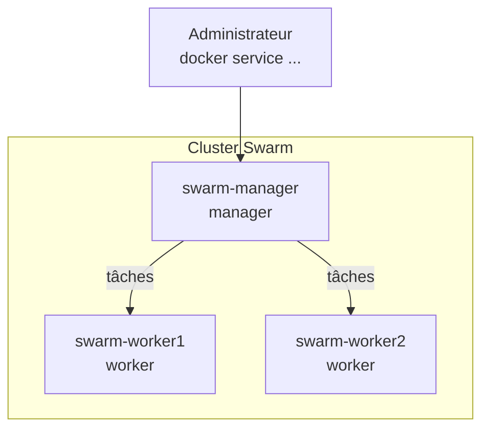
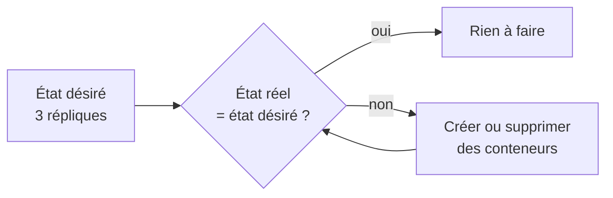
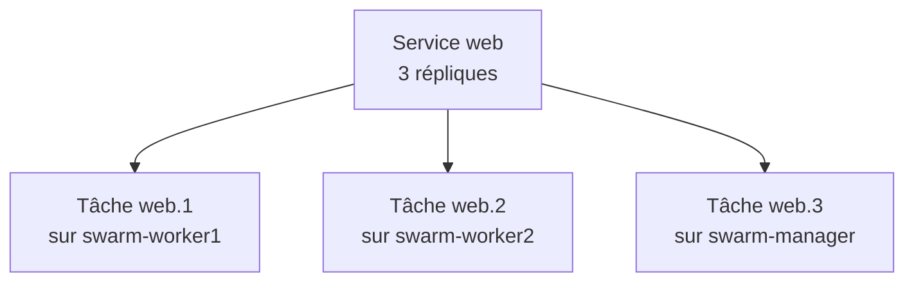
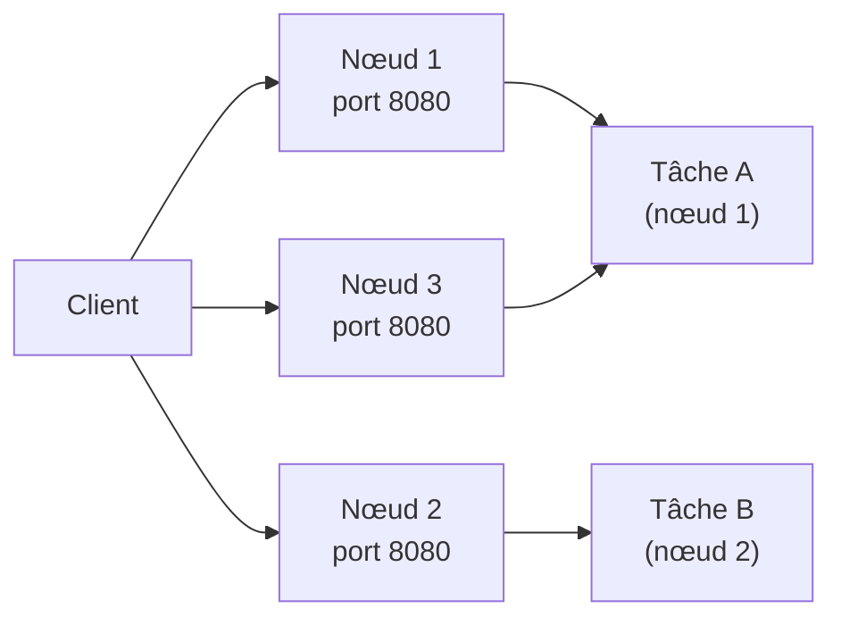
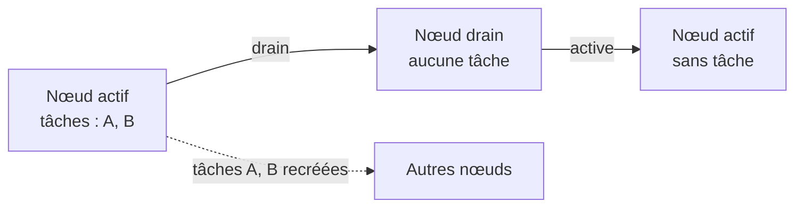

# Chapitre 11 : Swarm : cluster et services

!!! abstract "Objectifs du chapitre" - Expliquer pourquoi et quand on utilise un orchestrateur - Décrire l'architecture d'un cluster Docker Swarm : managers, workers, état désiré - Initialiser un cluster et y faire adhérer des nœuds - Déployer des services répliqués et globaux, les mettre à l'échelle et les observer - Expliquer le routing mesh et la répartition de charge - Mettre un nœud en maintenance sans interrompre les services - Acquis d'apprentissage visé : **AA8**

## 1. Pourquoi orchestrer ?

Avec Docker et Compose, vous savez décrire et exécuter une application sur **une seule machine**. En exploitation, cela ne suffit plus :

| Besoin               | Limite d'une seule machine                                                     |
| -------------------- | ------------------------------------------------------------------------------ |
| **Disponibilité**    | Si la machine tombe en panne, tous les conteneurs s'arrêtent                   |
| **Capacité**         | Une machine a une quantité de mémoire et de processeur limitée                 |
| **Montée en charge** | Il faut pouvoir lancer plus d'instances d'un service quand la demande augmente |
| **Maintenance**      | Arrêter la machine pour la mettre à jour interrompt l'application              |

Un **orchestrateur** gère un ensemble de machines comme un seul ensemble de ressources. On lui indique ce que l'on veut (« trois instances de ce service ») et il décide où les lancer, les surveille et les remplace en cas de panne.

**Docker Swarm** est l'orchestrateur intégré au moteur Docker : aucune installation supplémentaire, et il réutilise les concepts et le format de fichier que vous connaissez. Le chapitre 12 le compare à Kubernetes.

## 2. Architecture d'un cluster Swarm

Un **cluster Swarm** (ou _swarm_) est un groupe de machines exécutant Docker, appelées **nœuds**. Il existe deux rôles :

| Rôle        | Fonction                                                                              |
| ----------- | ------------------------------------------------------------------------------------- |
| **Manager** | Accepte les commandes, conserve l'état du cluster, décide du placement des conteneurs |
| **Worker**  | Exécute les conteneurs que les managers lui confient                                  |



Les commandes d'administration du cluster (`docker node ...`, `docker service ...`) s'exécutent sur un **manager**. Un worker ne peut pas les exécuter.

### 2.1 Plusieurs managers : le consensus

L'état du cluster (services, nœuds, configuration) est conservé par les managers, qui le répliquent entre eux avec un algorithme de **consensus** (Raft). Un seul manager (**leader**) prend les décisions ; les autres le suivent et peuvent le remplacer.

| Nombre de managers | Pannes de managers tolérées                                     |
| ------------------ | --------------------------------------------------------------- |
| 1                  | 0 : si le manager tombe, on ne peut plus administrer le cluster |
| 3                  | 1                                                               |
| 5                  | 2                                                               |

Le cluster ne fonctionne que si **la majorité** des managers est disponible (le **quorum**). On choisit donc un nombre **impair** de managers. Au-delà de 5, on n'améliore pas la disponibilité : on ralentit le consensus.

!!! note "Votre cluster de TP"
Votre cluster n'a qu'un manager : il n'est pas tolérant à la panne de celui-ci. C'est suffisant pour apprendre, pas pour la production.

### 2.2 État désiré et boucle de réconciliation

Swarm est **déclaratif** : vous décrivez l'**état désiré** (« trois répliques de `web` »), et Swarm compare en permanence l'état **réel** avec l'état désiré. Si un écart apparaît (un conteneur disparaît, un nœud tombe), il agit pour le corriger.



Cette **réconciliation** continue explique l'**auto-guérison** : vous n'avez pas à relancer à la main un conteneur qui s'est arrêté.

### 2.3 Communication sécurisée

Les nœuds s'authentifient par des **certificats** et leurs échanges de gestion sont chiffrés (TLS mutuel) : l'adhésion d'un nœud repose sur un **jeton** secret (section 3.2).

## 3. Créer le cluster

### 3.1 Initialiser le cluster

Sur la machine qui sera le premier manager :

```bash
docker swarm init --advertise-addr 192.168.56.10
```

L'option `--advertise-addr` indique l'adresse IP que les autres nœuds utiliseront pour joindre ce manager : utilisez l'adresse de la machine sur le réseau commun aux trois VM (remplacez l'exemple par la vôtre). La commande affiche la commande à exécuter sur les autres nœuds pour rejoindre le cluster.

### 3.2 Faire adhérer des nœuds

Sur chaque worker, on exécute la commande `docker swarm join` affichée, qui contient un **jeton** et l'adresse du manager (port 2377) :

```bash
docker swarm join --token <jeton> 192.168.56.10:2377
```

Pour afficher de nouveau la commande, sur le manager :

```bash
docker swarm join-token worker
docker swarm join-token manager
```

Il existe un jeton pour les workers et un jeton pour les managers.

!!! warning "Le jeton est un secret"
Quiconque possède le jeton et peut joindre le port 2377 du manager peut rejoindre le cluster. Ne le publiez pas (messages, dépôt Git). On le renouvelle avec `docker swarm join-token --rotate worker`.

### 3.3 Observer les nœuds

Sur le manager :

```bash
docker node ls
```

| Colonne          | Signification                                                        |
| ---------------- | -------------------------------------------------------------------- |
| `STATUS`         | `Ready` si le nœud est joignable, `Down` sinon                       |
| `AVAILABILITY`   | `Active` (reçoit des tâches), `Pause` ou `Drain` (voir la section 7) |
| `MANAGER STATUS` | `Leader`, `Reachable` pour un manager, vide pour un worker           |

La commande `docker info` affiche aussi l'état de Swarm sur la machine (`Swarm: active`).

### 3.4 Gérer les nœuds et les rôles

| Commande                           | Effet                                                |
| ---------------------------------- | ---------------------------------------------------- |
| `docker node promote noeud`        | Transforme un worker en manager                      |
| `docker node demote noeud`         | Transforme un manager en worker                      |
| `docker swarm leave` (sur le nœud) | Fait quitter le cluster au nœud                      |
| `docker node rm noeud`             | Retire du cluster un nœud arrêté (depuis le manager) |

## 4. Les services

### 4.1 Du conteneur au service

Dans un cluster, on ne lance plus des conteneurs isolés : on déclare des **services**. Un **service** décrit un conteneur à exécuter (image, port, variables…) et le nombre d'instances voulues. Swarm crée les **tâches** correspondantes : une **tâche** est une instance du service, qui s'exécute dans un conteneur sur un nœud.

```bash
docker service create --name web --replicas 3 -p 8080:80 nginx:1.27-alpine
```

| Élément             | Rôle                            |
| ------------------- | ------------------------------- |
| `--name web`        | Nom du service                  |
| `--replicas 3`      | Nombre de tâches voulues        |
| `-p 8080:80`        | Port publié (voir la section 6) |
| `nginx:1.27-alpine` | Image de chaque tâche           |



### 4.2 Commandes de gestion

Elles s'exécutent sur un manager.

| Commande                              | Rôle                                                                            |
| ------------------------------------- | ------------------------------------------------------------------------------- |
| `docker service ls`                   | Liste les services et leur nombre de répliques (`REPLICAS 3/3`)                 |
| `docker service ps web`               | Liste les tâches du service : nœud, état désiré, état actuel, erreur éventuelle |
| `docker service inspect --pretty web` | Affiche la configuration du service                                             |
| `docker service logs web`             | Journaux de toutes les tâches du service                                        |
| `docker service scale web=5`          | Change le nombre de répliques                                                   |
| `docker service rm web`               | Supprime le service et ses tâches                                               |

!!! note "Placement"
Par défaut, Swarm répartit les tâches pour **équilibrer** la charge entre les nœuds. Les managers exécutent aussi des tâches (sauf configuration contraire). Le chapitre 12 présente les contraintes de placement.

### 4.3 L'image doit être accessible par tous les nœuds

Chaque nœud qui reçoit une tâche **télécharge lui-même l'image**. Une image construite localement sur le manager n'existe pas sur les workers : le service échouera avec une erreur de téléchargement. Il faut donc une image publiée dans un **registre** (Docker Hub, registre privé : chapitre 4). Pour un registre privé, on ajoute l'option `--with-registry-auth` à la création ou à la mise à jour du service.

## 5. Modes de réplication

| Mode                         | Principe                                                      | Usage typique                              |
| ---------------------------- | ------------------------------------------------------------- | ------------------------------------------ |
| **Répliqué** (par défaut)    | Un nombre **fixe** de tâches, réparties sur les nœuds         | Application web, API                       |
| **Global** (`--mode global`) | **Une tâche par nœud**, y compris les nœuds ajoutés plus tard | Agent de supervision, collecte de journaux |

```bash
docker service create --name agent --mode global alpine:3.20 sleep 3600
```

Un service global n'a pas d'option `--replicas` : le nombre de tâches est le nombre de nœuds.

### 5.1 Auto-guérison en pratique

Si le conteneur d'une tâche s'arrête, ou si un nœud tombe, Swarm crée une **nouvelle tâche** pour revenir au nombre de répliques voulu. La commande `docker service ps` montre l'historique : l'ancienne tâche à l'état `Shutdown` ou `Failed`, et la nouvelle à l'état `Running`.

Les états d'une tâche se lisent dans cet ordre : `Pending` (en attente d'un nœud), `Preparing` (téléchargement de l'image), `Starting`, `Running`. Les états `Failed`, `Rejected` ou `Shutdown` indiquent un échec ou un arrêt.

### 5.2 Mise à l'échelle

On modifie le nombre de répliques d'un service répliqué sans l'interrompre :

```bash
docker service scale web=5
docker service scale web=2
```

Swarm crée ou supprime des tâches pour atteindre le nombre demandé, et répartit les nouvelles tâches sur les nœuds.

## 6. Le routing mesh

### 6.1 Principe

Quand on **publie un port** pour un service, Swarm ouvre ce port sur **tous les nœuds du cluster**, même ceux qui n'exécutent aucune tâche du service. Une requête arrivant sur n'importe quel nœud est redirigée vers l'une des tâches du service, où qu'elle se trouve, et la charge est répartie entre les tâches. C'est le **routing mesh**.



Conséquences :

- on peut joindre le service en s'adressant à **n'importe quel nœud** ;
- les requêtes successives sont réparties entre les tâches (répartition de charge) ;
- si un nœud tombe, les autres continuent de répondre.

Le routing mesh s'appuie sur un réseau spécial créé par Swarm, `ingress`, visible avec `docker network ls`. Il utilise les ports entre nœuds de l'[annexe environnement](../../annexes/environnement.md) (4789/udp notamment).

!!! note "Selon l'usage"
On peut aussi publier un port **uniquement** sur les nœuds qui exécutent une tâche, sans répartition de charge (option `mode=host` de `--publish`). Le routing mesh est le comportement par défaut.

### 6.2 Vérifier la répartition

L'image `nginx` renvoie toujours la même page : pour voir quelle tâche répond, on utilise un service qui renvoie son nom d'hôte (le nom d'hôte d'un conteneur est son identifiant). Vous le ferez au [Lab 11.2](lab-11-2-deployer-et-mettre-a-l-echelle-des-services.md).

## 7. Maintenance d'un nœud

Pour mettre à jour ou redémarrer un nœud sans interrompre le service, on le **vide** de ses tâches :

```bash
docker node update --availability drain swarm-worker1
```

| Disponibilité | Effet                                                                                 |
| ------------- | ------------------------------------------------------------------------------------- |
| `active`      | Le nœud reçoit et exécute des tâches                                                  |
| `pause`       | Le nœud garde ses tâches mais n'en reçoit plus de nouvelles                           |
| `drain`       | Le nœud ne reçoit plus de tâches et **ses tâches sont déplacées** vers d'autres nœuds |



Après la maintenance, on remet le nœud en service :

```bash
docker node update --availability active swarm-worker1
```

!!! warning "Swarm ne rééquilibre pas automatiquement"
Quand un nœud redevient `active`, il ne reprend **pas** les tâches qui ont été déplacées : il ne reçoit que les nouvelles tâches (nouveau service, mise à l'échelle). Pour rééquilibrer, on peut réduire puis augmenter le nombre de répliques.

## 8. Diagnostiquer un service

Appliquez la démarche du [chapitre 8](../../partie-2-donnees-reseau-et-exploitation/ch08-observabilite-et-depannage/cours.md), adaptée au cluster :

| Symptôme                          | Où regarder                                                                                                                          |
| --------------------------------- | ------------------------------------------------------------------------------------------------------------------------------------ |
| Le service reste à `0/3`          | `docker service ps web` : état `Pending`, `Rejected` ou `Failed` et message d'erreur (utilisez `--no-trunc` pour le message complet) |
| Tâche en erreur de téléchargement | L'image n'existe pas dans un registre accessible par le nœud : section 4.3                                                           |
| Tâche `Pending`                   | Aucun nœud ne peut accueillir la tâche (ressources insuffisantes, nœud en `drain`) : `docker node ls`                                |
| Le port ne répond pas             | Vérifiez le port publié, l'état des tâches, et les ports du cluster ouverts entre les nœuds                                          |
| Un nœud est `Down`                | Machine arrêtée ou injoignable : ports 2377, 7946 et 4789, réseau, service Docker                                                    |

Les journaux d'un service se lisent avec `docker service logs`, ceux d'un conteneur précis avec `docker logs` **sur le nœud qui l'héberge**.

## 9. Compose et Swarm

|                                    | Docker Compose                             | Docker Swarm                                            |
| ---------------------------------- | ------------------------------------------ | ------------------------------------------------------- |
| Machines                           | Une                                        | Plusieurs                                               |
| Unité                              | Service (conteneurs sur la machine locale) | Service (tâches réparties sur le cluster)               |
| Commande                           | `docker compose up`                        | `docker service create` (ou une **stack**, chapitre 12) |
| Auto-guérison sur panne de machine | Non                                        | Oui                                                     |
| Mise à l'échelle                   | Limitée à la machine                       | Sur tout le cluster                                     |

Au chapitre 12, vous déploierez une application complète depuis un fichier Compose sous forme de **stack**, avec des réseaux entre nœuds, des secrets et des mises à jour progressives.

!!! tip "À retenir" - Un orchestrateur gère plusieurs machines comme un seul ensemble de ressources, et maintient l'**état désiré**. - Un cluster Swarm comporte des **managers** (décisions, état, administration) et des **workers** (exécution). On choisit un nombre **impair** de managers. - `docker swarm init` crée le cluster, `docker swarm join` ajoute un nœud, avec un **jeton secret** ; les commandes d'administration se lancent sur un manager. - Un **service** produit des **tâches** ; il est **répliqué** (nombre fixe) ou **global** (une par nœud). - L'image d'un service doit être **accessible par tous les nœuds** : utilisez un registre. - Le **routing mesh** publie le port sur tous les nœuds et répartit les requêtes entre les tâches. - `drain` vide un nœud pour maintenance ; `active` le remet en service sans rééquilibrage automatique. - `docker service ps` est le premier outil de diagnostic d'un service.

## Pour vérifier votre compréhension

??? question "Pourquoi choisit-on un nombre impair de managers ?"
Le cluster fonctionne tant que la majorité des managers est disponible. Avec un nombre impair, on tolère autant de pannes qu'avec le nombre pair immédiatement supérieur, avec une machine de moins : 3 managers tolèrent 1 panne, comme 4.

??? question "Un conteneur d'un service répliqué est supprimé à la main sur un nœud. Que se passe-t-il ?"
Swarm constate que l'état réel (2 tâches) diffère de l'état désiré (3 répliques) et crée une nouvelle tâche, sur ce nœud ou sur un autre. C'est la boucle de réconciliation.

??? question "Pourquoi un service créé avec une image construite uniquement sur le manager échoue-t-il sur les workers ?"
Chaque nœud télécharge lui-même l'image depuis un registre. L'image locale du manager n'est pas disponible pour les workers : il faut la publier dans un registre accessible à tous les nœuds.

??? question "Une requête est envoyée au port publié d'un nœud qui n'exécute aucune tâche du service. Obtient-on une réponse ?"
Oui, grâce au routing mesh : le port est ouvert sur tous les nœuds et la requête est transmise à une tâche du service, quel que soit le nœud qui l'héberge.

??? question "Après la maintenance d'un nœud remis en `active`, pourquoi n'exécute-t-il aucune tâche ?"
Swarm ne rééquilibre pas les tâches existantes : le nœud ne reçoit que de nouvelles tâches. Pour rééquilibrer, on modifie le nombre de répliques (par exemple en le réduisant puis en le rétablissant).

## Ressources du chapitre

- [Lab 11.1 : Créer un cluster Swarm](lab-11-1-creer-un-cluster-swarm.md)
- [Lab 11.2 : Déployer et mettre à l'échelle des services](lab-11-2-deployer-et-mettre-a-l-echelle-des-services.md)
- [Quiz du chapitre](quiz.md)
