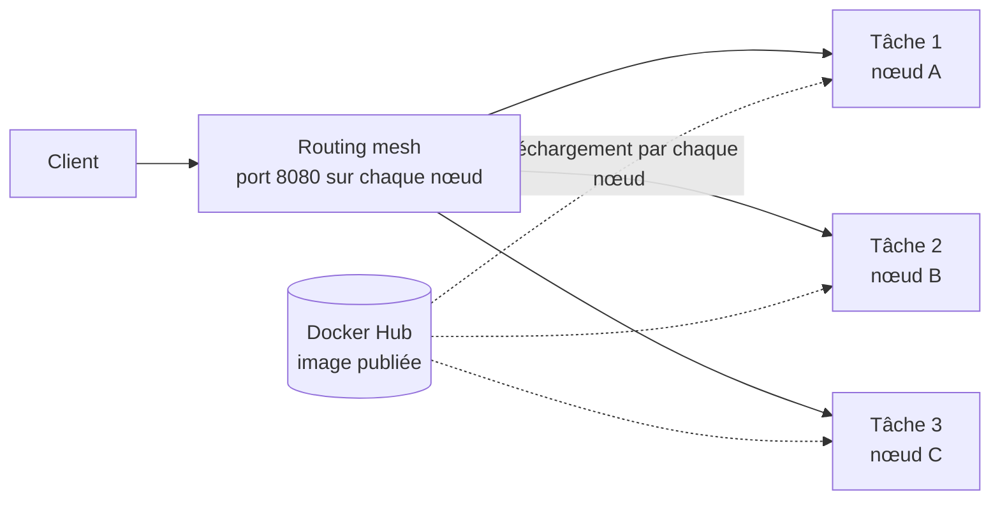

# Lab 11.2 : Déployer et mettre à l'échelle des services

|                  |                                                                                                                                                                                                                                                                            |
| ---------------- | -------------------------------------------------------------------------------------------------------------------------------------------------------------------------------------------------------------------------------------------------------------------------- |
| **Durée**        | 75 min                                                                                                                                                                                                                                                                     |
| **Niveau**       | Semi-guidé                                                                                                                                                                                                                                                                 |
| **Prérequis**    | [Lab 11.1 : Créer un cluster Swarm](lab-11-1-creer-un-cluster-swarm.md) (cluster de trois nœuds en état), [Lab 4.1 : Publier sur Docker Hub](../../partie-1-fondations/ch04-registres-et-distribution/lab-4-1-publier-sur-docker-hub.md), cours du [chapitre 11](cours.md) |
| **Acquis visés** | AA8                                                                                                                                                                                                                                                                        |

!!! abstract "Objectifs" - Constater qu'une image doit être accessible par tous les nœuds, et la publier sur Docker Hub - Déployer un service répliqué et observer le placement des tâches - Vérifier le routing mesh et la répartition de charge - Mettre un service à l'échelle et observer l'auto-guérison - Déployer un service global - Mettre un nœud en maintenance sans interrompre le service

## Contexte et schéma

Vous déployez une petite application qui répond par **le nom du conteneur qui a traité la requête** : en la sollicitant plusieurs fois, vous voyez quelle tâche répond. Les commandes `docker service ...` et `docker node ...` s'exécutent sur `swarm-manager`. Dans ce lab, seules les **commandes clés** vous sont données : à vous de les adapter et de déduire le reste à l'aide du [cours](cours.md).



!!! note "Organisation du travail"
Ouvrez trois terminaux (un par VM) comme au Lab 11.1. Les tests `curl` se font depuis un terminal de VM Linux, avec l'adresse IP d'un nœud (relevée au Lab 11.1).

## Étapes

### Étape 1 : Préparer l'application

- **Objectif :** disposer d'une image qui affiche le nom du conteneur.
- **Indices :** sur `swarm-manager`, créez un dossier `qui-repond` avec les trois fichiers suivants.

**`requirements.txt`**

```text
flask==3.0.3
```

**`app.py`**

```python
import socket

from flask import Flask

app = Flask(__name__)


@app.route("/")
def accueil():
    return f"Réponse du conteneur {socket.gethostname()}\n"


if __name__ == "__main__":
    app.run(host="0.0.0.0", port=5000)
```

**`Dockerfile`**

```dockerfile
FROM python:3.12-slim
WORKDIR /app
COPY requirements.txt .
RUN pip install --no-cache-dir -r requirements.txt
COPY app.py .
EXPOSE 5000
CMD ["python", "app.py"]
```

Construisez l'image `qui-repond:1.0` et vérifiez-la avec un conteneur isolé (`docker run`, `curl`), puis supprimez ce conteneur.

!!! info "Pourquoi le nom d'hôte ?"
Le nom d'hôte d'un conteneur est son identifiant court : il est différent pour chaque tâche. C'est ce qui permet de savoir laquelle a répondu.

!!! success "Point de contrôle" - [ ] `curl` affiche `Réponse du conteneur ...` avec un identifiant - [ ] Le conteneur d'essai est supprimé

### Étape 2 : Constater la limite d'une image locale

- **Objectif :** comprendre pourquoi l'image doit être dans un registre (section 4.3 du [cours](cours.md)).
- **Indices :**
  - Créez un service `test-local` de 3 répliques avec l'image **locale** `qui-repond:1.0` (non publiée), port 8081 de l'hôte vers le port 5000.
  - Lisez les messages affichés à la création, puis observez `docker service ps test-local --no-trunc` pendant quelques secondes : sur quels nœuds les tâches démarrent-elles, sur lesquels échouent-elles, avec quel message ?
  - Supprimez le service.

!!! success "Point de contrôle" - [ ] Vous avez relevé le message affiché à la création du service - [ ] Vous avez relevé ce qui se passe sur les workers (état et message d'erreur) - [ ] Vous savez expliquer pourquoi ce n'est pas le cas sur le manager

### Étape 3 : Publier l'image sur Docker Hub

- **Objectif :** rendre l'image accessible par tous les nœuds.
- **Indices :**
  - Connectez-vous à Docker Hub avec votre **jeton d'accès** (Lab 4.1), nommez l'image `<utilisateur>/qui-repond:1.0` (`docker tag`) et publiez-la (`docker push`).
  - Vérifiez sur le site de Docker Hub que le dépôt est **public** : les workers téléchargeront l'image sans identifiants.

!!! success "Point de contrôle" - [ ] L'image est visible sur Docker Hub, dépôt public - [ ] Vous n'avez saisi aucun mot de passe dans vos fichiers ni dans un historique partagé

### Étape 4 : Déployer un service répliqué

- **Objectif :** créer un service de 3 répliques et observer le placement.
- **Indices :**
  - Créez le service `web` : 3 répliques, port 8080 de l'hôte vers le port 5000, image `<utilisateur>/qui-repond:1.0`.
  - Observez : `docker service ls`, `docker service ps web`, `docker service inspect --pretty web`.
  - Sur chaque nœud, `docker ps` : quel conteneur y tourne ?

!!! success "Point de contrôle" - [ ] `docker service ls` affiche `web` avec `3/3` répliques - [ ] `docker service ps web` montre les trois tâches et leurs nœuds - [ ] Vous avez relevé la répartition des tâches sur les nœuds

### Étape 5 : Vérifier le routing mesh

- **Objectif :** constater la répartition de charge et l'accès par n'importe quel nœud.
- **Indices :**
  - Envoyez 12 requêtes à l'adresse du **manager**, puis comptez les réponses par conteneur :

```bash
for i in $(seq 1 12); do curl -s http://<adresse-du-manager>:8080; done | sort | uniq -c
```

    - Recommencez avec l'adresse d'un worker.
    - Réduisez le service à **2 répliques** (`docker service scale web=2`), repérez le nœud qui n'a plus de tâche, et envoyez-lui des requêtes.

!!! success "Point de contrôle" - [ ] Les requêtes sont réparties entre les conteneurs (plusieurs identifiants différents) - [ ] Le service répond aussi sur l'adresse d'un worker - [ ] Le nœud sans tâche répond quand même : vous savez l'expliquer par le routing mesh

### Étape 6 : Mettre à l'échelle

- **Objectif :** changer le nombre de répliques sans interruption.
- **Indices :**
  - Passez à **6 répliques**, observez `docker service ps web`, puis refaites l'envoi de 12 requêtes avec le comptage : combien de conteneurs différents répondent ?
  - Passez à 1 réplique, puis revenez à 3.

!!! success "Point de contrôle" - [ ] Avec 6 répliques, jusqu'à 6 conteneurs différents répondent - [ ] Vous avez observé la répartition des nouvelles tâches sur les nœuds - [ ] Le service est de nouveau à 3 répliques

### Étape 7 : Observer l'auto-guérison

- **Objectif :** voir Swarm remplacer une tâche disparue.
- **Indices :**
  - Sur un worker qui héberge une tâche, supprimez son conteneur à la main : `docker ps` pour repérer le conteneur, puis `docker rm -f`.
  - Sur le manager, observez immédiatement `docker service ps web` puis `docker service ls`.

!!! success "Point de contrôle" - [ ] L'ancienne tâche apparaît à l'état `Failed` ou `Shutdown` - [ ] Une nouvelle tâche est créée et passe `Running` - [ ] `docker service ls` revient à `3/3`

### Étape 8 : Déployer un service global

- **Objectif :** exécuter une tâche sur chaque nœud.
- **Indices :**
  - Créez un service `agent` en mode **global** avec l'image `alpine:3.20` qui exécute `sleep 3600`.
  - Observez `docker service ps agent` : combien de tâches, sur quels nœuds ?
  - Comparez avec le service `web`.

!!! success "Point de contrôle" - [ ] Une tâche exactement par nœud - [ ] Vous savez expliquer la différence entre un service répliqué et un service global

### Étape 9 : Mettre un nœud en maintenance

- **Objectif :** vider un nœud sans interrompre le service.
- **Indices :**
  - Dans un terminal, lancez une boucle de requêtes continue vers le service (par exemple une requête par seconde pendant 2 minutes).
  - Dans un autre, mettez `swarm-worker1` en `drain` (section 7 du [cours](cours.md)), puis observez `docker service ps web`, `docker service ps agent` et `docker node ls`.
  - Remettez le nœud en `active` : reçoit-il de nouveau des tâches de `web` ? Que se passe-t-il pour le service global ?
  - Pour rééquilibrer, réduisez puis rétablissez le nombre de répliques de `web`.

!!! success "Point de contrôle" - [ ] Le service a continué de répondre pendant le `drain` - [ ] Les tâches de `web` ont été recréées sur les autres nœuds - [ ] Après `active`, le nœud ne reprend pas automatiquement ses anciennes tâches - [ ] Après réduction puis rétablissement des répliques, les tâches sont de nouveau réparties

### Étape 10 (facultative) : Panne d'un nœud

- **Objectif :** observer la réaction du cluster à la perte d'une machine.
- **Indices :**
  - Sur `swarm-worker2`, arrêtez le moteur Docker (`sudo systemctl stop docker.service docker.socket`) ou éteignez la VM.
  - Sur le manager, observez `docker node ls` et `docker service ps web` pendant une minute : après combien de temps les tâches de ce nœud sont-elles recréées ailleurs ?
  - Redémarrez le nœud et observez son retour.

!!! success "Point de contrôle" - [ ] Le nœud passe `Down` - [ ] Les tâches de `web` sont recréées sur les nœuds restants - [ ] Le service reste accessible pendant la panne

### Étape 11 : Dresser la fiche de commandes

- **Objectif :** retenir les commandes de pilotage d'un service.
- **Indices :** complétez le tableau avec la commande que vous avez utilisée.

| Besoin                             | Commande |
| ---------------------------------- | -------- |
| Lister les services                |          |
| Voir où tournent les tâches        |          |
| Changer le nombre de répliques     |          |
| Voir la configuration d'un service |          |
| Mettre un nœud en maintenance      |          |
| Remettre un nœud en service        |          |

!!! success "Point de contrôle" - [ ] Chaque ligne contient une commande que vous avez exécutée

## Questions de réflexion

??? question "Pourquoi le service créé avec l'image locale pose-t-il problème sur les workers ?"
Chaque nœud télécharge lui-même l'image qu'on lui demande d'exécuter. L'image construite sur le manager n'existe pas sur les workers et n'est pas dans un registre : ils ne peuvent pas la télécharger.

??? question "Pourquoi un nœud qui n'exécute aucune tâche répond-il quand même sur le port publié ?"
Grâce au routing mesh : le port est ouvert sur tous les nœuds et les requêtes sont transmises à une tâche du service, où qu'elle se trouve.

??? question "Quelle différence entre supprimer un conteneur à la main et réduire le nombre de répliques ?"
Supprimer un conteneur à la main change l'état réel sans changer l'état désiré : Swarm recrée le conteneur. Réduire le nombre de répliques change l'état désiré : Swarm supprime des tâches pour s'y conformer.

??? question "Pourquoi un nœud remis en `active` ne reprend-il pas ses anciennes tâches ?"
Swarm ne rééquilibre pas les tâches existantes : un nœud ne reçoit que de nouvelles tâches. Une modification du nombre de répliques peut redistribuer la charge.

## Dépannage

| Symptôme                                                                                  | Pistes                                                                                                              |
| ----------------------------------------------------------------------------------------- | ------------------------------------------------------------------------------------------------------------------- |
| `docker service ps web` : tâches `Rejected` ou `Failed` avec une erreur de téléchargement | L'image n'est pas accessible aux nœuds : dépôt privé, nom incorrect ou pas de connexion Internet sur le worker      |
| Service à `0/3`                                                                           | `docker service ps web --no-trunc` pour lire le message d'erreur ; vérifiez le nom et le tag de l'image             |
| `curl` ne répond pas sur un nœud                                                          | Port 8080 déjà utilisé sur ce nœud, ports du cluster bloqués (4789/udp), ou tâche encore en `Preparing`             |
| Toutes les requêtes reviennent au même conteneur                                          | Vérifiez que le service a plusieurs répliques `Running` ; attendez la fin du démarrage                              |
| `port is already allocated` ou `port already in use`                                      | Un autre service ou conteneur occupe le port : changez le port publié                                               |
| Le nœud mis en `drain` garde ses tâches                                                   | Attendez quelques secondes et relisez `docker service ps` ; vérifiez la commande de mise à jour de la disponibilité |
| `This node is not a swarm manager`                                                        | Vous êtes sur un worker : utilisez le manager                                                                       |

## Nettoyage et reprise

Supprimez les services, **conservez le cluster** :

```bash
docker service rm web agent
docker service ls
```

Remettez tous les nœuds en `active` (`docker node ls`). L'image publiée sur Docker Hub reste disponible pour les prochains labs. Le [Lab 12.1](../ch12-swarm-stacks-et-exploitation/lab-12-1-deployer-une-stack.md) utilise le même cluster.

## Retour au chapitre

[Chapitre 11 : Swarm : cluster et services](cours.md) · Quiz : [Quiz du chapitre 11](quiz.md)
