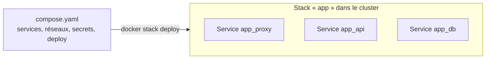
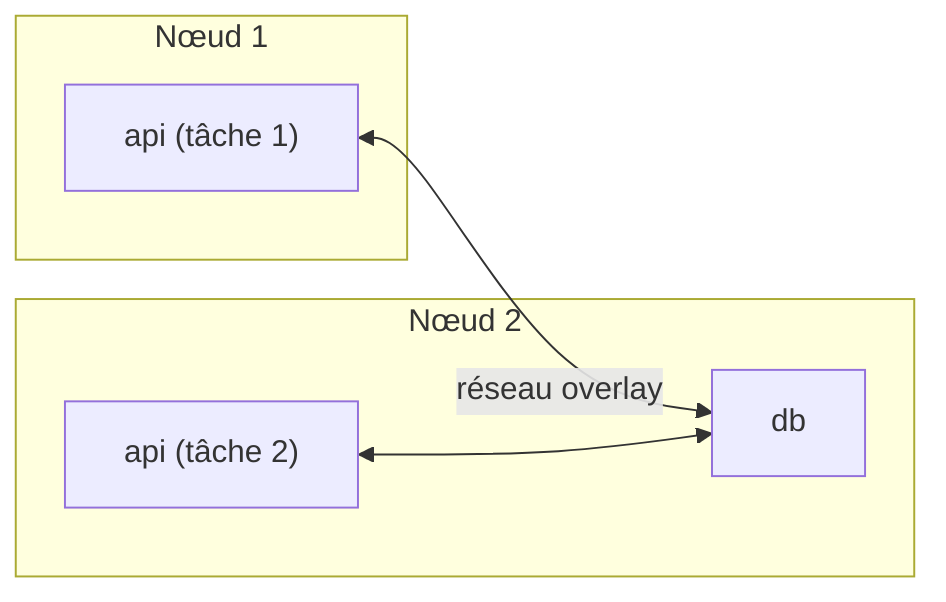

# Chapitre 12 : Swarm : stacks et exploitation

!!! abstract "Objectifs du chapitre"
    - Relier des services répartis sur plusieurs nœuds avec un réseau overlay
    - Déployer une application complète sous forme de stack à partir d'un fichier Compose
    - Fournir configurations et secrets aux services avec les objets de Swarm
    - Contrôler le placement des tâches
    - Mettre à jour un service progressivement et revenir en arrière en cas d'échec
    - Expliquer comment Swarm réagit aux pannes, et les limites des données locales
    - Situer Swarm par rapport à Kubernetes
    - Acquis d'apprentissage visé : **AA8**

## 1. Du service à la stack

Au chapitre 11, vous avez créé des services un par un avec `docker service create`. Une application réelle en comporte plusieurs (proxy, API, base de données), reliés par des réseaux, avec des secrets et des règles de mise à jour. Les créer à la main serait long et non reproductible, comme les `docker run` avant Compose.

Swarm reprend la solution de Compose : un **fichier** décrit l'application, et une **stack** est l'ensemble des services créés à partir de ce fichier.



## 2. Les réseaux overlay

### 2.1 Principe

Sur une seule machine, un réseau bridge relie des conteneurs. Dans un cluster, les conteneurs d'un même service peuvent être sur des machines différentes : il faut un réseau qui **s'étend sur plusieurs nœuds**. C'est le rôle du pilote **overlay**. Il encapsule le trafic entre les nœuds, ce qui explique le port 4789/udp de l'annexe environnement.



Les services d'un même réseau overlay se joignent **par leur nom de service**, comme dans un réseau bridge défini par l'utilisateur (chapitre 6), quel que soit le nœud qui les héberge.

```bash
docker network create --driver overlay reseau-app
docker service create --name db --network reseau-app ...
docker service create --name api --network reseau-app ...
```

Le réseau se crée sur un manager ; il n'existe sur un nœud que lorsqu'une tâche s'y connecte.

### 2.2 Résolution des noms et répartition de charge

Le nom d'un service est résolu vers une **adresse virtuelle** (VIP) unique, qui répartit les connexions entre les tâches du service. Un client interne n'a donc pas besoin de connaître le nombre de tâches ni leur emplacement. Le nom spécial `tasks.<service>` renvoie en revanche les adresses de **toutes** les tâches.

### 2.3 Chiffrement

Le trafic d'un réseau overlay entre les nœuds n'est pas chiffré par défaut. L'option `--opt encrypted` l'active :

```bash
docker network create --driver overlay --opt encrypted reseau-app
```

Le chiffrement ajoute un coût de traitement : on l'active quand le réseau entre les nœuds n'est pas de confiance.

## 3. Les stacks

### 3.1 Commandes

| Commande | Rôle |
|---|---|
| `docker stack deploy -c compose.yaml app` | Crée ou met à jour la stack `app` (sur un manager) |
| `docker stack ls` | Liste les stacks |
| `docker stack services app` | Liste les services de la stack |
| `docker stack ps app` | Liste les tâches de la stack |
| `docker stack rm app` | Supprime la stack |

La commande `docker stack deploy` sert aussi à **mettre à jour** : on modifie le fichier et on relance la même commande ; Swarm n'agit que sur ce qui a changé.

### 3.2 Nommage

Les objets créés sont préfixés par le **nom de la stack** : le service `api` de la stack `app` s'appelle `app_api`, et le réseau par défaut est `app_default`. Les services se joignent entre eux par leur nom **court** (`api`) au sein de la stack.

### 3.3 Ce qui change par rapport à Compose

Le fichier est celui que vous connaissez, avec une section supplémentaire `deploy` pour les paramètres propres à Swarm. Certaines clés de Compose ne s'appliquent pas à une stack :

| Clé Compose | Comportement avec `docker stack deploy` |
|---|---|
| `build` | **Ignorée** : une stack utilise des images déjà construites et **publiées dans un registre** (chapitre 11) |
| `depends_on` | **Ignorée** : Swarm ne gère pas l'ordre de démarrage ; l'application doit tolérer qu'un service soit un moment indisponible, et les healthchecks servent à détecter la disponibilité |
| `container_name` | Ignorée : les tâches reçoivent des noms générés |
| `restart` | Remplacée par `deploy.restart_policy` |
| `mem_limit`, `cpus` | Remplacées par `deploy.resources` |

Docker signale par un avertissement les options qu'il ignore.

### 3.4 La section `deploy`

| Clé | Rôle |
|---|---|
| `replicas` | Nombre de tâches |
| `mode` | `replicated` (par défaut) ou `global` |
| `resources` | Limites (`limits`) et réservations (`reservations`) de processeur et de mémoire |
| `restart_policy` | Quand et combien de fois redémarrer une tâche en échec |
| `placement` | Contraintes de placement (section 5) |
| `update_config` | Règles des mises à jour (section 6) |
| `rollback_config` | Règles du retour arrière (section 6) |

### 3.5 Un exemple de stack

```yaml
services:
  proxy:
    image: nginx:1.27-alpine
    ports:
      - "8080:80"
    networks:
      - frontend
    deploy:
      replicas: 2

  api:
    image: utilisateur/api:1.0
    networks:
      - frontend
      - backend
    deploy:
      replicas: 3
      resources:
        limits:
          cpus: "0.5"
          memory: 128M
      restart_policy:
        condition: on-failure

  db:
    image: postgres:16-alpine
    networks:
      - backend
    deploy:
      replicas: 1

networks:
  frontend:
  backend:
```

Les deux réseaux sont créés avec le pilote overlay lors du déploiement de la stack. Remplacez `utilisateur/api:1.0` par une image **publiée** et accessible à tous les nœuds.

!!! note "Registre privé"
    Pour une image d'un registre privé, ajoutez l'option `--with-registry-auth` à `docker stack deploy` : les nœuds reçoivent les identifiants nécessaires pour télécharger l'image.

## 4. Configurations et secrets de Swarm

Swarm fournit deux objets pour injecter des données dans les tâches **sans les mettre dans l'image ni dans des variables d'environnement** (chapitre 10) :

| Objet | Contenu | Stockage dans la tâche |
|---|---|---|
| **Config** | Données non sensibles (fichier de configuration d'un serveur) | Fichier monté dans le conteneur |
| **Secret** | Données sensibles (mot de passe, clé) | Fichier en mémoire, monté sous `/run/secrets/<nom>` |

Les secrets sont **chiffrés** dans le cluster, transmis uniquement aux nœuds qui exécutent une tâche qui en a besoin, et montés en mémoire : ils ne sont pas écrits sur le disque du nœud.

### 4.1 Création

```bash
docker config create proxy_conf default.conf
printf 'motdepasse-tp' | docker secret create db_password -
docker config ls
docker secret ls
```

La commande `docker secret create db_password -` lit la valeur sur l'entrée standard (le tiret). `docker secret inspect` n'affiche **jamais** la valeur.

### 4.2 Utilisation dans une stack

```yaml
services:
  proxy:
    image: nginx:1.27-alpine
    configs:
      - source: proxy_conf
        target: /etc/nginx/conf.d/default.conf

  db:
    image: postgres:16-alpine
    environment:
      POSTGRES_PASSWORD_FILE: /run/secrets/db_password
    secrets:
      - db_password

configs:
  proxy_conf:
    external: true

secrets:
  db_password:
    external: true
```

`external: true` indique que l'objet a déjà été créé avec `docker config create` ou `docker secret create`. On retrouve le même principe que le fichier `/run/secrets/...` du chapitre 10 avec `POSTGRES_PASSWORD_FILE`.

!!! warning "Configs et secrets sont immuables"
    On ne modifie pas un secret ou une config existants. Pour changer une valeur, on crée un **nouvel objet** (avec un autre nom, par exemple `db_password_v2`), on met la stack ou le service à jour pour l'utiliser, puis on supprime l'ancien. Le secret n'est pas non plus un coffre-fort : toute personne qui contrôle un manager ou le moteur Docker d'un nœud qui l'héberge peut le lire.

## 5. Contrôler le placement des tâches

Par défaut, Swarm répartit les tâches de façon équilibrée. On peut le contraindre avec `deploy.placement.constraints` :

```yaml
deploy:
  placement:
    constraints:
      - node.role == worker
```

| Contrainte | Effet |
|---|---|
| `node.role == worker` | Uniquement sur les workers |
| `node.role == manager` | Uniquement sur les managers |
| `node.hostname == swarm-worker1` | Uniquement sur le nœud nommé |
| `node.labels.zone == a` | Uniquement sur les nœuds portant l'étiquette `zone=a` |

Les **étiquettes** se posent sur un nœud depuis un manager :

```bash
docker node update --label-add zone=a swarm-worker1
```

L'option `max_replicas_per_node` limite le nombre de tâches d'un service par nœud.

### 5.1 Les données et le placement

!!! danger "Un volume est local à un nœud"
    Un volume nommé (chapitre 5) est stocké sur **un** nœud. Si une tâche qui l'utilise est recréée sur un **autre** nœud, elle trouve un volume **vide** : les données restent sur l'ancien nœud. Pour un service avec données (base de données), il faut donc :

    - **fixer** la tâche sur un nœud précis avec une contrainte de placement, en acceptant que ce nœud soit un point de défaillance ; ou
    - utiliser un **stockage partagé** entre les nœuds, ou une base de données gérée hors du cluster.

    Le choix d'un stockage partagé dépasse le cadre de ce cours : retenez que la **réplication d'une base de données** n'est pas résolue par le simple fait d'augmenter le nombre de répliques.

## 6. Mises à jour progressives et retour arrière

### 6.1 Principe

Mettre à jour un service ne doit pas l'interrompre. Swarm remplace les tâches **par lots** : il arrête quelques anciennes tâches, démarre les nouvelles, attend, puis passe au lot suivant.


```bash
docker service update --image utilisateur/api:2.0 app_api
```

On peut aussi modifier la balise de l'image dans le fichier et relancer `docker stack deploy`.

### 6.2 Régler la mise à jour

| Paramètre (`update_config`) | Option de `docker service update` | Effet |
|---|---|---|
| `parallelism` | `--update-parallelism` | Nombre de tâches remplacées à la fois |
| `delay` | `--update-delay` | Délai entre deux lots |
| `order` | `--update-order` | `stop-first` (arrêter l'ancienne avant de démarrer la nouvelle) ou `start-first` (démarrer la nouvelle avant) |
| `failure_action` | `--update-failure-action` | Que faire si la mise à jour échoue : `pause`, `continue` ou `rollback` |
| `monitor` | `--update-monitor` | Durée pendant laquelle une nouvelle tâche est surveillée avant de passer au lot suivant |

```yaml
deploy:
  replicas: 3
  update_config:
    parallelism: 1
    delay: 10s
    order: start-first
    failure_action: rollback
```

Avec `start-first`, il y a momentanément plus de tâches que de répliques voulues, mais le service ne descend jamais sous sa capacité : c'est le choix à privilégier pour un service sans interruption, quand l'application tolère deux versions simultanées.

!!! tip "Le healthcheck rend la mise à jour sûre"
    Quand l'image définit un healthcheck, Swarm attend qu'une nouvelle tâche soit `healthy` avant de continuer. Sans healthcheck, il considère la tâche comme prête dès qu'elle est démarrée.

### 6.3 Suivre et annuler

| Commande | Effet |
|---|---|
| `docker service ps app_api` | Montre les anciennes tâches (arrêtées) et les nouvelles |
| `docker service inspect --pretty app_api` | Affiche l'état de la mise à jour (`UpdateStatus`) |
| `docker service rollback app_api` | Revient à la configuration précédente du service |

Avec `failure_action: rollback`, Swarm revient **automatiquement** à la version précédente si la mise à jour échoue. Les paramètres du retour arrière se règlent avec `rollback_config`.

## 7. Tolérance aux pannes et exploitation

### 7.1 Ce que Swarm répare seul

| Panne | Réaction de Swarm |
|---|---|
| Un conteneur s'arrête | La tâche est recréée, selon la `restart_policy` |
| Un conteneur est `unhealthy` | Swarm le remplace par une nouvelle tâche (contrairement à Docker seul, chapitre 8) |
| Un nœud tombe | Ses tâches sont recréées sur les autres nœuds |
| Un manager tombe | Un autre manager devient leader, si le quorum est conservé (chapitre 11) |

### 7.2 Ce que Swarm ne répare pas

- les **données locales** d'un nœud perdu (section 5.1) ;
- la perte du **quorum** des managers : il faut rétablir assez de managers ;
- une application qui échoue systématiquement : Swarm la recrée en boucle, selon sa politique de redémarrage ;
- une image introuvable ou incorrecte.

### 7.3 Politique de redémarrage

```yaml
deploy:
  restart_policy:
    condition: on-failure
    delay: 5s
    max_attempts: 3
```

| Condition | Effet |
|---|---|
| `none` | Pas de redémarrage |
| `on-failure` | Redémarre si la tâche s'arrête avec une erreur |
| `any` | Redémarre toujours (valeur par défaut) |

## 8. Diagnostiquer une stack

Reprenez la démarche du chapitre 8 en y ajoutant les outils de Swarm :

| Question | Outil |
|---|---|
| La stack est-elle déployée comme prévu ? | `docker stack services app` |
| Où sont les tâches et pourquoi certaines échouent-elles ? | `docker stack ps app --no-trunc` |
| Que dit un service ? | `docker service logs app_api` |
| Le nom d'un service est-il résolu ? | Depuis une tâche : `ping` ou `nslookup` sur le nom court |
| Les secrets et configs sont-ils présents ? | `docker secret ls`, `docker config ls`, et le fichier monté dans la tâche |
| La mise à jour est-elle bloquée ? | `docker service inspect --pretty app_api` (`UpdateStatus`) |
| Un nœud est-il en cause ? | `docker node ls`, `docker node inspect --pretty` |

## 9. Swarm et Kubernetes

Docker Swarm n'est pas le seul orchestrateur : **Kubernetes** est aujourd'hui l'orchestrateur le plus répandu. Ce que vous avez appris ici se transpose en grande partie : les concepts sont proches, la mise en œuvre diffère.

| Concept | Docker Swarm | Kubernetes (équivalent approximatif) |
|---|---|---|
| Unité d'exécution | Tâche (un conteneur) | Pod (un ou plusieurs conteneurs) |
| Application répliquée | Service répliqué | Deployment |
| Accès réseau à un service | VIP, routing mesh | Service |
| Un pod ou une tâche par nœud | Service global | DaemonSet |
| Description de l'application | Fichier de stack | Manifestes (fichiers YAML) |
| Données non sensibles / sensibles | Config / Secret | ConfigMap / Secret |
| Mise à jour progressive | `update_config`, `rollback` | Stratégie du Deployment, `rollout undo` |
| Placement | Contraintes, étiquettes | Sélecteurs, affinités, *taints* |

| | Docker Swarm | Kubernetes |
|---|---|---|
| Installation | Intégré à Docker : `docker swarm init` | Composant à installer et à configurer |
| Prise en main | Rapide, reprend Compose | Plus longue, plus de concepts |
| Fonctionnalités | Essentielles | Très riches, extensibles |
| Écosystème | Plus restreint | Très vaste |
| Cas d'usage | Petits et moyens déploiements, équipes réduites | Grandes infrastructures, besoins avancés |

!!! note "Choisir un outil"
    Le choix dépend de la taille de l'infrastructure, des compétences de l'équipe et des besoins. Swarm permet de comprendre rapidement les principes d'orchestration ; vous les retrouverez dans le cours Kubernetes de ce Master.

!!! tip "À retenir"
    - Une **stack** déploie une application complète à partir d'un fichier Compose avec une section `deploy` ; `docker stack deploy` crée et met à jour.
    - Un réseau **overlay** relie les services sur plusieurs nœuds ; les services se joignent par leur nom.
    - Une stack utilise des **images publiées dans un registre** ; `build` et `depends_on` sont ignorés.
    - **Configs** et **secrets** sont des objets du cluster, immuables ; les secrets sont chiffrés et montés en mémoire sous `/run/secrets/`.
    - Les contraintes de placement (`node.role`, `node.hostname`, étiquettes) contrôlent où tournent les tâches.
    - Un **volume est local à un nœud** : un service avec des données doit être fixé à un nœud ou utiliser un stockage partagé.
    - Les mises à jour sont **progressives** (`parallelism`, `delay`, `order`) ; `failure_action: rollback` revient en arrière automatiquement.
    - Swarm recrée les tâches en échec ou `unhealthy` et réattribue celles d'un nœud perdu.

## Pour vérifier votre compréhension

??? question "Pourquoi `docker stack deploy` ignore-t-il la clé `build` ?"
    Les tâches peuvent être placées sur n'importe quel nœud, qui télécharge lui-même l'image. Une stack doit donc utiliser des images déjà construites et publiées dans un registre accessible à tous les nœuds.

??? question "Un service `db` a un volume nommé. Le nœud qui l'héberge tombe. Que se passe-t-il ?"
    Swarm recrée la tâche sur un autre nœud, où le volume nommé est vide : les données restent sur le nœud en panne. Il faut fixer le service à un nœud, utiliser un stockage partagé ou une base hors du cluster.

??? question "Quel avantage a `order: start-first` pour une mise à jour ?"
    La nouvelle tâche est démarrée avant l'arrêt de l'ancienne : la capacité du service ne baisse pas pendant la mise à jour. Il faut que l'application supporte la coexistence de deux versions.

??? question "Pourquoi crée-t-on un nouveau secret plutôt que de modifier un secret existant ?"
    Les secrets et configs sont immuables. Pour changer une valeur, on crée un nouvel objet, on met le service à jour pour l'utiliser, puis on supprime l'ancien.

??? question "Quelle différence principale entre une tâche Swarm et un pod Kubernetes ?"
    Une tâche correspond à un seul conteneur, alors qu'un pod peut regrouper plusieurs conteneurs qui partagent le réseau et le stockage. Les deux sont l'unité que l'orchestrateur place sur un nœud.

## Ressources du chapitre

- [Lab 12.1 : Déployer une stack](lab-12-1-deployer-une-stack.md)
- [Lab 12.2 : Mises à jour, secrets et panne d'un nœud](lab-12-2-mises-a-jour-secrets-et-panne-d-un-nud.md)
- [Quiz du chapitre](quiz.md)