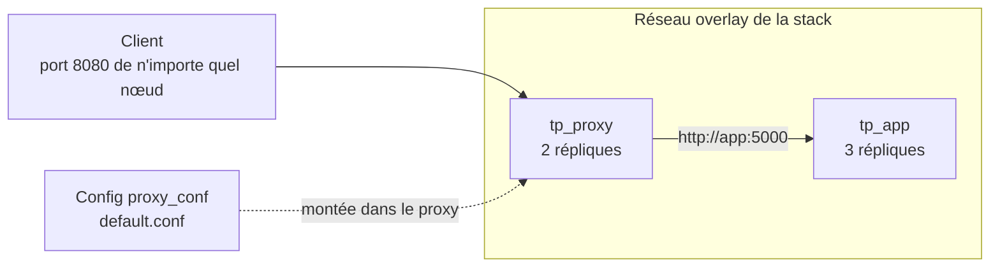

# Lab 12.1 : Déployer une stack

| | |
|---|---|
| **Durée** | 75 min |
| **Niveau** | Semi-guidé |
| **Prérequis** | [Lab 11.2 : Déployer et mettre à l'échelle des services](../ch11-swarm-cluster-et-services/lab-11-2-deployer-et-mettre-a-l-echelle-des-services.md) (cluster de trois nœuds, image `<utilisateur>/qui-repond:1.0` publiée sur Docker Hub), cours du [chapitre 12](cours.md) |
| **Acquis visés** | AA8 |

!!! abstract "Objectifs"
    - Écrire un fichier de stack avec une section `deploy`
    - Fournir un fichier de configuration à un service avec une config Swarm
    - Déployer, observer et mettre à jour une stack avec `docker stack`
    - Vérifier la résolution des noms sur un réseau overlay
    - Contraindre le placement des tâches
    - Comprendre que le fichier est la référence de l'état désiré

## Contexte et schéma

Vous déployez sur le cluster une application en deux niveaux : un **proxy** nginx qui reçoit les requêtes et les transmet à l'**application** `qui-repond` du Lab 11.2, répliquée sur plusieurs nœuds. Le proxy reçoit sa configuration sous forme de **config Swarm**. Toutes les commandes s'exécutent sur `swarm-manager`. Dans ce lab, seules les **commandes clés** vous sont données : à vous de les adapter et de déduire le reste à l'aide du [cours](cours.md).



!!! note "Organisation du travail"
    Ouvrez trois terminaux (un par VM) comme aux labs précédents. Les tests `curl` se font depuis une VM Linux, avec l'adresse IP d'un nœud.

## Étapes

### Étape 1 : Préparer le dossier et vérifier le cluster

- **Objectif :** partir d'un cluster sain, avec l'image accessible.
- **Indices :**
    - `docker node ls` : trois nœuds `Ready` et `Active` ; `docker service ls` : aucun service restant des labs précédents (supprimez-les sinon).
    - Vérifiez que l'image `<utilisateur>/qui-repond:1.0` est bien disponible sur Docker Hub (dépôt public).
    - Créez un dossier `tp-stack` sur `swarm-manager` et placez-vous dedans.
    - Créez dans ce dossier le fichier `default.conf` suivant, qui configure le proxy :

```text
server {
    listen 80;
    location / {
        proxy_pass http://app:5000;
    }
}
```

!!! info "Le nom `app`"
    Le proxy joint l'application par le nom de service `app`, grâce au DNS du réseau overlay. Vous nommerez le service `app` dans votre fichier de stack.

!!! success "Point de contrôle"
    - [ ] Le cluster est sain et sans service
    - [ ] `default.conf` existe dans `tp-stack`

### Étape 2 : Créer la config Swarm

- **Objectif :** stocker `default.conf` dans le cluster.
- **Indices :**
    - `docker config create proxy_conf default.conf`, puis `docker config ls`.
    - `docker config inspect --pretty proxy_conf` : repérez ce qui est affiché.
    - Essayez de la modifier : quelle commande permettrait de changer sa valeur ? (voir la section 4 du [cours](cours.md))

!!! success "Point de contrôle"
    - [ ] `docker config ls` affiche `proxy_conf`
    - [ ] Vous savez expliquer pourquoi une config ne se modifie pas

### Étape 3 : Écrire le fichier de stack

- **Objectif :** décrire l'application dans `compose.yaml`.
- **Indices :** écrivez le fichier d'après le cahier des charges ci-dessous, en vous aidant des sections 3.4, 3.5 et 4.2 du [cours](cours.md).

| Service | Image | Contraintes |
|---|---|---|
| `proxy` | `nginx:1.27-alpine` | 2 répliques ; port 8080 de l'hôte vers le port 80 ; la config `proxy_conf` (déclarée `external: true`) montée sur `/etc/nginx/conf.d/default.conf` |
| `app` | `<utilisateur>/qui-repond:1.0` | 3 répliques ; aucun port publié ; limites de 0,5 processeur et 128 Mo de mémoire ; redémarrage uniquement en cas d'échec |

- Les deux services partagent le réseau créé par défaut pour la stack (pas besoin de le déclarer).
- Remplacez `<utilisateur>` par votre nom d'utilisateur Docker Hub : le fichier ne doit contenir **aucun** mot de passe.
- Validez la syntaxe avec `docker compose -f compose.yaml config`.

!!! success "Point de contrôle"
    - [ ] `docker compose -f compose.yaml config` s'exécute sans erreur
    - [ ] Seul `proxy` publie un port
    - [ ] Chaque service a une section `deploy` conforme au tableau

### Étape 4 : Déployer la stack

- **Objectif :** créer tous les services en une commande.
- **Indices :**
    - `docker stack deploy -c compose.yaml tp` : lisez les messages affichés (objets créés, avertissements éventuels).
    - Observez : `docker stack ls`, `docker stack services tp`, `docker stack ps tp`.
    - Relevez les noms des services et du réseau (`docker network ls`), puis comparez avec la section 3.2 du [cours](cours.md).

!!! success "Point de contrôle"
    - [ ] `docker stack services tp` affiche `tp_proxy` (`2/2`) et `tp_app` (`3/3`)
    - [ ] Le réseau de la stack existe, avec le pilote `overlay`
    - [ ] Vous avez relevé la répartition des tâches sur les nœuds

### Étape 5 : Tester l'application

- **Objectif :** vérifier la chaîne complète : client, proxy, application.
- **Indices :**
    - Envoyez 12 requêtes à l'adresse du manager, puis d'un worker, et comptez les réponses par conteneur :

```bash
for i in $(seq 1 12); do curl -s http://<adresse-d-un-noeud>:8080; done | sort | uniq -c
```

    - Consultez les journaux du proxy : `docker service logs tp_proxy`, puis ceux de l'application.

!!! success "Point de contrôle"
    - [ ] Chaque requête reçoit une réponse `Réponse du conteneur ...`
    - [ ] Les réponses viennent de plusieurs conteneurs de l'application
    - [ ] Les journaux du proxy montrent les requêtes transmises

### Étape 6 : Examiner la résolution des noms sur le réseau overlay

- **Objectif :** voir comment le proxy trouve l'application.
- **Indices :**
    - Sur un nœud qui héberge une tâche du proxy (`docker service ps tp_proxy`), repérez son conteneur (`docker ps`).
    - Depuis ce conteneur, résolvez les noms `app` puis `tasks.app` :

```bash
docker exec <conteneur-du-proxy> nslookup app
docker exec <conteneur-du-proxy> nslookup tasks.app
```

    - Comparez le nombre d'adresses obtenues dans chaque cas.

!!! success "Point de contrôle"
    - [ ] `app` est résolu vers **une** adresse (adresse virtuelle du service)
    - [ ] `tasks.app` est résolu vers **les adresses des tâches** (trois adresses)
    - [ ] Vous savez expliquer l'intérêt de l'adresse virtuelle pour le proxy

### Étape 7 : Mettre à jour la stack depuis le fichier

- **Objectif :** constater que le fichier est la référence.
- **Indices :**
    - Dans `compose.yaml`, passez les répliques de `app` à 5 et relancez la **même** commande `docker stack deploy`. Observez les services recréés ou mis à jour.
    - Réduisez ensuite les répliques à 2 **avec la commande** `docker service scale tp_app=2`, puis relancez `docker stack deploy -c compose.yaml tp` sans modifier le fichier : combien de répliques de `app` obtenez-vous ?

!!! success "Point de contrôle"
    - [ ] Après la modification du fichier, `tp_app` passe à `5/5` sans que `tp_proxy` soit recréé
    - [ ] Après `docker service scale` puis un nouveau déploiement, `tp_app` revient au nombre de répliques du **fichier**
    - [ ] Vous pouvez expliquer pourquoi il vaut mieux modifier le fichier que les services

### Étape 8 : Contraindre le placement

- **Objectif :** exécuter le proxy uniquement sur les workers.
- **Indices :**
    - Dans le fichier, ajoutez au service `proxy` une contrainte de placement sur le rôle des nœuds (section 5 du [cours](cours.md)) et redéployez.
    - Vérifiez avec `docker service ps tp_proxy` qu'aucune tâche ne tourne sur le manager.
    - Testez que l'application répond toujours sur l'adresse du manager (routing mesh).

!!! success "Point de contrôle"
    - [ ] Aucune tâche de `tp_proxy` ne s'exécute sur le manager
    - [ ] Le manager répond toujours sur le port 8080
    - [ ] Vous savez expliquer pourquoi, malgré l'absence de tâche, le manager répond

### Étape 9 : Supprimer la stack

- **Objectif :** nettoyer proprement.
- **Indices :**
    - `docker stack rm tp`, puis `docker stack ls`, `docker service ls` et `docker network ls`.
    - Que devient la config `proxy_conf` ? Vérifiez avec `docker config ls`.

!!! success "Point de contrôle"
    - [ ] Les services et le réseau de la stack ont disparu
    - [ ] La config `proxy_conf` existe toujours : vous savez expliquer pourquoi

### Étape 10 : Dresser la fiche de la stack

- **Objectif :** retenir le rôle des clés du fichier.
- **Indices :** complétez le tableau avec le rôle de chaque élément de **votre** fichier.

| Élément du fichier | Rôle |
|---|---|
| `deploy.replicas` | |
| `deploy.resources.limits` | |
| `deploy.restart_policy` | |
| `deploy.placement.constraints` | |
| `configs` | |
| `ports` | |

!!! success "Point de contrôle"
    - [ ] Chaque ligne est complétée à partir de votre propre fichier

## Questions de réflexion

??? question "Pourquoi le proxy peut-il joindre l'application par le nom `app` alors que les tâches sont sur des nœuds différents ?"
    Les deux services sont sur un réseau overlay qui s'étend sur les nœuds, avec un DNS intégré : le nom `app` est résolu vers une adresse virtuelle qui répartit les connexions entre les tâches, où qu'elles soient.

??? question "Quel avantage a l'adresse virtuelle par rapport aux adresses des tâches ?"
    Le proxy n'a pas à connaître le nombre ni l'emplacement des tâches : l'adresse virtuelle reste stable quand les tâches sont recréées ou déplacées, et Swarm répartit les connexions entre elles.

??? question "Pourquoi la stack ignore-t-elle `build` et ne peut-elle utiliser qu'une image publiée ?"
    Chaque nœud télécharge lui-même l'image qu'il doit exécuter : il faut un registre accessible par tous les nœuds.

??? question "Que se passe-t-il si vous changez le nombre de répliques avec `docker service scale` puis redéployez la stack ?"
    Le déploiement ramène le service à l'état décrit par le fichier : le fichier est la référence. C'est pourquoi on modifie le fichier, qui est versionné, plutôt que les services un à un.

## Dépannage

| Symptôme | Pistes |
|---|---|
| Message `Ignoring unsupported options` | Une clé de Compose non gérée par les stacks (`build`, `depends_on`, `restart`…) : retirez-la ou remplacez-la par son équivalent `deploy` |
| `config proxy_conf not found` | La config n'a pas été créée avant le déploiement, ou son nom diffère dans le fichier |
| `tp_app` reste à `0/3` | `docker stack ps tp --no-trunc` : image introuvable (nom ou dépôt privé) ou nœud sans accès à Internet |
| `502 Bad Gateway` depuis le proxy | L'application n'est pas encore prête, ou le nom de service dans `default.conf` ne correspond pas : vérifiez `app` |
| `curl` ne répond pas | Port 8080 déjà utilisé, tâches du proxy non démarrées, ou ports du cluster bloqués entre nœuds |
| `nslookup` introuvable dans le conteneur | Outil absent de l'image : essayez `getent hosts app` ou un conteneur de diagnostic sur le même réseau |
| `docker stack deploy` refuse le fichier | Erreur d'indentation ou clé inconnue : validez avec `docker compose -f compose.yaml config` |
| `docker stack rm` laisse le réseau | Il disparaît après l'arrêt des dernières tâches : patientez quelques secondes |

## Nettoyage et reprise

La stack a été supprimée à l'étape 9. **Conservez le cluster**, le fichier `compose.yaml` et `default.conf` : le [Lab 12.2](lab-12-2-mises-a-jour-secrets-et-panne-d-un-nud.md) les réutilise. La config `proxy_conf` peut rester ; supprimez-la avec `docker config rm proxy_conf` si vous n'en avez plus besoin.

## Retour au chapitre

[Chapitre 12 : Swarm : stacks et exploitation](cours.md) · Lab suivant : [Lab 12.2 : Mises à jour, secrets et panne d'un nœud](lab-12-2-mises-a-jour-secrets-et-panne-d-un-nud.md)