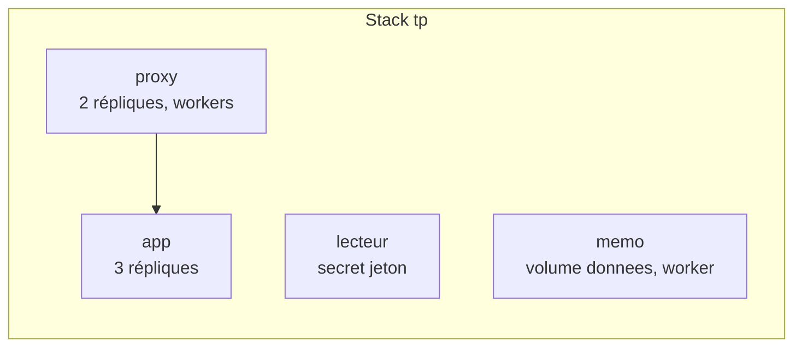

# Lab 12.2 : Mises à jour, secrets et panne d'un nœud

| | |
|---|---|
| **Durée** | 90 min |
| **Niveau** | Autonome |
| **Prérequis** | [Lab 12.1 : Déployer une stack](lab-12-1-deployer-une-stack.md) (cluster de trois nœuds, fichiers `compose.yaml` et `default.conf`), cours du [chapitre 12](cours.md) |
| **Acquis visés** | AA8 |

!!! abstract "Objectifs"
    - Mettre à jour un service par lots, sans interruption, puis revenir en arrière
    - Déclencher une mise à jour qui échoue et observer le retour arrière automatique
    - Utiliser un secret Swarm et le remplacer sans modifier l'application
    - Simuler la panne d'un nœud et observer la reprise
    - Constater la limite d'un volume local à un nœud

## Contexte et schéma

Vous exploitez maintenant la stack du Lab 12.1 comme en production : nouvelle version de l'application, mot de passe à renouveler, puis panne d'une machine. Ce lab est **autonome** : seuls les objectifs et les critères de réussite sont donnés. Appuyez-vous sur le [cours](cours.md) (sections 4, 6 et 7) et sur vos labs précédents. Toutes les commandes `docker` s'exécutent sur `swarm-manager`, sauf indication contraire.



| Service | Rôle dans ce lab |
|---|---|
| `proxy` et `app` | Mêmes services qu'au Lab 12.1, cibles des mises à jour |
| `lecteur` | Petit conteneur `alpine:3.20` qui lit un secret |
| `memo` | Petit conteneur `alpine:3.20` qui écrit un fichier dans un volume |

!!! warning "Ne stoppez jamais le manager"
    Le cluster n'a qu'**un seul manager** : sans lui, plus aucune commande Swarm n'est possible (chapitre 11). La panne simulée à l'étape 8 vise **uniquement un worker**.

## Étapes

### Étape 1 : Remettre la stack en place avec une politique de mise à jour

- **Objectif :** repartir d'un état connu, avec une stack dont la mise à jour est réglée.
- **Consignes :**
    - Vérifiez le cluster (`docker node ls`) et l'existence de la config `proxy_conf` (recréez-la depuis `default.conf` si elle a été supprimée).
    - Dans `compose.yaml`, mettez `app` à **3 répliques**, conservez la contrainte de placement du proxy sur les workers, et ajoutez à `app` une section `update_config` : un seul conteneur remplacé à la fois, 10 secondes entre deux lots, nouveau conteneur démarré **avant** l'arrêt de l'ancien, retour arrière automatique en cas d'échec.
    - Déployez la stack sous le nom `tp`.

!!! success "Point de contrôle"
    - [ ] `docker stack services tp` affiche `tp_proxy` (`2/2`) et `tp_app` (`3/3`)
    - [ ] `docker service inspect --pretty tp_app` affiche la politique de mise à jour voulue
    - [ ] Les réponses de l'application viennent de l'image `1.0`

### Étape 2 : Préparer la version 2.0 de l'application

- **Objectif :** disposer d'une seconde version, distinguable de la première.
- **Consignes :**
    - Reprenez le code de l'application `qui-repond` (Lab 11.2) et modifiez le **texte** de la réponse, de façon à ce qu'on reconnaisse la version (par exemple en y ajoutant `v2`).
    - Construisez l'image `<utilisateur>/qui-repond:2.0` et publiez-la sur Docker Hub.
    - **Ne modifiez pas** la balise `1.0`, qui reste disponible.

!!! success "Point de contrôle"
    - [ ] Les balises `1.0` et `2.0` existent toutes deux sur Docker Hub
    - [ ] Un conteneur lancé depuis `2.0` répond avec le nouveau texte

### Étape 3 : Mettre à jour sans interruption

- **Objectif :** passer de la version 1.0 à la version 2.0 sans refuser une seule requête.
- **Consignes :**
    - Dans un **second terminal**, lancez une boucle de requêtes vers un nœud, espacées d'une seconde, pendant environ une minute :

```bash
for i in $(seq 1 60); do curl -s -o /dev/null -w "%{http_code} " http://<adresse-d-un-noeud>:8080; sleep 1; done
```

    - Pendant ce temps, passez `app` en version `2.0` **en modifiant le fichier** puis en relançant `docker stack deploy`.
    - Suivez le remplacement avec `docker service ps tp_app` (répétez la commande pendant la mise à jour).
    - Une fois la mise à jour terminée, envoyez quelques requêtes pour vérifier que seule la version 2.0 répond.

!!! success "Point de contrôle"
    - [ ] La boucle n'affiche que des codes `200`
    - [ ] Pendant la mise à jour, `docker service ps tp_app` montre des tâches `1.0` arrêtées et des tâches `2.0` démarrées, remplacées **une par une**
    - [ ] Après la mise à jour, toutes les réponses viennent de la version 2.0
    - [ ] Vous savez expliquer le rôle de `order: start-first` dans ce résultat

### Étape 4 : Revenir en arrière

- **Objectif :** annuler une mise à jour réussie mais indésirable.
- **Consignes :**
    - Revenez à la version précédente **avec la commande dédiée** de Swarm, sans toucher au fichier.
    - Vérifiez la version qui répond et l'état de la mise à jour (`docker service inspect --pretty tp_app`).
    - Notez ce que contient maintenant le fichier `compose.yaml` et ce qui se passerait si vous relanciez `docker stack deploy` sans le modifier. Vérifiez votre hypothèse.
    - Remettez ensuite le **fichier** et le **service** en cohérence.

!!! success "Point de contrôle"
    - [ ] Après le retour arrière, la version `1.0` répond de nouveau
    - [ ] Vous avez constaté l'écart entre le fichier et le service, et son effet sur un nouveau déploiement
    - [ ] Le fichier et le service décrivent à nouveau la même version

### Étape 5 : Provoquer une mise à jour qui échoue

- **Objectif :** observer le retour arrière **automatique**.
- **Consignes :**
    - Mettez à jour `app` vers une image qui **n'existe pas** (une balise inexistante de votre dépôt), avec `docker service update --image`.
    - Observez `docker service ps tp_app` et `docker service inspect --pretty tp_app` pendant quelques dizaines de secondes.
    - Pendant ce temps, vérifiez avec quelques requêtes que l'application continue de répondre.

!!! success "Point de contrôle"
    - [ ] Les nouvelles tâches échouent (image introuvable) et la mise à jour est annulée sans intervention
    - [ ] L'état de la mise à jour (`UpdateStatus`) mentionne un retour arrière
    - [ ] Le service est de nouveau à `3/3` avec la version précédente et n'a pas cessé de répondre
    - [ ] Vous savez expliquer quel paramètre du fichier a déclenché ce comportement

### Étape 6 : Utiliser un secret

- **Objectif :** fournir une valeur sensible à un service sans la mettre dans le fichier.
- **Consignes :**
    - Créez un secret `jeton` à partir de la valeur de votre choix, **lue sur l'entrée standard** (jamais dans le fichier ni dans la ligne de commande d'un service).
    - Ajoutez au fichier le service `lecteur` : image `alpine:3.20`, une seule réplique, commande `sleep 3600`, avec le secret `jeton` (déclaré `external: true`).
    - Déployez, puis lisez la valeur **depuis le conteneur** du service (repérez le nœud avec `docker service ps tp_lecteur`, puis `docker exec` sur ce nœud).
    - Vérifiez ce que montrent `docker secret inspect jeton` et `docker service inspect tp_lecteur` : retrouvez-vous la valeur ?

!!! success "Point de contrôle"
    - [ ] Le fichier `/run/secrets/jeton` du conteneur contient la valeur choisie
    - [ ] Ni `docker secret inspect` ni `docker service inspect` n'affichent la valeur
    - [ ] Le fichier `compose.yaml` ne contient pas la valeur

### Étape 7 : Remplacer le secret

- **Objectif :** changer la valeur sans modifier l'application ni le chemin du fichier.
- **Consignes :**
    - Essayez de supprimer le secret `jeton` pendant qu'il est utilisé : notez le message.
    - Créez un secret `jeton_v2` avec une **nouvelle valeur**.
    - Mettez à jour **le service** `tp_lecteur` pour retirer `jeton` et ajouter `jeton_v2`, de façon que le conteneur lise toujours `/run/secrets/jeton`. Consultez l'aide de `docker service update` pour les options de secrets (`--secret-rm`, `--secret-add`, et le champ `target`).
    - Vérifiez la nouvelle valeur dans le conteneur, puis supprimez l'ancien secret.
    - Modifiez enfin le **fichier** pour qu'il décrive cet état.

!!! success "Point de contrôle"
    - [ ] La suppression d'un secret utilisé est refusée
    - [ ] Le conteneur lit la nouvelle valeur dans `/run/secrets/jeton`
    - [ ] L'ancien secret est supprimé, `docker secret ls` n'affiche plus que `jeton_v2`
    - [ ] Le fichier de stack est cohérent avec le service

!!! info "Ce que montre cette étape"
    Un secret est immuable : on le **remplace** par un nouvel objet, et le service est recréé pour le recevoir. Le choix d'un `target` fixe évite de modifier l'application.

### Étape 8 : Simuler la panne d'un worker

- **Objectif :** observer la reprise des tâches et la limite des volumes locaux.
- **Consignes :**
    - Ajoutez au fichier le service `memo` : image `alpine:3.20`, une réplique, **limité aux workers**, avec un volume nommé `donnees` monté sur `/data`, et la commande suivante (qui n'écrit la date dans le fichier qu'**à la première exécution** puis l'affiche) :

```text
sh -c "test -f /data/note.txt || date > /data/note.txt; cat /data/note.txt; sleep 3600"
```

    - Déployez, repérez le worker qui héberge la tâche et lisez la note avec `docker service logs tp_memo`. **Relevez la date.**
    - Sur **ce worker** (pas sur le manager), arrêtez Docker :

```bash
sudo systemctl stop docker docker.socket
```

    - Depuis le manager, observez pendant une à deux minutes `docker node ls`, `docker service ps tp_memo` et `docker stack services tp`.
    - Lisez de nouveau les journaux de `tp_memo` et comparez la date avec celle relevée.
    - Vérifiez que l'application répond toujours par les nœuds restants.

!!! success "Point de contrôle"
    - [ ] Le nœud arrêté passe à l'état `Down`
    - [ ] Les tâches qui s'y trouvaient (`memo`, et celles de `proxy` ou `app` éventuellement) sont recréées sur les nœuds restants
    - [ ] La note affiche une **autre date** : le fichier a été recréé, car le volume est resté sur le nœud arrêté
    - [ ] L'application continue de répondre

### Étape 9 : Rétablir le nœud

- **Objectif :** observer le retour du nœud et le devenir des tâches et des données.
- **Consignes :**
    - Redémarrez Docker sur le worker arrêté : `sudo systemctl start docker`.
    - Observez `docker node ls` puis `docker service ps tp_memo` et `docker stack ps tp`.
    - Sur le worker rétabli, listez les volumes (`docker volume ls`) et lisez le fichier du volume `tp_donnees` avec un conteneur temporaire `alpine:3.20` (voir le Lab 5.1).
    - Observez si Swarm **redéplace** les tâches vers ce nœud de lui-même.

!!! success "Point de contrôle"
    - [ ] Le nœud repasse à l'état `Ready`
    - [ ] Les tâches déplacées pendant la panne **ne reviennent pas** d'elles-mêmes sur ce nœud
    - [ ] L'ancien volume `tp_donnees` existe toujours sur ce nœud, avec la **première** date
    - [ ] Vous savez expliquer pourquoi la tâche `memo` a perdu ses données à l'étape 8

### Étape 10 : Dresser le bilan

- **Objectif :** classer les pannes et les remèdes rencontrés.
- **Consignes :** complétez le tableau à partir de ce que vous avez observé.

| Situation | Réaction de Swarm | Ce qu'il reste à faire à l'exploitant |
|---|---|---|
| Mise à jour réussie | | |
| Mise à jour échouée | | |
| Secret à changer | | |
| Nœud arrêté | | |
| Service avec données locales | | |

!!! success "Point de contrôle"
    - [ ] Chaque ligne est complétée avec vos propres observations

## Questions de réflexion

??? question "Pourquoi le retour arrière manuel a-t-il créé un écart entre le fichier et le service ?"
    `docker service rollback` modifie le service, pas le fichier. Le fichier reste la référence de l'état désiré : au prochain `docker stack deploy`, Swarm rétablit la version qu'il décrit. Après un retour arrière, il faut corriger le fichier.

??? question "Pourquoi l'application n'a-t-elle pas été interrompue pendant la mise à jour de l'étape 3 ?"
    Swarm remplace les tâches une par une et, avec `start-first`, démarre la nouvelle avant d'arrêter l'ancienne : le service ne descend jamais sous sa capacité, et le proxy joint toujours des tâches disponibles.

??? question "Quelle différence entre un secret et une variable d'environnement ?"
    Le secret est chiffré dans le cluster, transmis aux seuls nœuds concernés et monté en mémoire dans un fichier ; une variable d'environnement apparaît dans la configuration du service et dans les inspections.

??? question "Pourquoi les tâches ne reviennent-elles pas d'elles-mêmes sur le nœud rétabli ?"
    Swarm ne déplace pas des tâches qui fonctionnent déjà ailleurs : un redéploiement forcé du service serait nécessaire pour les répartir de nouveau.

??? question "Que faudrait-il pour que le service `memo` conserve ses données malgré la panne du nœud ?"
    Soit le fixer à un nœud précis (en acceptant que ce nœud soit un point de défaillance), soit utiliser un stockage partagé entre les nœuds ou un service de données hors du cluster (section 5.1 du cours).

## Dépannage

| Symptôme | Pistes |
|---|---|
| `secret not found` au déploiement | Le secret n'a pas été créé avant `docker stack deploy`, ou son nom diffère dans le fichier |
| `secret ... is in use by the following service` | Retirez-le d'abord du service (`--secret-rm`) |
| `docker secret create` reste en attente | Avec `-`, la commande lit l'entrée standard : fournissez la valeur avec `printf '...' \|` |
| La mise à jour reste bloquée ou en pause | `docker service inspect --pretty tp_app` : lisez `UpdateStatus` ; corrigez la cause puis relancez, ou utilisez `docker service rollback` |
| Aucun retour arrière automatique | Vérifiez que `failure_action: rollback` figure bien dans le fichier **déployé** |
| `tp_app` toujours en `1.0` après le déploiement | La balise du fichier n'a pas changé, ou l'image `2.0` n'est pas publiée |
| Le nœud n'apparaît pas `Down` | Patientez quelques dizaines de secondes ; vérifiez que Docker est bien arrêté (`systemctl status docker` sur le worker) |
| `docker.socket` relance Docker | Arrêtez bien les **deux** unités : `docker` et `docker.socket` |
| `memo` n'est pas recréée | Vérifiez que la contrainte autorise l'autre worker et que celui-ci est `Ready` |
| Fichier de stack refusé | Validez la syntaxe avec `docker compose -f compose.yaml config` |

## Nettoyage et reprise

```bash
docker stack rm tp
docker secret rm jeton_v2
docker config rm proxy_conf
```

Les volumes `tp_donnees` restent sur les nœuds où ils ont été créés : sur **chaque** nœud concerné, supprimez-les avec `docker volume rm tp_donnees` une fois les tâches arrêtées. Si l'ancien secret `jeton` existe encore, supprimez-le aussi. **Conservez le cluster** : le mini-projet de la partie y sera déployé. Vous pouvez supprimer les images `2.0` et les balises de test de Docker Hub si vous le souhaitez.

## Retour au chapitre

[Chapitre 12 : Swarm : stacks et exploitation](cours.md) · [Retour à l'index de la partie 3](../index.md)