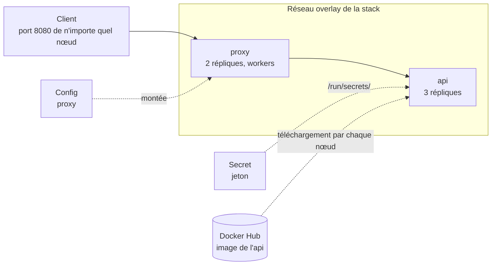

# Mini-projet 3 : Application sécurisée sur un cluster Swarm

## 1. Fiche du mini-projet

| Rubrique      | Description                                                                                                                                                                                                                                                                    |
| ------------- | ------------------------------------------------------------------------------------------------------------------------------------------------------------------------------------------------------------------------------------------------------------------------------ |
| Cours         | Docker : conteneurisation, orchestration et industrialisation d'applications                                                                                                                                                                                                   |
| Position      | Fin de la Partie 3 : Durcissement et orchestration Swarm (chapitres 9 à 12)                                                                                                                                                                                                    |
| Modalité      | En binôme, hors séance, avec une démonstration de 5 min en début de séance suivante                                                                                                                                                                                            |
| Durée         | Environ 3 h de travail + compte rendu                                                                                                                                                                                                                                          |
| Prérequis     | Labs 9.1 à 12.2 réalisés, en particulier le [Lab 10.2](ch10-securite-des-conteneurs/lab-10-2-analyser-et-corriger-une-image.md) (analyse avec Trivy) et le [Lab 12.1](ch12-swarm-stacks-et-exploitation/lab-12-1-deployer-une-stack.md) (stack), ainsi qu'un compte Docker Hub |
| Environnement | Cluster de trois machines virtuelles Ubuntu (`swarm-manager`, `swarm-worker1`, `swarm-worker2`) créé au [Lab 11.1](ch11-swarm-cluster-et-services/lab-11-1-creer-un-cluster-swarm.md) (voir [Environnement de travail](../annexes/environnement.md))                           |
| Acquis visés  | AA7 (optimiser et sécuriser des images et des conteneurs), AA8 (déployer et exploiter une application sur un cluster Swarm)                                                                                                                                                    |

## 2. Contexte

Votre équipe doit mettre en production une petite application web sur un cluster de trois machines. L'application fonctionne sur un poste de développeur, mais personne ne l'a préparée pour la production : son image est volumineuse et tourne en administrateur, son mot de passe d'accès serait écrit dans un fichier, et personne ne sait ce qui se passe si une machine tombe ou si l'on publie une version défectueuse. Votre mission : livrer une **image optimisée et durcie**, une **stack Swarm** qui la déploie sur les trois nœuds avec un **secret**, et la preuve que l'application supporte une **mise à jour sans coupure**, un **retour arrière** et la **panne d'un nœud**.

!!! info "Ce qui est évalué"
Vous pouvez reprendre l'application `qui-repond` des labs précédents (voir la section 6) ou une autre petite application web sans base de données. **L'évaluation porte sur la préparation de l'image, la conception de la stack et son exploitation, et non sur la qualité du code de l'application.**

## 3. Objectifs pédagogiques

À l'issue du mini-projet, vous serez capables de :

1. réduire une image avec une construction multi-stage et mesurer le gain ;
2. durcir une image et un conteneur, puis analyser ses vulnérabilités ;
3. décrire une application répliquée dans un fichier de stack ;
4. fournir un mot de passe à un service avec un secret, sans l'écrire dans un fichier ni dans une variable d'environnement ;
5. mettre à jour une application sans coupure, revenir en arrière et prouver la reprise après la panne d'un nœud ;
6. documenter l'exploitation pour qu'une autre équipe puisse déployer et dépanner la stack.

## 4. Architecture cible

## 5. Cahier des charges

| N°  | Exigence                                                                                                                                                                                                                                                                                         |
| --- | ------------------------------------------------------------------------------------------------------------------------------------------------------------------------------------------------------------------------------------------------------------------------------------------------ |
| E1  | L'image de l'`api` est construite avec un **Dockerfile multi-stage** (ou une base minimale justifiée) ; sa taille est **mesurée avant et après** optimisation, dans un tableau. L'image est publiée sur Docker Hub avec une **balise de version** (jamais `latest`).                             |
| E2  | L'image est **durcie** : exécution par un utilisateur **non root**, aucun secret ni outil inutile dans l'image. Une **analyse Trivy** est réalisée avant et après correction ; chaque vulnérabilité de gravité `HIGH` ou `CRITICAL` restante est **corrigée ou justifiée**.                      |
| E3  | Un **seul fichier `compose.yaml`** décrit la stack : `proxy` (2 répliques, port publié) et `api` (3 répliques, aucun port publié). Toutes les images ont une **version explicite**.                                                                                                              |
| E4  | L'`api` reçoit une valeur sensible par un **secret Swarm** lu dans `/run/secrets/` ; la valeur n'apparaît ni dans le dépôt, ni dans le fichier de stack, ni dans une variable d'environnement, ni dans l'image. Le proxy reçoit sa configuration par une **config Swarm**.                       |
| E5  | Le **durcissement du conteneur** est appliqué dans la stack autant que Swarm le permet (par exemple système de fichiers en lecture seule, limitation des privilèges). Pour chaque réglage envisagé, vous **vérifiez** qu'il est bien pris en compte, et vous documentez ceux qui ne le sont pas. |
| E6  | Chaque service a des **limites de ressources** et une **politique de redémarrage** ; le placement est **contraint** : le proxy sur les workers, l'`api` répartie sur **au moins deux nœuds**.                                                                                                    |
| E7  | La **mise à jour** de la version 1.0 à la version 2.0 de l'`api` est faite **sans coupure**, c'est-à-dire sans aucune requête en erreur, et **prouvée** par une boucle de requêtes. Une mise à jour défectueuse déclenche un **retour arrière automatique**, également prouvé.                   |
| E8  | La **panne d'un worker** est simulée : l'application continue de répondre, les tâches sont recréées, et vous décrivez l'état avant, pendant et après.                                                                                                                                            |
| E9  | Un fichier **`EXPLOITATION.md`** décrit comment surveiller la stack, mettre à jour l'application, revenir en arrière, changer le secret et réagir à la panne d'un nœud.                                                                                                                          |
| E10 | Un **`README.md`** permet à un autre binôme de déployer la stack **sans vous poser de question**.                                                                                                                                                                                                |

## 6. Application et images suggérées

- **Option simple :** reprenez l'application `qui-repond` du [Lab 11.2](ch11-swarm-cluster-et-services/lab-11-2-deployer-et-mettre-a-l-echelle-des-services.md) et ajoutez-lui une route qui indique si le **secret est présent** (et seulement cela : la valeur ne doit **jamais** être affichée). La version 2.0 se distingue de la 1.0 par un texte différent. Images suggérées : `python:3.12-slim` ou `python:3.12-alpine` pour l'application, `nginx:1.27-alpine` pour le proxy.
- **Option libre :** une autre petite application web sans base de données, après accord de votre enseignant. Fixez la version de chaque image.

Ne passez pas de temps à perfectionner le code de l'application : le temps est consacré à l'image, à la stack et à son exploitation.

## 7. Démarche guidée en étapes

Chaque étape propose un but, des indices (pas la solution), un point de contrôle et une question à traiter dans votre compte rendu.

### Étape 0 : Préparer le projet (10 min)

- **But :** disposer d'un dossier de travail propre et d'un cluster en état.
- **Indices :** créez un dossier de projet et un dépôt Git ; répartissez les rôles du binôme (par exemple : l'un prépare l'image, l'autre la stack, puis vous échangez) ; vérifiez `docker node ls` (trois nœuds `Ready`) et supprimez les stacks et services des labs précédents.
- **Point de contrôle :** le dépôt existe, contient le code de l'application, et le cluster est sain et vide.
- **Question :** pourquoi versionne-t-on le Dockerfile et le fichier de stack avec le code ?

### Étape 1 : Optimiser l'image (35 min)

- **But :** obtenir une image minimale (E1).
- **Indices :** mesurez d'abord la taille d'une image **naïve** (construction en une seule étape avec l'image complète) ; réécrivez ensuite le Dockerfile en **multi-stage** ([chapitre 9](ch09-optimisation-des-images/cours.md), [Lab 9.1](ch09-optimisation-des-images/lab-9-1-construire-avec-multi-stage.md) et [Lab 9.2](ch09-optimisation-des-images/lab-9-2-reduire-et-comparer-des-images.md)) ; comparez les tailles avec `docker image ls`.
- **Point de contrôle :** un tableau donne la taille avant et après, et l'application fonctionne avec la nouvelle image.
- **Question :** quels éléments de l'image naïve étaient inutiles à l'exécution ?

### Étape 2 : Durcir et analyser l'image (30 min)

- **But :** réduire la surface d'attaque (E2).
- **Indices :** [chapitre 10](ch10-securite-des-conteneurs/cours.md) et [Lab 10.1](ch10-securite-des-conteneurs/lab-10-1-durcir-un-conteneur.md) pour l'utilisateur non root ; [Lab 10.2](ch10-securite-des-conteneurs/lab-10-2-analyser-et-corriger-une-image.md) pour exporter l'image et l'analyser avec Trivy. Enregistrez le résultat **avant**, corrigez (image de base à jour, dépendances), puis enregistrez le résultat **après**.
- **Point de contrôle :** l'image tourne avec un utilisateur non root (vérifiez avec `docker run --rm <image> id`) ; le compte rendu contient les deux analyses et la justification de chaque vulnérabilité `HIGH` ou `CRITICAL` restante.
- **Question :** pourquoi une vulnérabilité signalée n'est-elle pas toujours corrigeable, et que faites-vous dans ce cas ?

### Étape 3 : Publier l'image et écrire la stack (35 min)

- **But :** décrire l'application complète dans un seul fichier (E1, E3, E4, E5, E6).
- **Indices :** publiez l'image `<utilisateur>/<nom>:1.0` sur Docker Hub ([Lab 4.1](../partie-1-fondations/ch04-registres-et-distribution/lab-4-1-publier-sur-docker-hub.md)) ; reprenez la structure du [Lab 12.1](ch12-swarm-stacks-et-exploitation/lab-12-1-deployer-une-stack.md) (proxy, config, réseau) ; créez le secret **sur l'entrée standard** puis déclarez-le `external: true` ([chapitre 12](ch12-swarm-stacks-et-exploitation/cours.md), section 4) ; ajoutez les sections `deploy` : répliques, limites, politique de redémarrage, placement (section 5). Essayez ensuite chaque réglage de durcissement envisagé et **lisez les messages** de `docker stack deploy` pour savoir lesquels sont ignorés.
- **Point de contrôle :** la stack est déployée, `docker stack services` montre toutes les répliques, l'application répond par n'importe quel nœud, la route de contrôle confirme la présence du secret, et `docker exec` dans une tâche ne montre **aucun** secret dans les variables d'environnement.
- **Question :** quels réglages de durcissement ont été pris en compte par Swarm, et lesquels ont été ignorés ?

### Étape 4 : Vérifier le placement et les ressources (10 min)

- **But :** s'assurer que les tâches sont réparties comme prévu (E6).
- **Indices :** `docker stack ps`, `docker service inspect --pretty`, `docker stats` sur un nœud.
- **Point de contrôle :** aucune tâche du proxy ne tourne sur le manager ; les tâches de l'`api` sont réparties sur au moins deux nœuds ; les limites sont visibles.
- **Question :** que se passerait-il si l'`api` avait des limites de mémoire trop basses ?

### Étape 5 : Mettre à jour sans coupure et revenir en arrière (25 min)

- **But :** déployer une nouvelle version sans interruption, puis provoquer et subir un échec (E7).
- **Indices :** préparez et publiez la version `2.0` ; réglez `update_config` dans le fichier ([chapitre 12](ch12-swarm-stacks-et-exploitation/cours.md), section 6) ; lancez dans un second terminal une boucle `curl` qui affiche les codes de réponse, puis passez en 2.0 **en modifiant le fichier**. Provoquez ensuite une mise à jour défectueuse (balise inexistante) et observez le retour arrière. Reprenez la démarche du [Lab 12.2](ch12-swarm-stacks-et-exploitation/lab-12-2-mises-a-jour-secrets-et-panne-d-un-nud.md).
- **Point de contrôle :** la boucle n'affiche que des codes `200` pendant la mise à jour ; la mise à jour défectueuse est annulée automatiquement ; le fichier de stack et le service sont de nouveau cohérents.
- **Question :** quels paramètres du fichier rendent la mise à jour sans coupure, et quel paramètre déclenche le retour arrière ?

### Étape 6 : Simuler la panne d'un worker (15 min)

- **But :** prouver la tolérance à la panne d'un nœud (E8).
- **Indices :** arrêtez Docker sur **un worker** (jamais sur le manager, seul de son espèce) comme au Lab 12.2 ; observez `docker node ls`, `docker stack ps` et la boucle de requêtes ; rétablissez le nœud.
- **Point de contrôle :** l'application répond pendant la panne, les tâches sont recréées, le nœud revient `Ready`. Vous notez le temps de reprise observé.
- **Question :** que ne répare pas Swarm dans cette situation, et en quoi votre application y est-elle ou non exposée ?

### Étape 7 : Documenter et valider avec un autre binôme (20 min)

- **But :** prouver que votre stack est utilisable par d'autres (E9, E10).
- **Indices :** rédigez `EXPLOITATION.md` et `README.md` (voir la section 8), puis demandez à un autre binôme de déployer votre stack sur **son** cluster en suivant uniquement votre README (l'image est publique sur Docker Hub).
- **Point de contrôle :** l'autre binôme obtient une application fonctionnelle sans vous poser de question.
- **Question :** quelles informations manquaient dans votre README lors du premier essai ?

## 8. Livrables

1. **Dépôt Git** contenant le code, le `Dockerfile`, la configuration du proxy, le fichier `compose.yaml`, le `README.md` et `EXPLOITATION.md`, **sans aucun secret**. Le README indique : ce que fait l'application, le schéma de l'architecture, les prérequis (cluster, compte Docker Hub), comment créer le secret et la config, comment déployer, tester et supprimer la stack (commandes complètes), et les adresses utiles. `EXPLOITATION.md` décrit la surveillance, la mise à jour, le retour arrière, le changement de secret et la conduite à tenir en cas de panne d'un nœud.
2. **Compte rendu** (2 à 3 pages) comprenant :
   - les réponses aux questions de chaque étape ;
   - le tableau de tailles avant et après optimisation, et les deux analyses Trivy résumées ;
   - la liste des réglages de durcissement pris en compte ou ignorés par Swarm ;
   - des sorties de commandes ou captures prouvant les exigences E4, E7 et E8 ;
   - un court paragraphe « difficultés rencontrées et enseignements ».
3. **Démonstration orale** de 5 minutes au début de la séance suivante : déploiement de la stack, test de l'application, mise à jour en 2.0 avec la boucle de requêtes, et panne d'un worker (ou montage de la preuve préparée).

## 9. Grille d'évaluation (/20)

| Critère                                                                      | Points | AA       |
| ---------------------------------------------------------------------------- | ------ | -------- |
| Image optimisée (multi-stage, mesures, balise de version) (E1)               | 3      | AA7      |
| Image et conteneur durcis, analyse de vulnérabilités traitée (E2, E5)        | 4      | AA7      |
| Stack répliquée, secret, config, placement et ressources (E3, E4, E6)        | 5      | AA8      |
| Mise à jour sans coupure, retour arrière et panne d'un nœud prouvés (E7, E8) | 4      | AA8      |
| `EXPLOITATION.md`, README, compte rendu et démonstration (E9, E10)           | 4      | AA7, AA8 |

## 10. Pour aller plus loin (facultatif)

- Ajouter un healthcheck à l'image et observer son effet sur la mise à jour.
- Poser une étiquette sur les nœuds et répartir les tâches de l'`api` selon cette étiquette.
- Scanner l'image dans un script qui échoue si une vulnérabilité `CRITICAL` est trouvée (préparation du chapitre 13).
- Comparer le temps de reprise avec différents réglages de `restart_policy` et de `update_config`.

## 11. Erreurs fréquentes et conseils de diagnostic

| Symptôme                                                   | Pistes                                                                                                                                                    |
| ---------------------------------------------------------- | --------------------------------------------------------------------------------------------------------------------------------------------------------- |
| `Ignoring unsupported options` au déploiement              | Une clé du fichier n'est pas prise en compte par `docker stack deploy` : retirez-la ou cherchez son équivalent, et notez-la dans le compte rendu          |
| `tp_api` reste à `0/3`                                     | `docker stack ps <stack> --no-trunc` : image introuvable, dépôt privé, ou nœud sans accès à Internet                                                      |
| L'application plante avec `read_only`                      | Elle écrit dans un répertoire du conteneur : identifiez-le dans les journaux et prévoyez un emplacement accessible en écriture, ou corrigez l'application |
| `permission denied` après passage en non root              | Un fichier ou un répertoire appartient encore à `root` : corrigez les droits dans l'image                                                                 |
| Le secret est introuvable dans le conteneur                | Il n'a pas été créé avant le déploiement, ou le chemin lu par l'application diffère de `/run/secrets/<nom>`                                               |
| La mise à jour produit des erreurs                         | `order: stop-first` (par défaut), ou application non prête au démarrage : vérifiez `update_config`                                                        |
| Aucun retour arrière automatique                           | `failure_action: rollback` absent du fichier **déployé**                                                                                                  |
| Le proxy renvoie une erreur `502`                          | L'`api` n'est pas encore prête, ou le nom du service dans la configuration du proxy est incorrect                                                         |
| La boucle de requêtes affiche des erreurs pendant la panne | Le client visait l'adresse du nœud arrêté : visez un nœud en fonctionnement                                                                               |
| Le secret apparaît dans `docker inspect`                   | Il a été passé par une variable d'environnement : utilisez un fichier monté                                                                               |

## 12. Aide-mémoire

| Besoin                        | Commande                                                                 |
| ----------------------------- | ------------------------------------------------------------------------ |
| Taille des images             | `docker image ls`                                                        |
| Utilisateur du conteneur      | `docker run --rm <image> id`                                             |
| Valider le fichier de stack   | `docker compose -f compose.yaml config`                                  |
| Déployer / supprimer la stack | `docker stack deploy -c compose.yaml <stack>`, `docker stack rm <stack>` |
| Services et tâches            | `docker stack services <stack>`, `docker stack ps <stack> --no-trunc`    |
| Journaux d'un service         | `docker service logs <stack>_<service>`                                  |
| État d'une mise à jour        | `docker service inspect --pretty <stack>_<service>`                      |
| Retour arrière manuel         | `docker service rollback <stack>_<service>`                              |
| Secrets et configs            | `docker secret ls`, `docker config ls`                                   |
| État des nœuds                | `docker node ls`                                                         |
