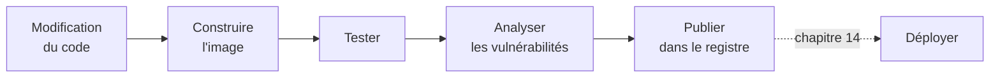
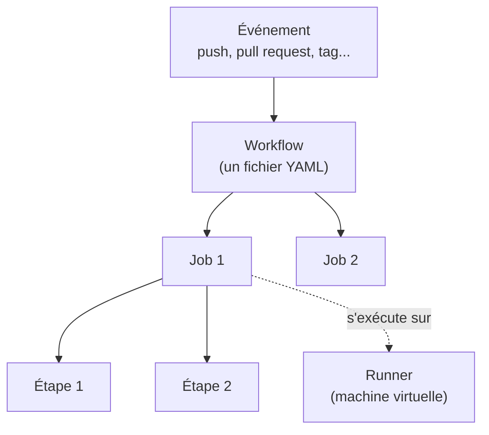

# Chapitre 13 : Intégration continue

!!! abstract "Objectifs du chapitre"
    - Expliquer ce qu'apportent l'intégration continue, la livraison continue et le déploiement continu
    - Décrire les étapes d'un pipeline de construction d'image
    - Lire et écrire un workflow GitHub Actions
    - Construire, tester et analyser une image dans un pipeline
    - Fournir les identifiants du registre au pipeline sans les exposer
    - Publier des images avec des tags de version traçables
    - Diagnostiquer l'échec d'un pipeline
    - Acquis d'apprentissage visé : **AA9**

## 1. Pourquoi automatiser

Jusqu'ici, vous avez construit, testé et publié vos images **à la main** : `docker build`, `docker run`, `curl`, `docker push`. Cette façon de faire pose des problèmes dès que l'on travaille à plusieurs ou que l'on publie souvent :

| Problème de la méthode manuelle | Conséquence |
|---|---|
| Les étapes dépendent de la personne qui les exécute | Résultats différents d'une machine à l'autre |
| On oublie une étape (test, analyse) | Une image défectueuse est publiée |
| La construction se fait sur un poste personnel | Image non reproductible, difficile à auditer |
| Les identifiants du registre sont sur un poste personnel | Risque de fuite |
| Chaque publication prend du temps | On publie moins souvent, avec plus de changements à la fois |

L'idée est de décrire ces étapes **dans un fichier**, versionné avec le code (comme le fichier Compose et le fichier de stack), et de les faire exécuter **automatiquement** par un serveur à chaque modification du code.

### 1.1 CI, livraison continue, déploiement continu

Trois termes, souvent regroupés sous le sigle **CI/CD**, désignent des degrés d'automatisation :

| Terme | Ce qui est automatisé | Qui déclenche la mise en production |
|---|---|---|
| **Intégration continue** (CI) | À chaque modification du code : construction, tests, analyse | Sans objet |
| **Livraison continue** (*continuous delivery*) | La CI, plus la préparation d'une version prête à être déployée (image publiée) | Une personne, par une action volontaire |
| **Déploiement continu** (*continuous deployment*) | La livraison continue, plus le déploiement lui-même | Automatique, sans validation humaine |

Ce chapitre traite de la **CI** et de la **publication** de l'image. Le [chapitre 14](../ch14-livraison-continue/cours.md) automatise le **déploiement** sur le cluster Swarm.

## 2. Le pipeline d'une application conteneurisée

Un **pipeline** est une suite d'étapes exécutées dans un ordre fixé : si une étape échoue, les suivantes ne sont pas exécutées. Pour une application conteneurisée, les étapes habituelles sont les suivantes.



| Étape | Question à laquelle elle répond | Voir |
|---|---|---|
| Construire | L'image se construit-elle depuis le dépôt, sur une machine « propre » ? | [Chapitre 3](../../partie-1-fondations/ch03-images-et-dockerfile/cours.md), [chapitre 9](../../partie-3-durcissement-et-orchestration-swarm/ch09-optimisation-des-images/cours.md) |
| Tester | L'application se comporte-t-elle comme prévu ? | Section 6 |
| Analyser | L'image contient-elle des vulnérabilités connues ? | [Chapitre 10](../../partie-3-durcissement-et-orchestration-swarm/ch10-securite-des-conteneurs/cours.md) |
| Publier | L'image validée est-elle disponible, avec un tag qui permet de la retrouver ? | [Chapitre 4](../../partie-1-fondations/ch04-registres-et-distribution/cours.md), section 8 |

!!! tip "Échouer tôt"
    On place les étapes **rapides et peu coûteuses** d'abord : une erreur de syntaxe se détecte en quelques secondes, une analyse complète en plusieurs minutes. Et on ne **publie** qu'après le succès de toutes les étapes de contrôle.

## 3. GitHub Actions : le vocabulaire

**GitHub Actions** est le service d'automatisation intégré à GitHub. Vous le configurez par des fichiers placés dans votre dépôt, sous `.github/workflows/`.



| Terme | Définition |
|---|---|
| **Workflow** | Un processus automatisé décrit dans un fichier YAML de `.github/workflows/` |
| **Événement** (*event*) | Ce qui déclenche le workflow : un `push`, une `pull_request`, la création d'un tag, un lancement manuel (`workflow_dispatch`), une heure… |
| **Job** | Un ensemble d'étapes qui s'exécutent sur **une même machine**. Les jobs d'un workflow sont indépendants, sauf si l'on déclare une dépendance avec `needs` |
| **Étape** (*step*) | Une commande (`run`) ou une action (`uses`) |
| **Action** | Un composant réutilisable publié par la communauté ou par GitHub, appelé avec `uses` |
| **Runner** | La machine qui exécute un job. Un runner « hébergé par GitHub » est une machine virtuelle neuve, détruite à la fin du job |

!!! note "Une machine neuve à chaque job"
    Un runner hébergé démarre **vide** : rien n'est installé de votre projet et rien n'est conservé d'un job à l'autre. Votre code doit donc être récupéré à chaque job, et les images construites dans un job ne sont pas disponibles dans un autre, sauf si on les publie ou si on les transmet explicitement.

## 4. Un premier workflow

Voici un workflow minimal qui construit l'image de l'application et vérifie qu'elle répond. Il se place dans le dépôt, par exemple dans `.github/workflows/ci.yml`.

```yaml
name: ci

on:
  push:
    branches: [main]
  pull_request:

permissions:
  contents: read

jobs:
  build:
    runs-on: ubuntu-latest
    steps:
      - name: Récupérer le code
        uses: actions/checkout@v4

      - name: Construire l'image
        run: docker build -t qui-repond:test .

      - name: Test de fumée
        run: |
          docker run -d --name appli -p 8080:5000 qui-repond:test
          curl --fail --retry 5 --retry-connrefused --retry-delay 1 http://localhost:8080
          docker rm -f appli
```

| Élément | Rôle |
|---|---|
| `name` | Nom du workflow, affiché dans l'onglet *Actions* de GitHub |
| `on` | Événements déclencheurs : ici un `push` sur la branche `main` et toute `pull_request` |
| `permissions` | Droits accordés au jeton temporaire du workflow ; on ne donne que le nécessaire (ici, la lecture du dépôt) |
| `jobs.build` | Un job nommé `build` |
| `runs-on` | Type de runner : ici une machine Ubuntu hébergée par GitHub |
| `uses: actions/checkout@v4` | Action officielle qui **récupère le code du dépôt** sur le runner |
| `run` | Commande exécutée par le shell du runner |

Le runner Ubuntu hébergé dispose de Docker : les commandes que vous connaissez (`docker build`, `docker run`) fonctionnent telles quelles.

!!! warning "Versions des actions"
    `@v4` désigne une **version majeure** de l'action. Les versions majeures évoluent : vérifiez la version courante dans la documentation de chaque action avant de l'utiliser, et mettez-la à jour régulièrement.

!!! info "Le fichier est du YAML"
    L'indentation compte, comme dans un fichier Compose. Une erreur d'indentation fait échouer le workflow avant même son exécution : GitHub l'indique dans l'onglet *Actions*.

### 4.1 Les dépendances entre jobs

Pour séparer les contrôles de la publication, on utilise plusieurs jobs et `needs` :

```yaml
jobs:
  test:
    runs-on: ubuntu-latest
    steps:
      - uses: actions/checkout@v4
      - run: echo "tests..."

  publish:
    needs: test
    runs-on: ubuntu-latest
    steps:
      - uses: actions/checkout@v4
      - run: echo "publication..."
```

Le job `publish` ne démarre que si `test` a réussi. Comme chaque job a son propre runner, `publish` doit récupérer le code lui-même et reconstruire l'image (ou la récupérer dans un registre).

## 5. Construire l'image dans le pipeline

### 5.1 Avec `docker build`

La commande `docker build` suffit pour construire et tester. Pour **publier** et bénéficier de BuildKit (chapitre 9), on utilise plutôt les actions maintenues par Docker :

| Action | Rôle |
|---|---|
| `docker/setup-buildx-action` | Prépare Buildx, l'interface de BuildKit |
| `docker/login-action` | Se connecte à un registre avec des identifiants |
| `docker/metadata-action` | Calcule les tags et les étiquettes (*labels*) de l'image à partir du contexte Git |
| `docker/build-push-action` | Construit l'image et, si demandé, la publie |

### 5.2 Le cache de construction

Sur un runner neuf, le cache des couches (chapitre 3) est vide : chaque exécution reconstruit toutes les couches. Un cache **partagé entre exécutions** réduit ce temps. L'action de construction accepte des options de cache :

```yaml
      - uses: docker/build-push-action@v6
        with:
          context: .
          push: false
          tags: qui-repond:test
          cache-from: type=gha
          cache-to: type=gha,mode=max
```

`type=gha` utilise le cache de GitHub Actions. Cette option est un **réglage de performance** : le pipeline fonctionne sans elle, et son effet se vérifie en comparant les durées d'exécution (lab 13.2).

## 6. Tester dans le pipeline

On distingue plusieurs niveaux de contrôle, du moins coûteux au plus coûteux.

| Niveau | Ce qu'il vérifie | Exemple |
|---|---|---|
| **Test unitaire** | Une fonction ou une route de l'application, **hors conteneur** | Un test Python exécuté avant la construction |
| **Test de fumée** (*smoke test*) | Le conteneur démarre et répond | `docker run` puis `curl --fail` |
| **Analyse de vulnérabilités** | L'image ne contient pas de vulnérabilité grave connue | Trivy (chapitre 10) |

### 6.1 Test unitaire

Un test unitaire s'exécute dans le job, sur le code, avant la construction. Pour une application Flask, un test peut utiliser le client de test intégré à Flask :

```python
import unittest
from app import app


class TestApp(unittest.TestCase):
    def test_racine_repond(self):
        client = app.test_client()
        reponse = client.get("/")
        self.assertEqual(reponse.status_code, 200)


if __name__ == "__main__":
    unittest.main()
```

Dans le workflow, il faut installer les dépendances puis lancer le test :

```yaml
      - name: Tests unitaires
        run: |
          pip install -r requirements.txt
          python -m unittest
```

!!! note "Adaptation"
    Le nom du module (`app`) et du fichier de dépendances dépendent de votre application. Le but ici est de comprendre où se place le test, pas de fixer son contenu.

### 6.2 Test de fumée du conteneur

Le test de fumée vérifie ce que le test unitaire ne voit pas : que l'**image** est correcte (bon port, bon utilisateur, bonnes dépendances). Il suit la démarche manuelle :

1. démarrer le conteneur en arrière-plan ;
2. attendre qu'il réponde ;
3. envoyer une requête et vérifier le code de retour ;
4. supprimer le conteneur.

L'option `--fail` de `curl` renvoie un code de sortie non nul si le serveur répond par une erreur (`4xx` ou `5xx`) : c'est ce code qui fait échouer l'étape. Une étape échoue dès qu'une de ses commandes renvoie un code de sortie différent de zéro, comme vous l'avez vu pour les conteneurs au chapitre 8.

!!! tip "Toujours nettoyer, même en cas d'échec"
    Sur un runner hébergé, la machine est détruite à la fin du job : le nettoyage n'est pas indispensable. Il l'est sur une machine qui sert plusieurs fois (comme votre poste ou un runner auto-hébergé). Pour afficher les journaux du conteneur **en cas d'échec**, on peut ajouter une étape `if: failure()` qui exécute `docker logs appli`.

### 6.3 Analyse de vulnérabilités

Le chapitre 10 a présenté l'analyse d'une image avec Trivy. Dans un pipeline, la même démarche s'applique : on exporte l'image dans une archive puis on lance Trivy dans un conteneur. Deux choix sont à faire :

| Choix | Effet |
|---|---|
| Le pipeline **échoue** si une vulnérabilité de gravité `HIGH` ou `CRITICAL` est trouvée | Aucune image grave n'est publiée, mais le pipeline peut bloquer pour une vulnérabilité sans correctif disponible |
| Le pipeline **signale** sans échouer | Le pipeline passe, mais le rapport peut être ignoré |

Le choix dépend de la politique de l'équipe. Le lab 13.2 vous demande de justifier le vôtre.

## 7. Les secrets du pipeline

Pour publier dans Docker Hub, le pipeline doit s'authentifier. Comme pour les secrets de Swarm (chapitre 12), les identifiants ne doivent figurer ni dans le dépôt, ni dans le workflow.

GitHub fournit les **secrets de dépôt** : des valeurs chiffrées, saisies dans les paramètres du dépôt, qu'un workflow lit avec la syntaxe `${{ secrets.NOM }}`.

```yaml
      - name: Se connecter à Docker Hub
        uses: docker/login-action@v3
        with:
          username: ${{ secrets.DOCKERHUB_USERNAME }}
          password: ${{ secrets.DOCKERHUB_TOKEN }}
```

!!! danger "Un jeton d'accès, pas votre mot de passe"
    N'enregistrez **jamais** le mot de passe de votre compte Docker Hub comme secret. Créez un **jeton d'accès** (*access token*) dans les paramètres de sécurité de votre compte Docker Hub, avec les droits strictement nécessaires, et enregistrez-le comme secret. Un jeton se révoque sans changer le mot de passe, et son droit se limite à ce qui est prévu.

Quelques règles complémentaires :

- GitHub **masque** dans les journaux la valeur exacte d'un secret, mais ne peut pas masquer une valeur transformée (encodée, découpée). N'affichez donc jamais un secret.
- Les workflows déclenchés par une `pull_request` venant d'un **fork** n'ont pas accès aux secrets du dépôt : c'est voulu. Pour cette raison, on ne publie qu'à partir d'un `push` sur la branche principale ou d'un tag.
- On donne au workflow les **permissions minimales** (`permissions: contents: read`, comme dans l'exemple de la section 4).
- Les actions de tiers sont du code exécuté dans votre pipeline, avec vos secrets : privilégiez les actions officielles ou maintenues par des organisations reconnues, et lisez leur documentation.

!!! warning "Un secret divulgué doit être révoqué"
    Si un jeton apparaît dans un dépôt ou dans un journal, il faut le **révoquer** et en créer un nouveau. Le supprimer du dépôt ne suffit pas : l'historique Git le conserve.

## 8. Versionner et publier les images

### 8.1 Pourquoi `latest` ne suffit pas

Le tag `latest` (chapitre 4) est un tag **mobile** : il désigne « la dernière image publiée », sans indiquer laquelle. Pour déployer, annuler une mise à jour ou rechercher l'origine d'une panne, on a besoin de tags qui **identifient une version précise** et qui ne changent pas.

| Tag | Exemple | Usage |
|---|---|---|
| **Version sémantique** | `1.4.2` | Version publiée volontairement, avec un numéro `majeur.mineur.correctif` |
| **Empreinte du commit** | `sha-3f9a1c2` | Traçabilité : on retrouve le code exact qui a produit l'image |
| **Branche** | `main` | Dernière image de la branche (tag mobile, pour des tests) |

!!! tip "Retenez ceci"
    En production, on déploie une image désignée par un tag **immuable** (version ou empreinte de commit), jamais par un tag mobile : c'est ce qui rend les mises à jour et les retours arrière **reproductibles**.

### 8.2 Les tags Git comme source de version

La version publiée vient d'un **tag Git** :

```bash
git tag v1.0.0
git push origin v1.0.0
```

Le workflow se déclenche sur ce tag (`on: push: tags: ['v*']`) et publie une image dont le tag Docker est dérivé du tag Git. L'action `docker/metadata-action` produit ces tags automatiquement :

```yaml
      - name: Calculer les tags
        id: meta
        uses: docker/metadata-action@v5
        with:
          images: <utilisateur>/qui-repond
          tags: |
            type=sha
            type=semver,pattern={{version}}
```

Avec cette configuration, un push du tag Git `v1.0.0` produit les tags Docker `1.0.0` et `sha-` suivi du début de l'empreinte du commit.

### 8.3 Le workflow de publication complet

```yaml
name: publication

on:
  push:
    branches: [main]
    tags: ['v*']

permissions:
  contents: read

jobs:
  publier:
    runs-on: ubuntu-latest
    steps:
      - name: Récupérer le code
        uses: actions/checkout@v4

      - name: Préparer Buildx
        uses: docker/setup-buildx-action@v3

      - name: Se connecter à Docker Hub
        uses: docker/login-action@v3
        with:
          username: ${{ secrets.DOCKERHUB_USERNAME }}
          password: ${{ secrets.DOCKERHUB_TOKEN }}

      - name: Calculer les tags
        id: meta
        uses: docker/metadata-action@v5
        with:
          images: <utilisateur>/qui-repond
          tags: |
            type=sha
            type=semver,pattern={{version}}

      - name: Construire et publier
        uses: docker/build-push-action@v6
        with:
          context: .
          push: true
          tags: ${{ steps.meta.outputs.tags }}
          labels: ${{ steps.meta.outputs.labels }}
```

Ici, les contrôles (tests, analyse) sont omis pour la lisibilité. Dans un vrai pipeline, ils se placent **dans un job préalable**, et le job de publication déclare `needs:` pour ne s'exécuter qu'en cas de succès.

!!! warning "Versions des actions et du comportement des tags"
    Les versions majeures des actions et les règles exactes de génération des tags évoluent. Contrôlez, dans la documentation de chaque action, la version à utiliser et le résultat obtenu, puis vérifiez sur Docker Hub que les tags publiés sont bien ceux attendus.

## 9. Diagnostiquer un pipeline en échec

Un pipeline échoue de la même façon qu'un conteneur : par un code de sortie non nul. La démarche du chapitre 8 s'applique, avec des outils différents.

| Question | Où regarder |
|---|---|
| Quel job et quelle étape ont échoué ? | Onglet *Actions* : l'étape fautive est marquée d'une croix rouge |
| Quel est le message d'erreur ? | Les journaux de l'étape : déroulez-la, lisez les **dernières lignes** avant l'échec |
| Le workflow s'est-il seulement lancé ? | Si aucun job n'apparaît, vérifiez la syntaxe YAML, l'événement déclencheur et le chemin du fichier (`.github/workflows/`) |
| L'étape fonctionne-t-elle en local ? | Rejouez les mêmes commandes sur votre machine : si elles échouent aussi, le problème n'est pas le pipeline |
| Le problème vient-il d'un secret ? | Une erreur d'authentification (`unauthorized`, `denied`) indique un secret absent, mal nommé ou un jeton expiré ou sans droit d'écriture |

| Symptôme | Pistes |
|---|---|
| Aucun workflow ne se déclenche | Fichier hors de `.github/workflows/`, branche ou tag qui ne correspond pas à `on`, ou erreur YAML |
| `unauthorized` ou `denied` à la publication | Secrets absents ou mal nommés, jeton sans droit d'écriture, nom d'image sans votre nom d'utilisateur |
| L'image ne se construit pas dans le pipeline mais se construit chez vous | Fichier ignoré par `.dockerignore`, fichier non versionné dans Git, ou dépendance disponible chez vous seulement |
| Le test de fumée échoue au premier essai | L'application n'a pas eu le temps de démarrer : prévoyez une attente (options `--retry` de `curl`) |
| `port is already allocated` | Un conteneur d'une étape précédente occupe encore le port |
| Le pipeline est lent | Pas de cache de construction (section 5.2), dépendances téléchargées à chaque exécution, étapes inutiles |

## À retenir

!!! tip "À retenir"
    - Un **pipeline** automatise construction, tests, analyse et publication à chaque modification du code, de façon **reproductible**.
    - **CI** : construire et contrôler en continu ; **livraison continue** : publier une version prête à déployer ; **déploiement continu** : déployer automatiquement.
    - Un workflow GitHub Actions est un fichier YAML dans `.github/workflows/` : des **événements** déclenchent des **jobs**, composés d'**étapes** exécutées sur un **runner**.
    - Un runner hébergé est une **machine neuve** à chaque job : le code doit être récupéré, et rien ne persiste d'un job à l'autre.
    - On place les contrôles **avant** la publication ; une étape échoue dès qu'une commande renvoie un code différent de zéro.
    - Les identifiants du registre se stockent dans les **secrets de dépôt**, sous forme de **jeton d'accès** ; on ne les affiche jamais, et un secret divulgué se révoque.
    - On publie des tags **immuables** (version, empreinte du commit), et on déploie avec ces tags, pas avec `latest`.
    - Un pipeline en échec se diagnostique comme un conteneur : étape fautive, journaux, reproduction locale.

## Pour vérifier votre compréhension

??? question "Pourquoi une image construite dans un job n'est-elle pas disponible dans le job suivant ?"
    Chaque job s'exécute sur un runner neuf, détruit à la fin du job. Pour transmettre une image, il faut la publier dans un registre (ou transmettre explicitement une archive), ou reconstruire l'image dans le job qui en a besoin.

??? question "Pourquoi ne publie-t-on pas depuis une `pull_request` venant d'un fork ?"
    Ces exécutions n'ont pas accès aux secrets du dépôt, et il serait dangereux de leur en donner : le code d'un tiers pourrait les lire. On publie uniquement depuis un `push` sur la branche principale ou sur un tag de votre dépôt.

??? question "Pourquoi un jeton d'accès est-il préférable au mot de passe du compte ?"
    Un jeton a des droits limités et se révoque sans changer le mot de passe : sa divulgation a un impact plus faible et se répare vite.

??? question "Quel est l'inconvénient de déployer avec le tag `latest` ?"
    Il désigne une image qui change au fil des publications : on ne sait pas quelle version tourne, et un retour arrière précis est impossible. Un tag de version ou d'empreinte de commit est immuable et traçable.

??? question "Un test de fumée réussit, mais les tests unitaires ont échoué. Faut-il publier l'image ?"
    Non. Une étape en échec arrête le pipeline : la publication, placée après les contrôles, ne doit pas s'exécuter.

## Ressources du chapitre

- [Lab 13.1 : Pipeline de construction d'image](lab-13-1-pipeline-de-construction-d-image.md)
- [Lab 13.2 : Tests et publication versionnée](lab-13-2-tests-et-publication-versionnee.md)
- [Quiz du chapitre](quiz.md)
- Documentation de GitHub Actions : [docs.github.com/actions](https://docs.github.com/actions)