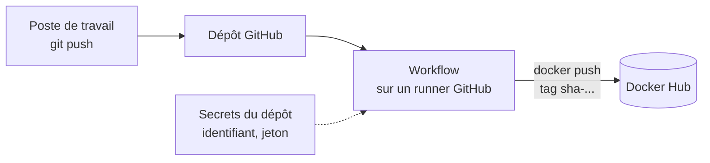

# Lab 13.1 : Pipeline de construction d'image

| | |
|---|---|
| **Durée** | 75 min |
| **Niveau** | Semi-guidé |
| **Prérequis** | [Lab 12.2 : Mises à jour, secrets et panne d'un nœud](../../partie-3-durcissement-et-orchestration-swarm/ch12-swarm-stacks-et-exploitation/lab-12-2-mises-a-jour-secrets-et-panne-d-un-nud.md) (code et Dockerfile de l'application `qui-repond`), compte GitHub et compte Docker Hub, cours du [chapitre 13](cours.md) |
| **Acquis visés** | AA9 |

!!! abstract "Objectifs"
    - Héberger le code et le Dockerfile d'une application dans un dépôt GitHub
    - Écrire un workflow qui construit l'image à chaque modification
    - Lire les journaux d'un pipeline et diagnostiquer un échec
    - Stocker les identifiants Docker Hub comme secrets du dépôt, avec un jeton d'accès
    - Publier automatiquement l'image avec un tag lié au commit
    - Constater qu'une `pull_request` construit l'image sans la publier

## Contexte et schéma

Vous automatisez la construction et la publication de l'image `qui-repond`. À la fin du lab, chaque `push` sur la branche `main` construit l'image et la publie sur Docker Hub, avec un tag qui identifie le commit. Les commandes `git` et `docker` s'exécutent sur la machine de votre choix (machine virtuelle ou Docker Desktop), les workflows s'exécutent sur GitHub. Dans ce lab, seules les **commandes clés** vous sont données : à vous de les adapter et de déduire le reste à l'aide du [cours](cours.md).

!!! note "Organisation du travail"
    Les workflows sont des fichiers de votre dépôt : pour les modifier, vous modifiez le fichier, puis `git commit` et `git push`. Observez chaque exécution dans l'onglet **Actions** de votre dépôt GitHub.

## Étapes

### Étape 1 : Créer le dépôt et y envoyer le code

- **Objectif :** disposer d'un dépôt GitHub contenant l'application.
- **Indices :**
    - Créez sur GitHub un dépôt **public** nommé `qui-repond`, sans fichier initial.
    - Sur votre machine, placez-vous dans le dossier de l'application (celui qui contient le code Flask et le `Dockerfile`, Lab 11.2) et créez-y un dépôt Git : `git init`, `git add`, `git commit`. Nommez la branche principale `main` (`git branch -M main`).
    - Reliez le dépôt local au dépôt GitHub avec `git remote add origin <adresse-du-depot>`, puis `git push -u origin main`.
    - GitHub n'accepte plus le mot de passe du compte pour `git push` en HTTPS : utilisez un **jeton d'accès personnel** ou une clé SSH, en suivant la documentation de GitHub.
    - Vérifiez `git status` : aucun fichier inutile (environnement virtuel, fichiers temporaires) ne doit être versionné. Au besoin, ajoutez un `.gitignore`.

!!! success "Point de contrôle"
    - [ ] Le code et le `Dockerfile` sont visibles sur la page du dépôt GitHub
    - [ ] Le dépôt ne contient aucun mot de passe ni jeton
    - [ ] `docker build` fonctionne dans le dossier local (l'image se construit sur votre machine)

### Étape 2 : Écrire un premier workflow de construction

- **Objectif :** construire l'image automatiquement, sans la publier.
- **Indices :**
    - Créez le fichier `.github/workflows/ci.yml`.
    - Le workflow se déclenche sur un `push` vers `main` **et** sur les `pull_request` ; il comporte un job `build` sur `ubuntu-latest`, avec deux étapes : récupérer le code (`actions/checkout`), puis construire l'image avec `docker build`.
    - Donnez au workflow les permissions minimales (`contents: read`).
    - Vous pouvez vous inspirer de la section 4 du [cours](cours.md). Vérifiez la version courante de l'action dans sa documentation.
    - Envoyez le fichier : `git add`, `git commit`, `git push`.

!!! success "Point de contrôle"
    - [ ] Un workflow apparaît dans l'onglet **Actions** juste après le `push`
    - [ ] Le job `build` se termine avec une coche verte
    - [ ] Vous avez retrouvé, dans les journaux, la sortie de `docker build`

### Étape 3 : Provoquer un échec et le diagnostiquer

- **Objectif :** savoir lire un pipeline en échec.
- **Indices :**
    - Introduisez volontairement **une erreur dans le Dockerfile** (au choix : une instruction mal écrite, un fichier à copier qui n'existe pas…), puis faites un `commit` et un `push`.
    - Dans l'onglet **Actions**, repérez l'étape fautive et lisez les dernières lignes de ses journaux.
    - Reproduisez l'erreur sur votre machine avec `docker build`.
    - Corrigez le Dockerfile, puis faites un nouveau `commit` et un `push`.

!!! success "Point de contrôle"
    - [ ] Le pipeline en échec est marqué d'une croix rouge, sur l'étape que vous attendiez
    - [ ] Vous avez trouvé la cause dans les journaux **avant** de la reproduire localement
    - [ ] Après correction, le pipeline repasse au vert

### Étape 4 : Créer les secrets du dépôt

- **Objectif :** donner au pipeline le droit de publier, sans exposer d'identifiants.
- **Indices :**
    - Dans les paramètres de sécurité de votre compte **Docker Hub**, créez un **jeton d'accès** avec les droits strictement nécessaires pour publier (section 7 du [cours](cours.md)). Copiez-le immédiatement : il ne sera pas réaffiché.
    - Dans les paramètres du dépôt GitHub, créez deux **secrets de dépôt** (*Actions secrets*) : `DOCKERHUB_USERNAME` (votre nom d'utilisateur) et `DOCKERHUB_TOKEN` (le jeton).
    - Ne copiez le jeton nulle part ailleurs (ni fichier, ni message de commit).

!!! success "Point de contrôle"
    - [ ] Les deux secrets sont listés dans les paramètres du dépôt, sans que leur valeur soit visible
    - [ ] Vous savez expliquer pourquoi vous avez créé un jeton plutôt que d'enregistrer votre mot de passe
    - [ ] Aucun fichier du dépôt ne contient le jeton

### Étape 5 : Publier l'image depuis le pipeline

- **Objectif :** construire et publier l'image à chaque `push` sur `main`.
- **Indices :**
    - Créez un second workflow `.github/workflows/publication.yml` (déclenché par un `push` sur `main`), ou ajoutez un job à `ci.yml` : à vous de choisir et de justifier votre choix.
    - Les étapes : récupérer le code, préparer Buildx, se connecter à Docker Hub avec les secrets, calculer les tags avec `docker/metadata-action` (tag `type=sha` uniquement), construire et publier avec `docker/build-push-action` (sections 5.1, 7 et 8 du [cours](cours.md)).
    - Le nom d'image est `<utilisateur>/qui-repond` ; n'utilisez le secret que pour la connexion.
    - Envoyez le fichier avec un `commit` et un `push`.

!!! success "Point de contrôle"
    - [ ] Le workflow se termine avec une coche verte
    - [ ] Une nouvelle balise de la forme `sha-<début-du-commit>` apparaît sur la page Docker Hub de votre dépôt `qui-repond`
    - [ ] Les journaux du workflow n'affichent ni l'identifiant ni le jeton en clair

### Étape 6 : Vérifier le lien entre l'image et le commit

- **Objectif :** retrouver le code qui a produit l'image.
- **Indices :**
    - Sur votre machine, affichez le début de l'empreinte du dernier commit avec `git rev-parse --short HEAD` et comparez-le au tag publié.
    - Téléchargez l'image depuis Docker Hub avec ce tag (`docker pull`) et lancez-la : elle doit répondre comme l'application locale.
    - Modifiez le texte de la réponse de l'application, faites un `commit` et un `push`, puis vérifiez qu'un **second** tag apparaît, différent du premier.

!!! success "Point de contrôle"
    - [ ] Le tag de l'image correspond au début de l'empreinte du commit
    - [ ] L'image téléchargée depuis Docker Hub répond correctement
    - [ ] Chaque commit sur `main` produit un tag différent : les deux images coexistent sur Docker Hub

### Étape 7 : Observer le comportement d'une `pull_request`

- **Objectif :** constater qu'une `pull_request` construit sans publier.
- **Indices :**
    - Créez une branche (`git switch -c essai`), modifiez le texte de la réponse, faites un `commit` et un `push` de cette branche, puis ouvrez une **pull request** vers `main` sur GitHub.
    - Observez les workflows qui se déclenchent : `ci.yml` (déclencheur `pull_request`) se lance-t-il ? Et le workflow de publication ?
    - Vérifiez sur Docker Hub qu'aucun nouveau tag n'a été publié.
    - Fusionnez la pull request et observez ce qui se passe ensuite.

!!! success "Point de contrôle"
    - [ ] La pull request déclenche la construction, mais **pas** la publication
    - [ ] Aucun tag n'apparaît sur Docker Hub avant la fusion
    - [ ] Après la fusion, la publication se déclenche et un nouveau tag apparaît

### Étape 8 : Dresser la fiche du pipeline

- **Objectif :** retenir le rôle de chaque élément de **vos** fichiers.
- **Indices :** complétez le tableau à partir de vos workflows.

| Élément du workflow | Rôle |
|---|---|
| `on` | |
| `permissions` | |
| `uses: actions/checkout` | |
| `docker/login-action` et `secrets.…` | |
| `docker/metadata-action` | |
| `push:` de `docker/build-push-action` | |

!!! success "Point de contrôle"
    - [ ] Chaque ligne est complétée à partir de votre propre workflow

## Questions de réflexion

??? question "Pourquoi le pipeline reconstruit-il l'image alors qu'elle se construit déjà sur votre machine ?"
    Le runner est une machine neuve, sans votre configuration : si l'image se construit, c'est qu'elle ne dépend que du contenu du dépôt. C'est une garantie de reproductibilité qu'un poste personnel ne donne pas.

??? question "Pourquoi publie-t-on seulement après la fusion sur `main` et pas à chaque branche ?"
    Une branche contient du code non validé : publier à chaque branche multiplierait les images sans valeur et exposerait les secrets au code non relu. On publie ce qui est intégré sur la branche principale.

??? question "Que se passe-t-il si quelqu'un lit le fichier `publication.yml` : y voit-il vos identifiants ?"
    Non : le fichier ne contient que le **nom** des secrets (`secrets.DOCKERHUB_TOKEN`), jamais leur valeur, qui est stockée chiffrée par GitHub.

??? question "Pourquoi le tag `sha-…` est-il utile pour un déploiement ?"
    Il identifie exactement le commit qui a produit l'image et ne change jamais : on sait quel code tourne, et on peut revenir à une version précise.

## Dépannage

| Symptôme | Pistes |
|---|---|
| `git push` demande un mot de passe puis refuse | Le mot de passe du compte n'est plus accepté : utilisez un jeton d'accès personnel ou une clé SSH |
| Aucun workflow ne se lance | Fichier hors de `.github/workflows/`, extension incorrecte, erreur d'indentation YAML, ou branche différente de `main` |
| `Dockerfile: no such file or directory` | Le `Dockerfile` n'est pas à la racine du dépôt, ou n'a pas été ajouté à Git (`git status`) |
| `unauthorized` ou `denied` à la publication | Secret absent ou mal nommé (le nom est sensible à la casse), jeton sans droit d'écriture, ou nom d'image sans votre nom d'utilisateur |
| `Context access might be invalid: DOCKERHUB_TOKEN` | Le secret n'existe pas dans le dépôt : créez-le dans les paramètres |
| Le pipeline publie lors d'une pull request | L'option `push:` de l'action vaut toujours `true` : conditionnez-la à l'événement (voir la section 8 du [cours](cours.md)) |
| Le tag publié ne ressemble pas à l'attendu | Configuration de `docker/metadata-action` : relisez les lignes `tags:` et les journaux de l'étape |
| Une action est introuvable ou refusée | Nom ou version erronés : vérifiez dans la documentation de l'action |
| Le workflow n'a pas les droits (`permission denied`) | Trop de restrictions dans `permissions` : relisez ce dont l'étape a besoin |

## Nettoyage et reprise

Conservez le **dépôt GitHub**, les workflows et les secrets : le [Lab 13.2](lab-13-2-tests-et-publication-versionnee.md) les réutilise. Vous pouvez supprimer sur votre machine les images téléchargées pour les tests (`docker image rm <image>`) et, sur Docker Hub, les tags dont vous n'avez plus besoin. En cas de doute sur la confidentialité du jeton, révoquez-le dans Docker Hub, créez-en un nouveau et remplacez le secret du dépôt.

## Retour au chapitre

[Chapitre 13 : Intégration continue](cours.md) · Lab suivant : [Lab 13.2 : Tests et publication versionnée](lab-13-2-tests-et-publication-versionnee.md)