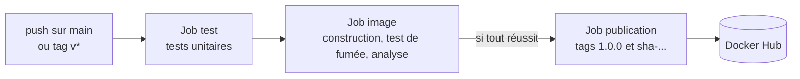

# Lab 13.2 : Tests et publication versionnée

| | |
|---|---|
| **Durée** | 90 min |
| **Niveau** | Autonome |
| **Prérequis** | [Lab 13.1 : Pipeline de construction d'image](lab-13-1-pipeline-de-construction-d-image.md) (dépôt GitHub, workflows, secrets `DOCKERHUB_USERNAME` et `DOCKERHUB_TOKEN`), [Lab 10.2 : Analyser et corriger une image](../../partie-3-durcissement-et-orchestration-swarm/ch10-securite-des-conteneurs/lab-10-2-analyser-et-corriger-une-image.md), cours du [chapitre 13](cours.md) |
| **Acquis visés** | AA9 |

!!! abstract "Objectifs"
    - Ajouter des tests unitaires et un test de fumée au pipeline
    - Empêcher la publication d'une image dont les contrôles échouent
    - Intégrer l'analyse de vulnérabilités et justifier la politique choisie
    - Publier des images avec des tags de version issus des tags Git
    - Mesurer l'effet du cache de construction

## Contexte et schéma

Vous complétez le pipeline du Lab 13.1 : avant toute publication, l'application doit passer des tests et une analyse de vulnérabilités. Les versions sont ensuite publiées à partir de **tags Git**. Ce lab est **autonome** : seuls les objectifs et les critères de réussite sont donnés. Appuyez-vous sur le [cours](cours.md) (sections 4 à 8) et sur vos labs précédents.

## Étapes

### Étape 1 : Écrire un test unitaire

- **Objectif :** disposer d'un test automatisé de l'application.
- **Consignes :**
    - Dans le dépôt, ajoutez un fichier de test qui vérifie qu'une route de votre application répond avec le code `200` et un contenu attendu (section 6.1 du cours).
    - Exécutez-le **d'abord sur votre machine** (en installant les dépendances de l'application) et vérifiez qu'il réussit.
    - Vérifiez aussi qu'il **échoue** lorsque vous modifiez volontairement le texte attendu, puis remettez-le.

!!! success "Point de contrôle"
    - [ ] Le test réussit en local avec l'application inchangée
    - [ ] Le test échoue quand la valeur attendue est fausse
    - [ ] Le fichier de test est versionné dans le dépôt

### Étape 2 : Séparer le pipeline en jobs

- **Objectif :** exécuter les tests avant la construction de l'image.
- **Consignes :**
    - Dans votre workflow, créez un job `test` qui récupère le code, installe les dépendances et lance les tests.
    - Rendez les jobs de construction et de publication **dépendants** du job `test` (`needs`).
    - Faites un `commit` et un `push` : observez l'ordre d'exécution des jobs dans l'onglet **Actions**.

!!! success "Point de contrôle"
    - [ ] Le job `test` s'exécute en premier et réussit
    - [ ] Les autres jobs ne démarrent qu'après lui
    - [ ] Le graphe des jobs affiché par GitHub reflète la dépendance voulue

### Étape 3 : Ajouter le test de fumée du conteneur

- **Objectif :** vérifier que l'**image** démarre et répond.
- **Consignes :**
    - Dans le job qui construit l'image, ajoutez des étapes qui démarrent le conteneur, envoient une requête avec `curl --fail` (avec des tentatives, section 6.2 du cours) et vérifient la réponse.
    - Ajoutez une étape exécutée **uniquement en cas d'échec** (`if: failure()`) qui affiche les journaux du conteneur.
    - Provoquez une panne (par exemple en changeant le port exposé dans le Dockerfile ou la commande de démarrage) : vérifiez que l'étape échoue, que les journaux s'affichent, puis corrigez.

!!! success "Point de contrôle"
    - [ ] Le test de fumée réussit sur l'image correcte
    - [ ] Il échoue sur l'image défectueuse, avec les journaux du conteneur affichés
    - [ ] Vous pouvez expliquer ce que le test de fumée détecte et que le test unitaire ne détecte pas

### Étape 4 : Prouver que la publication est bloquée

- **Objectif :** garantir qu'aucune image défectueuse n'est publiée.
- **Consignes :**
    - Sur une branche `echec`, faites échouer volontairement un test, puis fusionnez cette branche dans `main` (ou, si vous préférez, faites un `push` direct pour ce test).
    - Observez l'exécution : quels jobs se sont exécutés, lesquels ont été ignorés ?
    - Vérifiez sur Docker Hub qu'**aucun tag** n'a été publié pour ce commit.
    - Corrigez ensuite le test et vérifiez que la publication reprend.

!!! success "Point de contrôle"
    - [ ] Le job de publication n'a pas été exécuté (état « ignoré » ou « skipped » dans GitHub)
    - [ ] Docker Hub ne contient aucun tag pour le commit défectueux
    - [ ] Après correction, le tag du nouveau commit apparaît

### Étape 5 : Analyser les vulnérabilités dans le pipeline

- **Objectif :** intégrer l'analyse du chapitre 10 au pipeline et choisir une politique.
- **Consignes :**
    - Ajoutez au job de construction une étape qui exporte l'image dans une archive et l'analyse avec **Trivy** exécuté dans un conteneur, comme au Lab 10.2. Choisissez et fixez le tag de l'image de Trivy (pas de tag mobile).
    - Consultez l'aide de Trivy pour limiter le résultat aux gravités `HIGH` et `CRITICAL` et pour obtenir un code de sortie non nul lorsqu'il en trouve.
    - Choisissez votre politique, parmi les deux de la section 6.3 du cours : **faire échouer** le pipeline, ou **signaler** seulement. Justifiez-la en quelques lignes dans un fichier `docs-pipeline.md` à la racine du dépôt (ou dans le README).
    - Vérifiez que la politique choisie se comporte comme prévu : par exemple, utilisez temporairement une image de base ancienne pour provoquer des résultats.

!!! success "Point de contrôle"
    - [ ] L'étape d'analyse s'exécute dans le pipeline, avant la publication
    - [ ] Avec la politique « échec », une vulnérabilité grave bloque la publication ; avec la politique « signalement », le rapport apparaît dans les journaux sans bloquer
    - [ ] Votre justification mentionne un inconvénient de la politique retenue

### Étape 6 : Publier des versions à partir de tags Git

- **Objectif :** obtenir des tags Docker qui identifient une version précise.
- **Consignes :**
    - Faites en sorte que le workflow se déclenche aussi sur un **tag Git** de la forme `v<majeur>.<mineur>.<correctif>` et que `docker/metadata-action` en déduise le tag de version (section 8.2 du cours).
    - Créez et envoyez le tag Git `v1.0.0` sur le dernier commit validé.
    - Vérifiez sur Docker Hub que les tags `1.0.0` et `sha-…` désignent la **même** image (même empreinte, `digest`).
    - Téléchargez `<utilisateur>/qui-repond:1.0.0`, lancez-la et vérifiez la réponse.

!!! success "Point de contrôle"
    - [ ] Le tag Git `v1.0.0` déclenche le workflow et publie `1.0.0` et un tag `sha-…`
    - [ ] Les deux tags portent le même `digest`
    - [ ] L'image `1.0.0` répond comme attendu

### Étape 7 : Publier une correction et conserver l'ancienne version

- **Objectif :** constater que les versions successives coexistent.
- **Consignes :**
    - Modifiez le texte de la réponse de l'application, validez le pipeline, puis créez le tag `v1.0.1`.
    - Vérifiez que `1.0.0` et `1.0.1` sont disponibles et distinctes sur Docker Hub.
    - Indiquez dans votre compte rendu ce que vous feriez pour revenir de `1.0.1` à `1.0.0` sur le cluster Swarm du chapitre 12 (sans le faire).

!!! success "Point de contrôle"
    - [ ] Les versions `1.0.0` et `1.0.1` sont téléchargeables et répondent différemment
    - [ ] Vous savez nommer la commande qui ramènerait un service à la version précédente

### Étape 8 : Mesurer l'effet du cache

- **Objectif :** juger l'intérêt du cache de construction.
- **Consignes :**
    - Notez la durée de l'étape de construction dans trois exécutions **sans cache**.
    - Activez le cache GitHub Actions dans l'action de construction (section 5.2 du cours), puis relancez deux fois l'exécution sans modifier le code, et une fois en modifiant un fichier de l'application.
    - Comparez les durées dans un tableau, et expliquez les différences en vous appuyant sur le fonctionnement des couches (chapitre 3).

!!! success "Point de contrôle"
    - [ ] Un tableau compare les durées avec et sans cache
    - [ ] L'explication relie le résultat à l'ordre des instructions du Dockerfile
    - [ ] Vous savez dire dans quel cas le cache ne change rien

### Étape 9 : Dresser le bilan

- **Objectif :** classer les contrôles et leur effet.
- **Consignes :** complétez le tableau à partir de ce que vous avez observé.

| Contrôle | Ce qu'il détecte | Que se passe-t-il s'il échoue ? |
|---|---|---|
| Test unitaire | | |
| Test de fumée | | |
| Analyse de vulnérabilités | | |
| Publication | | |

!!! success "Point de contrôle"
    - [ ] Chaque ligne est complétée avec vos propres observations

## Questions de réflexion

??? question "Pourquoi l'image testée doit-elle être celle qui est publiée ?"
    Si le job de publication reconstruit une image, rien ne garantit qu'elle soit identique à celle qui a passé les tests (dépendances mises à jour entre-temps, image de base modifiée). Publier **l'image déjà testée**, par exemple en la transmettant d'un job à l'autre ou en la testant dans le registre, supprime cet écart.

??? question "Pourquoi publie-t-on aussi un tag `sha-…` en plus de la version ?"
    Le tag de version est choisi par une personne ; le tag `sha-…` identifie sans ambiguïté le commit. Il permet de retrouver le code exact, même si l'on a oublié de poser une version.

??? question "Quel risque y a-t-il à faire échouer le pipeline à chaque vulnérabilité grave ?"
    Le pipeline peut être bloqué par une vulnérabilité sans correctif disponible, ce qui empêche même la publication d'un correctif urgent. L'équipe doit alors décider d'une exception documentée.

??? question "Pourquoi ne pas lancer l'analyse et la publication dans un même job qui s'arrête à la première erreur ?"
    Séparer les jobs rend visible l'enchaînement, permet de relancer un job isolé et de réserver les secrets au seul job de publication.

## Dépannage

| Symptôme | Pistes |
|---|---|
| `ModuleNotFoundError` dans le job de test | Les dépendances ne sont pas installées dans le job (chaque job démarre sur une machine neuve) |
| Le test réussit en local mais échoue dans le pipeline | Version de Python ou de dépendances différente, fichier non versionné, ou dépendance à votre environnement |
| Le job de publication ne démarre jamais | `needs` désigne un nom de job inexistant, ou le job précédent est en échec |
| Le tag Git ne déclenche rien | Motif `v*` absent de `on.push.tags`, tag non envoyé (`git push origin <tag>`) ou tag posé avant l'ajout du workflow |
| Le tag `1.0.0` n'est pas publié | `type=semver` attend un tag Git de la forme `v1.0.0` : vérifiez l'écriture du tag et la configuration de `docker/metadata-action` |
| Trivy renvoie une erreur de version d'image | Le tag de Trivy n'existe pas : vérifiez-le sur Docker Hub |
| L'analyse est très longue | Base de vulnérabilités téléchargée à chaque exécution : c'est attendu sur un runner neuf |
| Le cache n'accélère pas la construction | Instructions modifiées tôt dans le Dockerfile, ou premier passage qui remplit le cache |
| `port is already allocated` | Le port de l'hôte est utilisé par un conteneur précédent : changez de port ou supprimez le conteneur |

## Nettoyage et reprise

Conservez le **dépôt**, les workflows, les secrets et les images publiées : le [chapitre 14](../ch14-livraison-continue/cours.md) déploie ces images sur le cluster. Supprimez, si vous le souhaitez, les tags de test de Docker Hub, en gardant les versions `1.0.0` et `1.0.1`. Vérifiez que `git log` et les fichiers du dépôt ne contiennent aucun secret.

## Retour au chapitre

[Chapitre 13 : Intégration continue](cours.md) · Chapitre suivant : [Chapitre 14 : Livraison continue](../ch14-livraison-continue/cours.md)