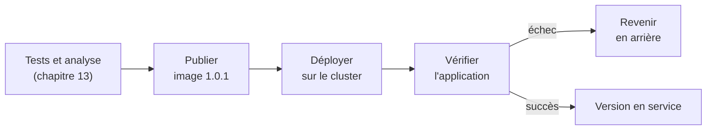
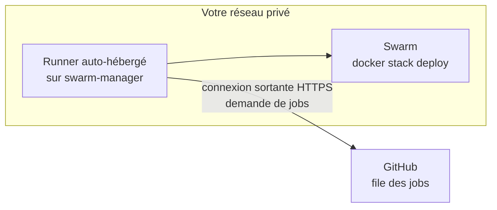

# Chapitre 14 : Livraison continue

!!! abstract "Objectifs du chapitre"
    - Situer le déploiement automatisé dans le pipeline du chapitre 13
    - Choisir comment un pipeline atteint un cluster Swarm situé sur un réseau privé
    - Déployer une version précise d'une image sur une stack à partir d'un workflow
    - Contrôler qui peut déclencher un déploiement, et quand
    - Vérifier un déploiement et revenir en arrière automatiquement en cas d'échec
    - Gérer les versions déployées de façon traçable et reproductible
    - Acquis d'apprentissage visés : **AA9, AA8**

## 1. De la publication au déploiement

Au [chapitre 13](../ch13-integration-continue/cours.md), le pipeline construit, teste, analyse et **publie** une image portant un tag de version. L'application n'est pourtant pas encore à jour sur le cluster : quelqu'un doit encore taper `docker stack deploy` ou `docker service update`. Cette étape manuelle présente les mêmes défauts que la construction manuelle : oublis, erreurs, dépendance à une personne.

La **livraison continue** ajoute au pipeline les étapes de déploiement et de vérification :



Rappel du chapitre 13 : dans la **livraison continue**, une personne déclenche la mise en production ; dans le **déploiement continu**, tout est automatique. Ce chapitre vous donne les outils pour choisir entre les deux, et pour que, dans les deux cas, un échec soit détecté et corrigé sans intervention manuelle.

## 2. Déployer sur Swarm : deux façons

Au [chapitre 12](../../partie-3-durcissement-et-orchestration-swarm/ch12-swarm-stacks-et-exploitation/cours.md), vous avez vu qu'une stack se met à jour par `docker stack deploy` et un service par `docker service update`. Un pipeline peut utiliser l'une ou l'autre.

| | `docker stack deploy -c compose.yaml <stack>` | `docker service update --image <image:tag> <service>` |
|---|---|---|
| Source de vérité | **Le fichier de stack**, versionné | La commande lancée par le pipeline |
| Cohérence fichier / service | Garantie : le déploiement applique le fichier | Écart possible entre le fichier et le service |
| Autres changements (secrets, réseaux, limites) | Appliqués avec le même déploiement | Non pris en compte |
| Usage conseillé | Déploiement normal | Correction rapide ponctuelle |

On retient la première : le **fichier de stack reste la référence** de l'état désiré, comme vous l'avez constaté au Lab 12.2.

### 2.1 Passer la version au fichier

Le fichier de stack ne doit pas contenir une version figée par une modification manuelle à chaque livraison. On y place une **variable** :

```yaml
services:
  app:
    image: <utilisateur>/qui-repond:${TAG:?La variable TAG est obligatoire}
    deploy:
      replicas: 3
```

Le pipeline définit ensuite `TAG` avant le déploiement :

```bash
export TAG=1.0.1
docker stack deploy -c compose.yaml tp
```

| Syntaxe | Effet |
|---|---|
| `${TAG}` | Remplacée par la valeur de la variable d'environnement |
| `${TAG:-1.0.0}` | Valeur par défaut si la variable est absente |
| `${TAG:?message}` | **Erreur** avec le message si la variable est absente : empêche un déploiement sans version |

!!! warning "Les variables viennent de l'environnement, pas du fichier `.env`"
    Contrairement à `docker compose`, `docker stack deploy` ne lit pas le fichier `.env` : les variables doivent être **exportées dans le shell** qui lance la commande. Vérifiez ce comportement sur votre version de Docker en affichant le résultat avec `docker compose -f compose.yaml config` (en ayant exporté la variable).

!!! tip "Déployer l'image déjà testée, pas une nouvelle construction"
    Le pipeline de livraison **ne reconstruit pas** l'image : il déploie le tag publié par le pipeline du chapitre 13. C'est la même image qui a passé les tests qui arrive en production.

## 3. Atteindre le cluster depuis le pipeline

Un runner hébergé par GitHub (chapitre 13) s'exécute sur Internet. Votre cluster, lui, est généralement sur un **réseau privé** : des machines virtuelles sur votre poste, ou derrière un routeur. Le runner hébergé ne peut pas s'y connecter.

| Solution | Principe | Convient quand |
|---|---|---|
| **Runner auto-hébergé** | Vous installez le programme *runner* de GitHub Actions sur une machine du cluster. Il **contacte GitHub** (connexion sortante) pour demander du travail, puis exécute les jobs localement | Cluster sans adresse publique (cas de vos TP) |
| **Connexion SSH depuis le runner hébergé** | Le runner se connecte en SSH à un manager et lance les commandes | Manager joignable depuis Internet, avec un accès SSH bien protégé |
| Service de déploiement externe | Un outil dédié reçoit l'ordre de déploiement | Hors cadre de ce cours |



Le **runner auto-hébergé** est la solution de ce cours : il ne demande **aucune ouverture de port** entrante. Dans un workflow, on le sélectionne avec `runs-on: self-hosted`.

!!! danger "Un runner auto-hébergé exécute du code sur votre machine"
    Un job qui s'exécute sur le manager peut tout faire sur le manager : lire les secrets Swarm, arrêter des services, supprimer des données. Le runner étant dans le groupe `docker`, son utilisateur est de fait **équivalent à l'administrateur** de la machine (chapitre 10).

    - Ne l'utilisez **jamais** avec des workflows déclenchés par des *pull requests* de personnes que vous ne maîtrisez pas : GitHub déconseille d'associer des runners auto-hébergés à des **dépôts publics**, car n'importe qui pourrait y proposer du code à exécuter. Préférez un dépôt **privé** pour le déploiement, ou restreignez strictement ce qui peut s'exécuter dessus.
    - Limitez les événements qui déclenchent un déploiement (section 5).
    - N'installez pas de runner sur une machine qui contient autre chose que ce qu'il doit déployer.

!!! note "Ressources"
    Le runner consomme de la mémoire et du processeur sur la machine qui l'héberge. Sur les VM de l'annexe environnement (2 Go de mémoire), surveillez la charge avec `docker stats` et `free -h`, et faites tourner le runner sur `swarm-manager`, qui n'exécute pas la charge applicative des TP.

L'installation du runner suit les instructions affichées par GitHub dans les paramètres du dépôt (*Actions*, puis *Runners*) : le jeton d'enregistrement y est généré, **à usage unique et de courte durée**, et ne se range dans aucun fichier.

## 4. Un workflow de déploiement

Voici un workflow qui déploie la version choisie, la vérifie, et revient en arrière en cas d'échec. Il suppose que le fichier `compose.yaml` du dépôt contient la variable `TAG` (section 2.1) et que le runner est installé sur le manager.

```yaml
name: livraison

on:
  push:
    tags: ['v*']
  workflow_dispatch:
    inputs:
      version:
        description: "Version à déployer (par exemple 1.0.1)"
        required: true

concurrency:
  group: livraison-production
  cancel-in-progress: false

permissions:
  contents: read

jobs:
  deployer:
    runs-on: self-hosted
    environment: production
    steps:
      - name: Récupérer le code
        uses: actions/checkout@v4

      - name: Déployer la stack
        env:
          VERSION: ${{ inputs.version || github.ref_name }}
        run: |
          export TAG="${VERSION#v}"
          echo "Déploiement de la version $TAG"
          docker stack deploy -c compose.yaml tp

      - name: Vérifier l'application
        run: |
          for i in $(seq 1 30); do
            if curl --fail --silent http://localhost:8080 > /dev/null; then
              echo "Application disponible"
              exit 0
            fi
            sleep 2
          done
          echo "L'application ne répond pas"
          exit 1

      - name: Retour arrière
        if: failure()
        run: docker service rollback tp_app
```

| Élément | Rôle |
|---|---|
| `on.push.tags` | Un tag Git `v…` déclenche la livraison (voir chapitre 13) |
| `on.workflow_dispatch` | Lancement **manuel**, avec la version saisie par la personne qui déclenche |
| `concurrency` | Un seul déploiement à la fois : un second attend la fin du premier (`cancel-in-progress: false` évite d'interrompre un déploiement en cours) |
| `runs-on: self-hosted` | Le job s'exécute sur le runner installé sur le manager |
| `environment: production` | Rattache le job à un **environnement** GitHub (section 5) |
| `VERSION: ${{ inputs.version \|\| github.ref_name }}` | La version vient de la saisie manuelle ou du tag Git ; `${VERSION#v}` retire le préfixe `v` pour obtenir `1.0.1` |
| `if: failure()` | L'étape ne s'exécute que si une étape précédente a échoué |

!!! warning "Passer les entrées par `env`"
    La valeur saisie lors d'un lancement manuel est un texte libre. On la transmet au shell par une variable d'environnement (`env:`) et non en la collant dans la commande, pour qu'elle ne soit pas interprétée comme du code.

## 5. Contrôler qui déploie, et quand

Déployer modifie le service en production : on contrôle strictement les conditions.

| Garde-fou | Mise en œuvre | Effet |
|---|---|---|
| **Événements limités** | Déclencher uniquement sur un tag `v*` ou sur un lancement manuel | Aucun déploiement à partir d'une simple modification de branche |
| **Environnement GitHub** | `environment: production` | Les secrets et les règles de protection sont rattachés à l'environnement |
| **Approbation manuelle** | Règle de protection de l'environnement demandant la validation d'une personne désignée | Livraison continue : une personne autorise chaque déploiement |
| **Pas de règle d'approbation** | Environnement sans protection | Déploiement continu : le déploiement est automatique |
| **Lancement manuel** | `workflow_dispatch` | Une personne choisit la version à déployer ou à rétablir |
| **Un déploiement à la fois** | `concurrency` | Évite deux déploiements simultanés sur la même stack |
| **Permissions minimales** | `permissions: contents: read` | Le jeton du workflow ne peut rien modifier dans le dépôt |

!!! info "Disponibilité des environnements"
    Les règles de protection des environnements (approbation, restriction des branches ou tags) dépendent du type de dépôt et de l'offre GitHub. Consultez la documentation de GitHub pour votre cas, et gardez le lancement manuel (`workflow_dispatch`) comme solution de repli.

## 6. Gérer les versions déployées

Pour savoir ce qui tourne, et pouvoir rétablir une version, on s'appuie sur trois éléments.

| Élément | Rôle |
|---|---|
| **Tag Git** `v1.0.1` | Marque le commit qui correspond à la version |
| **Tag Docker** `1.0.1` (et `sha-…`) | Identifie l'image, publiée par le chapitre 13 |
| **Fichier de stack** (`compose.yaml`) | Décrit l'état désiré : services, réseaux, secrets, limites, avec la variable `TAG` |

Pour connaître la version en service, on interroge le cluster :

```bash
docker service ls
docker service inspect --pretty tp_app
```

La colonne `IMAGE` de `docker service ls` et le champ `Image` de l'inspection montrent le tag déployé. On veille à ce que ce tag soit **toujours un tag de version ou d'empreinte** (chapitre 13, section 8) : jamais `latest`.

!!! tip "Une version = un tag Git + une image + un état de la stack"
    Si ces trois éléments se correspondent, on peut **reconstituer** n'importe quel état passé de la production. C'est ce qui rend les retours arrière fiables.

### 6.1 Images privées

Si l'image est dans un dépôt **privé**, chaque nœud doit pouvoir s'authentifier. Avec `docker stack deploy`, l'option `--with-registry-auth` transmet aux nœuds les identifiants de la session `docker login` du manager. Dans ce cours, les images sont publiques : ce cas est mentionné pour information.

## 7. Vérifier le déploiement

Une commande de déploiement qui se termine sans erreur ne prouve pas que l'application fonctionne : `docker stack deploy` **déclenche** la mise à jour, qui se poursuit ensuite dans le cluster (chapitre 12). Le pipeline doit donc **vérifier lui-même** le résultat.

| Vérification | Ce qu'elle prouve | Exemple |
|---|---|---|
| **Convergence** | Les tâches voulues sont démarrées | `docker service ps tp_app` : tâches `Running` avec la nouvelle image |
| **Réponse de l'application** | Le service répond | `curl --fail` avec des tentatives (section 4) |
| **Version attendue** | C'est bien la nouvelle version qui répond | Comparer le texte de la réponse avec celui de la version déployée |

Le **test de fumée** du chapitre 13 trouve ici sa suite : il s'exécute maintenant sur le service **déployé**, et son échec déclenche le retour arrière.

!!! warning "Attendre sans bloquer indéfiniment"
    Une boucle d'attente doit avoir une **limite de temps** (30 tentatives de 2 secondes dans l'exemple). Sans limite, un déploiement défectueux bloquerait le pipeline sans jamais échouer.

## 8. Revenir en arrière automatiquement

Deux mécanismes se complètent.

| Mécanisme | Où il agit | Déclenché par | Voir |
|---|---|---|---|
| **Retour arrière de Swarm** | Dans le cluster | L'échec de la **mise à jour** elle-même (nouvelles tâches qui ne démarrent pas) avec `failure_action: rollback` | Chapitre 12, section 6 |
| **Retour arrière du pipeline** | Dans le workflow | L'échec de la **vérification** après déploiement (l'application démarre, mais ne répond pas correctement) | Section 4 |

Le premier ne détecte pas une application qui démarre **mais est défectueuse** (elle renvoie des erreurs, une mauvaise réponse). Le second la détecte, car il teste le comportement.

Pour le retour arrière du pipeline, on dispose de deux méthodes :

| Méthode | Principe | Inconvénient |
|---|---|---|
| `docker service rollback <service>` | Revient à la **configuration précédente** du service | Le fichier de stack et le service divergent (chapitre 12, Lab 12.2) |
| **Redéployer la version précédente** | Relancer `docker stack deploy` avec le `TAG` précédent | Il faut connaître la version précédente |

!!! tip "Le bon réflexe après un retour arrière"
    Après un retour arrière, **corrigez la source** : annulez le commit ou le tag fautif dans Git (`git revert`), pour que le dépôt, le fichier de stack et le cluster décrivent de nouveau le même état. Sinon, le prochain déploiement réinstallera la version défectueuse.

## 9. Diagnostiquer un pipeline de déploiement

Reprenez la démarche du chapitre 13 (étape en échec, journaux, reproduction), avec ces points de plus :

| Symptôme | Pistes |
|---|---|
| Le job reste en attente (`Waiting for a runner`) | Aucun runner disponible : runner arrêté, machine éteinte, ou étiquette de `runs-on` qui ne correspond pas à celle du runner |
| `Waiting` sur un environnement | Une règle d'approbation attend une validation |
| `docker: permission denied` | L'utilisateur du runner n'a pas accès au moteur Docker |
| `TAG` : message d'erreur de variable manquante | La variable n'a pas été exportée dans l'étape qui lance `docker stack deploy` |
| La stack est déployée, mais l'ancienne version tourne | Le tag n'a pas changé dans le fichier ou la variable, ou le déploiement est encore en cours |
| Les nœuds ne trouvent pas l'image | Tag inexistant sur Docker Hub, ou dépôt privé sans `--with-registry-auth` |
| La vérification échoue alors que l'application fonctionne | Délai trop court, mauvais port ou mauvaise adresse |
| Le retour arrière s'exécute alors qu'il ne le devrait pas | `if: failure()` s'applique à **toute** étape précédente en échec : vérifiez laquelle a échoué |
| Deux déploiements se mélangent | `concurrency` absent ou groupe différent |

## À retenir

!!! tip "À retenir"
    - La **livraison continue** prolonge le pipeline : déployer, **vérifier**, revenir en arrière en cas d'échec.
    - Le **fichier de stack** reste la référence : on y place une variable de version (`${TAG}`), exportée par le pipeline avant `docker stack deploy`.
    - Le pipeline **déploie l'image déjà publiée et testée**, désignée par un tag immuable ; il ne la reconstruit pas.
    - Pour atteindre un cluster privé, on utilise un **runner auto-hébergé** : connexion sortante uniquement, mais il a les pleins pouvoirs sur sa machine.
    - On ne l'associe pas à un dépôt public accessible à des tiers, et on limite les événements qui déclenchent un déploiement.
    - Un déploiement qui ne renvoie pas d'erreur n'est pas forcément réussi : on **vérifie** l'application, avec une limite de temps.
    - Le retour arrière de Swarm détecte l'échec de la mise à jour ; celui du pipeline détecte une application défectueuse. Après un retour arrière, on corrige la source dans Git.

## Pour vérifier votre compréhension

??? question "Pourquoi un runner hébergé par GitHub ne peut-il pas déployer sur vos machines virtuelles de TP ?"
    Ces machines sont sur un réseau privé, sans adresse accessible depuis Internet : le runner hébergé ne peut pas les joindre. Un runner auto-hébergé inverse le sens de la connexion : il contacte GitHub, ce qui ne demande aucun port entrant.

??? question "Pourquoi préfère-t-on `docker stack deploy` à `docker service update --image` pour un déploiement normal ?"
    `docker stack deploy` applique tout le fichier de stack, qui reste la référence de l'état désiré ; `docker service update` ne modifie que l'image et laisse le fichier et le service diverger.

??? question "Pourquoi le pipeline de livraison ne reconstruit-il pas l'image ?"
    Pour déployer exactement l'image qui a passé les tests. Une reconstruction pourrait produire une image différente (dépendances ou image de base mises à jour).

??? question "Le déploiement s'est terminé sans erreur. Pourquoi faut-il encore vérifier l'application ?"
    La commande ne fait que lancer la mise à jour. Une application peut démarrer et rester défectueuse : seule une vérification de son comportement (requête, version attendue) le montre.

??? question "Après un `docker service rollback`, pourquoi faut-il aussi intervenir dans Git ?"
    Le retour arrière modifie le service, pas le fichier de stack ni le dépôt. Sans correction dans Git (annulation du commit ou du tag fautif), le prochain déploiement réinstallerait la version défectueuse.

## Ressources du chapitre

- [Lab 14.1 : Déploiement automatisé sur Swarm](lab-14-1-deploiement-automatise-sur-swarm.md)
- [Lab 14.2 : Pipeline complet avec retour arrière](lab-14-2-pipeline-complet-avec-retour-arriere.md)
- [Quiz du chapitre](quiz.md)
- Documentation de GitHub Actions : [docs.github.com/actions](https://docs.github.com/actions)