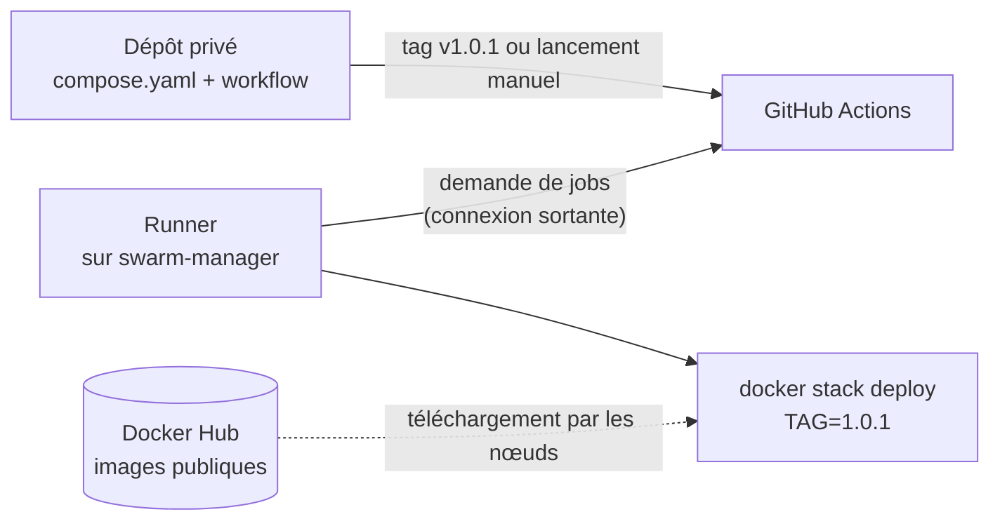

# Lab 14.1 : Déploiement automatisé sur Swarm

| | |
|---|---|
| **Durée** | 90 min |
| **Niveau** | Autonome |
| **Prérequis** | [Lab 13.2 : Tests et publication versionnée](../ch13-integration-continue/lab-13-2-tests-et-publication-versionnee.md) (images `<utilisateur>/qui-repond:1.0.0` et `1.0.1` publiées), cluster Swarm de trois nœuds en état, fichiers `compose.yaml` et `default.conf` du [Lab 12.1](../../partie-3-durcissement-et-orchestration-swarm/ch12-swarm-stacks-et-exploitation/lab-12-1-deployer-une-stack.md), cours du [chapitre 14](cours.md) |
| **Acquis visés** | AA9, AA8 |

!!! abstract "Objectifs"
    - Installer un runner auto-hébergé sur le manager et en mesurer les risques
    - Paramétrer un fichier de stack par une variable de version
    - Déployer une version précise de l'application depuis un workflow
    - Déclencher le déploiement manuellement, puis par un tag Git
    - Limiter les déploiements simultanés et contrôler leur déclenchement
    - Vérifier la version réellement en service

## Contexte et schéma

Vous automatisez le déploiement des images publiées au chapitre 13 sur votre cluster. Le code de l'application reste dans le dépôt public du chapitre 13. Le **déploiement** se fait depuis un **second dépôt, privé**, qui contient le fichier de stack et le workflow de livraison : un runner auto-hébergé sur le manager n'est jamais associé à un dépôt public (section 3 du [cours](cours.md)). Ce lab est **autonome** : seuls les objectifs et les critères de réussite sont donnés.

!!! warning "Risques du runner auto-hébergé"
    Le runner exécute le code des workflows **avec les droits de Docker** sur le manager. N'y associez que le dépôt **privé** de ce lab, ne l'ouvrez à personne d'autre, et supprimez-le à la fin du chapitre si vous n'en avez plus besoin (nettoyage en fin de lab).

## Étapes

### Étape 1 : Préparer l'état initial du cluster

- **Objectif :** partir d'un cluster sain, sans stack ni service.
- **Consignes :**
    - Vérifiez `docker node ls` (trois nœuds `Ready`) et `docker stack ls` : supprimez les stacks des labs précédents.
    - Vérifiez que la config `proxy_conf` existe (`docker config ls`) ; recréez-la depuis `default.conf` si nécessaire.
    - Vérifiez sur Docker Hub que les tags `1.0.0` et `1.0.1` existent et sont publics.

!!! success "Point de contrôle"
    - [ ] Le cluster est sain et sans stack
    - [ ] `proxy_conf` existe
    - [ ] Les deux tags de l'image sont accessibles publiquement

### Étape 2 : Créer le dépôt privé de déploiement

- **Objectif :** séparer le code de l'application de sa livraison.
- **Consignes :**
    - Créez sur GitHub un dépôt **privé** nommé `deploiement-qui-repond`, avec un fichier `README.md`.
    - Clonez-le sur `swarm-manager`.
    - Ajoutez-y votre fichier `compose.yaml` du Lab 12.1 (proxy et application), en remplaçant le tag de l'image de l'application par la variable `TAG`, **obligatoire** : le déploiement doit échouer avec un message clair si elle n'est pas définie (section 2.1 du cours). Conservez la contrainte de placement du proxy et la déclaration de la config `proxy_conf` en `external: true`.
    - Faites un `commit` et un `push`.

!!! success "Point de contrôle"
    - [ ] Le dépôt est privé (cadenas visible sur GitHub)
    - [ ] Le `compose.yaml` ne contient aucune version figée de l'image de l'application
    - [ ] `docker compose -f compose.yaml config` échoue **sans** `TAG` et réussit avec `TAG=1.0.0` exporté

### Étape 3 : Déployer à la main avec la variable

- **Objectif :** valider le fichier avant d'automatiser.
- **Consignes :**
    - Exportez `TAG=1.0.0` dans votre shell sur `swarm-manager`, puis déployez la stack `tp` avec `docker stack deploy`.
    - Vérifiez les services, les tâches et la réponse de l'application sur un nœud.
    - Supprimez ensuite la stack.

!!! success "Point de contrôle"
    - [ ] `tp_app` est à `3/3` avec l'image `1.0.0`
    - [ ] L'application répond sur le port 8080
    - [ ] Vous avez constaté qu'un déploiement **sans** `TAG` est refusé

### Étape 4 : Installer le runner auto-hébergé

- **Objectif :** permettre à GitHub d'exécuter des jobs sur le manager.
- **Consignes :**
    - Dans les paramètres du dépôt privé (*Actions*, puis *Runners*), ajoutez un runner auto-hébergé de système Linux et suivez les instructions affichées par GitHub, **sur `swarm-manager` uniquement**.
    - Vérifiez que l'utilisateur qui exécute le runner peut utiliser Docker (`docker ps` sans `sudo`).
    - Démarrez le runner (en premier plan pour ce lab, ou comme service si vous le souhaitez) et vérifiez qu'il apparaît **inactif** (*idle*) dans la liste des runners.
    - Notez dans votre compte rendu les droits de l'utilisateur du runner et ce qu'un job pourrait en faire.

!!! success "Point de contrôle"
    - [ ] Le runner est listé comme actif dans les paramètres du dépôt privé
    - [ ] Il n'est enregistré que pour ce dépôt
    - [ ] Vous avez décrit un risque lié à ses droits

### Étape 5 : Écrire le workflow de livraison manuel

- **Objectif :** déployer une version choisie par la personne qui déclenche.
- **Consignes :**
    - Créez `.github/workflows/livraison.yml` : déclencheur **manuel** avec une entrée `version`, job exécuté sur le runner auto-hébergé, étapes : récupérer le code, déployer la stack `tp` avec `TAG` défini à partir de l'entrée.
    - Transmettez l'entrée au shell par une **variable d'environnement**, comme indiqué à la section 4 du cours.
    - Donnez au workflow les permissions minimales.
    - Faites un `commit` et un `push`, puis lancez le workflow depuis l'onglet **Actions** avec la version `1.0.0`.

!!! success "Point de contrôle"
    - [ ] Le job est pris par votre runner (visible dans les journaux)
    - [ ] `tp_app` est à `3/3` avec l'image `1.0.0`
    - [ ] Aucune valeur sensible ne figure dans le workflow

### Étape 6 : Ajouter la vérification du déploiement

- **Objectif :** ne pas se contenter d'un déploiement « sans erreur ».
- **Consignes :**
    - Ajoutez une étape qui interroge l'application avec `curl --fail`, avec des tentatives espacées et une **limite de temps**, et qui échoue si l'application ne répond pas.
    - Lancez de nouveau le workflow : la vérification doit réussir.
    - Lancez-le ensuite avec une version **qui n'existe pas** (par exemple `9.9.9`) : observez ce qui se passe dans le cluster et dans le pipeline.
    - Rétablissez ensuite la version `1.0.0` en relançant le workflow.

!!! success "Point de contrôle"
    - [ ] La vérification réussit sur la version `1.0.0`
    - [ ] Le pipeline échoue de façon explicite avec la version inexistante, sans rester bloqué indéfiniment
    - [ ] L'application est de nouveau en `1.0.0` à la fin de l'étape

!!! info "À noter pour le Lab 14.2"
    Vous constaterez que, sans retour arrière, une version défectueuse reste partiellement déployée. Le [Lab 14.2](lab-14-2-pipeline-complet-avec-retour-arriere.md) traite ce cas.

### Étape 7 : Déployer la version suivante sans coupure

- **Objectif :** passer de `1.0.0` à `1.0.1` pendant que l'application est utilisée.
- **Consignes :**
    - Dans un second terminal, lancez une boucle de requêtes qui affiche le code HTTP et le début de la réponse, une fois par seconde.
    - Lancez le workflow avec la version `1.0.1`.
    - Observez `docker service ps tp_app` pendant le déploiement, puis la réponse de l'application.

!!! success "Point de contrôle"
    - [ ] La boucle ne montre aucune erreur pendant la mise à jour
    - [ ] L'application répond avec le contenu de la version `1.0.1`
    - [ ] `docker service inspect --pretty tp_app` affiche l'image `1.0.1`

### Étape 8 : Déclencher le déploiement par un tag Git

- **Objectif :** faire d'un tag la décision de livraison.
- **Consignes :**
    - Modifiez le workflow pour qu'il se déclenche aussi lorsqu'un **tag Git** `v*` est envoyé dans le **dépôt de déploiement**, et que la version déployée soit alors déduite du tag (sans le préfixe `v`).
    - Vérifiez que le workflow ne se déclenche **pas** sur un simple `push` de branche.
    - Créez et envoyez le tag `v1.0.0` : la version `1.0.0` doit être déployée. Puis `v1.0.1`.

!!! success "Point de contrôle"
    - [ ] Un `push` de branche ne déclenche aucun déploiement
    - [ ] Le tag `v1.0.0` déploie l'image `1.0.0`, puis `v1.0.1` déploie l'image `1.0.1`
    - [ ] Vous savez expliquer pourquoi la version est déduite du tag et non saisie à la main

### Étape 9 : Limiter les déploiements simultanés

- **Objectif :** éviter que deux déploiements se mélangent.
- **Consignes :**
    - Ajoutez au workflow une règle de **concurrence** : un seul déploiement à la fois, sans interrompre celui en cours.
    - Lancez deux fois de suite le workflow manuel (par exemple `1.0.0` puis `1.0.1`) sans attendre la fin du premier.
    - Observez l'état du second lancement dans l'onglet **Actions**.

!!! success "Point de contrôle"
    - [ ] Le second lancement attend la fin du premier
    - [ ] Aucune exécution n'a été annulée
    - [ ] La version finale en service est celle du **dernier** lancement

### Étape 10 : Contrôler la livraison avec un environnement

- **Objectif :** rendre la livraison « continue » ou « déploiement continu » selon le besoin.
- **Consignes :**
    - Rattachez le job à un **environnement** `production` (section 5 du cours).
    - Si les règles de protection sont disponibles pour votre dépôt, ajoutez une **approbation manuelle** et relancez un déploiement : constatez qu'il attend votre validation. Sinon, notez dans votre compte rendu que la fonction n'est pas disponible et gardez le lancement manuel comme garde-fou.
    - Répondez par écrit : dans votre configuration, s'agit-il de **livraison continue** ou de **déploiement continu** ?

!!! success "Point de contrôle"
    - [ ] Le job est bien rattaché à l'environnement
    - [ ] Vous avez testé l'approbation, ou vous avez expliqué pourquoi elle n'est pas disponible
    - [ ] Votre réponse sur le type de livraison est justifiée

### Étape 11 : Dresser le bilan

- **Objectif :** retenir ce qui fait la sûreté du déploiement.
- **Consignes :** complétez le tableau à partir de ce que vous avez réalisé.

| Élément | Rôle | Risque s'il est mal configuré |
|---|---|---|
| Dépôt privé | | |
| Runner auto-hébergé | | |
| Variable `TAG` obligatoire | | |
| Vérification après déploiement | | |
| Concurrence | | |
| Environnement et approbation | | |

!!! success "Point de contrôle"
    - [ ] Chaque ligne est complétée avec vos propres observations

## Questions de réflexion

??? question "Pourquoi le déploiement se fait-il depuis un dépôt privé distinct du code de l'application ?"
    Le runner auto-hébergé a les droits de Docker sur le manager : il ne doit exécuter que du code de confiance. Un dépôt public permettrait à un tiers de proposer du code qui s'exécuterait sur votre manager. Séparer aussi la livraison du code permet de donner des droits différents aux personnes qui écrivent l'application et à celles qui la déploient.

??? question "Pourquoi un déploiement sans la variable `TAG` doit-il échouer plutôt qu'utiliser une valeur par défaut ?"
    Une valeur par défaut (par exemple `latest`) pourrait déployer à l'insu de l'équipe une version non voulue. Un échec explicite force à désigner la version.

??? question "Pourquoi vérifier l'application après le déploiement, alors que la commande se termine sans erreur ?"
    La commande lance la mise à jour mais ne garantit pas son résultat : l'application peut démarrer sans répondre correctement. La vérification fait échouer le pipeline dans ce cas.

??? question "Que se passe-t-il si deux déploiements s'exécutent en même temps sans règle de concurrence ?"
    Ils modifient la même stack simultanément : l'état final dépend de l'ordre d'exécution et peut ne correspondre à aucune des deux versions voulues. La concurrence les met en file.

## Dépannage

| Symptôme | Pistes |
|---|---|
| Le job reste en attente (`Waiting for a runner`) | Runner arrêté, machine éteinte, dépôt différent, ou étiquette de `runs-on` qui ne correspond pas à celle du runner |
| `docker: permission denied` dans le job | L'utilisateur du runner n'est pas dans le groupe `docker` : ajoutez-le, puis redémarrez le runner |
| Message d'erreur sur la variable `TAG` | La variable n'est pas exportée dans l'étape qui lance `docker stack deploy`, ou le nom diffère |
| `config proxy_conf not found` | La config n'existe plus : recréez-la depuis `default.conf` |
| `tp_app` reste à `0/3` | Image ou tag introuvable (`docker stack ps tp --no-trunc`) |
| Le déploiement semble réussi mais l'ancienne version répond | Mise à jour en cours : patientez et relisez `docker service ps`, ou la variable `TAG` n'a pas la valeur attendue |
| Le workflow ne se déclenche pas sur le tag | Motif de tag absent de `on.push.tags`, tag créé avant le workflow, ou tag non envoyé (`git push origin <tag>`) |
| Les deux déploiements s'exécutent en parallèle | `concurrency` absent, ou groupes de noms différents |
| Aucune approbation demandée | Les règles de protection ne sont pas disponibles pour ce dépôt ou ne sont pas configurées sur l'environnement |
| La boucle `curl` s'arrête à `Connection refused` | Le nœud interrogé est en cours de mise à jour ou n'est pas celui qui répond : visez un autre nœud |

## Nettoyage et reprise

**Conservez** le dépôt privé, le runner et la stack `tp` en version `1.0.1` : le [Lab 14.2](lab-14-2-pipeline-complet-avec-retour-arriere.md) les réutilise. À la fin du chapitre, si vous n'avez plus besoin du déploiement automatisé, supprimez le runner dans les paramètres du dépôt (et désinstallez-le de la machine en suivant les instructions de GitHub), puis arrêtez-le : un runner inutilisé reste une porte ouverte vers votre manager.

## Retour au chapitre

[Chapitre 14 : Livraison continue](cours.md) · Lab suivant : [Lab 14.2 : Pipeline complet avec retour arrière](lab-14-2-pipeline-complet-avec-retour-arriere.md)