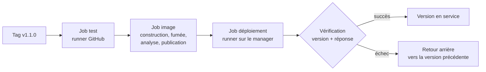

# Lab 14.2 : Pipeline complet avec retour arrière

| | |
|---|---|
| **Durée** | 90 min |
| **Niveau** | Autonome |
| **Prérequis** | [Lab 14.1 : Déploiement automatisé sur Swarm](lab-14-1-deploiement-automatise-sur-swarm.md) (dépôt privé, runner actif, stack `tp` en `1.0.1`), [Lab 13.2 : Tests et publication versionnée](../ch13-integration-continue/lab-13-2-tests-et-publication-versionnee.md) (workflows de test et de publication), cours du [chapitre 14](cours.md) |
| **Acquis visés** | AA9, AA8 |

!!! abstract "Objectifs"
    - Chaîner test, construction, analyse, publication, déploiement et vérification dans un seul pipeline
    - Constater qu'un déploiement « réussi » peut cacher un retour arrière de Swarm
    - Vérifier la **version** réellement en service, pas seulement la réponse de l'application
    - Revenir automatiquement à la version précédente quand la vérification échoue
    - Remettre le dépôt, le fichier de stack et le cluster en cohérence après un incident

## Contexte et schéma

Vous assemblez le pipeline complet. Une seule action de l'équipe (poser un tag Git) doit tester, construire, publier et déployer une version, puis la vérifier ; en cas d'échec, l'application doit revenir seule à la version précédente. Ce lab est **autonome** : seuls les objectifs et les critères de réussite sont donnés. Appuyez-vous sur les chapitres 12, 13 et 14.

!!! note "Un seul dépôt privé"
    Le déploiement ne peut s'exécuter que dans le dépôt **privé** auquel le runner est rattaché (Lab 14.1). Pour chaîner les jobs, vous **regroupez** dans ce dépôt le code de l'application et les workflows du chapitre 13. Le dépôt public du chapitre 13 n'est plus modifié.

## Étapes

### Étape 1 : Regrouper le code et le pipeline dans le dépôt privé

- **Objectif :** disposer, dans `deploiement-qui-repond`, de tout ce qu'il faut pour construire et déployer.
- **Consignes :**
    - Copiez dans le dépôt privé le code de l'application, son `Dockerfile`, ses tests et les fichiers qui en dépendent (sans l'historique Git du dépôt public).
    - Recréez dans ce dépôt les **secrets** `DOCKERHUB_USERNAME` et `DOCKERHUB_TOKEN` (les secrets ne se transfèrent pas d'un dépôt à l'autre). Vous pouvez réutiliser le jeton ou en créer un nouveau.
    - Vérifiez que le build local fonctionne (`docker build`) et que les tests passent en local.
    - Faites un `commit` et un `push`.

!!! success "Point de contrôle"
    - [ ] Le dépôt privé contient le code, le `Dockerfile`, les tests et le `compose.yaml`
    - [ ] Les deux secrets existent dans ce dépôt
    - [ ] Aucun secret n'est versionné

### Étape 2 : Vérifier la politique de mise à jour de la stack

- **Objectif :** s'assurer que Swarm sait revenir en arrière de lui-même.
- **Consignes :**
    - Dans `compose.yaml`, vérifiez que l'application a une section `update_config` avec un retour arrière automatique en cas d'échec, une mise à jour **une tâche à la fois**, et un démarrage de la nouvelle tâche **avant** l'arrêt de l'ancienne.
    - Complétez le fichier si nécessaire, puis redéployez à la main la version `1.0.1` pour que le service porte cette politique.

!!! success "Point de contrôle"
    - [ ] `docker service inspect --pretty tp_app` affiche la politique de mise à jour voulue
    - [ ] L'application est en `1.0.1` sur trois répliques

### Étape 3 : Écrire le pipeline complet

- **Objectif :** un workflow unique qui enchaîne toutes les étapes.
- **Consignes :**
    - Créez `.github/workflows/pipeline.yml` à partir des workflows du chapitre 13 et du workflow de livraison du Lab 14.1. Il comporte trois jobs liés par `needs` :
        1. **`test`** : tests unitaires (runner hébergé par GitHub) ;
        2. **`image`** : construction, test de fumée, analyse Trivy, publication avec les tags de version et d'empreinte (runner hébergé) ;
        3. **`deploiement`** : exécuté sur le **runner auto-hébergé**, rattaché à l'environnement `production`, avec la règle de concurrence du Lab 14.1.
    - Déclenchement : un tag `v*` exécute les trois jobs ; un `push` sur `main` exécute seulement `test` et `image`, **sans publier** (sauf si vous l'avez décidé autrement au chapitre 13 : justifiez votre choix).
    - Désactivez dans `livraison.yml` le déclenchement par tag (pour éviter un double déploiement) ; conservez-y le lancement **manuel**.
    - Les jobs reçoivent les permissions minimales.

!!! success "Point de contrôle"
    - [ ] Le graphe des jobs affiché par GitHub montre l'enchaînement `test`, `image`, `deploiement`
    - [ ] Un `push` sur `main` ne déploie rien
    - [ ] Un seul workflow se déclenche sur un tag (pas de double déploiement)

### Étape 4 : Livrer une nouvelle version de bout en bout

- **Objectif :** exécuter la chaîne complète.
- **Consignes :**
    - Modifiez le texte de la réponse de l'application, faites un `commit` et un `push` sur `main`, puis vérifiez que seuls `test` et `image` s'exécutent.
    - Créez et envoyez le tag `v1.1.0` : observez les trois jobs.
    - Vérifiez sur Docker Hub les tags publiés, et sur le cluster la version en service (`docker service inspect --pretty tp_app`).

!!! success "Point de contrôle"
    - [ ] Les trois jobs réussissent pour le tag `v1.1.0`
    - [ ] Docker Hub contient les tags `1.1.0` et `sha-…`
    - [ ] L'application en service répond avec le nouveau texte, avec l'image `1.1.0`

### Étape 5 : Constater l'arrêt de la chaîne sur un test défaillant

- **Objectif :** montrer que rien n'est publié ni déployé quand un contrôle échoue.
- **Consignes :**
    - Sur une branche, faites échouer un test, fusionnez dans `main`, puis envoyez un tag **de pré-version** (par exemple `v1.1.1-rc1`) sur ce commit. Adaptez le déclencheur du workflow si nécessaire.
    - Observez quels jobs s'exécutent, lesquels sont ignorés, et vérifiez que Docker Hub et le cluster sont inchangés.
    - Corrigez le test, puis supprimez le tag de pré-version du dépôt (local et distant).

!!! success "Point de contrôle"
    - [ ] `image` et `deploiement` ne s'exécutent pas (état « ignoré »)
    - [ ] Aucun nouveau tag n'apparaît sur Docker Hub
    - [ ] La version en service est restée `1.1.0`

### Étape 6 : Provoquer un échec en production

- **Objectif :** produire une version qui passe la CI mais **ne peut pas** démarrer sur le cluster.
- **Consignes :**
    - Dans `compose.yaml`, introduisez une erreur de configuration qui empêche les **nouvelles tâches de démarrer** sans empêcher l'image de se construire ni de passer les tests : par exemple une limite de mémoire beaucoup trop basse pour l'application, ou toute autre erreur de configuration de votre choix (notez laquelle).
    - Faites un `commit`, puis envoyez le tag `v1.1.2`.
    - Observez en parallèle `docker service ps tp_app`, `docker service inspect --pretty tp_app` (champ `UpdateStatus`) et le résultat du pipeline.

!!! success "Point de contrôle"
    - [ ] Les nouvelles tâches échouent à démarrer sur le cluster
    - [ ] Swarm revient seul à la version précédente
    - [ ] Vous avez noté le **statut final du pipeline** (vert ou rouge)
    - [ ] Vous pouvez expliquer pourquoi la vérification de l'étape 4, qui ne teste que la réponse de l'application, peut dans ce cas passer

!!! info "Ce que vous devez constater"
    Si le pipeline est resté **vert** alors que `v1.1.2` n'est pas en service, la vérification est insuffisante : elle a validé… l'ancienne version, remise en place par Swarm. C'est l'objet de l'étape suivante.

### Étape 7 : Vérifier la version en service, pas seulement la réponse

- **Objectif :** faire échouer le pipeline quand la version voulue n'est pas celle qui tourne.
- **Consignes :**
    - Renforcez l'étape de vérification du job `deploiement` : elle doit contrôler que
        1. l'image du service `tp_app` correspond à la version voulue (`TAG`) ;
        2. l'état de la mise à jour du service (`UpdateStatus`, voir `docker service inspect`) est celui d'une mise à jour **terminée avec succès**, et non d'un retour arrière ;
        3. l'application répond (comme précédemment), avec une limite de temps.
    - Choisissez les champs et les valeurs en consultant `docker service inspect` (format `--format` avec un modèle Go, ou sortie JSON), et testez votre vérification à la main sur le cluster avant de l'intégrer.
    - Relancez la livraison de la version défectueuse (nouveau tag `v1.1.3` avec la même erreur) et vérifiez que le pipeline devient **rouge**.

!!! success "Point de contrôle"
    - [ ] Avec la version défectueuse, le pipeline échoue sur l'étape de vérification, avec un message explicite
    - [ ] Avec une version saine, la vérification réussit
    - [ ] Vous avez testé votre commande de vérification à la main avant de l'intégrer

### Étape 8 : Revenir automatiquement à la version précédente

- **Objectif :** que l'échec de la vérification laisse le cluster dans un état connu et sain.
- **Consignes :**
    - Ajoutez au job `deploiement` :
        - une étape qui **mémorise** la version en service **avant** le déploiement (transmise aux étapes suivantes) ;
        - une étape de **retour arrière**, exécutée seulement en cas d'échec, qui rétablit cette version.
    - Choisissez la méthode de retour arrière (section 8 du cours) : `docker service rollback`, ou redéploiement du `TAG` précédent. Justifiez votre choix et son inconvénient dans le compte rendu.
    - Relancez la livraison de la version défectueuse (`v1.1.4`) et observez : échec de la vérification, puis retour arrière, puis état final.

!!! success "Point de contrôle"
    - [ ] Après l'échec, la version en service est celle d'avant le déploiement, sur trois répliques
    - [ ] Le pipeline est **rouge**, et le retour arrière est visible dans les journaux
    - [ ] Une version saine ne déclenche aucun retour arrière
    - [ ] Vous avez décrit l'inconvénient de la méthode choisie

### Étape 9 : Remettre le dépôt en cohérence

- **Objectif :** que Git, le fichier de stack et le cluster décrivent le même état.
- **Consignes :**
    - Corrigez l'erreur de configuration dans `compose.yaml` (annulation du commit fautif avec `git revert`, ou correction explicite).
    - Livrez une version corrigée avec un nouveau tag (`v1.1.5`).
    - Vérifiez que le tag, l'image publiée, le fichier de stack et la version en service sont cohérents.
    - Supprimez, si vous le souhaitez, les tags `v1.1.2` à `v1.1.4` qui ne correspondent à aucune version valide, ou documentez-les comme **versions abandonnées**.

!!! success "Point de contrôle"
    - [ ] La version `1.1.5` est en service, issue du fichier de stack corrigé
    - [ ] Un redéploiement du fichier ne réinstalle pas l'erreur
    - [ ] Vous savez dire quelles versions sont valides et lesquelles sont abandonnées

### Étape 10 : Dresser l'historique des livraisons

- **Objectif :** retracer ce qui s'est passé.
- **Consignes :** complétez le tableau à partir de l'historique de l'onglet **Actions** et de Docker Hub.

| Tag Git | Image publiée | Résultat du pipeline | Version en service ensuite |
|---|---|---|---|
| `v1.1.0` | | | |
| `v1.1.1-rc1` | | | |
| `v1.1.2` | | | |
| `v1.1.3` | | | |
| `v1.1.4` | | | |
| `v1.1.5` | | | |

!!! success "Point de contrôle"
    - [ ] Le tableau est complété et cohérent avec les observations des étapes précédentes
    - [ ] Chaque échec est relié à l'étape qui l'a détecté

## Questions de réflexion

??? question "Pourquoi le pipeline de l'étape 6 est-il resté vert alors que la nouvelle version n'était pas en service ?"
    Swarm a annulé de lui-même la mise à jour (`failure_action: rollback`) et l'ancienne version a continué de répondre : la vérification qui ne contrôle que la réponse de l'application a validé l'ancienne version. Il faut vérifier la **version** et l'**état de la mise à jour**.

??? question "Pourquoi ne reconstruit-on pas l'image dans le job de déploiement ?"
    Pour déployer exactement l'image qui a passé les tests et l'analyse. Une reconstruction pourrait produire une image différente de celle qui a été contrôlée.

??? question "Pourquoi mémoriser la version en service avant de déployer ?"
    Pour savoir à quelle version revenir. Sans cette information, un retour arrière automatique par redéploiement n'est pas possible, et `docker service rollback` ne permet pas de choisir la version rétablie.

??? question "Après le retour arrière, pourquoi faut-il encore corriger Git ?"
    Le retour arrière répare le cluster, pas le dépôt : le commit fautif y est toujours, et le prochain déploiement le réinstallerait. Git doit redevenir la source de vérité de ce qui est déployé.

??? question "Que protège la concurrence du workflow pendant un retour arrière ?"
    Elle empêche qu'un autre déploiement démarre pendant que l'on rétablit la version précédente : deux opérations simultanées sur la même stack donneraient un état imprévisible.

## Dépannage

| Symptôme | Pistes |
|---|---|
| Le job `deploiement` ne démarre pas | `needs` mal écrit, job `image` en échec, runner arrêté, ou environnement en attente d'approbation |
| `docker: permission denied` | L'utilisateur du runner n'a pas accès à Docker (voir Lab 14.1) |
| Deux déploiements pour un même tag | Le déclenchement par tag est resté actif dans `livraison.yml` |
| Le job `image` échoue à la publication | Secrets absents du dépôt privé, jeton sans droit d'écriture, ou nom d'image sans votre nom d'utilisateur |
| La version défectueuse du Lab ne se comporte pas comme prévu | L'erreur choisie ne fait pas échouer les tâches : elle doit empêcher leur démarrage sur le cluster (journaux de `docker service ps --no-trunc`) |
| La vérification passe alors que le déploiement a échoué | Elle ne contrôle ni l'image, ni l'état de la mise à jour du service |
| La vérification échoue alors que le déploiement a réussi | La mise à jour n'est pas terminée au moment du contrôle : prévoyez une attente avec limite de temps |
| L'étape de retour arrière ne s'exécute pas | La condition de l'étape ne porte pas sur l'échec, ou l'échec s'est produit avant son démarrage |
| La version mémorisée est vide ou erronée | L'étape de mémorisation n'a pas transmis sa valeur aux étapes suivantes, ou s'exécute après le déploiement |
| `git revert` crée un conflit | Des modifications ultérieures touchent les mêmes lignes : résolvez-les à la main |

## Nettoyage et reprise

Ce lab est le dernier du chapitre. **Conservez** le dépôt privé et le pipeline : le [projet final](../../projet-final.md) peut les réutiliser. En fin de projet, ou si vous n'avez plus besoin du déploiement automatisé, supprimez le runner (paramètres du dépôt, puis désinstallation sur la machine) et arrêtez-le, puis supprimez la stack avec `docker stack rm tp`. Révoquez les jetons Docker Hub devenus inutiles.

## Retour au chapitre

[Chapitre 14 : Livraison continue](cours.md) · [Retour à l'index de la partie 4](../index.md)