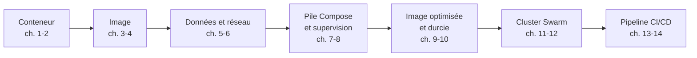

# Chapitre 15 : Synthèse et ouverture vers Kubernetes

!!! abstract "Objectifs du chapitre"
    - Faire le bilan des acquis d'apprentissage AA1 à AA9 et les relier aux chapitres, labs et mini-projets
    - Reconstituer le parcours d'une application, du premier `docker run` au pipeline de livraison
    - Appliquer une liste de bonnes pratiques de bout en bout
    - Situer les limites de Docker Swarm
    - Faire le lien entre les concepts de ce cours et ceux de Kubernetes
    - Préparer le projet final
    - Acquis d'apprentissage visés : **AA1 à AA9**

## 1. Le parcours accompli

Au début de ce cours, vous lanciez un conteneur à la main. Vous savez maintenant décrire, construire, sécuriser, déployer et livrer une application conteneurisée sur un cluster, par un pipeline automatisé. Ce chapitre fait le point, avant le projet final.

### 1.1 Les neuf acquis d'apprentissage

| Acquis | Vous savez… | Chapitres | Où vous l'avez mis en pratique |
|---|---|---|---|
| **AA1** | Expliquer le fonctionnement des conteneurs et l'architecture de Docker | 1 | Labs 1.1 et 1.2 |
| **AA2** | Créer, exécuter et gérer le cycle de vie des conteneurs | 2 | Labs 2.1 et 2.2 |
| **AA3** | Construire, versionner et distribuer des images via des registres | 3, 4, 9 | Labs 3.1 à 4.1, [mini-projet 1](../../partie-1-fondations/mini-projet-1.md) |
| **AA4** | Gérer la persistance des données et le réseau des conteneurs | 5, 6 | Labs 5.1 à 6.2 |
| **AA5** | Orchestrer une application multi-conteneurs avec Docker Compose | 7 | Labs 7.1 et 7.2, [mini-projet 2](../../partie-2-donnees-reseau-et-exploitation/mini-projet-2.md) |
| **AA6** | Superviser et diagnostiquer des conteneurs en exploitation | 8 | Labs 8.1 et 8.2 |
| **AA7** | Optimiser et sécuriser des images et des conteneurs | 9, 10 | Labs 9.1 à 10.2, [mini-projet 3](../../partie-3-durcissement-et-orchestration-swarm/mini-projet-3.md) |
| **AA8** | Déployer et exploiter une application sur un cluster Docker Swarm | 11, 12, 14 | Labs 11.1 à 12.2, 14.1, mini-projet 3 |
| **AA9** | Automatiser la construction, les tests et la livraison par un pipeline CI/CD | 13, 14 | Labs 13.1 à 14.2 |

!!! tip "Faites votre propre bilan"
    Pour chaque acquis, demandez-vous : « Pourrais-je le refaire **sans** le sujet de lab, avec la documentation seulement ? » Les acquis où la réponse est non sont ceux à retravailler avant le projet final : relisez le chapitre, puis refaites le lab correspondant.

### 1.2 Le fil conducteur : une application, plusieurs états

Une même application a traversé tout le cours, en changeant de forme à chaque étape.

| Étape | Forme de l'application | Ce qui a été ajouté |
|---|---|---|
| Chapitres 1 et 2 | Un conteneur lancé à la main | Cycle de vie, ports, variables, journaux |
| Chapitres 3 et 4 | Une image versionnée, publiée sur Docker Hub | Dockerfile, couches, tags, registre |
| Chapitres 5 et 6 | Un conteneur avec volume et réseau | Persistance, isolation par réseaux, DNS |
| Chapitres 7 et 8 | Une pile Compose supervisée | Healthchecks, limites, diagnostic |
| Chapitres 9 et 10 | Une image petite, sans privilèges inutiles, analysée | Multi-stage, utilisateur non root, secrets, Trivy |
| Chapitres 11 et 12 | Une stack répliquée sur trois nœuds | Services, overlay, secrets Swarm, mises à jour |
| Chapitres 13 et 14 | Une version livrée par pipeline | Tests, tags de version, déploiement, retour arrière |

## 2. Les bonnes pratiques de bout en bout

Voici une liste de contrôle qui regroupe ce que vous avez rencontré. Elle sert à relire un projet avant de le livrer.

### 2.1 Images

| Pratique | Pourquoi | Chapitre |
|---|---|---|
| Fixer la version de l'image de base (`python:3.12-slim`, pas `latest`) | Reproductibilité | 3, 4 |
| Ordonner le Dockerfile pour tirer parti du cache | Constructions rapides | 3 |
| Utiliser un `.dockerignore` | Contexte léger, pas de fichier sensible envoyé | 3 |
| Construire en multi-stage et choisir une base minimale | Image petite, moins de surface d'attaque | 9 |
| Ne jamais écrire de secret dans l'image | Une image se partage, ses couches se lisent | 2, 10 |
| Analyser l'image et traiter les vulnérabilités graves | Détecter les failles connues | 10 |

### 2.2 Conteneurs

| Pratique | Pourquoi | Chapitre |
|---|---|---|
| Un processus principal par conteneur, configuré par variables ou fichiers | Conteneurs simples et remplaçables | 2 |
| Exécuter en utilisateur non root, retirer les privilèges inutiles, système de fichiers en lecture seule si possible | Moindre privilège | 10 |
| Fixer des limites de mémoire et de processeur justifiées par des mesures | Un conteneur ne doit pas affecter les autres | 2, 8 |
| Définir un healthcheck | L'état de santé est visible et exploitable | 7, 8 |

### 2.3 Données et réseau

| Pratique | Pourquoi | Chapitre |
|---|---|---|
| Placer les données à conserver dans des volumes nommés | Les données survivent au conteneur | 5 |
| Sauvegarder, et **tester la restauration** | Une sauvegarde non testée n'est pas une garantie | 5 |
| Cloisonner par réseaux, n'exposer que le point d'entrée, publier sur l'interface locale si possible | Réduire l'exposition | 6 |
| Joindre les services par leur nom, pas par leur adresse IP | Les adresses changent | 6 |

### 2.4 Pile applicative et exploitation

| Pratique | Pourquoi | Chapitre |
|---|---|---|
| Décrire l'application dans un fichier versionné (Compose, stack) | Reproductible, relisible, partageable | 7, 12 |
| Sortir la configuration du fichier (`.env` non versionné, secrets) | Pas de secret dans le dépôt | 7, 10, 12 |
| Superviser avec journaux, état, consommation et espace disque | Voir avant que cela tombe | 8 |
| Diagnostiquer avec méthode : symptôme, état, journaux, configuration, réseau, ressources | Éviter les essais au hasard | 8 |

### 2.5 Cluster et livraison

| Pratique | Pourquoi | Chapitre |
|---|---|---|
| Un nombre impair de managers, sauvegarde de la configuration du cluster | Conserver le quorum | 11 |
| Placer les tâches avec des contraintes, comprendre qu'un volume est local à un nœud | Éviter la perte de données à la panne d'un nœud | 12 |
| Mettre à jour par lots, avec retour arrière automatique en cas d'échec | Pas d'interruption, pas de version défectueuse | 12 |
| Automatiser construction, tests, analyse et publication | Résultats reproductibles | 13 |
| Publier des tags **immuables** (version, empreinte du commit), jamais `latest` en production | Traçabilité et retour arrière | 13, 14 |
| Garder les identifiants dans les secrets du pipeline, avec un jeton à droits limités | Éviter les fuites | 13 |
| Vérifier le déploiement (version et comportement) et revenir en arrière automatiquement | Ne pas confondre commande réussie et application en service | 14 |
| Limiter qui peut déclencher un déploiement, et ne pas ouvrir un runner à des tiers | Le pipeline a les droits sur la production | 14 |

!!! note "Une règle qui revient partout"
    Presque toutes ces pratiques appliquent trois idées : **tout est décrit dans des fichiers versionnés**, **rien de sensible n'est écrit dans ces fichiers**, et **chaque étape est vérifiée automatiquement**.

## 3. Les limites de Docker Swarm

Swarm vous a permis de comprendre l'orchestration avec des outils proches de ceux que vous connaissiez déjà. Il a aussi des limites, dont certaines ont été rencontrées dans les labs.

| Limite | Ce que vous avez observé | Chapitre |
|---|---|---|
| **Données** : un volume nommé est local à un nœud, et Swarm ne fournit pas de stockage partagé | Les données de `memo` restent sur le nœud en panne | 12 |
| **Mise à l'échelle manuelle** : le nombre de répliques est fixé par vous, Swarm ne l'ajuste pas à la charge | `docker service scale`, `replicas` dans le fichier | 11, 12 |
| **Fonctionnalités avancées plus limitées** que dans les grands orchestrateurs (réglage fin du placement, extensions) | Quelques contraintes et étiquettes | 12 |
| **Écosystème plus restreint** d'outils et d'intégrations | Peu d'outils tiers pour les labs | 12 |
| **Sécurité du cluster** : un manager a tous les droits, un secret est lisible par qui contrôle un nœud | Section sur les secrets | 12 |
| **Un seul manager dans vos TP** : aucune tolérance à sa panne | Avertissement du Lab 12.2 | 11, 12 |

!!! info "Ce que cela signifie"
    Ces limites ne rendent pas Swarm « mauvais » : pour une petite infrastructure et une équipe réduite, un outil simple et intégré à Docker est un vrai avantage. Elles expliquent pourquoi des infrastructures plus grandes ou plus exigeantes choisissent d'autres orchestrateurs.

## 4. Passer à Kubernetes

**Kubernetes** est aujourd'hui l'orchestrateur le plus répandu. Vous le retrouverez dans le cours Kubernetes de ce Master, qui prolonge celui-ci. Une grande partie de ce que vous avez appris **se transpose directement**.

### 4.1 Ce qui reste valable

| Ce que vous avez appris | Dans Kubernetes |
|---|---|
| Une **image** OCI, construite avec un Dockerfile, publiée dans un registre | Les mêmes images : celles que vous avez construites peuvent être déployées sur Kubernetes |
| Les notions de **conteneur**, d'isolation (namespaces, cgroups), de limites de ressources | Identiques : Kubernetes exécute les mêmes conteneurs |
| La logique d'**état désiré** décrit dans un fichier et réconcilié par le cluster | C'est le cœur de Kubernetes |
| Les **healthchecks** | Remplacés par des sondes configurables (*probes*) |
| La **démarche de diagnostic** et la lecture des journaux | La même démarche, avec d'autres commandes |
| Le **pipeline** CI/CD | Les mêmes étapes (construire, tester, publier, déployer) |

Le moteur qui exécute les conteneurs sur un nœud Kubernetes est un *runtime* compatible avec l'interface standard **CRI**, comme **containerd** que vous avez rencontré au chapitre 1.

### 4.2 Correspondance des concepts

Reprenez le tableau du [chapitre 12](../../partie-3-durcissement-et-orchestration-swarm/ch12-swarm-stacks-et-exploitation/cours.md) et élargissez-le à l'ensemble du cours :

| Dans ce cours | Équivalent approximatif dans Kubernetes |
|---|---|
| Fichier Compose ou de stack | Manifestes (fichiers YAML) |
| `docker` et `docker stack` | `kubectl` |
| Service Swarm répliqué | Deployment |
| Tâche (un conteneur) | Pod (un ou plusieurs conteneurs) |
| Réseau overlay, routing mesh | Service, réseau du cluster |
| Config / Secret | ConfigMap / Secret |
| Volume nommé | Volume, avec des notions de stockage persistant |
| Contraintes de placement, étiquettes | Sélecteurs, affinités |
| Mise à jour progressive et `rollback` | Stratégie du Deployment, `rollout undo` |
| Manager / worker | Plan de contrôle / nœuds de travail |

!!! warning "Équivalent approximatif"
    Une correspondance n'est pas une identité : chaque concept a ses propres règles et ses propres limites. Ce tableau vous aide à vous repérer, pas à traduire mot à mot.

### 4.3 Ce que Kubernetes ajoute

À titre d'aperçu, voici des notions que vous rencontrerez dans le cours suivant, et que ce cours n'a pas abordées :

- le **Pod** comme unité de déploiement, qui regroupe des conteneurs partageant réseau et stockage ;
- les **espaces de noms** (*namespaces*), qui partagent un cluster entre équipes ou environnements ;
- l'**exposition des applications** vers l'extérieur par des objets dédiés ;
- le **stockage persistant** géré comme une ressource du cluster ;
- le **contrôle d'accès** par rôles ;
- les **outils de packaging** et un écosystème très vaste.

## 5. Préparer le projet final

Le [projet final](../../projet-final.md) réunit les acquis AA1 à AA9 sur une même application. Pour bien l'aborder :

1. **relisez** votre bilan de la section 1.1 et retravaillez les acquis les moins sûrs ;
2. **reprenez** la liste de contrôle de la section 2 : elle vous servira à relire votre propre travail avant de le rendre ;
3. **conservez** les dépôts, workflows et fichiers de vos labs et mini-projets : vous pouvez les réutiliser ;
4. **lisez** attentivement l'énoncé du projet final, avec sa grille d'évaluation, avant de commencer ;
5. **documentez** au fur et à mesure : le rapport et la soutenance s'appuient sur ce que vous pouvez montrer et prouver.

## À retenir

!!! tip "À retenir"
    - Vous disposez d'une chaîne complète : conteneur, image, données et réseau, pile, supervision, durcissement, orchestration, pipeline.
    - Les bonnes pratiques se résument en trois idées : tout est décrit dans des **fichiers versionnés**, rien de **sensible** n'est écrit dans ces fichiers, chaque étape est **vérifiée automatiquement**.
    - Swarm est simple et intégré, mais limité pour les données, la mise à l'échelle automatique et l'écosystème.
    - Les **images**, les conteneurs, la logique d'état désiré et la démarche de diagnostic **se transposent** à Kubernetes ; les concepts de Kubernetes ont des équivalents approximatifs, pas identiques.
    - Le projet final réutilise l'ensemble de ces acquis : préparez-le avec votre bilan et votre liste de contrôle.

## Pour vérifier votre compréhension

??? question "Une image que vous avez publiée sur Docker Hub peut-elle être déployée sur Kubernetes ? Pourquoi ?"
    Oui : une image conforme aux normes OCI se déploie sur n'importe quel orchestrateur qui peut la télécharger. Ce que vous avez appris sur les Dockerfile, les tags, l'optimisation et la sécurité des images reste valable.

??? question "Pourquoi dit-on que le fichier de stack est « la référence » de l'état désiré, et quel concept de Kubernetes est proche ?"
    Le cluster est amené à l'état décrit par le fichier : on modifie le fichier plutôt que les services. Kubernetes repose sur la même logique : on décrit l'état désiré dans des manifestes, et le cluster le réalise.

??? question "Quelles limites de Swarm avez-vous rencontrées au cours de ce cours ?"
    Les volumes locaux à un nœud et l'absence de stockage partagé (perte de données lors de la panne d'un nœud), la mise à l'échelle manuelle, le manager unique des TP qui n'offre aucune tolérance à sa propre panne.

??? question "Citez trois pratiques qui protègent les secrets, de la construction à la livraison."
    Ne pas écrire de secret dans l'image ni dans le dépôt (chapitres 2, 7, 10) ; utiliser les secrets de Swarm montés en fichier (chapitres 10 et 12) ; stocker les identifiants du registre dans les secrets du pipeline, avec un jeton à droits limités (chapitre 13).

??? question "Un pipeline est vert, mais la nouvelle version n'est pas en service. Que s'est-il passé et comment l'éviter ?"
    Swarm a probablement annulé la mise à jour de lui-même, et l'ancienne version répond. Pour l'éviter, la vérification doit contrôler la version en service et l'état de la mise à jour, pas seulement la réponse de l'application (chapitre 14).

## Ressources du chapitre

- [Projet final](../../projet-final.md)
- Documentation de Docker : [docs.docker.com](https://docs.docker.com)
- Documentation de GitHub Actions : [docs.github.com/actions](https://docs.github.com/actions)
- Documentation de Kubernetes : [kubernetes.io/docs](https://kubernetes.io/docs)