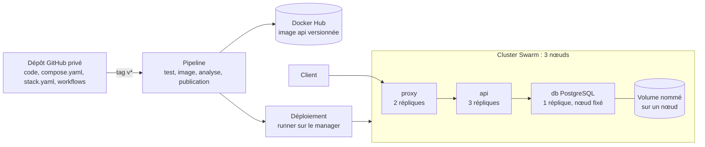

# Projet final : Plateforme conteneurisée, sécurisée et livrée par pipeline

## 1. Fiche du projet

| Rubrique | Description |
|---|---|
| Cours | Docker : conteneurisation, orchestration et industrialisation d'applications |
| Position | Fin du cours, après les chapitres 1 à 15 et les trois mini-projets |
| Modalité | En binôme, hors séance, avec un rapport écrit et une soutenance orale |
| Durée | Environ 15 h de travail par binôme, étalées sur plusieurs semaines, avec les phases indiquées en section 7 |
| Prérequis | Tous les labs et mini-projets, en particulier le [mini-projet 2](partie-2-donnees-reseau-et-exploitation/mini-projet-2.md), le [mini-projet 3](partie-3-durcissement-et-orchestration-swarm/mini-projet-3.md) et les [labs du chapitre 14](partie-4-industrialisation/ch14-livraison-continue/lab-14-2-pipeline-complet-avec-retour-arriere.md) |
| Environnement | Un poste avec Docker (option au choix, voir [Environnement de travail](annexes/environnement.md)), un cluster de trois machines virtuelles Ubuntu, un compte Docker Hub et un compte GitHub |
| Acquis visés | AA1 à AA9 |
| Pondération | 25 % de la note du cours (voir le syllabus) |

## 2. Contexte

Votre équipe reprend une application web qui enregistre ses données dans une base PostgreSQL. Elle doit la **conteneuriser**, la **sécuriser**, la **déployer sur un cluster de trois machines**, et en **automatiser la livraison**, de sorte que la pose d'un simple tag dans Git suffise à publier une nouvelle version, à la déployer sans coupure et, en cas de problème, à revenir à la version précédente. Vous devez aussi pouvoir **exploiter** la plateforme : la surveiller, sauvegarder ses données et réagir à une panne.

Ce projet n'est pas guidé pas à pas : vous disposez d'un cahier des charges, de jalons et de la grille d'évaluation. Vous réutilisez ce que vous avez construit dans les labs et les mini-projets.

!!! info "Ce qui est évalué"
    Vous pouvez reprendre l'application du mini-projet 2 ou une autre application web à trois niveaux (voir la section 6). **L'évaluation porte sur la conception, la sécurité, l'automatisation et l'exploitation de la plateforme, et non sur la qualité du code de l'application.**

## 3. Objectifs pédagogiques

À l'issue du projet, vous serez capables de :

1. expliquer le fonctionnement des conteneurs et justifier vos choix d'architecture (AA1) ;
2. gérer le cycle de vie des conteneurs et configurer leur exécution (AA2) ;
3. construire, versionner et distribuer des images (AA3) ;
4. gérer la persistance des données et le réseau, et prouver la restauration d'une sauvegarde (AA4) ;
5. décrire une application multi-conteneurs avec Compose (AA5) ;
6. superviser la plateforme et diagnostiquer une panne (AA6) ;
7. optimiser, durcir et analyser les images et les conteneurs (AA7) ;
8. déployer et exploiter l'application sur un cluster Swarm (AA8) ;
9. automatiser les tests, la publication et le déploiement par un pipeline, avec retour arrière (AA9).

## 4. Architecture cible

## 5. Cahier des charges

| N° | Exigence | AA |
|---|---|---|
| E1 | L'application comporte **trois services** : un point d'entrée (`proxy`), une application (`api`, construite depuis un Dockerfile du dépôt) et une base PostgreSQL (`db`). Toutes les images externes ont une **version explicite**. | AA2, AA3 |
| E2 | Un fichier **`compose.yaml`** permet de démarrer la plateforme **en développement** sur un poste avec une seule commande : réseaux `frontend` et `backend` (interne), seul le proxy publie un port, volume nommé pour la base, configuration par `.env` non versionné (avec `.env.example`), healthchecks et dépendances conditionnées à la santé. | AA4, AA5 |
| E3 | L'image de l'`api` est **optimisée** (multi-stage ou base minimale, avec taille mesurée avant et après) et **durcie** (utilisateur non root, aucun secret dans l'image). Une **analyse de vulnérabilités** est réalisée ; chaque vulnérabilité `HIGH` ou `CRITICAL` restante est corrigée ou justifiée. | AA3, AA7 |
| E4 | Un fichier **`stack.yaml`** décrit le **déploiement sur Swarm** : `proxy` (2 répliques) et `api` (3 répliques), `db` (1 réplique), réseau overlay, **configs** et **secrets Swarm** (le mot de passe de la base ne figure ni dans le dépôt, ni dans l'image, ni dans une variable d'environnement), limites de ressources, politique de redémarrage et réglage des mises à jour avec retour arrière automatique. | AA8, AA7 |
| E5 | Le **placement** est contraint : le proxy sur les workers ; la base **fixée à un nœud précis** par une étiquette, avec son volume ; les tâches de l'`api` réparties sur au moins deux nœuds. Vous expliquez pourquoi la base est fixée. | AA8, AA4 |
| E6 | La base dispose d'une **procédure de sauvegarde et de restauration**, **prouvée** sur le cluster (vous détruisez des données puis les retrouvez à l'identique). | AA4 |
| E7 | Un **pipeline d'intégration** (GitHub Actions) exécute à chaque modification les tests, la construction, un test de fumée du conteneur et l'analyse de vulnérabilités ; la publication n'a lieu **qu'en cas de succès**, avec des tags de version et d'empreinte (jamais `latest` en production). | AA9, AA7 |
| E8 | Un **pipeline de déploiement** se déclenche sur un tag Git, déploie **la version publiée** sur le cluster depuis un **dépôt privé** avec un runner auto-hébergé, **vérifie la version en service et l'état de la mise à jour**, et **revient automatiquement** à la version précédente en cas d'échec. | AA9, AA8 |
| E9 | Vous **démontrez** : une mise à jour **sans coupure** (boucle de requêtes sans erreur), un **retour arrière automatique** déclenché par une version défectueuse, et la **panne d'un worker** avec la reprise des tâches. | AA8, AA9, AA6 |
| E10 | Un fichier **`EXPLOITATION.md`** décrit comment surveiller la plateforme (journaux, état de santé, consommation, espace disque), mettre à jour, revenir en arrière, changer un secret, sauvegarder et restaurer la base, et réagir à la panne d'un nœud. Il contient la **fiche de diagnostic** d'une panne que vous avez provoquée puis résolue. | AA6 |
| E11 | Les **risques** sont analysés dans le rapport : droits du runner auto-hébergé, circulation des secrets, ce qui n'est **pas** protégé (par exemple la base fixée à un nœud). | AA7, AA8 |
| E12 | Un **`README.md`** permet à une équipe extérieure de comprendre l'architecture, de démarrer la plateforme en développement et de déployer la stack. Le dépôt est **privé** et l'enseignant y est invité. | AA5 |

## 6. Application et images suggérées

- **Option simple :** reprenez l'API Flask, le Dockerfile et la configuration du proxy du [Lab 7.2](partie-2-donnees-reseau-et-exploitation/ch07-docker-compose/lab-7-2-application-trois-niveaux-avec-compose.md) et du [mini-projet 2](partie-2-donnees-reseau-et-exploitation/mini-projet-2.md), avec `nginx:1.27-alpine` et `postgres:16-alpine`.
- **Option libre :** une autre application web à trois niveaux avec PostgreSQL, **après accord de l'enseignant**. Fixez la version de chaque image.

Ne passez pas de temps à perfectionner le code de l'application : une page qui lit et écrit dans la base, et une route de contrôle qui indique la **version** de l'application, suffisent.

!!! warning "Contraintes de Swarm à anticiper"
    - Un volume nommé est **local à un nœud** : la base doit être fixée à un nœud (chapitre 12).
    - Une stack n'utilise que des **images publiées** : `build` est ignoré (chapitre 12).
    - Le runner auto-hébergé exécute du code avec les droits de Docker : il ne s'associe **qu'à un dépôt privé** (chapitre 14).

## 7. Démarche en phases

Chaque phase donne un but, un point de contrôle et les chapitres utiles. Les durées sont indicatives.

### Phase 0 : Cadrage (1 h)

- **But :** choisir l'application, répartir les rôles, préparer le dépôt.
- **À faire :** dépôt GitHub **privé** avec l'enseignant invité ; vérification du cluster (`docker node ls`) ; schéma d'architecture ; répartition des rôles.
- **Point de contrôle :** le dépôt existe, l'architecture est dessinée, le cluster est sain.

### Phase 1 : Application et pile de développement (2 h)

- **But :** E1, E2.
- **À faire :** reprenez la pile Compose ; ajoutez la route de version ; prouvez le cloisonnement des réseaux.
- **Chapitres :** 5 à 8, mini-projet 2.
- **Point de contrôle :** `docker compose up -d --build` démarre l'application ; le proxy ne joint pas la base ; les healthchecks sont `healthy`.

### Phase 2 : Image optimisée, durcie, analysée (2 h)

- **But :** E3.
- **À faire :** mesure d'une image naïve, multi-stage, utilisateur non root, analyse avant et après correction.
- **Chapitres :** 9, 10.
- **Point de contrôle :** tableau de tailles, rapport d'analyse, `docker run --rm <image> id` ne renvoie pas `root`.

### Phase 3 : Stack Swarm (3 h)

- **But :** E4, E5, E6.
- **À faire :** écrivez `stack.yaml`, créez secrets et configs, étiquetez le nœud de la base, déployez ; testez sauvegarde et restauration sur le cluster.
- **Chapitres :** 11, 12, 5.
- **Point de contrôle :** toutes les répliques sont `Running`, l'application répond par les trois nœuds, le secret est lu dans `/run/secrets/`, la restauration est prouvée.

### Phase 4 : Pipelines CI et CD (3 h)

- **But :** E7, E8.
- **À faire :** workflow d'intégration (tests, image, fumée, analyse, publication) ; runner auto-hébergé ; workflow de déploiement avec vérification de la version et retour arrière.
- **Chapitres :** 13, 14, labs 13.1 à 14.2.
- **Point de contrôle :** un tag Git déroule la chaîne complète jusqu'au cluster ; un tag défectueux revient à la version précédente.

### Phase 5 : Exploitation et preuves (2 h)

- **But :** E9, E10, E11.
- **À faire :** boucle de requêtes pendant une mise à jour ; version défectueuse ; arrêt d'un worker ; rédaction d'`EXPLOITATION.md` et de la fiche de diagnostic ; analyse des risques.
- **Chapitres :** 8, 12, 14, 15.
- **Point de contrôle :** vous disposez de sorties de commandes ou de captures prouvant chaque démonstration.

### Phase 6 : Rapport et soutenance (2 h)

- **But :** E12 et livrables.
- **À faire :** README, rapport, préparation de la démonstration, relecture avec la liste de contrôle du [chapitre 15](partie-4-industrialisation/ch15-synthese-et-ouverture-vers-kubernetes/cours.md).
- **Point de contrôle :** une personne extérieure peut déployer votre stack avec le README seul.

## 8. Livrables

1. **Dépôt Git privé** contenant le code, les Dockerfile, `compose.yaml`, `stack.yaml`, les workflows, `.env.example`, `.gitignore`, `README.md` et `EXPLOITATION.md`, **sans aucun secret**. L'enseignant y est invité.
2. **Rapport** (environ 10 pages) comprenant :
    - le schéma d'architecture et la justification des choix (AA1, AA2) ;
    - le tableau de tailles d'image et le résumé des analyses de vulnérabilités ;
    - la description du pipeline et du mécanisme de retour arrière ;
    - les preuves de la mise à jour sans coupure, du retour arrière et de la panne d'un nœud (sorties de commandes, captures de l'onglet *Actions*) ;
    - l'analyse des risques et des limites de la plateforme (section 5, E11) ;
    - une réflexion sur ce qui changerait avec **Kubernetes** (section 4 du chapitre 15) ;
    - un court paragraphe « difficultés rencontrées et enseignements » et la répartition du travail dans le binôme.
3. **Soutenance orale** de 15 minutes par binôme (voir la section 9).

## 9. Soutenance

| Temps | Contenu |
|---|---|
| 8 min | Présentation et démonstration : architecture, déclenchement d'une livraison par un tag, vérification de la version en service |
| 2 min | Démonstration d'un retour arrière automatique (ou preuve préparée) |
| 5 min | Questions de l'enseignant à **chaque membre** du binôme, sur le projet et sur le cours |

Les questions portent sur le fonctionnement des conteneurs et de Docker (AA1), le cycle de vie d'un conteneur (AA2), vos choix de configuration et leurs conséquences, et sur le dépannage d'une situation que l'enseignant décrit. **Les deux membres du binôme doivent pouvoir expliquer l'ensemble du projet.**

## 10. Grille d'évaluation (/20)

| Critère | Points | AA |
|---|---|---|
| Architecture, pile de développement et justification des choix (E1, E2) | 3 | AA1, AA2, AA4, AA5 |
| Image optimisée, durcie et analysée (E3) | 3 | AA3, AA7 |
| Stack Swarm : secrets, placement, ressources, mises à jour (E4, E5, E6) | 4 | AA4, AA8 |
| Pipelines CI/CD : tests, publication, déploiement, vérification, retour arrière (E7, E8) | 4 | AA9, AA8 |
| Exploitation, preuves et analyse des risques (E9, E10, E11) | 3 | AA6, AA7, AA8 |
| Dépôt, README et rapport (E12) | 2 | AA5 |
| Soutenance et réponses aux questions | 1 | AA1 à AA9 |

!!! note "Évaluation individuelle"
    La note de la soutenance et les réponses aux questions permettent à l'enseignant d'ajuster la note individuelle de chaque membre du binôme.

## 11. Pour aller plus loin (facultatif)

- Ajouter un **healthcheck** à l'image de l'`api` et en observer l'effet sur la mise à jour.
- Automatiser la **sauvegarde** de la base avec un script daté et une politique de conservation.
- Envoyer le **rapport d'analyse** de Trivy comme fichier joint de l'exécution du pipeline.
- Comparer les **temps de reprise** selon les réglages de `restart_policy` et de `update_config`.
- Décrire, sans le réaliser, la **traduction de votre stack en manifestes Kubernetes** (concepts, pas commandes).

## 12. Erreurs fréquentes et conseils de diagnostic

| Symptôme | Pistes |
|---|---|
| `password authentication failed` après un changement de secret | Le volume contient une base initialisée avec l'ancien mot de passe : changez le mot de passe dans la base ou repartez d'un volume neuf |
| Les données disparaissent après la panne d'un nœud | La base n'est pas fixée au nœud qui porte son volume (chapitre 12, section 5.1) |
| `tp_api` reste à `0/3` | Image ou tag introuvable, dépôt privé sans authentification des nœuds, ou nœud sans accès à Internet |
| Le déploiement échoue sur la variable de version | La variable n'est pas exportée dans l'étape qui lance `docker stack deploy` |
| Le pipeline publie lors d'une pull request | La condition de publication est absente (chapitre 13, section 8) |
| Le pipeline est vert mais l'ancienne version tourne | La vérification ne contrôle que la réponse : contrôlez aussi l'image et l'état de la mise à jour (chapitre 14) |
| Le job de déploiement reste en attente | Runner arrêté, dépôt différent de celui du runner, ou approbation en attente |
| `docker: permission denied` dans un job | L'utilisateur du runner n'est pas dans le groupe `docker` |
| Un secret apparaît dans un journal ou `docker inspect` | Il a été passé en variable d'environnement ou affiché : révoquez-le et utilisez un fichier monté |
| Le runner ralentit le manager | Ressources limitées des machines virtuelles : surveillez `docker stats` et `free -h` |

## 13. Aide-mémoire : où retrouver quoi

| Besoin | Chapitre |
|---|---|
| Architecture de Docker, isolation | 1 |
| Cycle de vie, variables, limites de base | 2 |
| Dockerfile, cache, tags, registre | 3, 4 |
| Volumes, sauvegarde et restauration | 5 |
| Réseaux, DNS, publication de ports | 6 |
| Compose, healthchecks, dépendances | 7 |
| Journaux, statistiques, diagnostic | 8 |
| Multi-stage, images minimales | 9 |
| Non root, secrets, analyse de vulnérabilités | 10 |
| Cluster Swarm, services, routing mesh | 11 |
| Stacks, secrets Swarm, placement, mises à jour | 12 |
| GitHub Actions, tests, tags de version | 13 |
| Déploiement, vérification, retour arrière | 14 |
| Bilan, bonnes pratiques, Kubernetes | 15 |